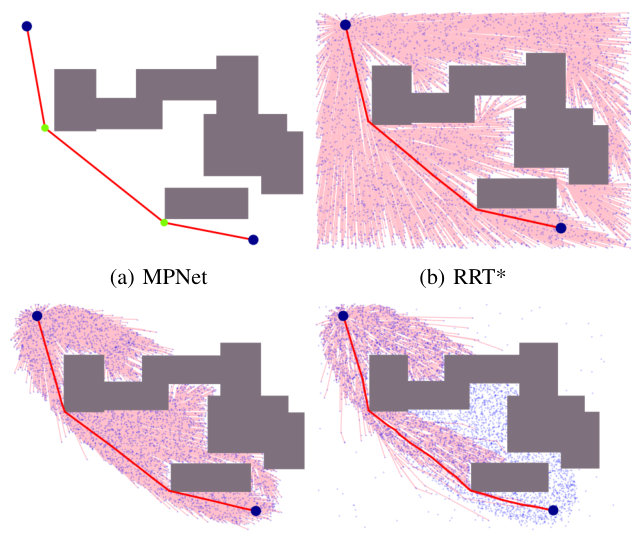
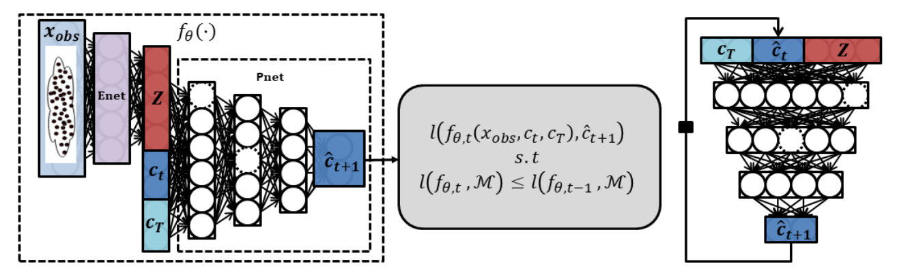
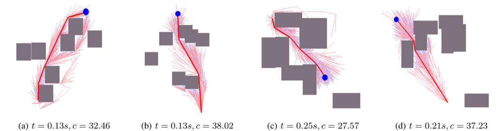

> **TL;DR** MPNet은 RRT\*를 모방하도록 학습합니다. 장애물 point cloud, 현재 state, 목표가 주어지면 network가 다음 waypoint를 예측하고, planner는 양 끝에서 path를 키워 서로 만나게 합니다. RRT\*에 가까운 품질의 path를 최소 100배 빠르게 찾고, 2D부터 7-DOF Baxter 팔까지 동작합니다. Network가 어떤 구간에서 막히면 그 구간만 고전 planner가 고치므로, probabilistic completeness가 유지됩니다.

> **고전인 이유:** MPNet은 고전 planner를 경쟁자가 아니라 fallback으로 두면, neural planner가 빠르면서도 최악의 경우에 대한 보장을 지킬 수 있음을 보였습니다. "neural path + oracle 수리"와 "RRT\*용 neural sample"이라는 두 모드는 지금도 sampling-based planner에 학습을 넣는 두 가지 표준 방식입니다.

## 왜 이 논문인가

Ichter 등(2018)은 *어디를* sampling할지 학습했습니다. MPNet은 더 나아갑니다. Network가 직접 path를 깔고, 고전 planner는 network가 실패할 때만 부릅니다. Sampling-based planner가 주도권을 쥐고 학습은 안내만 한 우리 IROS 2023 planner와는 설계 공간의 반대편입니다. MPNet이 어디서 조용히 도움을 받는지 알면, planner의 얼마만큼을 network에 맡길지 정할 수 있습니다.

## 문제

좋은 motion planning (경로 계획) 알고리즘은 완전하고 최적이며, 빠르고(가능하면 1초 이내), 복잡한 환경에 둔감해야 합니다. 고전 planner는 이 셋을 맞바꿉니다. RRT\*는 asymptotically optimal하지만, d차원에서 최적의 ε 이내로 가려면 대략 1/ε^d개의 sample이 필요합니다. Informed RRT\*와 BIT\*는 sampling을 집중시키지만, 차원이 커지면 역시 느려집니다. 이전의 neural planner(Value Iteration Networks, Universal Planning Networks, L2RRT)는 이산 문제에서만 되거나, 새 환경으로 일반화하지 못하거나, latent space에서 계획해서 latent path가 실제 path라는 보장이 없었습니다.

## 핵심 아이디어

Planner를 network 두 개로 나누고, 고전적인 뼈대로 감쌉니다.

- **Enet (encoder)**: 장애물 point cloud(또는 voxel)를 latent 벡터 Z로 압축합니다.
- **Pnet (planning network)**: Z, 현재 configuration c_t, 목표 c_T를 받아 다음 configuration ĉ_{t+1}을 출력합니다. 반복해서 부르면 path가 자랍니다.

Pnet은 **실행 시점에도 Dropout을 켜 둡니다**. 부를 때마다 조금씩 다른 network를 쓰므로 출력이 무작위가 됩니다. 이 무작위성 덕분에 MPNet은 다시 시도하고, 다시 계획하고, 서로 다른 sample을 많이 만들 수 있습니다.

## 작동 방식

**학습(모방).** 전문가는 RRT\*입니다. Pnet은 시연 path의 다음 waypoint를 mean-squared-error loss로 예측하도록 배우고, Enet은 함께 또는 별도 autoencoder로 학습합니다. Offline batch 학습 외에 **continual learning**(시연이 스트림으로 들어오고, 작은 episodic memory의 loss가 늘지 않게 gradient를 사영)과 **active continual learning**(MPNet이 새 문제를 먼저 풀어 보고, 실패할 때만 전문가에게 요청)도 제안합니다.

**계획(MPNetPath).**

1. **Bidirectional neural planning**: Pnet으로 시작점과 목표점에서 path를 번갈아 키웁니다. 한 걸음마다 두 끝을 직선 충돌 검사(`steerTo`)로 이어 봅니다. RRT-Connect와 같은 방식입니다.
2. **Lazy states contraction**: 이웃하지 않은 waypoint를 바로 이어서 불필요한 waypoint를 지웁니다(shortcutting).
3. **Replanning**: 연속한 두 waypoint가 이어지지 않으면("beacon state"), 이 둘을 새 시작과 목표로 보고 그 틈에서 neural planner를 다시 돌립니다. Dropout 때문에 매번 다른 시도가 됩니다.
4. **Hybrid replanning**: 정해진 횟수만큼 neural replanning을 해도 실패하면, 그 두 beacon state 사이에서만 RRT\*를 부릅니다.

**Sampling 모드(MPNetSMP).** 처음 N_smp번은 MPNet이 목표 쪽으로 제안하는 state를 RRT\*에 넣고, 그 뒤로는 uniform sample을 씁니다. RRT\* 자체는 그대로이므로 asymptotic optimality도 그대로입니다.

## 결과

시험 환경: simple 2D, complex 2D, complex 3D(점 로봇), SE(2) 강체. 학습은 작업 공간 100개, 각 4,000개 path로 합니다. "Seen" 시험은 같은 작업 공간에 새 시작–목표 쌍을, "unseen" 시험은 새 작업 공간 10개에서 2,000쌍씩을 씁니다.

- **자기 선생과 비교**: MPNetPath는 RRT\*보다 최소 100배 빠르고, path 비용은 RRT\*의 10% 이내입니다.
- **고급 planner와 비교**(seen 작업 공간의 평균 시간, 초. Informed-RRT\*와 BIT\*는 MPNet 비용의 5% 이내가 될 때까지 실행):

| Planner | Simple 2D | Complex 3D | 강체 SE(2) |
|---|---|---|---|
| Informed-RRT\* | 1.06 | 2.99 | 15.58 |
| BIT\* | 0.59 | 0.19 | 7.16 |
| MPNetSMP (RRT\*와 함께) | 0.13 | 0.25 | 0.49 |
| MPNetPath, neural replanning | **0.02** | **0.06** | **0.38** |

- **성공률**: neural만 쓰는 MPNetPath는 네 환경에서 각각 99.3%, 99.7%, 99.1%, 94.2%를 풀고, hybrid replanning과 sampling 모드는 100%입니다. Replanning을 빼면 약 60–70%로 떨어집니다. Unseen 작업 공간에서도 숫자가 거의 같습니다.
- **7-DOF Baxter**(어수선한 테이블 장면 10개): MPNetPath는 0.59 s, path 비용 7.86, 성공률 87.8%입니다. BIT\*의 첫 해는 0.94 s지만 비용이 13.91이고, MPNet 비용의 40% 이내까지 줄이려면 9.2 s가 걸리며 성공률은 56%뿐입니다.
- **SE(3) 강체**: 성공률 약 85%, 첫 해까지 0.96 s 대 BIT\* 2.84 s, path 비용 457.8 대 836.9.

## 한계

- **직선 steering.** `steerTo`는 configuration space의 직선 구간만 검사합니다. 모든 실험이 기하학적이고, kinodynamic이나 nonholonomic 제약은 없습니다.
- **Neural만으로는 완전하지 않습니다.** 94–99%는 100%가 아닙니다. Completeness는 RRT\* fallback에서 오므로, 최악의 실행 시간은 RRT\*와 같습니다.
- **선생이 상한을 정합니다.** Path 품질은 RRT\* 시연과 비슷합니다.
- **Unseen은 "비슷한"이라는 뜻입니다.** 새 작업 공간도 학습 때와 같은 생성기에서 나옵니다.
- **Dropout을 무작위성으로 쓰는 것**은 편리한 휴리스틱이지, 좋은 path에 대한 보정된 분포가 아닙니다.
- **데이터.** 2D/3D/SE(2) 환경의 batch 학습에 path 40만 개를 씁니다.

## DYROS 관점

**2026년의 독자가 가져갈 것.** 오래 남는 아이디어는 역할 분담입니다. 흔한 경우는 neural planning이 맡고, 고전 planner는 *실패한 구간에서만* 쓰며, 증명은 고전 planner의 보장을 물려받습니다. 논문은 불편한 숫자도 정직하게 보고합니다. Replanning이 없으면 순수 network는 60–70%만 성공합니다.

**우리 연구와의 연결.** MPNetSMP는 우리 IROS 2023 아이디어와 가깝습니다. Network가 trajectory가 갈 곳을 제안하고, RRT\*가 주도권을 유지합니다. Bidirectional neural planner는 bidirectional planning 특성을 이용하는 learning-based sampling을 다룬 우리 JKRS 2026 연구와 관련이 있습니다. 주차는 원래 양방향 문제입니다. TargetTree-RRT\*도 이미 목표 쪽을 continuous-curvature path의 tree로 만들어 둡니다.

**우리 차에서는 무엇이 깨질까.**

- `steerTo`는 기어 변경을 포함한 continuous-curvature나 Reeds-Shepp 연결로 바뀌어야 합니다. 충돌 없는 두 waypoint 사이에 가능한 연결이 아예 없을 수 있으므로, 2D 지도에서보다 beacon state가 훨씬 자주 생깁니다.
- Shortcutting도 차량에서는 공짜가 아닙니다. 지름길 역시 가능한 곡선이어야 합니다.
- Encoder는 고정된 작업 공간을 봅니다. 주차장에서는 입력이 차 주변의 local LiDAR나 AVM occupancy이고, 차가 움직이면 바뀝니다.

**일주일 안에 해 볼 수 있는 것.** 우리 planner의 주차 해에서 나온 (x, y, cos θ, sin θ) waypoint로 작은 Pnet을 학습하고, local occupancy grid와 주차 칸 pose로 조건화합니다. 기존 steering과 충돌 검사를 그대로 두고 MPNetSMP 모드로만 써서, 첫 해까지의 시간을 uniform sampling, 그리고 우리의 learned committed-trajectory sampler와 비교합니다.

**논문 기회.** "Nonholonomic oracle을 쓰는 hybrid replanning": network가 전체 기동의 거친 waypoint를 제안하고, 이어지지 않는 구간에서만 TargetTree-RRT\*를 돌립니다. Oracle이 probabilistically complete하면 MPNet의 completeness 논증이 그대로 넘어오고, 주차 칸 근처의 어려운 여러 번 꺾기가 정확히 oracle이 쓰일 곳입니다.

## 용어 정리

- **Enet / Pnet**: 장애물을 Z로 임베딩하는 encoder, 그리고 Z, 현재 state, 목표로 다음 configuration을 예측하는 network.
- **Beacon state**: 충돌 없이 바로 이을 수 없는 연속 waypoint. MPNet은 그 사이를 다시 계획합니다.
- **Lazy states contraction**: 건너뛸 수 있는 waypoint를 지우는 shortcutting.
- **Hybrid replanning**: beacon state 사이에서만 고전 planner(RRT\*)로 넘기는 방식.
