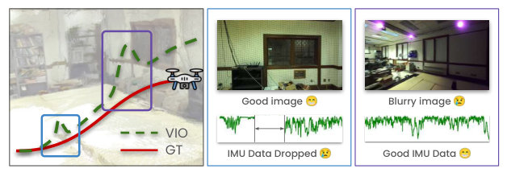

> **TL;DR** MUSE is a small learned add-on for any visual or visual–inertial odometry. It watches the last 100 frames of camera features, IMU data and the odometry's own poses, and predicts both a pose correction and a full 6×6 covariance. On EuRoC it cuts VINS-Fusion's error by 46% and gives better-calibrated uncertainty than earlier learned methods, in under 3 ms per window.

## Why this paper

The other papers in this batch compute uncertainty from geometry: a Hessian, a particle cloud, a guaranteed set. MUSE takes the opposite route and *learns* it from data, as a plug-in on top of an existing estimator you do not want to touch. That is attractive for a lab with a working SLAM stack and lots of logged drives. It also shows what learned uncertainty is good at (catching sensor glitches the geometry cannot see) and where it is fragile (it only knows the conditions it was trained on).

## The problem

**Uncertainty that changes over time.** Odometry error is *heteroscedastic*: its size changes with conditions. Good texture and smooth motion give small errors; a blurry frame, an IMU dropout or a fast turn give large ones. A single fixed covariance is wrong most of the time, too big when things are easy and too small when they are hard.

**Uncertainty has many causes.** The cue that error is coming may be in the images (blur, darkness), in the IMU (dropped samples, spikes), or in the odometry itself (a sudden jump that disagrees with the IMU). Most learned uncertainty estimators (DICE, D-DICE, DPC-Net) look at a single image, so they miss the other two.

**What "calibrated" means, with numbers.** Suppose the model says σ = 10 cm for a set of frames. If it is calibrated, the actual errors on those frames should have an RMS of about 10 cm. If the RMS is 15 cm, the model is overconfident by 50%. The paper's metric, expected normalized calibration error (ENCE), does exactly this: group samples into bins by predicted uncertainty, compare each bin's predicted σ (RMV) with its actual RMSE, and average |RMSE − RMV| / RMV over bins. Lower is better; 0 is perfect. They also report log-likelihood (LL, higher is better).

## Key idea

Model the odometry error as a Gaussian *with a nonzero mean*, ξ ~ N(μ, Σ), on the Lie algebra se(3), and learn both from multimodal sequences with a state-space model.

- The **mean μ** is the systematic bias. Applying exp(μ) to the odometry pose corrects it.
- The **covariance Σ** is the remaining spread, and it is what a downstream planner would consume.
- **Mamba**, a selective state-space model, processes long sequences in linear time (a Transformer's attention is quadratic), and can choose what to remember and what to forget. That fits a stream of 100 frames of mixed sensor tokens in real time.

## How it works

1. **Encode each stream.** Grayscale images go through a frozen SuperPoint encoder plus a small MLP (256-dimensional). IMU samples at 200 Hz are cut into chunks between consecutive odometry poses and encoded by a frozen RoNIN encoder (128). The odometry pose, and its 6×6 covariance if the estimator provides one (as MSCKF does), go through a one-layer network (128).
2. **Concatenate along time.** Tokens from all streams are stacked into one sequence, so the streams can be asynchronous.
3. **Mamba.** Four Mamba blocks model the sequence; the window is T = 100 frames.
4. **Decode.** One MLP outputs μ (6 numbers). Another outputs 21 numbers that build Σ through an LDL decomposition, Σ = L·diag(exp(d))·Lᵀ, which guarantees a valid positive definite covariance. A skip connection adds a projection of the raw odometry to the mean, and the decoders start at zero for stable training.
5. **Train two losses separately.** The mean uses a geodesic loss on SE(3) plus a smoothness penalty; the covariance uses negative log-likelihood. Decoupling them trained more stably than optimizing jointly. Training takes about one hour on four RTX 6000 GPUs.

**New dataset: UnCal-Flight.** 145 drone flights in a 3 × 5 × 7 m Vicon arena, ZED 2i stereo at 15 Hz, IMU at 200 Hz, ground truth at 100 Hz. Trajectories include lines, circles, figure-eights, spirals, varying speeds and yaw motions, changing light, and a person walking through the view.

## Results

**EuRoC pose correction** (train on Machine Hall 01–04, test on MH 05). Translation RMSE in meters:

| Odometry | Raw | D-DICE | DPC-Net | **MUSE** |
|---|---|---|---|---|
| VINS-Fusion | 0.164 | 0.161 | 0.162 | **0.089** |
| MSCKF | 0.063 | 0.066 | 0.063 | **0.062** |
| ORB-SLAM3 | 0.027 | 0.032 | 0.027 | 0.028 |
| DPVO | 0.048 | 0.070 | 0.048 | 0.048 |

MUSE cuts VINS-Fusion's error by 45.7%. On the already-accurate estimators it does no harm, while D-DICE makes them worse.

**EuRoC uncertainty (ENCE, lower is better), zero-mean setting:**

| Odometry | Empirical | DICE | D-DICE | **MUSE** |
|---|---|---|---|---|
| VINS-Fusion | 0.497 | 0.765 | 0.704 | **0.300** |
| MSCKF | 0.904 | 0.439 | 0.611 | **0.138** |
| ORB-SLAM3 | **0.080** | 0.432 | 0.561 | 0.097 |
| DPVO | 0.135 | 0.473 | 0.601 | **0.123** |

"Empirical" is the filter's own covariance for MSCKF (poorly calibrated, 0.904) and a fitted Gaussian for the others. The image-only learned baselines lose to this simple empirical baseline on three of the four estimators. With the mean also predicted (non-zero-mean setting), MUSE beats D-DICE on every estimator (e.g. ORB-SLAM3 ENCE 0.087 vs 0.639).

**UnCal-Flight** (ZED's built-in VO as the odometry). RMSE drops by 22.2% (0.045 → 0.035 m) on constant-yaw flights and 38.4% (0.065 → 0.040 m) on yaw-forward flights; ENCE is 0.421 and 0.379 versus 0.631 and 0.522 for D-DICE. Inference is under 3 ms per window on one RTX 6000.

**Ablation** (yaw-forward). Camera only: ENCE 0.677, RMSE 0.061 m. Camera + IMU: 0.628, 0.058 m. Camera + odometry: 0.359, 0.050 m. All three: 0.379, 0.040 m. The odometry stream matters most for calibration; all three give the best correction.

## Limitations

- **One EuRoC test sequence.** MH 05 is the only held-out EuRoC trajectory, from the same building as training.
- **Indoor drone only.** No cars, no outdoor scenes, no long trajectories; the arena is a few meters across.
- **Learned, so in-distribution.** Calibration is measured on test flights that look like training flights. A new environment or sensor setup needs new ground-truth data, and the paper does not test that shift.
- **Gaussian, no guarantee.** A single Gaussian per window cannot represent a multi-modal error (two plausible places), and nothing bounds how wrong Σ can be.
- **Mixed ablation.** Using all three inputs is not best on every metric (camera + odometry has slightly lower ENCE).
- **Ground truth for training.** Every new deployment needs motion capture or an equivalent reference.

## DYROS lens

**Where it fits.** The plug-in design is the interesting part for us. We already have an AVM + wheel odometry SLAM (and the weighted GICP work); we would not want to rewrite it. A MUSE-like model could sit beside it, read the AVM images, wheel speeds, IMU and the SLAM pose, and output a correction and covariance. The multimodal argument applies directly to a car: wheel slip on painted floors, AVM glare from ceiling lights, and a sudden SLAM jump at a loop closure are separate cues, and only a model that sees all streams can learn them.

**For the go/no-go decision.** A per-window covariance from MUSE could gate the final parking maneuver: proceed when the predicted lateral and heading σ are small enough, wait when they spike (glare, slip). Its strength is reacting to sensor events the geometry cannot see; its weakness is that nothing guarantees the number in a garage it never saw. A sensible design pairs it with conformal calibration on a few runs per site (see the polytopic UQ paper in this batch), which turns a learned σ into a bound with a stated coverage.

**What would break.** Ground truth. EuRoC and UnCal-Flight have motion capture; a garage does not. We would need a reference trajectory, for example offline LiDAR map localization or a carefully surveyed set of markers, for every training garage. And a car drives far more slowly and smoothly than a drone, so the error patterns will differ.

**What we could try in a week.** Take logged garage runs where a high-quality offline reference exists, compute our SLAM's pose error, and train a small sequence model (a GRU is fine for a first test) on AVM features, wheel odometry and SLAM pose to predict the error mean and covariance. Measure ENCE on held-out runs, then on a held-out garage.

**Paper opportunity.** Learned + conformal localization uncertainty for automated valet parking: train across several garages, recalibrate per site with conformal prediction, and test whether the resulting σ predicts final parking error at the slot. The cross-garage shift is exactly the test this paper does not run.

## Key terms

- **Heteroscedastic**: the noise level changes over time or with conditions.
- **Calibration**: predicted uncertainty matches the size of actual errors.
- **ENCE (expected normalized calibration error)**: average relative gap between predicted σ and actual RMSE across bins; 0 is perfect.
- **Mamba**: a selective state-space model that handles long sequences in linear time.
- **Lie algebra se(3)**: a 6-number vector form of a pose change, where Gaussian errors are easy to define.
