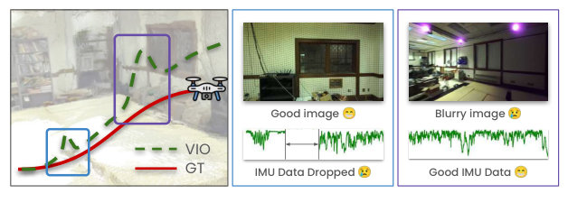
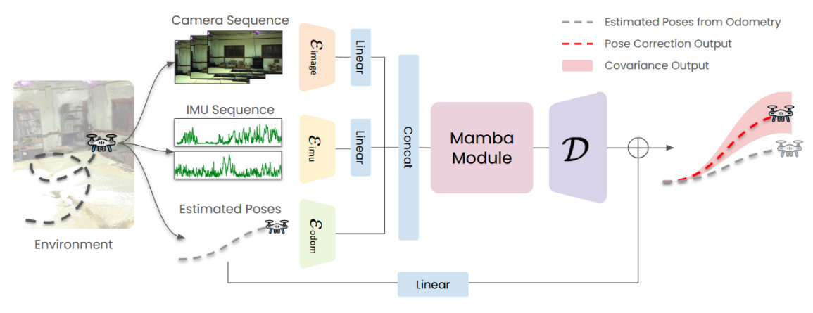

> **TL;DR** MUSE는 어떤 visual odometry나 visual–inertial odometry (VIO)에든 붙일 수 있는 작은 학습 기반 add-on입니다. 최근 100 프레임의 카메라 특징, IMU 데이터, odometry 자신의 pose를 보고, pose 보정값과 6×6 covariance (공분산) 전체를 함께 예측합니다. EuRoC에서 VINS-Fusion의 오차를 46% 줄이고, 이전 학습 기반 방법보다 잘 보정된 불확실성을 창 하나당 3 ms 미만에 냅니다.

## 왜 이 논문인가

이 묶음의 다른 논문들은 기하학으로 불확실성을 계산합니다. Hessian, particle 분포, 보장된 집합입니다. MUSE는 반대로 불확실성을 데이터에서 *학습*하고, 손대고 싶지 않은 기존 estimator 위에 plug-in으로 얹습니다. 잘 돌아가는 SLAM 스택과 주행 로그가 많은 연구실에는 매력적입니다. 또 학습된 불확실성이 무엇을 잘하는지(기하학이 못 보는 센서 이상 감지)와 어디서 약한지(학습한 조건만 안다는 점)를 보여 줍니다.

## 문제

**시간에 따라 바뀌는 불확실성.** Odometry 오차는 *heteroscedastic*(이분산적)입니다. 크기가 조건에 따라 바뀝니다. 질감이 좋고 움직임이 부드러우면 오차가 작고, 흐린 프레임, IMU 끊김, 빠른 회전이 있으면 큽니다. 고정된 covariance 하나는 대부분의 시간에 틀립니다. 쉬울 때는 너무 크고, 어려울 때는 너무 작습니다.

**불확실성의 원인은 여러 가지입니다.** 오차가 다가온다는 단서가 영상(흐림, 어두움)에 있을 수도, IMU(샘플 누락, 튀는 값)에 있을 수도, odometry 자체(IMU와 맞지 않는 갑작스러운 점프)에 있을 수도 있습니다. 대부분의 학습 기반 불확실성 추정기(DICE, D-DICE, DPC-Net)는 영상 한 장만 보기 때문에 나머지 둘을 놓칩니다.

**"보정되었다"는 뜻을 숫자로.** 모델이 어떤 프레임들에 대해 σ = 10 cm라고 말한다고 합시다. 보정되어 있다면 그 프레임들의 실제 오차 RMS도 약 10 cm여야 합니다. RMS가 15 cm라면 모델은 50% 과신하고 있습니다. 논문의 metric인 expected normalized calibration error (ENCE)가 바로 이것을 잽니다. 예측 불확실성으로 표본을 구간별로 묶고, 구간마다 예측 σ(RMV)와 실제 RMSE를 비교해 |RMSE − RMV| / RMV를 구간에 대해 평균합니다. 낮을수록 좋고 0이 완벽입니다. Log-likelihood (LL, 높을수록 좋음)도 함께 봅니다.

## 핵심 아이디어

Odometry 오차를 Lie algebra se(3) 위에서 *평균이 0이 아닌* Gaussian ξ ~ N(μ, Σ)로 모델링하고, 둘 다 state-space model로 여러 센서의 시퀀스에서 학습합니다.

- **평균 μ**는 체계적인 편향입니다. Odometry pose에 exp(μ)를 적용하면 보정됩니다.
- **Covariance Σ**는 남은 퍼짐이고, 하위 planner가 실제로 쓸 값입니다.
- **Mamba**는 selective state-space model로, 긴 시퀀스를 선형 시간에 처리하고(Transformer의 attention은 제곱 시간입니다) 무엇을 기억하고 잊을지 고를 수 있습니다. 여러 센서 token이 섞인 100 프레임 흐름을 실시간으로 처리하기에 맞습니다.

## 작동 방식

1. **흐름별 encoding.** 흑백 영상은 고정된 SuperPoint encoder와 작은 MLP를 거칩니다(256차원). 200 Hz IMU 샘플은 연속한 odometry pose 사이 구간으로 잘라 고정된 RoNIN encoder로 encoding합니다(128). Odometry pose와, estimator가 주면(MSCKF처럼) 그 6×6 covariance는 한 층짜리 네트워크를 거칩니다(128).
2. **시간 방향으로 이어 붙이기.** 모든 흐름의 token을 한 시퀀스로 쌓으므로, 흐름끼리 비동기여도 됩니다.
3. **Mamba.** Mamba block 네 개가 시퀀스를 모델링하고, 창 길이는 T = 100 프레임입니다.
4. **Decoding.** MLP 하나가 μ(숫자 6개)를 냅니다. 다른 MLP는 숫자 21개를 내고, LDL 분해 Σ = L·diag(exp(d))·Lᵀ로 Σ를 만듭니다. 이렇게 하면 항상 올바른 positive definite covariance가 나옵니다. Skip connection이 원래 odometry를 변환해 평균에 더하고, 안정적인 학습을 위해 decoder는 0에서 시작합니다.
5. **두 loss를 따로 학습.** 평균에는 SE(3) 위 geodesic loss와 부드러움 페널티를, covariance에는 negative log-likelihood를 씁니다. 한꺼번에 최적화하는 것보다 나눠서 하는 편이 안정적이었습니다. 학습은 RTX 6000 네 장에서 약 1시간입니다.

**새 데이터셋: UnCal-Flight.** 3 × 5 × 7 m Vicon 실험장에서 드론 비행 145회, ZED 2i stereo 15 Hz, IMU 200 Hz, ground truth 100 Hz입니다. 직선, 원, 8자, 나선 등의 trajectory에 속도와 yaw 움직임을 바꾸고, 조명을 바꾸고, 사람이 시야를 지나가게 했습니다.

## 결과

**EuRoC pose 보정** (Machine Hall 01–04로 학습, MH 05로 시험). Translation RMSE, 단위 m:

| Odometry | Raw | D-DICE | DPC-Net | **MUSE** |
|---|---|---|---|---|
| VINS-Fusion | 0.164 | 0.161 | 0.162 | **0.089** |
| MSCKF | 0.063 | 0.066 | 0.063 | **0.062** |
| ORB-SLAM3 | 0.027 | 0.032 | 0.027 | 0.028 |
| DPVO | 0.048 | 0.070 | 0.048 | 0.048 |

MUSE는 VINS-Fusion의 오차를 45.7% 줄입니다. 이미 정확한 estimator에는 해를 끼치지 않는 반면, D-DICE는 오히려 나쁘게 만듭니다.

**EuRoC 불확실성 (ENCE, 낮을수록 좋음), 평균 0 설정:**

| Odometry | Empirical | DICE | D-DICE | **MUSE** |
|---|---|---|---|---|
| VINS-Fusion | 0.497 | 0.765 | 0.704 | **0.300** |
| MSCKF | 0.904 | 0.439 | 0.611 | **0.138** |
| ORB-SLAM3 | **0.080** | 0.432 | 0.561 | 0.097 |
| DPVO | 0.135 | 0.473 | 0.601 | **0.123** |

"Empirical"은 MSCKF에서는 filter 자체의 covariance(보정이 나쁨, 0.904)이고, 나머지에서는 맞춘 Gaussian입니다. 영상만 쓰는 학습 baseline은 네 estimator 중 셋에서 이 단순한 empirical baseline에도 집니다. 평균까지 예측하는 설정(평균이 0이 아닌 설정)에서도 MUSE는 모든 estimator에서 D-DICE보다 낫습니다(예: ORB-SLAM3 ENCE 0.087 대 0.639).

**UnCal-Flight** (ZED 내장 VO를 odometry로 사용). RMSE가 yaw 고정 비행에서 22.2%(0.045 → 0.035 m), yaw 전방 비행에서 38.4%(0.065 → 0.040 m) 줄고, ENCE는 0.421과 0.379로 D-DICE의 0.631과 0.522보다 낮습니다. 추론은 RTX 6000 한 장에서 창 하나당 3 ms 미만입니다.

**Ablation** (yaw 전방). 카메라만: ENCE 0.677, RMSE 0.061 m. 카메라 + IMU: 0.628, 0.058 m. 카메라 + odometry: 0.359, 0.050 m. 셋 모두: 0.379, 0.040 m. 보정에는 odometry 흐름이 가장 중요하고, pose 보정은 셋 모두 쓸 때 가장 좋습니다.

## 한계

- **EuRoC 시험 시퀀스가 하나뿐입니다.** 따로 떼어 둔 EuRoC trajectory는 MH 05 하나이고, 학습과 같은 건물입니다.
- **실내 드론뿐입니다.** 차량, 실외, 긴 trajectory가 없고, 실험장은 몇 m 크기입니다.
- **학습 기반이라 학습 분포 안에서만 압니다.** 보정은 학습 비행과 비슷한 시험 비행에서 측정했습니다. 새 환경이나 센서 구성에는 새 ground truth 데이터가 필요하고, 논문은 그런 변화를 시험하지 않습니다.
- **Gaussian이고 보장이 없습니다.** 창마다 Gaussian 하나로는 봉우리가 여러 개인 오차(그럴듯한 위치가 두 곳)를 나타낼 수 없고, Σ가 얼마나 틀릴 수 있는지 제한하는 장치도 없습니다.
- **Ablation이 엇갈립니다.** 세 입력을 다 쓰는 것이 모든 metric에서 최선은 아닙니다(카메라 + odometry의 ENCE가 조금 더 낮습니다).
- **학습에 ground truth가 필요합니다.** 새로 배치할 때마다 motion capture나 그에 준하는 기준이 있어야 합니다.

## DYROS 관점

**어디에 맞는가.** 우리에게 흥미로운 부분은 plug-in 설계입니다. 우리는 이미 AVM + wheel odometry SLAM(그리고 weighted GICP 연구)이 있고, 이것을 다시 쓰고 싶지 않습니다. MUSE 같은 모델은 그 옆에 앉아 AVM 영상, 바퀴 속도, IMU, SLAM pose를 읽고 보정값과 covariance를 낼 수 있습니다. 여러 센서를 봐야 한다는 논리는 차량에 그대로 적용됩니다. 칠한 바닥에서의 바퀴 미끄러짐, 천장 조명 때문에 생기는 AVM 반사광, loop closure 때 SLAM의 갑작스러운 점프는 서로 다른 단서이고, 모든 흐름을 보는 모델만 이들을 배울 수 있습니다.

**진행/정지 판단에 쓰기.** MUSE의 창별 covariance로 마지막 주차 기동을 관문처럼 막을 수 있습니다. 예측한 횡방향과 heading σ가 충분히 작으면 진행하고, 튀면(반사광, 미끄러짐) 기다립니다. 강점은 기하학이 못 보는 센서 사건에 반응한다는 것이고, 약점은 처음 보는 주차장에서 그 숫자를 보장할 장치가 없다는 것입니다. 합리적인 설계는 주차장마다 몇 번 주행해 conformal 보정을 함께 쓰는 것입니다(이 묶음의 polytopic UQ 논문 참고). 그러면 학습된 σ가 포함률이 명시된 범위가 됩니다.

**무엇이 깨질까.** Ground truth입니다. EuRoC와 UnCal-Flight에는 motion capture가 있지만 주차장에는 없습니다. 학습할 주차장마다 기준 trajectory가 필요합니다. 예를 들어 offline LiDAR 지도 기반 localization이나 정밀 측량한 marker입니다. 또 차량은 드론보다 훨씬 느리고 부드럽게 움직이므로 오차 패턴이 다를 것입니다.

**일주일 안에 해 볼 수 있는 것.** 좋은 offline 기준이 있는 주차장 주행 로그를 골라 우리 SLAM의 pose 오차를 계산합니다. 그리고 AVM 특징, wheel odometry, SLAM pose로 오차의 평균과 covariance를 예측하는 작은 시퀀스 모델(첫 시험은 GRU로도 충분합니다)을 학습합니다. 따로 떼어 둔 주행에서, 그다음 따로 떼어 둔 주차장에서 ENCE를 잽니다.

**논문 기회.** Automated valet parking을 위한 학습 + conformal localization 불확실성: 여러 주차장에서 학습하고, 주차장마다 conformal prediction으로 다시 보정한 뒤, 그 σ가 주차 칸에서의 최종 주차 오차를 예측하는지 시험합니다. 주차장 간 분포 변화는 이 논문이 하지 않은 바로 그 시험입니다.

## 용어 정리

- **Heteroscedastic**: 노이즈 크기가 시간이나 조건에 따라 바뀌는 성질.
- **Calibration**: 예측한 불확실성이 실제 오차 크기와 맞는 것.
- **ENCE (expected normalized calibration error)**: 구간별 예측 σ와 실제 RMSE의 상대 차이를 평균한 값. 0이 완벽입니다.
- **Mamba**: 긴 시퀀스를 선형 시간에 처리하는 selective state-space model.
- **Lie algebra se(3)**: pose 변화를 숫자 6개 벡터로 쓴 형태. 여기서는 Gaussian 오차를 정의하기 쉽습니다.
