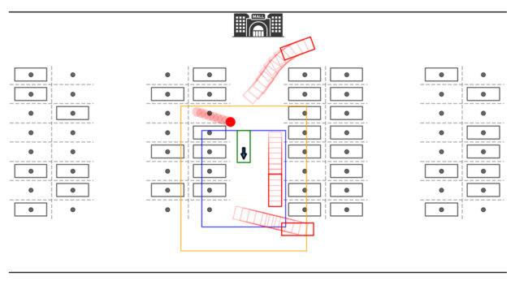
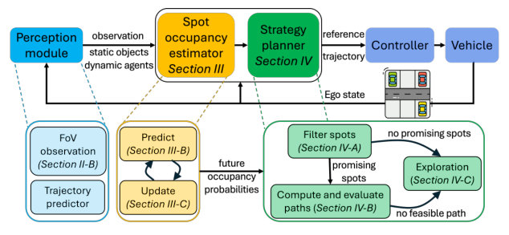
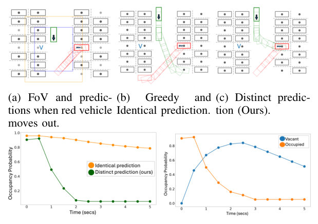

> **TL;DR** 발레 주차 차량은 주차장 전체를 볼 수 없고, 다른 차가 들어오고 나가면서 칸 상태는 계속 바뀝니다. 이 논문은 Bayes filter로 5 s 뒤에 어느 칸이 비어 있을지 예측합니다. "지금 빈칸"과 "지금 찬 칸"을 다르게 다루고, 주변 차의 움직임을 읽습니다. 그다음 planner가 바로 주차할지, 곧 빌 칸을 잠깐 기다릴지, 정보를 얻으러 탐색할지 고릅니다. 무작위 쇼핑몰 주차장 50회 실험에서 기존 AVP 방법보다 약 26% 빨리 주차하고, 경로도 더 짧고 부드럽습니다.

## 왜 이 논문인가

붐비는 주차장에서 운전자는 두 가지 요령을 압니다. 어떤 차가 후진해서 나오고 있으면 몇 초 기다렸다가 그 칸을 차지합니다. 내 앞의 빈칸으로 다른 차가 슬금슬금 다가가면 그 칸은 포기합니다. *지금* 비어 있는 칸만 보는 planner는 둘 다 놓칩니다.

이 논문은 그 요령을 확률 모델로 바꿔 Hybrid A\* 주차 planner에 연결합니다. 이 목록의 "Selecting Spots" 논문과 같은 Honda Research Institute 그룹의 연구이고, 그 논문은 이 논문을 주요 baseline으로 씁니다.

## 문제

**Type-1 autonomous valet parking**(자율 발레 주차, AVP): 주차장 인프라의 도움(주차장 카메라, V2X) 없이 차가 스스로 주차합니다. Ego 차량은 정적 지도(주차장 경계, 통로, 칸 위치)는 알지만 칸이 찼는지는 제한된 차량 센서로 직접 관측해야 합니다.

어려운 이유:

- **부분 관측.** 멀거나 시야 밖의 칸은 모릅니다. 센싱은 거리가 멀수록 믿기 어렵습니다.
- **주차장이 변합니다.** 차가 들어오고 나갑니다. 지금 칸 상태는 5 s 뒤 상태를 거의 말해 주지 않습니다.
- **기존 방법은 단순화합니다.** Greedy 방법은 현재 상태만 봅니다. 기본 Bayes filter(InfPath)는 다른 차의 움직임을 무시하고 센서 신뢰도가 어디서나 같다고 봅니다. 탐색 방법은 목표가 주차라는 것을 잊습니다.

## 핵심 아이디어

칸마다 **미래** 점유 확률을 Bayes filter로 예측합니다. 예측 단계는 두 가지에 따라 달라집니다.

- **지금 빈칸인지, 찬 칸인지**(빈칸은 *뺏길* 수 있고, 찬 칸은 *빌* 수 있습니다)
- **주변 차와 보행자가 어디로 가는지**(칸에 가까우면서 *동시에* 칸 쪽으로 향하는지)

그다음 planner가 **지금 주차**, **잠깐 기다렸다 주차**, **탐색** 중 하나를 비용 하나로 비교해 고릅니다.

## 작동 방식

**관측 모델.** Field of view (시야, FoV)는 차 앞쪽으로 치우친 사각형입니다. 논문 설정에서는 길이 약 25 m, 폭 약 11 m 영역을 완전히 믿습니다. 그 1.5배 크기까지는 칸을 바르게 읽을 확률이 1에서 0.5(동전 던지기)로 부드럽게 떨어지고, 그 밖은 관측하지 못합니다.

**Spot occupancy estimator**(T = 5 s를 0.1 s 간격으로 예측):

1. **다른 agent의 영향.** 다른 agent의 예측 위치는 시간이 갈수록 공분산이 커지는 Gaussian입니다. Agent j가 칸 s를 차지할 확률은 두 항의 곱입니다. *근접도*(칸까지의 Mahalanobis distance)와 *정렬도*(예측 속도가 칸을 향하는가)입니다. 빠르게 지나가는 차는 낮게, 속도를 줄이며 꺾어 드는 차는 높게 나옵니다. 모든 agent를 합치면 q = 1 − Π(1 − p)입니다.
2. **비대칭 예측.**
   - *지금 빈칸*: 걱정은 누가 차지하는 것입니다. 점유 belief가 q와 함께 올라갑니다.
   - *지금 찬 칸*: 기대는 비는 것입니다. 주차된 차의 예측 움직임이 칸 밖으로 나가면 belief가 떨어집니다.
   - *관측 안 된 칸*: 주차 연구에서 가져온 느린 배경 도착률과 출발률(초당 약 0.0006과 0.0004)만 씁니다.
3. **갱신.** 완전히 관측한 칸은 현재 관측을 그대로 믿습니다. 부분 관측한 칸은 거리에 따른 신뢰도로 Bayes 규칙에 따라 합칩니다. 관측 안 된 칸은 prior를 유지합니다.

**Strategy planner.**

1. **칸 거르기.** 시야 안의 칸 중 5 s 뒤 점유 예측이 낮은 칸만 남깁니다. 지금 빈칸이면 ≤ 0.3, 지금 찬 칸이면 ≤ 0.7입니다(비워지는 중인 칸은 더 쉽게 받아들입니다).
2. **계획과 점수.** 후보마다 Hybrid A\*를 병렬로 돌립니다. 정적 장애물은 탐색에서, 움직이는 agent는 비용에서만 다룹니다. 비용은 주행 시간, 대기 시간, 장애물 거리에 대한 지수형 barrier, 그리고 부드러움(가속도, 방향 변화, 후진, 기어 변경)을 더합니다. 최소 여유 거리는 차 50 cm, 보행자 90 cm, 정적 장애물 20 cm입니다.
3. **Wait-and-go.** 각 경로는 대기 시간 t_w ≤ 5 s 뒤에 출발할 수 있습니다. 그 지연만큼 밀린 다른 agent의 예측과 경로를 비교하므로, "차가 후진해 나올 때까지 3 s 기다렸다가 들어가기"도 그냥 후보 중 하나가 됩니다.
4. **탐색**: 맞는 칸이 없으면 합니다. 목표는 셋입니다: 직진, 다음 통로에서 좌회전, 우회전. 각각 같은 비용에서 **information gain**(정보 이득), 즉 그 경로를 달리면 모든 칸 belief의 entropy가 얼마나 줄어드는지를 뺀 값으로 평가합니다.

## 결과

**설정.** 칸 8줄 × 12열의 시뮬레이션 쇼핑몰 주차장으로, 입구 근처가 더 붐빕니다. 차량 모델은 2024 Honda Accord(4.97 × 1.86 m, 축거 2.83 m, 최대 3.5 m/s)입니다. 다른 차는 Hybrid A\* 경로로 칸에 들어가거나 나오고, 보행자는 최대 1.5 m/s로 걷습니다. 방법마다 무작위 50회입니다. Python으로 데스크톱 Xeon CPU에서 돌렸습니다.

**기존 AVP 방법과 비교**(50회 평균):

| 방법 | 경로 길이 | 주차 시간 | Step당 실행 시간 | Smoothness 비용 |
|---|---|---|---|---|
| InfPath – Traversal | 42.4 m | 26.7 s | 0.059 s | 13.6 |
| InfPath – MCBFT | 35.7 m | 23.4 s | 0.281 s | 14.5 |
| Rule-OBCA(가장 가까운 칸 + MPC) | 32.9 m | 25.2 s | 0.416 s | 20.5 |
| **Ours** | **24.0 m** | **17.2 s** | **0.045 s** | **3.5** |

- 어떤 baseline보다도 주차 시간은 최소 26%, 경로는 최소 27% 짧고, 경로가 훨씬 부드럽습니다(평균 곡률 0.024 대 0.061–0.077 1/m).
- 빠릅니다. 모든 후보 칸에 대한 Hybrid A\*를 포함해 Python에서 planning step당 45 ms입니다.
- 여유 거리도 괜찮습니다. 가장 가까운 움직이는 agent까지 평균 8.6 m, 정적 장애물까지 최소 0.27 m입니다(Rule-OBCA는 0.34 m로 더 넓습니다).

**Ablation.**

- *Estimator.* Greedy(앞을 보지 않음) 23.7 s, Identical prediction(빈칸과 찬 칸에 같은 규칙) 22.6 s, Position only(속도 정렬 없음) 21.5 s, 전체 estimator 17.2 s. 논문은 전체 estimator가 움직이는 agent와 "최소 2.3배" 더 거리를 둔다고 쓰는데, Greedy와 Identical(3.3–3.7 m 대 8.6 m)에는 맞지만 Position only(8.3 m)에는 맞지 않습니다.
- *Strategy.* 대기 없음: 28.5 s, smoothness 비용 32.7(탐색하러 갔다가 후진해서 돌아옵니다). 순수 lawn-mower 탐색: 32.5 s. 둘 다 시간과 거리에서 39% 이상 뒤집니다.

## 한계

- **다른 agent의 예측이 주어진다고 가정합니다.** 예측기를 만들지 않고, 시뮬레이터가 주는 거의 완벽한 예측을 씁니다.
- **Occlusion이 없습니다.** FoV는 주차된 차를 뚫고 보는 사각형입니다. 후속 논문 "Selecting Spots"가 이 점을 지적하고 ray casting으로 바꿉니다.
- **단순한 환경.** 평행한 줄만 있습니다(탐색 목표 셋: 직진, 좌, 우). 다층 주차장은 future work입니다. 다른 agent는 정해진 경로를 따르고 ego에 반응하지 않습니다.
- **거친 Hybrid A\*** (조향 5 × 속도 5), 그리고 교통량과 무관하게 **5 s로 고정된 최대 대기 시간**.
- 시뮬레이션만 했고, 방법당 50회, 실제 센서 데이터는 없습니다.

## DYROS 관점

**우리 스택의 어디에 맞는가.** 이 논문의 planner는 "모든 후보 칸에 Hybrid A\*를 돌리고 비용으로 고르기"입니다. 두 가지가 TargetTree-RRT\* pipeline으로 바로 옮겨 옵니다.

- **시간 이동으로서의 wait-and-go.** 통로를 차가 막을 때 기하 경로를 다시 계획하는 대신, continuous-curvature 경로는 그대로 두고 출발 지연 t_w를 더해 밀린 예측과 비교합니다. 기하학적 주차 planner에 동적인 행동을 싸게 더하는 방법입니다.
- **비대칭 점유 추론**을 planner 위의 칸 점수 층으로 씁니다. Ego 가까이에서 비워지는 칸이 멀리 있는 빈칸보다 나을 수 있습니다.

**우리 차에서는 무엇이 깨질까.**

- **관측 모델.** 이 논문의 신뢰도는 깨끗한 사각형 안에서 거리에만 달려 있습니다. 우리 칸 관측은 AVM 영상에서 나오고, fisheye 왜곡과 짧은 범위, 기둥과 주차된 차의 가림이 있습니다.
- **칸의 정체성과 localization (위치 추정).** 칸은 알려진 지도로 주어지고, ego pose는 정확하다고 가정합니다. 주차선과 기둥이 반복되는 GNSS-denied 실내 주차장에서 관측한 칸을 지도의 칸과 맞추는 일은 SLAM 정확도에 달려 있습니다. 우리의 weighted GICP AVM SLAM 연구가 다루는 오차가 바로 이것입니다.
- **구조.** 탐색 목표 셋은 야외의 격자형 주차장을 가정합니다. 경사로와 막다른 길이 있는 지하 주차장에는 그래프 기반 탐색이 필요합니다. 주차 도로를 순회하는 우리의 ITSC 2019 Rural Postman 연구가 "직진 / 좌 / 우"를 대신할 자연스러운 후보입니다.

**일주일 안에 해 볼 수 있는 것.** 이 논문의 관측 모델을 실제 데이터에 맞춰 봅니다. 주차장에서 AVM 주행을 몇 번 기록하고, 칸 검출을 손으로 단 정답과 비교해 차로부터의 거리와 각도에 따른 검출 정확도를 그립니다. 그들의 sigmoid와 많이 다르다면 그것만으로 시뮬레이션 결과가 낙관적이라는 것을 보여 주고, 다시 넣을 수 있는 보정된 모델도 생깁니다.

**논문 기회.** HRI의 두 논문 모두 이상적인 인식을 가정한 시뮬레이션에서 멈춥니다. (1) AVM으로 보정한 occlusion-aware 점유 filter, (2) 주변 차의 intention 예측, (3) wait-and-go를 갖춘 빠른 continuous-curvature planner를 합쳐 실제 주차장에서 실차로 돌리는 AVP 연구가 그 빈칸을 채웁니다. DYROS에는 차, 주차장, planner가 있고, 빠진 조각은 대부분 이 논문의 점유 층입니다.

## 용어 정리

- **Type-1 AVP**: 주차장 인프라의 도움 없이 차 혼자 하는 발레 주차.
- **Bayes filter**: 확률을 앞으로 예측한 뒤 새 관측이 들어올 때마다 보정하는 재귀 추정기.
- **Field of view (FoV)**: 차량 센서가 관측할 수 있는 영역.
- **Mahalanobis distance**: 불확실성으로 나눈 거리. Agent의 불확실성 타원 안에 있는 칸은 "가깝다"고 봅니다.
- **Information gain**: 어떤 경로를 달렸을 때 기대되는 칸 belief의 불확실성(entropy) 감소량.
- **Wait-and-go**: 다른 agent가 비켜 갈 때까지 몇 초 기다렸다가 출발하는 후보 계획.
