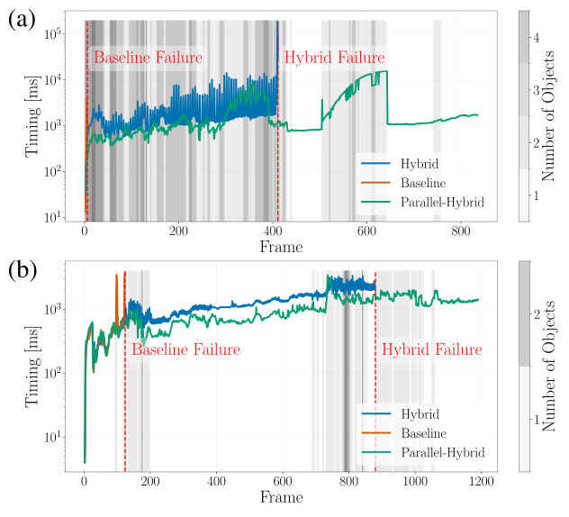

> **TL;DR** The DynoSAM authors make Dynamic SLAM run online. A new "Hybrid" factor graph keeps the accurate world-frame object motion but stores each object point once, in a fixed object frame, so the incremental solver iSAM2 can update it cheaply. Splitting the graph into one static smoother and one smoother per object ("Parallel-Hybrid") runs 5× faster than the incremental baseline, at 1–5 Hz, with almost the same accuracy.

## Why this paper

DynoSAM (also in this list) estimates every moving object's motion accurately inside the SLAM factor graph, but its back-end takes minutes per sequence. A planner cannot wait that long. This paper is the "make it online" sequel. It is also a good lesson in factor-graph engineering: the same physics written as a different graph can be the difference between a solver that runs and one that runs out of memory.

## The problem

Incremental solvers like **iSAM2** are why static SLAM runs in real time. They keep the problem as a **Bayes tree**, a tree of small groups of variables called cliques. When a new measurement arrives, they re-solve only the part of the tree it touches. This works when the graph is sparse, because cliques stay small.

Dynamic SLAM breaks this. In DynoSAM's world-centric formulation:

- every point on a moving object gets a **new variable every frame**;
- each object motion connects to all of that object's points at two frames;
- all objects connect to the same camera poses.

When iSAM2 eliminates variables, these connections fill in, and cliques grow until they hold variables from all objects at once. Each update re-solves a large part of the tree, and on long sequences memory runs out.

## Key idea

Keep the good part of each existing formulation:

- **From world-centric methods**: the object motion is a world-frame rigid transform. It encodes rigid-body kinematics exactly and gives accurate motion.
- **From object-centric methods**: each object point is a **single, constant variable** in an object frame, not a new variable per frame.

The trick is to anchor all motion to a fixed **embedded frame** L_e, created when the object is first seen (at the centroid of its first points, with identity rotation). The state is the motion ᵂH(e→k) that carries this frame, and every point attached to it, from the first-seen time e to the current time k. A point's world position at time k is

ᵂm(k) = ᵂH(e→k) · L_e · m

where m is the point's fixed coordinate in the embedded frame. The object pose at k is simply ᵂH(e→k) · L_e, so pose, motion and velocity all come out without chaining per-frame motions.

Why this helps the solver: each dynamic point is now a **leaf** in the graph. It connects only to its object's motions, so it can be eliminated without building large cliques. And because points persist, the object's point cloud grows naturally as more of the object becomes visible.

## How it works

**Factors.**

- **Hybrid motion factor**: the measured 3D point z₃D vs. the predicted point, camera⁻¹ × motion(e→k) × L_e × m. It links the camera pose at k, the object motion at k, and the point.
- **Smoothing factor**: a constant-velocity prior on three consecutive motions, computed in the object's **body frame**. DynoSAM computed it in the world frame, where the error grows with the object's distance from the origin. The body frame avoids that, and it is also where class-specific models (for example, a car model) would naturally live.
- Static part: the same as DynoSAM (point factors, and odometry between camera poses).

**Parallel-Hybrid.** Even with the Hybrid graph, all objects still share the camera poses, and that coupling eventually builds big cliques. So they cut the graph:

1. Static measurements update one iSAM2 instance (the SFG), which gives the optimal camera pose and its marginal covariance.
2. Each object has its own iSAM2 instance (a DOFG) that includes the camera poses as variables, held by a prior with that mean and covariance.
3. When a camera pose in the SFG is relinearized significantly, the matching priors in the DOFGs are updated.

Objects are now independent and can be solved in parallel. The price: information flows only from static to dynamic. A well-tracked object cannot help the ego pose.

The front-end is DynoSAM's (RGB-D, instance masks, optical flow). Everything runs inside the DynoSAM framework with GTSAM 4.2 on an Intel i9-9900 CPU.

## Results

The datasets are the same as for DynoSAM: KITTI tracking, Outdoor Cluster and OMD S4U, plus TartanAir Shibuya and VIODE for timing. The baseline is DynoSAM's world-centric formulation; the prefix "i" means solved with iSAM2.

**Accuracy.** All variants stay close to the batch baseline. Camera RPE changes by at most 0.02 m and 0.01°. Object motion error changes by at most 1.29° and 0.18 m. The pattern is consistent: incremental solving costs a little accuracy (iSAM2 approximates the batch solution), and decoupling (Parallel-Hybrid) costs a little more. The authors read this as evidence that solving objects and camera jointly helps both.

**Structure.** On KITTI 20, the incremental baseline's cliques keep growing until variable elimination runs out of memory. iHybrid's cliques stay much smaller, and fewer variables are re-eliminated per frame.

**Timing** (average iSAM2 update per frame; iHybrid and iBaseline with relinearize-skip λrs = 10):

| Sequence | Parallel-Hybrid | iHybrid | iBaseline |
|---|---|---|---|
| KITTI 00 | 247 ms | 601 ms | fails |
| KITTI 20 | 1252 ms | fails | fails |
| OMD S4U | 494 ms | fails | fails |
| VIODE Parking Lot (High) | 838 ms | 1947 ms | fails |
| TartanAir Shibuya VII | 75 ms | 142 ms | 146 ms |

- iBaseline fails on almost every sequence; iHybrid completes four times as many; Parallel-Hybrid completes **all** of them.
- Parallel-Hybrid is about 2× faster than iHybrid and 5× faster than iBaseline, running at 1–5 Hz. (Relinearizing every step, λrs = 1, lets the others finish more sequences but costs 200%+ more time.)

**Real world.** Indoors, with an Intel RealSense D415, people walking around, and at most 100 features per object, iSAM2 updates stayed under 150 ms with up to 9 dynamic objects.

**An insight worth keeping.** Problem structure also depends on how objects move relative to the camera: an object that shows the same face for a long time (following a car on a highway) builds long tracks and bigger cliques.

## Limitations

- **1–5 Hz on a desktop i9** (about 1.3 s per update on KITTI 20): still slower than a typical planning loop, and front-end time (hundreds of ms per object in DynoSAM) is not included.
- **One-way information.** Parallel-Hybrid cannot use objects to correct the ego pose. If cars block most of the static scene, the camera pose suffers.
- Still RGB-D, rigid bodies, a constant-velocity prior, and no loop closure. Without the parallel split, iHybrid still fails on long, crowded sequences (KITTI 18 and 20).

## DYROS lens

**This is the version that could actually feed a planner.** It gives each object's pose, velocity and accumulated shape every 0.2–1 s. For our parking stack, think of it as a slower "map of movers" running beside the planner; it need not run at control rate if the planner already does fast reactive collision checks.

**The body-frame smoothing factor is a hook for us.** The authors moved the constant-motion prior into the object's body frame precisely so that class-specific models could be written there. A car in a parking aisle cannot slide sideways and turns with bounded curvature. Writing a kinematic bicycle (nonholonomic) prior there is a few lines of factor code, and it is where our planning background is a real advantage.

**What would break.**

- Parked cars on both sides of an aisle are the "same face visible for a long time" case that grows cliques, except that they do not move. They must be classified as static early, or they cost compute for nothing.
- The one-way information flow hurts most in a full parking lot, where moving cars can cover much of the view.
- We would need depth input (stereo, or LiDAR projected into a camera).

**What we could try in a week.** Run Parallel-Hybrid inside DynoSAM on the VIODE Parking Lot sequences on our onboard computer. Log the per-update latency and the object count, and check whether latency stays bounded as cars enter and leave. That number tells us whether the "map of movers" idea is realistic on our hardware.

**Paper opportunity.** A two-way Parallel-Hybrid with a vehicle motion prior: let well-constrained car tracks (nonholonomic, slow) send information back to the ego pose in a crowded garage, and measure both ego drift and the quality of the planner's collision checks.

## Key terms

- **iSAM2**: an incremental smoother that updates only the part of the solution affected by new measurements.
- **Bayes tree**: the tree of variable groups (cliques) that iSAM2 maintains; small cliques mean fast updates.
- **Embedded frame**: a fixed object frame created when an object is first seen; all its points and motions are anchored to it.
- **Hybrid formulation**: world-frame object motion plus constant object points stored in the embedded frame.
- **Parallel-Hybrid**: one static smoother plus one smoother per object, linked by camera-pose priors.
