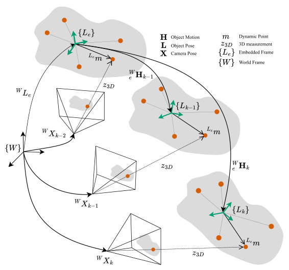
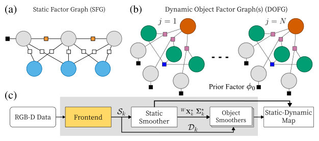
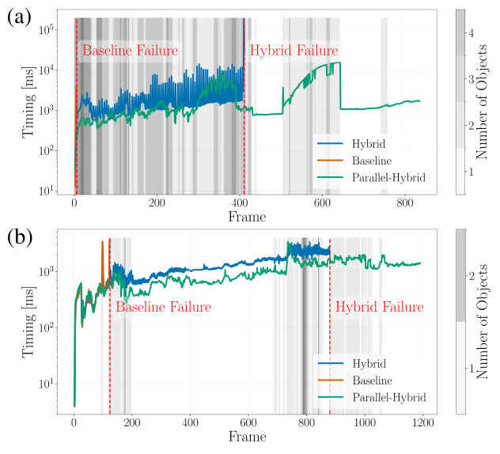

> **TL;DR** DynoSAM 저자들이 Dynamic SLAM을 온라인으로 돌아가게 만든 논문입니다. 새 "Hybrid" factor graph는 정확한 world frame 물체 motion은 그대로 두되, 물체의 각 점은 고정된 물체 좌표계에 한 번만 저장합니다. 그래서 incremental solver인 iSAM2가 싸게 갱신할 수 있습니다. 그래프를 정적 smoother 하나와 물체별 smoother로 나눈 "Parallel-Hybrid"는 incremental baseline보다 5배 빠르게 1–5 Hz로 돌고, 정확도는 거의 같습니다.

## 왜 이 논문인가

DynoSAM(이 목록에 함께 있습니다)은 움직이는 모든 물체의 motion을 SLAM factor graph 안에서 정확하게 추정하지만, back-end가 시퀀스 하나에 몇 분씩 걸립니다. Planner는 그렇게 오래 기다릴 수 없습니다. 이 논문은 "온라인으로 만들기" 편입니다. Factor graph 설계에 대한 좋은 교훈이기도 합니다. 같은 물리를 다른 그래프로 쓰는 것만으로, solver가 도는지 메모리가 터지는지가 갈립니다.

## 문제

정적 SLAM이 실시간으로 도는 이유는 **iSAM2** 같은 incremental solver 덕분입니다. iSAM2는 문제를 **Bayes tree**로 유지합니다. 변수 묶음(clique)으로 이루어진 트리입니다. 새 측정이 들어오면 그 측정이 닿는 트리 부분만 다시 풉니다. 그래프가 sparse해서 clique가 작게 유지될 때 잘 동작합니다.

Dynamic SLAM은 이 전제를 깹니다. DynoSAM의 world-centric formulation에서는:

- 움직이는 물체 위의 모든 점이 **매 프레임 새 변수**가 됩니다.
- 각 물체 motion이 그 물체의 모든 점과 두 프레임에 걸쳐 연결됩니다.
- 모든 물체가 같은 카메라 pose에 연결됩니다.

iSAM2가 변수를 소거하면 이 연결이 채워지면서 clique가 모든 물체의 변수를 한꺼번에 담을 만큼 커집니다. 그러면 갱신할 때마다 트리의 큰 부분을 다시 풀어야 하고, 긴 시퀀스에서는 메모리가 바닥납니다.

## 핵심 아이디어

기존 두 formulation의 좋은 점만 가져옵니다.

- **World-centric 방식에서**: 물체 motion을 world frame 강체 변환으로 둡니다. 강체 운동학을 정확히 담고, motion이 정확합니다.
- **Object-centric 방식에서**: 물체의 각 점을 프레임마다 새로 만들지 않고, 물체 좌표계 안의 **상수 변수 하나**로 둡니다.

요령은 모든 motion을 고정된 **embedded frame** L_e에 묶는 것입니다. L_e는 물체를 처음 볼 때 만듭니다(처음 관측한 점들의 중심, 회전은 identity). 상태 변수는 이 좌표계와 거기 붙은 모든 점을 처음 본 시각 e에서 현재 시각 k로 옮기는 motion ᵂH(e→k)입니다. 시각 k에서 점의 world 위치는

ᵂm(k) = ᵂH(e→k) · L_e · m

이고, m은 embedded frame 안에서 고정된 점 좌표입니다. 시각 k의 물체 pose는 그냥 ᵂH(e→k) · L_e입니다. 그래서 프레임별 motion을 이어 붙이지 않아도 pose, motion, 속도가 모두 나옵니다.

이것이 solver에 도움이 되는 이유: 동적 점 하나하나가 그래프의 **leaf**가 됩니다. 자기 물체의 motion에만 연결되므로, 큰 clique를 만들지 않고 소거할 수 있습니다. 또 점이 계속 유지되므로 물체가 더 많이 보일수록 물체 점 구름이 자연스럽게 자랍니다.

## 작동 방식

**Factor.**

- **Hybrid motion factor**: 측정한 3D 점 z₃D와 예측한 점(camera⁻¹ × motion(e→k) × L_e × m)의 차이. 시각 k의 카메라 pose, 시각 k의 물체 motion, 그리고 점을 연결합니다.
- **Smoothing factor**: 연속한 세 motion에 거는 등속 prior로, 물체의 **body frame**에서 계산합니다. DynoSAM은 이것을 world frame에서 계산했는데, 그러면 오차가 원점에서 물체까지의 거리에 비례해 커집니다. Body frame은 이 문제를 피하고, 클래스별 모델(예: 차량 모델)을 쓰기에도 자연스러운 자리입니다.
- 정적 부분: DynoSAM과 같습니다(점 factor, 카메라 pose 사이의 odometry (주행 거리 추정)).

**Parallel-Hybrid.** Hybrid 그래프에서도 모든 물체가 카메라 pose를 공유하므로, 이 결합이 결국 큰 clique를 만듭니다. 그래서 그래프를 자릅니다.

1. 정적 측정으로 iSAM2 인스턴스 하나(SFG)를 갱신해, 최적 카메라 pose와 그 marginal 공분산을 얻습니다.
2. 물체마다 자기 iSAM2 인스턴스(DOFG)가 있고, 여기에 카메라 pose를 변수로 넣어 그 평균과 공분산으로 만든 prior로 붙잡습니다.
3. SFG에서 카메라 pose가 크게 relinearize되면, 해당 DOFG prior를 갱신합니다.

이제 물체끼리 독립이라 병렬로 풀 수 있습니다. 대가는 정보가 정적 쪽에서 동적 쪽으로만 흐른다는 점입니다. 잘 추적된 물체가 ego pose를 도와줄 수 없습니다.

Front-end는 DynoSAM 것을 씁니다(RGB-D, instance mask, optical flow). 모두 DynoSAM 프레임워크 안에서 GTSAM 4.2로 구현했고, Intel i9-9900 CPU에서 돌렸습니다.

## 결과

데이터셋은 DynoSAM과 같습니다. KITTI tracking, Outdoor Cluster, OMD S4U이고, 시간 측정에는 TartanAir Shibuya와 VIODE를 더합니다. Baseline은 DynoSAM의 world-centric formulation이고, 이름 앞의 "i"는 iSAM2로 풀었다는 뜻입니다.

**정확도.** 모든 변형이 batch baseline과 가깝습니다. 카메라 RPE 변화는 최대 0.02 m, 0.01°입니다. 물체 motion 오차 변화는 최대 1.29°, 0.18 m입니다. 경향은 일관됩니다. Incremental로 풀면 정확도가 조금 떨어지고(iSAM2는 batch 해의 근사입니다), 그래프를 나누면(Parallel-Hybrid) 조금 더 떨어집니다. 저자들은 이를 물체와 카메라를 함께 푸는 것이 둘 다에 도움이 된다는 증거로 해석합니다.

**구조.** KITTI 20에서 incremental baseline의 clique는 계속 커지다가 변수 소거 중 메모리가 바닥납니다. iHybrid의 clique는 훨씬 작게 유지되고, 프레임마다 다시 소거하는 변수도 적습니다.

**시간**(프레임당 평균 iSAM2 갱신 시간, iHybrid와 iBaseline은 relinearize-skip λrs = 10):

| 시퀀스 | Parallel-Hybrid | iHybrid | iBaseline |
|---|---|---|---|
| KITTI 00 | 247 ms | 601 ms | 실패 |
| KITTI 20 | 1252 ms | 실패 | 실패 |
| OMD S4U | 494 ms | 실패 | 실패 |
| VIODE Parking Lot (High) | 838 ms | 1947 ms | 실패 |
| TartanAir Shibuya VII | 75 ms | 142 ms | 146 ms |

- iBaseline은 거의 모든 시퀀스에서 실패하고, iHybrid는 그보다 네 배 많은 시퀀스를 끝내며, Parallel-Hybrid는 **모든** 시퀀스를 끝냅니다.
- Parallel-Hybrid는 iHybrid보다 약 2배, iBaseline보다 5배 빠르고, 1–5 Hz로 돕니다. (매 단계 relinearize하는 λrs = 1로 두면 다른 둘도 더 많은 시퀀스를 끝내지만, 시간이 200% 이상 늘어납니다.)

**실제 환경.** 실내에서 Intel RealSense D415로, 사람들이 걸어 다니는 장면을 물체당 최대 100개 특징점으로 돌렸을 때, 동적 물체가 최대 9개여도 iSAM2 갱신이 150 ms 아래였습니다.

**기억할 만한 통찰.** 문제 구조는 물체가 카메라에 대해 어떻게 움직이는지에도 달려 있습니다. 같은 면을 오래 보여 주는 물체(고속도로에서 따라가는 앞차)는 긴 track을 만들고 clique를 키웁니다.

## 한계

- **데스크톱 i9에서 1–5 Hz**입니다(KITTI 20에서는 갱신 한 번에 약 1.3 s). 일반적인 planning 주기보다 여전히 느리고, front-end 시간(DynoSAM에서 물체당 수백 ms)은 이 숫자에 들어 있지 않습니다.
- **정보가 한 방향으로만 흐릅니다.** Parallel-Hybrid는 물체로 ego pose를 보정할 수 없습니다. 차들이 정적 장면을 대부분 가리면 카메라 pose가 나빠집니다.
- 여전히 RGB-D, 강체, 등속 prior이고, loop closure (루프 폐합)가 없습니다. 병렬 분할이 없는 iHybrid는 길고 붐비는 시퀀스(KITTI 18, 20)에서 여전히 실패합니다.

## DYROS 관점

**실제로 planner에 넣을 수 있는 버전입니다.** 각 물체의 pose, 속도, 누적 형상을 0.2–1 s마다 줍니다. 우리 주차 스택에서는 planner 옆에서 도는 느린 "움직이는 물체 지도"로 생각하면 됩니다. Planner가 빠른 반응형 충돌 검사를 이미 하고 있다면, 이 층은 제어 주기로 돌 필요가 없습니다.

**Body frame smoothing factor는 우리에게 열린 문입니다.** 저자들은 클래스별 모델을 쓸 수 있도록 일부러 등속 prior를 물체 body frame으로 옮겼습니다. 주차 통로의 차는 옆으로 미끄러질 수 없고 곡률이 제한된 채로 돕니다. 그 자리에 kinematic bicycle(nonholonomic) prior를 쓰는 것은 factor 코드 몇 줄이고, 우리의 planning 배경이 실제로 강점이 되는 지점입니다.

**무엇이 깨질까.**

- 통로 양쪽에 주차된 차들은 clique를 키우는 "같은 면이 오래 보이는" 경우와 같습니다. 다만 움직이지 않습니다. 일찍 정적으로 분류하지 않으면 아무 이득 없이 계산만 잡아먹습니다.
- 한 방향 정보 흐름은 꽉 찬 주차장에서 가장 아픕니다. 움직이는 차들이 시야를 많이 가릴 수 있기 때문입니다.
- Depth 입력(스테레오, 또는 카메라에 투영한 LiDAR)이 필요합니다.

**일주일 안에 해 볼 수 있는 것.** 우리 차량 탑재 컴퓨터에서 DynoSAM 안의 Parallel-Hybrid를 VIODE Parking Lot 시퀀스로 돌립니다. 갱신당 지연 시간과 물체 수를 기록하고, 차가 들어오고 나갈 때 지연이 일정 범위 안에 머무는지 확인합니다. 이 숫자가 "움직이는 물체 지도" 아이디어가 우리 하드웨어에서 현실적인지 알려 줍니다.

**논문 기회.** 차량 motion prior를 넣은 양방향 Parallel-Hybrid입니다. 잘 제약된 차 track(nonholonomic, 저속)이 붐비는 주차장에서 ego pose로 정보를 되돌려 보내게 하고, ego drift와 planner 충돌 검사의 품질을 함께 측정합니다.

## 용어 정리

- **iSAM2**: 새 측정이 영향을 주는 부분만 다시 푸는 incremental smoother.
- **Bayes tree**: iSAM2가 유지하는 변수 묶음(clique)의 트리. Clique가 작을수록 갱신이 빠릅니다.
- **Embedded frame**: 물체를 처음 볼 때 만드는 고정 물체 좌표계. 그 물체의 모든 점과 motion이 여기에 묶입니다.
- **Hybrid formulation**: world frame 물체 motion과, embedded frame에 저장한 상수 물체 점의 조합.
- **Parallel-Hybrid**: 정적 smoother 하나와 물체별 smoother들을 카메라 pose prior로 연결한 구조.
