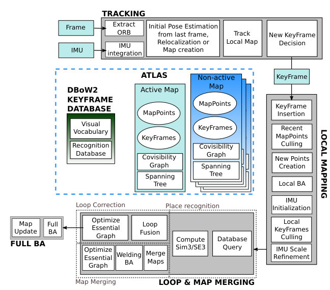
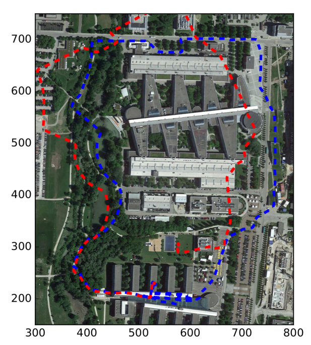

> **TL;DR** ORB-SLAM3 is one open-source library for visual and visual-inertial SLAM with monocular, stereo, RGB-D, pinhole and fisheye cameras. Its two new pieces are an IMU initialization solved as MAP estimation (true scale within 5% after 2 s) and Atlas, a multi-map system that starts a fresh map when tracking is lost and merges it back when a place is recognized.

> **Why it is a classic:** It is the reference feature-based visual SLAM system. Its framing of short-term, mid-term, long-term and multi-map data association explains why SLAM beats visual odometry, and its code is the baseline that most visual(-inertial) SLAM papers since 2021 compare against.

## Why this paper

Our cars carry four AVM fisheye cameras. Before designing camera SLAM for a garage, know what the strongest classical system does, why it is accurate, and where it breaks. ORB-SLAM3 is that system, and its authors are unusually clear about failure cases that matter to us.

## The problem

Visual SLAM had good pieces, but no single system did everything:

- **Visual odometry (VO) forgets.** Most VO and visual-inertial odometry (VIO) systems match only the last few seconds, so they drift even when the camera stays in one room.
- **IMU initialization was slow or sloppy.** ORB-SLAM-VI needed 15 s for a first scale estimate, VI-DSO 20–30 s to reach 1% scale error; closed-form methods ignore sensor noise.
- **Getting lost was fatal.** After blur or occlusion, the map was gone.
- **Place recognition was slow to fire.** DBoW2 waits for three consecutive keyframes to agree before accepting a loop, reaching 100% precision but only 30–40% recall.
- **Fisheye was second-class.** Rectifying a 180° fisheye to pinhole throws away the image edges.

## Key idea

Reuse everything you have ever mapped. The paper names four kinds of **data association** (deciding which observations refer to the same 3D point):

- **Short-term**: the last few seconds (all VO does this).
- **Mid-term**: map points near the camera whose drift is still small; reusing them in bundle adjustment (BA) gives zero drift while moving inside a mapped area.
- **Long-term**: place recognition for loop closure and relocalization.
- **Multi-map**: matching against maps from earlier sessions or from before tracking was lost.

The authors argue that using all four matters more for accuracy than feature-vs-direct or other design choices.

## How it works

**Three threads.** *Tracking* matches each frame's ORB features to the active map. *Local mapping* manages keyframes and points and runs local BA (visual-inertial with an IMU). *Loop and map merging* runs place recognition on every new keyframe against the whole Atlas.

**MAP IMU initialization** (MAP = maximum a posteriori), in three steps:

1. Run pure monocular SLAM for 2 s (10 keyframes at 4 Hz). This gives an accurate but up-to-scale trajectory.
2. Inertial-only MAP: with that trajectory fixed, estimate scale, gravity direction, IMU biases and velocities from the preintegrated IMU, with a prior that keeps biases small.
3. Joint visual-inertial BA, repeated at 5 s and 15 s, plus a cheap scale-and-gravity refinement every 10 s for slow-motion cases.

**Atlas and losing track.** If fewer than 15 map points are tracked, the system predicts the pose with the IMU for up to 5 s while searching widely. If that fails, it stores the map as non-active and starts a new one. A map lost within 15 s of IMU initialization is discarded as untrustworthy.

**Higher-recall place recognition.** Query DBoW2 for the 3 most similar keyframes; align map points with RANSAC (Sim(3) or SE(3)); refine with guided matching; then verify with 2 keyframes that are already covisible in the map, instead of waiting for new keyframes. With an IMU, also check that roll and pitch agree with gravity.

**Merging.** A match in the active map closes a loop; a match in another map merges the two: first a "welding" BA around the matched keyframes, so tracking can reuse the old map at once, then a pose-graph optimization for the rest.

**Cameras.** Camera models are pluggable (pinhole, Kannala-Brandt fisheye). Stereo does not need rectification: two cameras with a fixed relative pose, overlapping or not.

## Results

All numbers are RMS absolute trajectory error (ATE), on an Intel i7 CPU, median of several runs.

- **EuRoC drone, stereo-inertial:** 3.5 cm average, vs 5.1 cm for BASALT (which failed one sequence), 11.9 cm for Kimera and 13.8 cm for VINS-Fusion.
- **EuRoC, monocular-inertial:** 4.3 cm, vs 8.9 cm for VI-DSO and 11.0 cm for VINS-Mono (2.6× better), and 22–41 cm for OKVIS, ROVIO and MSCKF.
- **Pure visual:** monocular 4.1 cm (fails on V203), stereo 8.4 cm, ahead of ORB-SLAM2, DSM, DSO and SVO.
- **TUM-VI room sequences** (hand-held fisheye): 9 mm stereo-inertial, 11 mm monocular-inertial. Indoor corridors mostly under 10 cm; 900 m indoor routes around 1 m; long outdoor routes 10–70 m.
- **Multi-session EuRoC:** Machine Hall 6.5 cm mono-inertial vs 21.0 cm for VINS-Mono (3.2× better). The hard sequences V103 and V203 succeed once a previous session's map is available.

- **Speed:** 30–40 frames/s tracking; place recognition under 10 ms per keyframe; merges under 1 s; a full BA after a loop takes a few seconds in a background thread.

## Limitations

- **Low texture is the main failure case,** say the authors. Features vanish on blank walls and in the dark.
- **A car on flat ground is hard for IMU initialization.** The paper says so directly: slow motion without roll and pitch makes the IMU hard to initialize; use stereo if possible.
- **Static world.** No dynamic-object handling; moving objects must be rejected as outliers.
- **Far points hurt.** Outdoors, points beyond 20 m (e.g. clouds) had to be discarded by hand.
- **Drone and hand-held benchmarks only.** No car data, no non-overlapping multi-camera rigs.

## DYROS lens

**What a 2026 reader should take from it.** Mid-term data association (reusing the map, not just the last frames) is the difference between SLAM and odometry, and the Atlas idea, "when lost, start a new map and merge later", is the right way to survive failures. It remains the baseline to beat.

**On our indoor parking garage car.**

- *AVM fisheye cameras.* Raw fisheye images are supported, and "two cameras with a known transform" hints at multi-camera rigs, but four outward fisheyes with little overlap are not supported out of the box. SLAM on the stitched AVM top view is a different problem again.
- *Flat floors.* The IMU initialization issue hits us directly. Wheel odometry gives metric scale from the start and could replace the IMU-only initialization step.
- *Repetitive garages.* Identical pillars and parking lines make DBoW2 candidates look alike; geometric and gravity checks help, but need testing on garage data.
- *Dim lighting and blank walls* hit the main failure case.
- *Multi-session maps* fit automated valet parking well: map the garage once, then relocalize and merge on every later visit.

**What we could try in a week.** Run ORB-SLAM3 monocular-inertial on the raw front fisheye camera plus IMU over two garage loops. Log how long IMU initialization takes, how often tracking is lost, and how many false place recognitions occur. Then run the second loop as a second session and check whether Atlas merges it.

**Paper opportunity.** Wheel-aided initialization and multi-session Atlas for AVM fisheye cameras in garages: metric scale from wheels on day one, map merging across visits. It links our AVM SLAM work with motion planning on a reusable garage map.

## Key terms

- **Bundle adjustment (BA)**: joint optimization of camera poses and 3D points by minimizing reprojection error.
- **Data association (short/mid/long-term, multi-map)**: deciding which observations are the same 3D point, over seconds, the local map, loops, or other maps.
- **Atlas**: ORB-SLAM3's set of disconnected maps, one active, merged when overlap is found.
- **DBoW2**: a bag-of-words image database that retrieves similar keyframes for place recognition.
- **ATE**: absolute trajectory error, RMS position error after aligning the estimate with ground truth.
