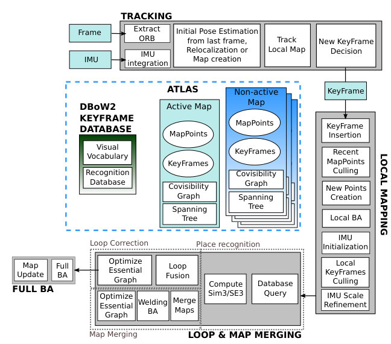
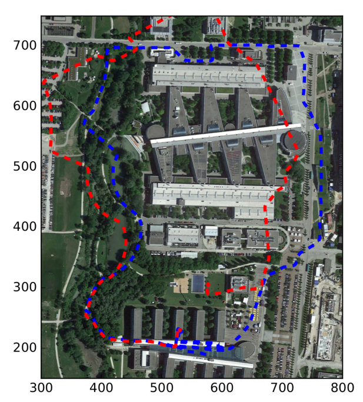

> **TL;DR** ORB-SLAM3는 monocular, stereo, RGB-D, pinhole, fisheye 카메라로 visual SLAM과 visual-inertial SLAM을 모두 하는 하나의 오픈소스 라이브러리입니다. 새로운 두 가지는 MAP 추정으로 푸는 IMU 초기화(2 s 만에 실제 scale을 5% 이내로)와, tracking을 잃으면 새 지도를 시작했다가 장소를 알아보면 다시 합치는 multi-map 시스템 Atlas입니다.

> **고전인 이유:** Feature 기반 visual SLAM의 기준 시스템입니다. Short-term, mid-term, long-term, multi-map data association이라는 틀로 SLAM이 visual odometry (영상 기반 주행 거리 추정)보다 나은 이유를 설명했고, 2021년 이후 visual(-inertial) SLAM 논문 대부분이 이 코드와 비교합니다.

## 왜 이 논문인가

우리 차에는 AVM fisheye 카메라 네 대가 있습니다. 주차장용 카메라 SLAM을 설계하기 전에, 가장 강한 고전 시스템이 무엇을 하는지, 왜 정확한지, 어디서 깨지는지 알아야 합니다. ORB-SLAM3가 그 시스템이고, 저자들은 우리에게 중요한 실패 사례를 드물게 솔직히 밝힙니다.

## 문제

Visual SLAM에는 좋은 부품이 있었지만 모든 것을 하는 시스템은 없었습니다.

- **Visual odometry (VO)는 잊어버립니다.** 대부분의 VO와 visual-inertial odometry (VIO)는 최근 몇 초만 맞추므로, 카메라가 한 방 안에 머물러도 drift가 생깁니다.
- **IMU 초기화가 느리거나 엉성했습니다.** ORB-SLAM-VI는 첫 scale 추정에 15 s, VI-DSO는 scale 오차 1%에 도달하는 데 20–30 s가 걸렸고, closed-form 방법은 센서 노이즈를 무시합니다.
- **길을 잃으면 끝이었습니다.** 흔들림이나 가림 뒤에는 지도가 사라졌습니다.
- **Place recognition이 늦게 반응했습니다.** DBoW2는 loop를 받아들이기 전에 연속 세 keyframe이 동의하기를 기다립니다. Precision은 100%지만 recall은 30–40%뿐입니다.
- **Fisheye는 찬밥이었습니다.** 180° fisheye를 pinhole로 rectify하면 영상 가장자리를 버리게 됩니다.

## 핵심 아이디어

지금까지 지도로 만든 모든 것을 다시 씁니다. 논문은 **data association**(어떤 관측들이 같은 3D 점인지 정하는 일)을 네 종류로 나눕니다.

- **Short-term**: 최근 몇 초(모든 VO가 하는 일).
- **Mid-term**: 카메라 근처에 있고 drift가 아직 작은 지도 점. 이를 bundle adjustment (BA)에 다시 쓰면 지도 안에서 움직이는 동안 drift가 0이 됩니다.
- **Long-term**: loop closure (루프 폐합)와 relocalization을 위한 place recognition.
- **Multi-map**: 이전 session이나 tracking을 잃기 전에 만든 지도와 맞추기.

저자들은 정확도에는 feature냐 direct냐 같은 선택보다 이 네 가지를 모두 쓰는 것이 더 중요하다고 주장합니다.

## 작동 방식

**세 개의 스레드.** *Tracking*은 각 프레임의 ORB feature를 active map에 맞춥니다. *Local mapping*은 keyframe과 점을 관리하고 local BA(IMU가 있으면 visual-inertial)를 돌립니다. *Loop & map merging*은 새 keyframe마다 Atlas 전체를 대상으로 place recognition을 합니다.

**MAP IMU 초기화**(MAP = maximum a posteriori)는 세 단계입니다.

1. 순수 monocular SLAM을 2 s 동안 돌립니다(4 Hz로 keyframe 10개). 정확하지만 scale을 모르는 trajectory를 얻습니다.
2. Inertial-only MAP: 그 trajectory를 고정하고, preintegration한 IMU로 scale, 중력 방향, IMU bias, 속도를 추정합니다. Bias가 작게 유지되도록 prior를 둡니다.
3. Visual-inertial BA를 5 s와 15 s에 다시 돌리고, 느린 움직임에 대비해 10 s마다 가벼운 scale·중력 보정을 합니다.

**Atlas와 tracking 손실.** 추적되는 지도 점이 15개 미만이면, 최대 5 s 동안 IMU로 pose를 예측하며 넓게 찾습니다. 그래도 실패하면 지도를 non-active로 저장하고 새 지도를 시작합니다. IMU 초기화 후 15 s 안에 길을 잃은 지도는 믿을 수 없다고 보고 버립니다.

**Recall을 높인 place recognition.** DBoW2에서 가장 비슷한 keyframe 3개를 찾고, RANSAC으로 지도 점을 정렬하고(Sim(3) 또는 SE(3)), guided matching으로 다듬은 뒤, 새 keyframe을 기다리는 대신 지도에 이미 있는 covisible keyframe 2개로 검증합니다. IMU가 있으면 roll과 pitch가 중력과 맞는지도 확인합니다.

**합치기.** Active map 안에서 짝을 찾으면 loop를 닫고, 다른 지도에서 찾으면 두 지도를 합칩니다. 먼저 짝지은 keyframe 주변에서 "welding" BA를 돌려 tracking이 옛 지도를 바로 쓰게 하고, 나머지는 pose-graph optimization으로 보정합니다.

**카메라.** 카메라 모델을 끼워 바꿀 수 있습니다(pinhole, Kannala-Brandt fisheye). Stereo도 rectification이 필요 없습니다. 상대 pose가 고정된 카메라 두 대면 되고, 시야가 겹치지 않아도 됩니다.

## 결과

모든 숫자는 RMS absolute trajectory error (ATE)이고, Intel i7 CPU에서 여러 번 돌린 중앙값입니다.

- **EuRoC 드론, stereo-inertial:** 평균 3.5 cm입니다. BASALT 5.1 cm(sequence 하나 실패), Kimera 11.9 cm, VINS-Fusion 13.8 cm보다 좋습니다.
- **EuRoC, monocular-inertial:** 4.3 cm입니다. VI-DSO 8.9 cm, VINS-Mono 11.0 cm(2.6배 차이), OKVIS·ROVIO·MSCKF 22–41 cm보다 좋습니다.
- **순수 visual:** monocular 4.1 cm(V203 실패), stereo 8.4 cm로 ORB-SLAM2, DSM, DSO, SVO보다 앞섭니다.
- **TUM-VI room sequence**(손에 든 fisheye): stereo-inertial 9 mm, monocular-inertial 11 mm. 실내 복도는 대부분 10 cm 미만, 900 m 실내 경로는 약 1 m, 긴 실외 경로는 10–70 m입니다.
- **EuRoC multi-session:** Machine Hall에서 mono-inertial 6.5 cm로 VINS-Mono 21.0 cm보다 3.2배 좋습니다. 어려운 V103, V203도 이전 session의 지도가 있으면 성공합니다.

- **속도:** tracking은 초당 30–40 프레임, place recognition은 keyframe당 10 ms 미만, 지도 합치기는 1 s 미만입니다. Loop 뒤 full BA는 백그라운드 스레드에서 몇 초 걸립니다.

## 한계

- **저자들이 꼽은 주된 실패 사례는 질감이 적은 환경입니다.** 빈 벽이나 어두운 곳에서는 feature가 사라집니다.
- **평평한 바닥을 달리는 차는 IMU 초기화가 어렵습니다.** 논문이 직접 말합니다. Roll, pitch 없이 느리게 움직이면 IMU를 초기화하기 어려우니 가능하면 stereo를 쓰라고 합니다.
- **정적인 세계.** 동적 물체 처리가 없고, 움직이는 물체는 outlier로 걸러져야 합니다.
- **먼 점이 해롭습니다.** 실외에서는 20 m 넘는 점(예: 구름)을 손으로 버려야 했습니다.
- **드론과 손에 든 장비 benchmark뿐입니다.** 자동차 데이터도, 시야가 겹치지 않는 multi-camera rig도 없습니다.

## DYROS 관점

**2026년 독자가 가져갈 것.** Mid-term data association(최근 프레임만이 아니라 지도를 다시 쓰는 것)이 SLAM과 odometry를 가르고, "길을 잃으면 새 지도를 시작하고 나중에 합친다"는 Atlas 아이디어가 실패를 견디는 올바른 방법입니다. 지금도 이겨야 할 baseline입니다.

**실내 주차장 차량에서는.**

- *AVM fisheye 카메라.* Raw fisheye 영상은 지원하고 "상대 pose를 아는 카메라 두 대"라는 관점은 multi-camera rig로 가는 실마리지만, 겹침이 적은 바깥쪽 fisheye 네 대는 기본 지원이 아닙니다. 합성한 AVM top view 위의 SLAM은 또 다른 문제입니다.
- *평평한 바닥.* IMU 초기화 문제가 우리에게 그대로 해당합니다. Wheel odometry는 처음부터 metric scale을 주므로 IMU-only 초기화 단계를 대신할 수 있습니다.
- *반복적인 주차장.* 똑같은 기둥과 주차선 때문에 DBoW2 후보가 서로 비슷해 보입니다. 기하 검증과 중력 검사가 도움이 되지만 주차장 데이터로 시험해야 합니다.
- *어두운 조명과 빈 벽*은 주된 실패 사례에 그대로 걸립니다.
- *Multi-session 지도*는 automated valet parking에 잘 맞습니다. 주차장을 한 번 지도로 만들고, 이후 방문마다 relocalize하고 합칩니다.

**일주일 안에 해 볼 수 있는 것.** 앞쪽 raw fisheye 카메라와 IMU로 ORB-SLAM3 monocular-inertial을 주차장 두 바퀴에 돌립니다. IMU 초기화에 걸리는 시간, tracking을 잃는 횟수, 잘못된 place recognition 횟수를 기록합니다. 그다음 두 번째 바퀴를 두 번째 session으로 돌려 Atlas가 합치는지 확인합니다.

**논문 기회.** 주차장의 AVM fisheye 카메라를 위한 wheel 보조 초기화와 multi-session Atlas입니다. 첫날부터 바퀴로 metric scale을 얻고, 방문할 때마다 지도를 합칩니다. 우리의 AVM SLAM 연구와, 재사용 가능한 주차장 지도 위의 motion planning (경로 계획)을 잇는 주제입니다.

## 용어 정리

- **Bundle adjustment (BA)**: reprojection error를 최소화해 카메라 pose와 3D 점을 함께 최적화하는 것.
- **Data association (short/mid/long-term, multi-map)**: 어떤 관측들이 같은 3D 점인지 정하는 일. 몇 초 단위, local map, loop, 다른 지도 단위로 나뉩니다.
- **Atlas**: ORB-SLAM3가 가진 서로 떨어진 지도들의 묶음. 하나만 active이고, 겹침을 찾으면 합칩니다.
- **DBoW2**: place recognition을 위해 비슷한 keyframe을 찾아 주는 bag-of-words 영상 데이터베이스.
- **ATE**: absolute trajectory error. 추정 trajectory를 ground truth에 정렬한 뒤의 RMS 위치 오차.
