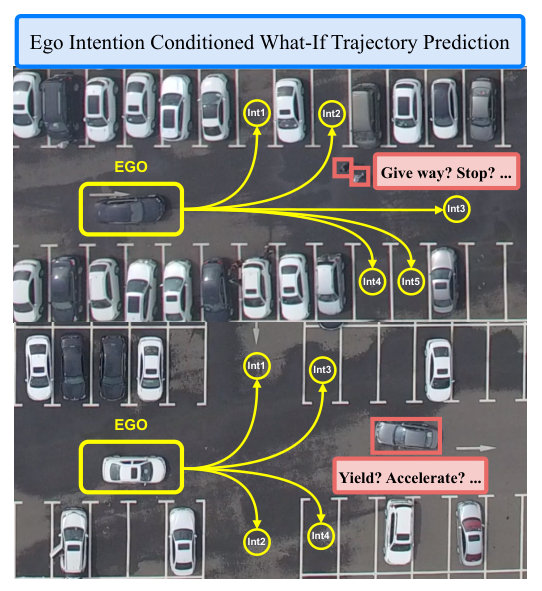

> **TL;DR** ParkDiffusion++ first proposes a handful of places the ego car might drive to in the next 4 s, then, for each of them, predicts how all nearby cars and pedestrians would move in response. A diffusion-based "safety critic" and a teacher that imagines alternative ego choices are used only during training. On the Dragon Lake Parking dataset it beats ego-conditioned predictors such as MotionLM and DTPP on almost every metric, and roughly halves the predicted collision rate.

## Why this paper

A parking planner in a busy lot keeps asking "what if?": if I pull into this slot now, does the car behind me wait or squeeze past? If I back up, does the pedestrian stop? Most trajectory predictors answer a different question: "what will everyone do?", with the ego treated as just another agent. In a parking lot, what others do depends heavily on what *you* do.

This paper builds a predictor that answers the what-if question directly, for the parking domain, and with collisions between predicted agents treated as a first-class error. It is not a planner, but it is the kind of model a planner like ours would want to query.

## The problem

Two linked tasks:

1. **Ego intention prediction**: from the scene, propose a small set of plausible places the ego might go next.
2. **Ego-conditioned joint prediction**: for each such intention, predict the future of *all* other agents *together*, so the predicted scene is consistent (no two predicted cars drive through each other).

Two difficulties:

- **No labels for the paths not taken.** A dataset records only what the ego actually did. If the ego had turned left instead, nobody knows how the others would have reacted. Those **counterfactual** futures have no ground truth.
- **Marginal predictions do not add up.** Predicting each agent separately (marginal prediction) and stacking the results often gives scenes where predicted agents overlap. Earlier parking predictors (ParkPredict+, ParkDiffusion) are marginal and ignore safety constraints.

## Key idea

Split the problem into **discrete ego intentions** plus a **conditional joint predictor**, and fill the missing counterfactual labels with a **teacher** that is pushed toward safe, plausible scenes by a frozen diffusion denoiser.

A chess analogy: list a few candidate moves (intention tokens) and imagine the opponent's reply to each (conditional prediction). Replies to moves you never played are learned from a stronger version of yourself that also rejects illegal positions (the safety-guided denoiser).

## How it works

**Inputs.** The last 10 steps (4 s at 0.4 s) of every agent, plus a vectorized map: parking slots and drivable boundaries (soft constraints) and obstacles (hard constraints). Output: 10 future steps (4 s).

**Stage 1: ego intention tokenizer.**

- A scene encoder runs a 1-D convolution and a GRU over each agent's history, then a transformer across agents, and lets the ego attend to the two map streams.
- Six learned "mode" embeddings each regress one **endpoint token** (where the ego will be in 4 s) and a score. Trained with winner-takes-all, so the six tokens spread over different maneuvers.

**Stage 2: conditional joint predictor.**

- The chosen token modulates every agent's features (FiLM).
- An **exposure gate** decides how much each agent matters for this intention: agents close to the straight line from the ego to the token, or close to the token itself, get more weight. A car parked on the far side of the lot is ignored.
- Each agent gets 6 marginal futures. A beam search over the top ones builds 6 candidate *joint scenes*, and a learned selector scores them.

**Safety-guided denoiser.** A diffusion denoiser (Leapfrog-style, as in ParkDiffusion) is pretrained on real trajectories and frozen. To refine a scene it runs a few "project-then-guide" steps:

- **project**: subtract the predicted noise, which pulls the scene toward realistic motion;
- **guide**: take a gradient step on a hand-made cost with five terms: agent–agent overlap, obstacle clearance, ego staying in a tube around its intended path, ego ending near its token, and smooth motion.

**Counterfactual knowledge distillation (CKD).** With probability 0.5 per batch, pick a token the ego did *not* take. An **EMA teacher** (a slowly averaged copy of the decoder) predicts the scene for that token, the frozen denoiser cleans it up, and the student learns to match it, plus a collision penalty. The ground-truth branch is always trained as well.

The denoiser and teacher only shape training. At test time the model is one encoder, the tokenizer, and the student decoder.

## Results

**Data.** DLP (dense parking lots, 51,750 training / 5,750 validation samples) and inD (urban intersections with many pedestrians, 34,014 / 4,859). **Baselines**: WIMP, SceneTransformer, ScePT, MotionLM, DTPP (each given the ego condition from outside, all sharing the same map encoder), and ParkDiffusion† (random combination of marginals).

**Metrics.** min- metrics take the best of 6 scenes; f- metrics take the top-1 scene the model picks. MR: miss rate (no scene has every agent within 2 m at the end). OR: overlap rate, any vehicle–vehicle, vehicle–pedestrian or vehicle–obstacle contact in the scene.

| DLP | minADE | minFDE | minOR | f-ADE | f-FDE | f-OR |
|---|---|---|---|---|---|---|
| ParkDiffusion† | 0.52 | 1.06 | 0.21 | 0.90 | 1.78 | 0.28 |
| SceneTransformer | 0.36 | 0.79 | 0.07 | 0.55 | 1.08 | 0.12 |
| MotionLM | 0.32 | 0.80 | 0.08 | **0.34** | 0.88 | 0.10 |
| DTPP | 0.32 | 0.82 | 0.06 | 0.50 | 1.21 | 0.09 |
| **ParkDiffusion++** | **0.29** | **0.56** | **0.03** | 0.36 | **0.66** | **0.05** |

(ADE/FDE in meters; OR as a fraction.)

What stands out:

- **Endpoint error drops most**: minFDE 0.56 m vs 0.79 m for the next best. The ego token makes the end of the trajectory much easier to get right.
- **Fewer impossible scenes**: overlap rate 0.03 vs 0.06–0.21 (oracle) and 0.05 vs 0.09–0.28 (top-1).
- **Average error is not always best**: MotionLM has slightly lower f-ADE on DLP (0.34 vs 0.36 m), and on inD ScePT and DTPP win minADE and f-ADE, though ParkDiffusion++ keeps the best minFDE (0.78 m) and overlap rates there. The authors blame the model's conservative, safety-first predictions.

**Ablations (DLP).**

- Adding the joint selector to plain marginals: minFDE 1.06 → 0.75 m, OR 0.21 → 0.12. Adding the safety-guided denoiser: 0.60 m, OR 0.05. Adding CKD: 0.56 m, OR 0.03.
- Six intention tokens and a CKD probability of 0.5 work best; more counterfactuals (18 tokens, or probability 0.75) hurt.
- An EMA teacher alone gives no gain. The gain appears only when the teacher's output is refined by the denoiser *with* the safety terms.

## Limitations

- **Open loop only.** The model is never used to drive. Whether its what-if answers help a planner is not tested; the authors list this gap themselves.
- **Counterfactuals are not measured.** The numbers score only the realized ego intention. The what-if quality is shown with pictures, not metrics.
- **Short horizon.** 4 s ahead, 4 s of history. A parking maneuver with direction changes takes longer, and the "intention" is a 4 s endpoint, not a parking slot.
- **Hand-made safety terms** in the denoiser, and a conservative bias (one car yields so far that it moves closer to pedestrians).
- **No runtime reported** and no code link; runtime matters for any use inside a planning loop.

## DYROS lens

**Where it fits our stack.** In our IROS 2023 work a network predicted where good ego trajectories lie and the sampling-based planner sampled from it. ParkDiffusion++ adds the other half for dynamic lots: for each ego option, *how the others respond*. The six intention tokens resemble learned goal regions to bias sampling, and the conditional joint prediction is an obstacle model for each branch of the tree, exactly what a narrow-space planner needs when another car waits in the aisle.

**What would break on our car.**

- **Horizon and goal mismatch.** Our TargetTree-RRT\* plans the whole maneuver to a slot pose, often with gear changes. A 4 s endpoint token is a mid-course waypoint, not a slot. We would need slot-level intentions or a longer horizon.
- **Perfect tracks.** DLP and inD come from drones, with every agent visible and accurately tracked. Our car sees the lot from inside, among pillars and parked cars, through distorted AVM fisheye images. History will be short and noisy.
- **No safety guarantee at test time.** The denoiser is training-only; the deployed model still predicts overlapping scenes about 5% of the time (f-OR). A planner must still check collisions itself.

**What we could try in a week.** Without public code, reproducing the model is not a one-week job. Ask a cheaper question first: does ego conditioning matter in real parking data? On DLP, cluster the ego's 4 s endpoints into six tokens and measure how much other agents' true futures differ between similar scenes with different ego tokens. Small differences mean a cheap marginal predictor is enough for our planner; large ones justify this line of work.

**Paper opportunity.** Close the loop. Use the intention tokens as sampling biases and the conditional joint prediction as a per-branch obstacle model inside a sampling-based parking planner, and evaluate in closed loop on DLP replays. The authors name coupling with planning as future work. A second angle: run the safety-guided denoiser at test time on *planner* samples, as a learned repair step for candidate ego paths.

## Key terms

- **Ego intention token**: one of a few learned candidate endpoints for the ego car 4 s ahead.
- **Joint prediction**: predicting all agents' futures together so the scene is consistent, instead of one agent at a time.
- **Counterfactual**: what would have happened under an ego choice that was not actually taken.
- **Diffusion denoiser**: a network trained to remove noise from trajectories; repeated denoising pulls a sample toward realistic motion.
- **Overlap rate (OR)**: the fraction of predicted scenes in which any agents, or an agent and an obstacle, collide.
