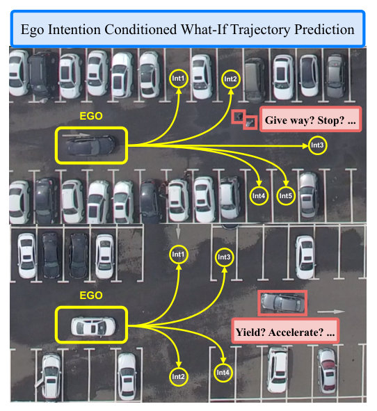
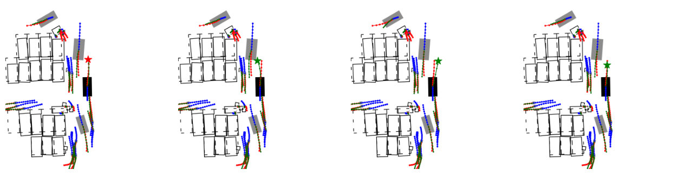

> **TL;DR** ParkDiffusion++는 먼저 ego 차량이 앞으로 4 s 동안 갈 만한 곳 몇 개를 제안하고, 그 각각에 대해 주변 차와 보행자가 어떻게 반응해 움직일지 함께 예측합니다. Diffusion 기반의 "안전 검사기"와, ego가 하지 않은 선택을 상상하는 teacher는 학습 때만 씁니다. Dragon Lake Parking 데이터셋에서 MotionLM, DTPP 같은 ego-conditioned 예측기를 거의 모든 지표에서 앞서고, 예측 장면 안의 충돌 비율을 대략 절반으로 줄입니다.

## 왜 이 논문인가

붐비는 주차장의 planner는 계속 "만약에?"를 묻습니다. 지금 이 칸으로 들어가면 뒤차는 기다릴까, 비집고 지나갈까? 후진하면 보행자가 멈출까? 대부분의 trajectory prediction (궤적 예측) 모델은 다른 질문에 답합니다. "모두가 무엇을 할까?"이고, ego는 그냥 agent 중 하나로 취급됩니다. 주차장에서는 다른 agent의 행동이 *내* 행동에 크게 좌우됩니다.

이 논문은 주차 상황에서 what-if 질문에 직접 답하는 예측기를 만들고, 예측된 agent끼리의 충돌을 핵심 오차로 다룹니다. Planner는 아니지만, 우리 같은 planner가 물어보고 싶은 종류의 모델입니다.

## 문제

서로 얽힌 두 과제입니다.

1. **Ego intention 예측**: 장면을 보고 ego가 다음에 갈 만한 곳을 몇 개 제안합니다.
2. **Ego-conditioned joint prediction**: 각 intention마다 다른 *모든* agent의 미래를 *함께* 예측해서, 예측 장면이 서로 모순되지 않게 합니다(예측된 두 차가 서로를 뚫고 지나가지 않게).

어려움은 두 가지입니다.

- **가지 않은 길에는 정답이 없습니다.** 데이터셋에는 ego가 실제로 한 행동만 기록됩니다. Ego가 대신 왼쪽으로 돌았다면 다른 agent가 어떻게 반응했을지는 아무도 모릅니다. 이런 **counterfactual**(반사실) 미래에는 ground truth가 없습니다.
- **Marginal 예측은 합쳐지지 않습니다.** Agent마다 따로 예측(marginal prediction)해서 쌓으면 예측된 agent끼리 겹치는 장면이 자주 나옵니다. 이전 주차 예측기(ParkPredict+, ParkDiffusion)는 marginal 방식이고 안전 제약을 무시합니다.

## 핵심 아이디어

문제를 **이산적인 ego intention**과 **조건부 joint 예측기**로 나누고, 빠진 counterfactual 정답은 얼려 둔 diffusion denoiser가 안전하고 그럴듯한 장면 쪽으로 다듬어 주는 **teacher**로 채웁니다.

체스에 비유하면, 후보 수 몇 개를 적고(intention token) 수마다 상대의 응수를 상상합니다(조건부 예측). 두지 않은 수에 대한 응수는, 불가능한 배치도 걸러 내는 더 강한 자기 자신(safety-guided denoiser)에게서 배웁니다.

## 작동 방식

**입력.** 모든 agent의 최근 10 step(0.4 s 간격, 4 s)과 vectorized map입니다. 지도는 주차 칸과 주행 가능 경계(soft 제약), 장애물(hard 제약)로 나뉩니다. 출력은 미래 10 step(4 s)입니다.

**Stage 1: ego intention tokenizer.**

- Scene encoder가 agent마다 과거 기록에 1-D convolution과 GRU를 적용하고, agent 사이에는 transformer를 돌린 뒤, ego가 두 지도 흐름에 attention을 겁니다.
- 학습된 "mode" embedding 6개가 각각 **endpoint token**(4 s 뒤 ego의 위치) 하나와 점수를 회귀합니다. Winner-takes-all로 학습해서 token 6개가 서로 다른 기동으로 퍼집니다.

**Stage 2: 조건부 joint 예측기.**

- 선택된 token이 모든 agent의 feature를 조절합니다(FiLM).
- **Exposure gate**가 이 intention에 대해 각 agent가 얼마나 중요한지 정합니다. Ego에서 token까지의 직선 가까이에 있거나 token 자체에 가까운 agent는 가중치를 더 받습니다. 주차장 반대편에 서 있는 차는 무시됩니다.
- Agent마다 marginal 미래 6개를 만듭니다. 상위 후보들에 beam search를 돌려 *joint 장면* 후보 6개를 만들고, 학습된 selector가 점수를 매깁니다.

**Safety-guided denoiser.** ParkDiffusion처럼 Leapfrog 방식의 diffusion denoiser를 실제 trajectory로 미리 학습하고 얼려 둡니다. 장면을 다듬을 때는 "project-then-guide" 단계를 몇 번 돌립니다.

- **project**: 예측한 노이즈를 빼서 장면을 현실적인 움직임 쪽으로 당깁니다.
- **guide**: 손으로 만든 비용의 gradient 방향으로 한 걸음 갑니다. 비용 항은 다섯 개입니다: agent끼리 겹침, 장애물과의 여유 거리, ego가 의도한 경로 주변 tube 안에 머물기, ego가 token 근처에서 끝나기, 부드러운 움직임.

**Counterfactual knowledge distillation**(CKD). 배치마다 0.5 확률로 ego가 실제로 *택하지 않은* token을 고릅니다. **EMA teacher**(decoder의 가중치를 천천히 평균한 복사본)가 그 token에 대한 장면을 예측하고, 얼려 둔 denoiser가 그것을 다듬고, student는 충돌 페널티와 함께 그 결과를 따라 배웁니다. 정답 branch도 항상 같이 학습합니다.

Denoiser와 teacher는 학습만 돕습니다. 시험 때 모델은 encoder 하나, tokenizer, student decoder뿐입니다.

## 결과

**데이터.** DLP(붐비는 주차장, 학습 51,750 / 검증 5,750 샘플)와 inD(보행자가 많은 도심 교차로, 34,014 / 4,859). **Baseline**: WIMP, SceneTransformer, ScePT, MotionLM, DTPP(모두 ego 조건을 외부에서 받고, 같은 지도 encoder를 공유), 그리고 ParkDiffusion†(marginal을 무작위로 조합).

**지표.** min- 지표는 장면 6개 중 가장 좋은 것, f- 지표는 모델이 고른 top-1 장면을 봅니다. MR: miss rate(끝 시점에 모든 agent가 2 m 안에 들어오는 장면이 하나도 없으면 실패). OR: overlap rate, 장면 안에 차–차, 차–보행자, 차–장애물 접촉이 하나라도 있는 비율.

| DLP | minADE | minFDE | minOR | f-ADE | f-FDE | f-OR |
|---|---|---|---|---|---|---|
| ParkDiffusion† | 0.52 | 1.06 | 0.21 | 0.90 | 1.78 | 0.28 |
| SceneTransformer | 0.36 | 0.79 | 0.07 | 0.55 | 1.08 | 0.12 |
| MotionLM | 0.32 | 0.80 | 0.08 | **0.34** | 0.88 | 0.10 |
| DTPP | 0.32 | 0.82 | 0.06 | 0.50 | 1.21 | 0.09 |
| **ParkDiffusion++** | **0.29** | **0.56** | **0.03** | 0.36 | **0.66** | **0.05** |

(ADE/FDE 단위는 m, OR은 비율입니다.)

눈여겨볼 점:

- **끝점 오차가 가장 크게 줄어듭니다.** minFDE 0.56 m로, 다음으로 좋은 0.79 m보다 낮습니다. Ego token이 trajectory의 끝을 맞히기 훨씬 쉽게 만듭니다.
- **불가능한 장면이 줄어듭니다.** Overlap rate가 0.03 대 0.06–0.21(oracle), 0.05 대 0.09–0.28(top-1)입니다.
- **평균 오차가 항상 최고는 아닙니다.** DLP의 f-ADE는 MotionLM이 조금 낮고(0.34 대 0.36 m), inD에서는 ScePT와 DTPP가 minADE와 f-ADE에서 이깁니다. 다만 inD에서도 minFDE(0.78 m)와 overlap rate는 ParkDiffusion++가 가장 좋습니다. 저자들은 안전을 우선하는 보수적인 예측 때문이라고 설명합니다.

**Ablation (DLP).**

- 단순한 marginal에 joint selector를 더하면 minFDE 1.06 → 0.75 m, OR 0.21 → 0.12. Safety-guided denoiser를 더하면 0.60 m, OR 0.05. CKD까지 더하면 0.56 m, OR 0.03.
- Intention token 6개와 CKD 확률 0.5가 가장 좋습니다. Counterfactual이 더 많으면(token 18개, 또는 확률 0.75) 오히려 나빠집니다.
- EMA teacher만으로는 이득이 없습니다. Teacher 출력을 *안전 항이 들어간* denoiser로 다듬을 때 비로소 이득이 생깁니다.

## 한계

- **Open loop만 했습니다.** 모델로 실제 주행을 하지 않습니다. What-if 답이 planner에 도움이 되는지는 시험하지 않았고, 저자들도 이 빈틈을 직접 언급합니다.
- **Counterfactual은 측정하지 않습니다.** 수치는 실제로 일어난 ego intention만 평가합니다. What-if 품질은 지표가 아니라 그림으로만 보여 줍니다.
- **짧은 horizon.** 4 s 앞, 4 s 기록입니다. 방향 전환이 있는 주차 기동은 더 오래 걸리고, 여기서 "intention"은 주차 칸이 아니라 4 s 뒤의 끝점입니다.
- Denoiser 안의 안전 항은 **손으로 만든 것**이고, 보수적인 편향도 있습니다(어떤 차가 너무 많이 양보해서 오히려 보행자 쪽으로 붙습니다).
- **실행 시간을 보고하지 않고** 코드 링크도 없습니다. Planning loop 안에서 쓰려면 실행 시간이 중요합니다.

## DYROS 관점

**우리 스택의 어디에 맞는가.** 우리 IROS 2023 연구에서는 네트워크가 좋은 ego trajectory가 있을 곳을 예측하고 sampling-based planner가 거기서 sampling했습니다. ParkDiffusion++는 붐비는 주차장에서 나머지 절반, 즉 ego의 선택지마다 *다른 agent가 어떻게 반응하는지*를 줍니다. Intention token 6개는 sampling을 치우치게 할 학습된 목표 영역과 닮았고, 조건부 joint 예측은 tree의 각 가지에 대한 장애물 모델이 됩니다. 통로에 다른 차가 기다릴 때 좁은 공간용 planner에 꼭 필요한 정보입니다.

**우리 차에서는 무엇이 깨질까.**

- **Horizon과 목표가 맞지 않습니다.** TargetTree-RRT\*는 기어 변경을 포함해 칸의 pose까지 기동 전체를 계획합니다. 4 s 끝점 token은 칸이 아니라 중간 waypoint입니다. 칸 단위 intention이나 더 긴 horizon이 필요합니다.
- **완벽한 track.** DLP와 inD는 드론 영상이라 모든 agent가 보이고 정확히 추적됩니다. 우리 차는 기둥과 주차된 차 사이에서, 왜곡된 AVM fisheye 영상으로 주변을 봅니다. 기록이 짧고 노이즈가 많을 것입니다.
- **시험 때는 안전 보장이 없습니다.** Denoiser는 학습에만 쓰이고, 배포된 모델은 여전히 약 5%의 장면에서 겹침을 예측합니다(f-OR). Planner가 충돌 검사를 직접 해야 합니다.

**일주일 안에 해 볼 수 있는 것.** 공개 코드가 없어서 모델을 일주일 안에 재현하기는 어렵습니다. 더 싼 질문부터 봅니다: 실제 주차 데이터에서 ego 조건이 중요한가? DLP에서 ego의 4 s 끝점을 token 6개로 묶고, 비슷한 장면인데 ego token만 다를 때 다른 agent의 실제 미래가 얼마나 달라지는지 잽니다. 차이가 작으면 우리 planner에는 값싼 marginal 예측기로 충분하고, 크면 이 방향에 투자할 가치가 있습니다.

**논문 기회.** Loop를 닫습니다. Intention token을 sampling bias로, 조건부 joint 예측을 가지별 장애물 모델로 sampling-based 주차 planner 안에 넣고, DLP replay에서 closed loop로 평가합니다. 저자들은 planning과의 결합을 future work로 남겼습니다. 다른 각도로는, safety-guided denoiser를 시험 때 *planner*의 sample에 돌려 후보 ego 경로를 학습 기반으로 수리하는 방법이 있습니다.

## 용어 정리

- **Ego intention token**: 4 s 뒤 ego 차량의 위치에 대한, 학습된 소수의 후보 끝점.
- **Joint prediction**: agent를 하나씩 따로 예측하지 않고 모두의 미래를 함께 예측해 장면이 모순 없게 하는 것.
- **Counterfactual**: 실제로 하지 않은 ego 선택 아래에서 일어났을 일.
- **Diffusion denoiser**: trajectory에서 노이즈를 제거하도록 학습한 네트워크. 반복해서 적용하면 sample이 현실적인 움직임 쪽으로 당겨집니다.
- **Overlap rate (OR)**: 예측 장면 중 agent끼리, 또는 agent와 장애물이 충돌하는 장면의 비율.
