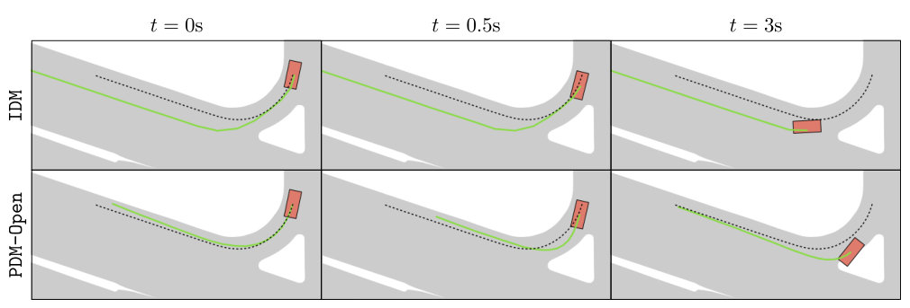
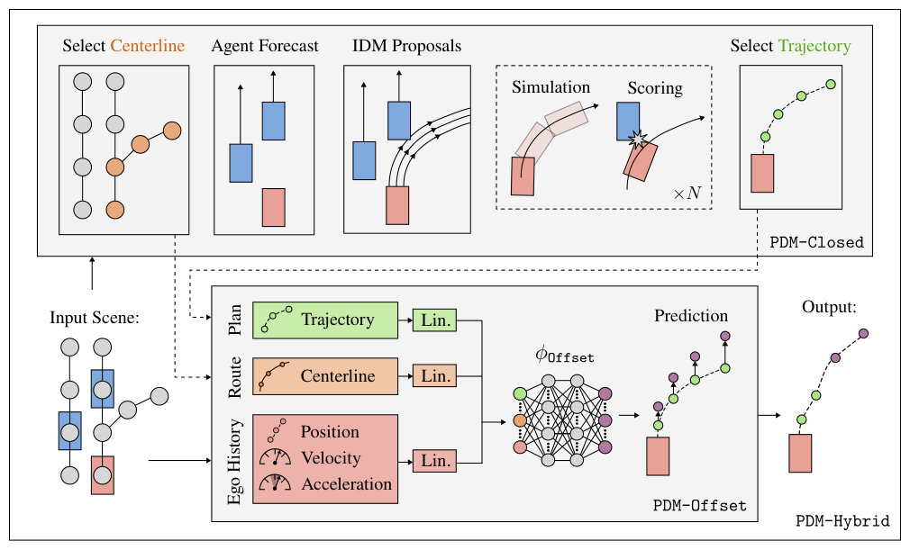

> **TL;DR** 저자들은 nuPlan benchmark에서, 사람 운전자가 어디로 갈지 예측하는 일(open-loop)과 실제로 잘 운전하는 일(closed-loop)이 서로 반대 방향으로 당긴다는 것을 보입니다. 20년 된 차량 추종 규칙인 IDM이 closed-loop에서 시험한 모든 학습 planner를 이기고, 이를 조금 확장한 PDM-Closed는 100점 만점에 92–93점을 받습니다. 차선 centerline만 보는 작은 network가 open-loop 점수 1위이고, 둘을 합친 PDM-Hybrid가 2023 nuPlan challenge에서 우승했습니다.

> **고전인 이유:** 주행 planning 커뮤니티가 가정을 다시 점검하게 만든 논문입니다. Open-loop 모방 점수는 운전 실력을 재지 못하고, rule-based baseline은 모든 표에 들어가야 합니다. PDM-Closed는 nuPlan의 표준 baseline이 되었고, 이후 NAVSIM benchmark는 주 metric 이름을 PDM Score로 지었습니다.

## 왜 이 논문인가

우리 연구실은 실제 차량에서 도는 planner를 만들고, 학습도 씁니다(IROS 2023, Sci. Rep. 2022의 imitation learning (모방 학습) 연구). 흔한 이야기는 "rule-based planner는 일반화가 안 되니 데이터로 planner를 학습하자"입니다. 이 논문은 최초의 대규모 실제 주행 planning benchmark에서 이 이야기를 시험하고, 대부분 틀렸다는 것을 보입니다. 학습 요소가 도움이 된다고 주장하기 전에 넘어야 할 기준이 이것입니다.

## 문제

**nuPlan**은 1,300시간의 실제 주행으로 만든 데이터 기반 시뮬레이터입니다. 시나리오는 15초이고, HD map과 완벽한 인식 결과가 주어집니다. 점수는 0에서 100 사이로 세 가지입니다.

- **OLS (open-loop score)**: 로그를 그대로 재생하고, planner의 8초 예측을 사람이 실제로 간 길과 비교해 채점합니다. 이것이 **ego-forecasting**입니다.
- **CLS-NR (closed-loop, non-reactive)**: planner가 운전하고, 다른 agent는 로그대로 움직입니다.
- **CLS-R (closed-loop, reactive)**: planner가 운전하고, 다른 차량은 IDM이 조종합니다.

Closed-loop 점수는 진행 거리, time-to-collision, 제한 속도 준수, 승차감을 보고, 여기에 페널티를 곱합니다. 내 잘못인 충돌이나 주행 가능 영역 이탈이 있으면 대개 그 시나리오는 0점입니다.

대부분의 학습 planner는 ego-forecaster로 학습됩니다. 즉 사람의 미래 trajectory를 모방합니다. 질문은 예측을 잘하면 운전도 잘하느냐입니다.

## 핵심 아이디어

두 과제를 따로 다루고, 각각 가장 단순한 도구를 씁니다.

- **운전(closed loop)**: model predictive control 맛을 조금 낸 rule-based planner입니다. 후보 trajectory 몇 개를 만들고, 시뮬레이션하고, 점수를 매겨, 가장 좋은 것을 고릅니다.
- **예측(open loop)**: 경로 centerline과 ego state만 보는 작은 MLP입니다.
- **둘 다**: 학습 모델은 controller가 실행하지 않는 trajectory의 먼 부분만 고칩니다.

바탕은 **Intelligent Driver Model**(IDM)입니다. 차선 centerline을 따라가며 가속도를 다음 식으로 정합니다.

dv/dt = a · (1 − (v / v₀)^δ − (s\* / s)²)

v₀는 목표 속도, s는 앞차와의 간격, s\*는 원하는 간격입니다.

## 작동 방식

**PDM-Closed**(운전):

1. **Centerline**: 경로를 따라 lane graph에서 그래프 탐색을 합니다.
2. **예측**: 다른 agent는 등속으로 움직인다고 봅니다. 8초, 10 Hz.
3. **Proposal**: 목표 속도 다섯 개(제한 속도의 20–100%) × 횡방향 offset 세 개(−1, 0, +1 m)로 IDM을 돌려 proposal 15개를 만듭니다. 각 4초 길이입니다.
4. **시뮬레이션**: 각 proposal을 nuPlan과 같은 방식으로 LQR controller와 kinematic bicycle model로 추종시킵니다. 그래서 planner는 이상적인 path가 아니라 차가 *실제로* 할 움직임에 점수를 매깁니다.
5. **점수**: nuPlan metric을 닮은 함수로 채점합니다.
6. **선택**: 가장 좋은 proposal을 8초까지 늘립니다. 가장 좋은 것도 2초 안에 충돌하면 급제동합니다.

**PDM-Open**(예측): centerline(120 m, 1 m 간격)과 2초간의 ego history가 폭 512의 hidden layer 두 개인 MLP로 들어갑니다. 8초 분량의 waypoint를 출력하고, 약 17만 7천 개 시나리오에서 L1 loss로 학습합니다.

**PDM-Hybrid**: 최종 waypoint = PDM-Closed waypoint + 학습된 offset이고, offset은 correction horizon C = 2 s 이후에만 더합니다. nuPlan controller는 처음 2초만 쓰므로 운전은 바뀌지 않지만, 8초 예측은 사람과 비슷해집니다.

## 결과

저자들은 leaderboard의 14개 시나리오 유형에서 1,118개 검증 시나리오를 뽑은 **Val14**를 정의합니다. 제출물은 Val14와 leaderboard에서 거의 같은 점수를 받았습니다.

| Planner | 입력 | CLS-R | CLS-NR | OLS | 시간 (ms) |
|---|---|---|---|---|---|
| Urban Driver | polygon | 50 | 53 | 82 | 64 |
| GC-PGP | lane graph | 55 | 59 | 83 | 100 |
| PlanCNN | raster | 72 | 73 | 64 | 43 |
| IDM | centerline | 77 | 76 | 38 | 27 |
| PDM-Open | centerline | 54 | 50 | **86** | 7 |
| PDM-Closed | centerline | **92** | **93** | 42 | 91 |
| PDM-Hybrid | centerline | **92** | **93** | 84 | 96 |
| Log replay (사람) | ground truth | 80 | 94 | 100 | - |

눈여겨볼 점:

- **IDM 하나가 가장 좋은 학습 planner를 이깁니다**(closed loop, CLS-R 77 대 72).
- **Trade-off는 실재합니다.** IDM의 최대 가속도를 1.0에서 0.1 m/s²로 낮추면 OLS는 38에서 48로 오르지만 CLS-R은 77에서 54로 떨어집니다. PDM-Open에서 centerline은 OLS를 72에서 86으로 올리지만, ego history는 OLS를 거의 못 올리면서 closed-loop 점수를 낮춥니다.
- **PDM-Closed는 reactive closed loop에서 사람 로그 재생보다도 높습니다**(92 대 80). nuPlan controller가 로그 trajectory에서 벗어나는 탓도 있는데, PDM-Closed는 controller의 실제 출력에 점수를 매기기 때문입니다.
- **Ablation**: 모든 waypoint를 보정하면(C = 0) OLS는 87이지만 CLS-R이 58로 떨어집니다. Agent 예측을 빼면 CLS-R이 6점, 횡방향이나 종방향 proposal 다양성을 빼면 3–4점 떨어집니다.
- **Challenge**: 초기 버전(PDM-Closed + GC-PGP)이 25개 팀 중 1위였고, 종합 점수는 90이었습니다.

## 한계

- **차선 변경이 없습니다.** nuPlan은 하다 만 차선 변경에 큰 페널티를 주므로, PDM은 아예 시도하지 않습니다.
- **특권 입력.** HD map과 완벽한 인식을 씁니다. Localization 오차도, 검출 오차도 없습니다.
- **시뮬레이터 하나.** Non-reactive agent는 ego 차량을 무시해서 너무 공격적이고, reactive agent는 IDM이라 centerline에 붙어 너무 소극적입니다.
- **PDM-Hybrid는 metric을 공략합니다.** 운전은 바꾸지 않고 OLS만 올립니다. 저자들이 말하려는 요점이지만, 더 나은 운전자가 아니라 benchmark의 산물입니다.
- **실차 시험은** 이 논문에 없습니다.

## DYROS 관점

**2026년의 독자가 가져갈 것.** 세 가지 습관입니다. 학습 planner는 closed loop로 평가하고, 위치 오차만으로 판단하지 않습니다. 강한 rule-based baseline을 항상 넣습니다. 후보에 점수를 매기기 *전에* 실제 controller와 차량 모델로 시뮬레이션합니다.

**우리 연구와의 연결.** PDM-Closed는 사실 작고 구조화된 sample 집합을 쓰는 sampling-based planner입니다. 규칙 family에서 나온 trajectory 15개를 시뮬레이션하고 채점합니다. 잘 고른 작은 집합이 학습 모델을 이길 수 있습니다. 우리의 learned sampler(IROS 2023, JKRS 2026)에 주는 교훈은, network가 시연을 얼마나 잘 재현하는지가 아니라 closed-loop 성공률과 planning 시간을 보고해야 한다는 것입니다.

**우리 차에서는 무엇이 깨질까.** 주차장과 캠퍼스 도로는 반정형 환경이고, PDM의 뼈대인 차선 centerline이 없는 경우가 많습니다. 우리에게 가장 가까운 것은 ITSC 2019 Rural Postman 연구에서 쓴 것 같은 주차 도로 그래프입니다. IDM에는 후진, 기어 변경, 여러 번 꺾기가 없으므로 PDM-Closed는 주차 planner가 아닙니다. 또 nuPlan의 완벽한 인식은 우리 AVM/SLAM 연구가 다루는 localization 문제를 정확히 가려 버립니다.

**일주일 안에 해 볼 수 있는 것.** CARLA에서 통로 주행용 PDM-Closed식 baseline을 만듭니다. 주차 도로 경로를 따라 여러 속도와 횡방향 offset으로 IDM proposal을 만들고, 우리 tracking controller로 시뮬레이션한 뒤 채점합니다. 이것을 우리 sampling-based planner, imitation learning policy와 closed loop에서 성공률, 충돌, 승차감으로 비교합니다.

**논문 기회.** PDM의 손으로 만든 proposal을 우리 것 같은 학습된 trajectory 분포의 sample로 바꾸고, "시뮬레이션 후 채점" 단계는 그대로 둡니다. 그리고 centerline proposal이 존재하지 않는 좁고 비정형인 공간에서 시험합니다. 학습된 분포의 open-loop 정확도가 closed-loop 주차 성공을 예측하는지는 아직 열려 있고, 측정하기도 쉬운 질문입니다.

## 용어 정리

- **Open-loop vs closed-loop 평가**: 재생되는 로그에 대해 예측을 채점하는 것과, planner가 시뮬레이션에서 실제로 운전하게 하는 것.
- **Ego-forecasting**: 내 차량의 미래 trajectory를 예측하는 일. 보통 사람 운전자를 모방합니다.
- **IDM (Intelligent Driver Model)**: 속도와 앞차 간격으로 가속도를 정하는 고전 차량 추종 규칙.
- **PDM-Closed / PDM-Open / PDM-Hybrid**: rule-based planner, centerline만 보는 예측 MLP, 그리고 둘의 결합.
