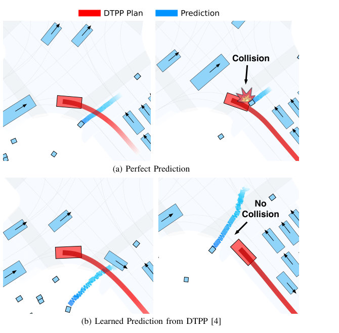
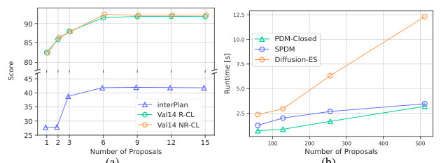

> **TL;DR** The authors take four planners that tightly couple prediction and planning and feed them the *true* future motion of other road users. Planning does not get better, and sometimes gets worse. They then show that the real bottleneck is the set of candidate trajectories ("proposals"): learned planners, diffusion included, produce worse candidates than a simple lane-following rule set, and adding a few spline-based lane-change proposals to that rule set raises the interPlan score from 41.88 to 63.66.

## Why this paper

A lot of recent planning work assumes that better prediction means better planning, and builds ever tighter "integrated prediction and planning" (IPP) systems. This paper runs the experiment nobody runs: give the planner a perfect crystal ball and see what happens.

It matters to us because it tests the core claim behind "learn where to sample". If the bottleneck is the quality and coverage of candidate trajectories, then the proposal distribution is the place to invest. That is the bet our IROS 2023 framework made, and this paper gives independent evidence for it on a large driving benchmark.

## The problem

Two questions:

1. Do IPP planners actually use predictions? If they did, perfect predictions should help.
2. If not prediction, what limits planning? The authors suspect the **proposal generator**, the part that suggests candidate ego trajectories before a scorer picks one.

They test on two nuPlan benchmarks: **Val14** (1,118 mostly simple scenes, many solvable by lane following) and **interPlan** (80 hand-modified long-tail scenes: nudging around parked vehicles, jaywalkers, lane changes in dense traffic).

## Key idea

Two controlled swaps, then one fix.

- **Swap the prediction**, keep the planner: learned predictions vs perfect predictions vs no predictions.
- **Swap the proposal generator**, keep the scorer: feed 15 proposals from each learned planner into the same PDM scoring function and compare against PDM's own 15 rule-based proposals.
- **Fix**: keep the scorer and improve the proposals with a cheap rule-based generator (SPDM).

Analogy: a chess player who misses good moves will not be saved by knowing the opponent's next move. They need to see better candidate moves first.

## How it works

**The IPP planners tested.**

- **DTPP**: grows a tree of ego trajectories from rule-based proposals; a Transformer predicts other agents conditioned on each ego branch; a learned cost (trained by inverse RL) ranks branches. Two expansion stages.
- **GameFormer**: a level-k game; Transformer decoders refine all agents' futures over 3 interaction levels.
- **DIPP**: a network predicts other agents and an initial ego plan; a differentiable optimizer refines the plan under costs for comfort, rules and safety.
- **GameFormer + DIPP**: GameFormer's predictions feed the DIPP optimizer.

**The prediction swap.** For the 10 nearest agents:

- learned/rule-based: whatever the method normally uses;
- perfect: the logged future (non-reactive) or the IDM agents' actual reaction to the ego plan (reactive; pedestrians use logs);
- none: all futures set to zero.

**The proposal swap.** Each learned method produces 15 ego proposals (GameFormer and GC-PGP retrained with 15 modes; Diffusion Planner sampled at temperature 1.5; an autoregressive GameFormer with nucleus sampling; Diffusion-ES with and without PDM's proposals as its initial set). The PDM scoring function, which mirrors the nuPlan metric, picks the best.

**SPDM (Spline-fitting PDM).**

1. PDM-Closed's proposals: an IDM car-follower along the current centerline with target speeds of 20/40/60/80/100% of the speed limit and lateral offsets of −1, 0, +1 m.
2. Added proposals for **every lane on the route**, not only the current one, with the same target speeds. The speed profile is a cubic v(t) = c0 + c1·t + c2·t² + c3·t³ with v(0) = current speed, v̇(0) = current acceleration, v(T) = target speed, v̇(T) = 0.
3. Each proposal is tracked with LQR on a kinematic bicycle model, then scored with the PDM score (collisions, TTC, progress, comfort, drivable area, direction). The best one is executed.

## Results

**Perfect predictions do not help** (nuPlan score; Val14 NR / R, interPlan R):

| Planner | Learned predictions | Perfect predictions | No predictions |
|---|---|---|---|
| DTPP | 64.54 / 68.23, 37.27 | 53.65 / 64.04, 25.12 | 51.09 / 54.81, 21.72 |
| GameFormer + DIPP | 79.83 / 80.95, 21.26 | 81.04 / 81.15, 19.00 | 58.14 / 51.14, 13.19 |
| DIPP | 73.35 / 77.65, 21.25 | 74.19 / 79.02, 12.90 | 49.58 / 56.86, 13.07 |
| PDM-Closed (const. velocity) | 92.84 / 92.28, 41.88 | 93.80 / –, – | 41.07 / 40.33, 30.63 |

- Removing predictions hurts every method, so predictions do carry information.
- But perfect predictions give at most a point or two on Val14, and **lower** scores on interPlan. DTPP drops by 11 points on Val14 NR.
- Only DTPP turns perfect predictions into fewer collisions on interPlan, and even it loses overall.

**Learned planners are weak proposal generators** (15 proposals each, PDM scorer picks; Val14 NR / R, interPlan R):

| Proposal generator | Val14 NR / R | interPlan R |
|---|---|---|
| PDM-Closed (rule-based) | **92.84 / 92.28** | 41.88 |
| Diffusion-ES\* (seeded with PDM proposals) | 75.98 / 79.92 | **57.41** |
| Diffusion-ES | 72.77 / 75.80 | 35.18 |
| Diffusion Planner | 91.26 / 91.13 | 25.76 |
| GameFormer + DIPP | 82.98 / 83.39 | 19.09 |
| GC-PGP | 58.40 / 63.82 | 14.55 |
| GameFormer | 42.95 / 40.30 | 3.95 |

- Diffusion Planner is nearly as good as PDM on easy Val14 but collapses on interPlan (25.76): its 15 samples lack the maneuvers the scene needs.
- The only learned method that does well on interPlan, Diffusion-ES\*, is seeded with PDM's rule-based proposals.

**Proposals, not prediction, move the needle.**

- PDM saturates at about 6 proposals; even 3 PDM proposals beat most learned planners. More of the *same kind* of proposal does not help (PDM-Closed with 60 proposals: 42.96 on interPlan).
- SPDM on interPlan: 42.00 (15 proposals) → 59.07 (30) → **63.66 (60)**, about +52% over PDM-Closed, while Val14 stays around 91.5–92.8.
- Runtime stays close to PDM-Closed as the proposal count grows, while Diffusion-ES grows much faster: read from the plot, about 12 s vs about 3.5 s at roughly 500 proposals.

## Limitations

- **Small hard set.** interPlan has 80 scenarios, so a few scenes move the score a lot.
- **"Perfect" in reactive mode means IDM.** The true future is how a simple IDM agent would react, which is a simulator artifact rather than real human behavior.
- **Learned costs meet unfamiliar inputs.** DTPP's cost was trained with its own predictions; ground truth is a distribution shift for it. The authors note the non-reactive case (in-distribution logs) shows no gain either, which weakens but does not kill this objection.
- **Scorer ≈ metric.** The PDM score closely tracks the nuPlan metric, so "generate many, pick with PDM" is partly optimizing the test metric directly.
- **SPDM needs lanes.** It relies on an HD map with route lanes and forward driving.
- Simulation only, no code link.

## DYROS lens

**Relation to our work.** This is the most direct support in this batch for the "learn where to sample" framing of our IROS 2023 work. In a propose-then-score planner, the proposal set is the bottleneck, and better prediction cannot compensate for missing maneuvers. Two honest twists, though:

- Their winning proposal generator is **rule-based**, not learned. Learned generators (including diffusion) mostly reproduce common, in-lane behavior and miss rare maneuvers. A learned sampling distribution has the same risk unless it is mixed with structured or uniform samples.
- The best learned result, Diffusion-ES\*, works because it starts from structured proposals. That is a hybrid of the two ideas, and it is the hybrid we should be building.

**Parking analogy.** TargetTree-RRT\* already does this: the target tree is a set of hand-built, high-quality continuous-curvature proposals near the slot, and the search connects to it. The paper's lesson in our language: structured proposals where the geometry is known, learned bias where it is not, and prediction used mainly as a collision check.

**What would break.** SPDM leans on lanes and forward motion. Parking aisles have weak lane structure, and the maneuvers include reverse and cusps.

**What we could try in a week.** Two cheap experiments in our simulator: (1) give our planner the true future of a car moving in the aisle vs a constant-velocity guess and measure whether success or time-to-park changes; (2) plot planning success vs number of samples for uniform, learned and target-tree samples, the parking version of their Figure 3a.

**Paper opportunity.** A small "interPlan for parking": long-tail interactive parking scenes (car backing out, pedestrian between cars, blocked aisle), used to compare proposal-centric and prediction-centric planners. Our planners and learned samplers would be natural baselines, and the paper's two-swap protocol (prediction swap, proposal swap) is a ready-made experimental design.

## Key terms

- **IPP (integrated prediction and planning)**: planners where predictions of other agents and the ego plan influence each other, instead of running in sequence.
- **Proposal**: a candidate ego trajectory that a scorer may select.
- **PDM-Closed**: a rule-based nuPlan planner that rolls out IDM lane-following proposals and picks one with a metric-like score.
- **SPDM**: this paper's extension of PDM with cubic-speed-profile proposals on every route lane.
- **IDM (Intelligent Driver Model)**: a car-following rule that sets acceleration from the gap and speed difference to the leader.
- **interPlan**: an 80-scene nuPlan-based benchmark of long-tail, highly interactive situations.
