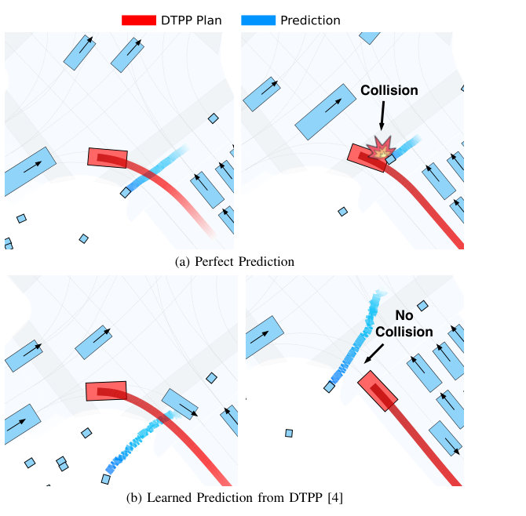
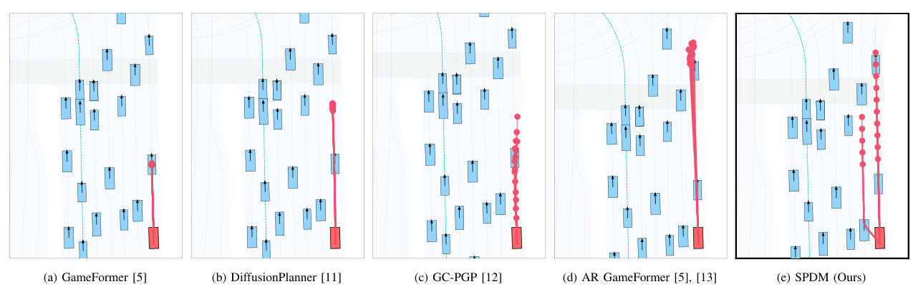
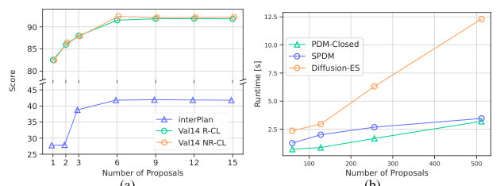

> **TL;DR** 저자들은 prediction과 planning을 긴밀하게 묶은 planner 네 개에 다른 도로 이용자의 *실제* 미래 움직임을 넣어 줍니다. Planning은 좋아지지 않고, 때로는 나빠집니다. 이어서 진짜 병목은 후보 trajectory("proposal") 집합이라는 것을 보입니다. Diffusion을 포함한 학습 기반 planner는 단순한 차선 추종 규칙 묶음보다 못한 후보를 만들고, 그 규칙 묶음에 spline 기반 차선 변경 후보 몇 개만 더해도 interPlan 점수가 41.88에서 63.66으로 오릅니다.

## 왜 이 논문인가

최근 planning 연구 상당수는 prediction(예측)이 좋아지면 planning도 좋아진다고 가정하고, 점점 더 긴밀한 "integrated prediction and planning"(IPP) 시스템을 만듭니다. 이 논문은 아무도 하지 않던 실험을 합니다. Planner에게 완벽한 수정 구슬을 주고 무슨 일이 생기는지 봅니다.

우리에게 중요한 이유는 "어디를 sampling할지 학습하기"의 핵심 주장을 시험하기 때문입니다. 병목이 후보 trajectory의 품질과 범위라면, 투자할 곳은 proposal 분포입니다. IROS 2023 framework가 건 것이 바로 그 내기이고, 이 논문은 큰 주행 benchmark에서 독립적인 근거를 줍니다.

## 문제

두 가지 질문입니다.

1. IPP planner는 prediction을 실제로 쓰는가? 쓴다면 완벽한 prediction은 도움이 되어야 합니다.
2. Prediction이 아니라면 무엇이 planning을 제한하는가? 저자들은 **proposal 생성기**를 의심합니다. Scorer가 하나를 고르기 전에 ego 후보 trajectory를 제안하는 부분입니다.

nuPlan benchmark 두 개에서 시험합니다. **Val14**(대부분 단순한 1,118개 장면, 상당수는 차선 추종만으로 풀림)와 **interPlan**(사람이 손본 80개 long-tail 장면: 주차된 차 비켜 가기, 무단횡단 보행자, 밀집 교통에서 차선 변경)입니다.

## 핵심 아이디어

통제된 교체 두 번, 그리고 해결책 하나입니다.

- **Prediction을 바꾸고** planner는 그대로: 학습된 prediction vs 완벽한 prediction vs prediction 없음.
- **Proposal 생성기를 바꾸고** scorer는 그대로: 학습 기반 planner마다 proposal 15개를 같은 PDM 점수 함수에 넣고, PDM 자신의 규칙 기반 proposal 15개와 비교합니다.
- **해결책**: scorer는 유지하고, 값싼 규칙 기반 생성기(SPDM)로 proposal을 개선합니다.

비유하자면, 좋은 수를 못 보는 체스 기사는 상대의 다음 수를 안다고 구원받지 못합니다. 먼저 더 좋은 후보 수를 볼 수 있어야 합니다.

## 작동 방식

**시험한 IPP planner.**

- **DTPP**: 규칙 기반 proposal로 ego trajectory tree를 키우고, Transformer가 ego 가지마다 다른 agent를 조건부로 예측하며, inverse RL로 학습한 비용이 가지 순위를 매깁니다. 확장 단계는 2번입니다.
- **GameFormer**: level-k 게임입니다. Transformer decoder가 상호작용 수준 3단계에 걸쳐 모든 agent의 미래를 다듬습니다.
- **DIPP**: network가 다른 agent와 초기 ego plan을 예측하고, 미분 가능한 최적화기가 승차감, 규칙, 안전 비용 아래에서 plan을 다듬습니다.
- **GameFormer + DIPP**: GameFormer의 prediction을 DIPP 최적화기에 넣습니다.

**Prediction 교체.** 가장 가까운 agent 10대에 대해:

- 학습/규칙 기반: 각 방법이 원래 쓰는 것
- 완벽: 기록된 미래(non-reactive) 또는 ego plan에 대한 IDM agent의 실제 반응(reactive, 보행자는 기록 사용)
- 없음: 모든 미래를 0으로 지움

**Proposal 교체.** 학습 기반 방법마다 ego proposal 15개를 만듭니다(GameFormer와 GC-PGP는 mode 15개로 재학습, Diffusion Planner는 temperature 1.5로 sampling, autoregressive GameFormer는 nucleus sampling, Diffusion-ES는 PDM proposal을 초기 집합으로 쓰는 경우와 쓰지 않는 경우). nuPlan 지표를 따라 하는 PDM 점수 함수가 가장 좋은 것을 고릅니다.

**SPDM (Spline-fitting PDM).**

1. PDM-Closed의 proposal: 현재 차선 중심선을 따르는 IDM 차량 추종, 목표 속도는 제한 속도의 20/40/60/80/100%, 횡방향 offset은 −1, 0, +1 m.
2. 현재 차선만이 아니라 **경로 위의 모든 차선**에 같은 목표 속도로 proposal을 추가합니다. 속도 프로파일은 3차식 v(t) = c0 + c1·t + c2·t² + c3·t³이고, v(0) = 현재 속도, v̇(0) = 현재 가속도, v(T) = 목표 속도, v̇(T) = 0입니다.
3. 각 proposal을 kinematic bicycle model 위에서 LQR로 추종하고, PDM 점수(충돌, TTC, 진행, 승차감, 주행 가능 영역, 방향)로 채점합니다. 가장 좋은 것을 실행합니다.

## 결과

**완벽한 prediction은 도움이 안 됩니다** (nuPlan 점수, Val14 NR / R, interPlan R):

| Planner | 학습된 prediction | 완벽한 prediction | Prediction 없음 |
|---|---|---|---|
| DTPP | 64.54 / 68.23, 37.27 | 53.65 / 64.04, 25.12 | 51.09 / 54.81, 21.72 |
| GameFormer + DIPP | 79.83 / 80.95, 21.26 | 81.04 / 81.15, 19.00 | 58.14 / 51.14, 13.19 |
| DIPP | 73.35 / 77.65, 21.25 | 74.19 / 79.02, 12.90 | 49.58 / 56.86, 13.07 |
| PDM-Closed (등속 가정) | 92.84 / 92.28, 41.88 | 93.80 / –, – | 41.07 / 40.33, 30.63 |

- Prediction을 없애면 모든 방법이 나빠지므로, prediction에 정보가 있는 것은 맞습니다.
- 그런데 완벽한 prediction은 Val14에서 기껏 1–2점을 더하고, interPlan에서는 점수를 **낮춥니다**. DTPP는 Val14 NR에서 11점 떨어집니다.
- 완벽한 prediction을 interPlan에서 충돌 감소로 바꾸는 것은 DTPP뿐이고, 그마저 전체 점수는 떨어집니다.

**학습 기반 planner는 약한 proposal 생성기입니다** (각 15개, PDM scorer가 선택, Val14 NR / R, interPlan R):

| Proposal 생성기 | Val14 NR / R | interPlan R |
|---|---|---|
| PDM-Closed (규칙 기반) | **92.84 / 92.28** | 41.88 |
| Diffusion-ES\* (PDM proposal로 시작) | 75.98 / 79.92 | **57.41** |
| Diffusion-ES | 72.77 / 75.80 | 35.18 |
| Diffusion Planner | 91.26 / 91.13 | 25.76 |
| GameFormer + DIPP | 82.98 / 83.39 | 19.09 |
| GC-PGP | 58.40 / 63.82 | 14.55 |
| GameFormer | 42.95 / 40.30 | 3.95 |

- Diffusion Planner는 쉬운 Val14에서는 PDM과 거의 같지만 interPlan에서는 무너집니다(25.76). Sample 15개에 장면이 요구하는 기동이 없습니다.
- interPlan에서 잘하는 유일한 학습 기반 방법인 Diffusion-ES\*는 PDM의 규칙 기반 proposal로 시작합니다.

**바늘을 움직이는 것은 prediction이 아니라 proposal입니다.**

- PDM은 proposal 6개 정도에서 포화되고, 3개만 써도 학습 기반 planner 대부분보다 낫습니다. *같은 종류*의 proposal을 늘려도 도움이 안 됩니다(proposal 60개 PDM-Closed: interPlan 42.96).
- interPlan에서 SPDM: 42.00(15개) → 59.07(30개) → **63.66(60개)**, PDM-Closed보다 약 52% 높고, Val14는 91.5–92.8 근처를 유지합니다.
- Proposal 수가 늘어도 실행 시간은 PDM-Closed와 비슷하게 유지되지만, Diffusion-ES는 훨씬 빨리 늘어납니다. 그래프에서 읽으면 proposal 약 500개에서 약 12초 vs 약 3.5초입니다.

## 한계

- **어려운 세트가 작습니다.** interPlan은 80개 장면이라 몇 장면이 점수를 크게 흔듭니다.
- **Reactive에서의 "완벽"은 IDM입니다.** 실제 미래가 단순한 IDM agent의 반응이므로, 실제 사람 행동이 아니라 시뮬레이터의 산물입니다.
- **학습된 비용이 낯선 입력을 만납니다.** DTPP의 비용은 자기 prediction으로 학습했으므로 정답 미래는 그에게 분포 이동입니다. 저자들은 non-reactive(분포 안의 기록) 경우에도 이득이 없다고 지적하는데, 이 반론을 약하게 할 뿐 없애지는 못합니다.
- **Scorer ≈ 지표.** PDM 점수는 nuPlan 지표를 가깝게 따르므로, "많이 만들고 PDM으로 고르기"는 부분적으로 시험 지표를 직접 최적화하는 셈입니다.
- **SPDM은 차선이 필요합니다.** 경로 차선이 있는 HD map과 전진 주행에 기댑니다.
- 시뮬레이션만 했고, code 링크가 없습니다.

## DYROS 관점

**우리 연구와의 관계.** 이번 묶음에서 IROS 2023 연구의 "어디를 sampling할지 학습하기" 관점을 가장 직접적으로 지지하는 논문입니다. 제안하고 채점하는 planner에서 병목은 proposal 집합이고, 더 좋은 prediction은 빠진 기동을 메워 주지 못합니다. 다만 정직하게 짚을 반전이 두 가지 있습니다.

- 이긴 proposal 생성기는 학습이 아니라 **규칙 기반**입니다. 학습 기반 생성기(diffusion 포함)는 흔한 차선 내 행동을 주로 재현하고 드문 기동을 놓칩니다. 학습된 sampling 분포도 구조적 sample이나 uniform sample과 섞지 않으면 같은 위험이 있습니다.
- 학습 기반 중 최고인 Diffusion-ES\*가 잘되는 이유는 구조적 proposal에서 출발하기 때문입니다. 두 아이디어의 hybrid이고, 우리가 만들어야 할 것도 그 hybrid입니다.

**주차에 비유하면.** TargetTree-RRT\*가 이미 이렇게 합니다. Target tree는 주차 칸 근처에 미리 만든 고품질 continuous-curvature proposal 집합이고, 탐색이 거기에 연결됩니다. 이 논문의 교훈을 우리 말로 옮기면, 기하가 알려진 곳에는 구조적 proposal을, 모르는 곳에는 학습된 bias를 쓰고, prediction은 주로 충돌 검사에 씁니다.

**무엇이 깨질까.** SPDM은 차선과 전진 주행에 기댑니다. 주차장 통로는 차선 구조가 약하고, 기동에는 후진과 cusp가 들어갑니다.

**일주일 안에 해 볼 수 있는 것.** 시뮬레이터에서 값싼 실험 두 개를 합니다. (1) 통로에서 움직이는 차의 실제 미래 vs 등속 가정을 우리 planner에 주고, 성공률이나 주차 시간이 달라지는지 잽니다. (2) uniform sample, 학습된 sample, target-tree sample에 대해 sample 수에 따른 planning 성공률을 그립니다. 논문 Figure 3a의 주차 버전입니다.

**논문 기회.** 작은 "주차판 interPlan"입니다. Long-tail 상호작용 주차 장면(후진으로 빠져나오는 차, 차 사이의 보행자, 막힌 통로)을 만들어 proposal 중심 planner와 prediction 중심 planner를 비교합니다. 우리 planner와 learned sampler가 자연스러운 baseline이 되고, 이 논문의 두 가지 교체 실험(prediction 교체, proposal 교체)이 그대로 실험 설계가 됩니다.

## 용어 정리

- **IPP (integrated prediction and planning)**: 다른 agent의 prediction과 ego plan이 순서대로 돌지 않고 서로 영향을 주는 planner.
- **Proposal**: scorer가 고를 수 있는 ego 후보 trajectory.
- **PDM-Closed**: IDM 차선 추종 proposal을 굴려 보고 지표와 비슷한 점수로 하나를 고르는 규칙 기반 nuPlan planner.
- **SPDM**: 경로 위 모든 차선에 3차 속도 프로파일 proposal을 더한, 이 논문의 PDM 확장.
- **IDM (Intelligent Driver Model)**: 앞차와의 간격과 속도 차로 가속도를 정하는 차량 추종 규칙.
- **interPlan**: long-tail, 고상호작용 상황 80개로 만든 nuPlan 기반 benchmark.
