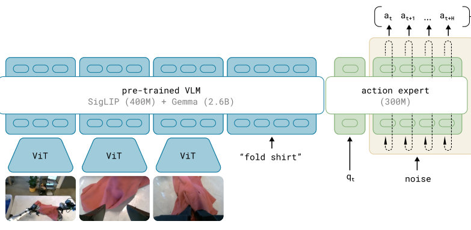
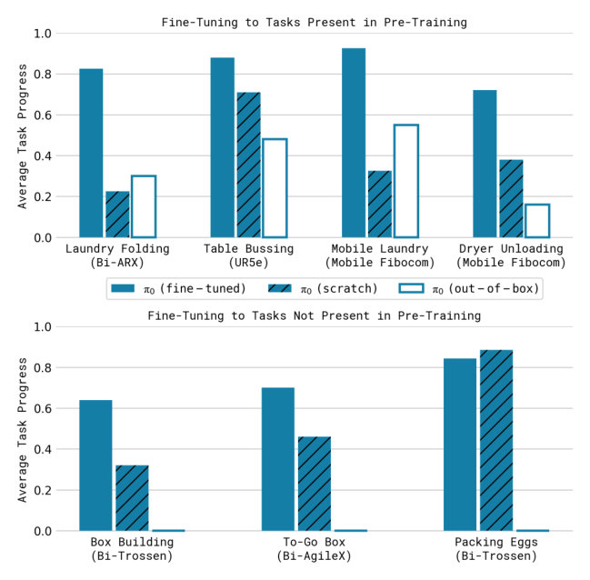

> **TL;DR** π0는 이미 이미지와 글을 이해하는 3B vision-language model (VLM)에 300M짜리 "action expert"를 붙입니다. Action expert는 flow matching으로 노이즈를 연속적인 로봇 action 50 step짜리 chunk로 바꿉니다. 7종 로봇의 약 10,000시간 데이터로 사전 학습하고 선별한 과제 데이터로 fine-tuning하면, 구겨진 빨래 더미에서 옷을 꺼내 개고, 식탁을 치우고, 상자를 조립합니다. 이전 로봇 foundation model들이 하지 못한 과제입니다.
>
> **고전인 이유:** 2026년 연구 대부분이 따르는 vision-language-action (VLA) 모델의 틀을 정했습니다. VLM backbone, diffusion 계열 head가 내는 연속 action chunk, 그리고 LLM 같은 pre-training / post-training 레시피입니다. 모델 가중치가 공개되면서 "로봇 foundation model을 fine-tuning한다"가 대학 연구실에도 현실적인 선택지가 되었습니다.

## 왜 이 논문인가

요즘 로봇 연구실이라면 "그냥 VLA를 쓰면 되지 않나?"라는 질문을 받습니다. 답하기 전에 읽어야 할 논문이 π0입니다. Diffusion Policy의 action chunk를 가져오고, diffusion을 flow matching으로 바꾸고, 둘을 인터넷 규모로 사전 학습된 모델 위에 올렸습니다. DYROS에서 관련된 쪽은 휴머노이드 manipulation(조작)이고, 정직한 질문은 어떤 부분이 연구실 규모에서 통하느냐입니다.

## 문제

범용 로봇 policy는 데이터 부족, 약한 일반화, 쉽게 깨지는 동작이라는 문제를 안고 있습니다. 기존 모델은 두 갈래였고, 각자 절반만 풀었습니다.

- **이전 VLA**(OpenVLA 등)는 VLM이 action을 글자 같은 이산 token으로 하나씩 내게 합니다. 의미 지식은 물려받지만, token 단위 action은 느리고 거칠어서 action chunk도, 높은 제어 주기도 없습니다.
- **작은 imitation policy**(ACT, Diffusion Policy)는 매끄럽고 정교한 action chunk를 내지만, 과제마다 따로 학습하고 시연 밖의 것은 모릅니다.

## 핵심 아이디어

재료는 세 가지입니다.

1. **VLM에서 시작합니다.** PaliGemma(SigLIP 이미지 encoder + Gemma 2.6B 언어 모델)가 물체와 언어에 대한 인터넷 규모의 지식을 가져옵니다.
2. **Flow matching으로 학습하는 action expert를 붙입니다.** 로봇 상태와 action token은 VLM token을 attention으로 보는 별도의 작은 transformer 가중치(300M)를 거칩니다. 출력은 연속 action H = 50개짜리 chunk입니다.
3. **넓게 사전 학습하고, 좁게 후속 학습합니다.** LLM과 같습니다. 다양하고 불완전한 데이터는 넓은 기술과 복구 동작을 가르치고, 작지만 질 좋은 데이터는 한 과제를 매끄럽게 하는 법을 가르칩니다.

**Flow matching**을 한 문단으로: diffusion의 가까운 친척입니다. 실제 action chunk A와 노이즈 ε를 Aτ = τA + (1 − τ)ε로 섞습니다. 네트워크는 어떤 섞인 상태에서든 직선 방향 A − ε를 예측하도록 학습합니다. 실행할 때는 노이즈에서 출발해 예측한 방향으로 Euler step을 10번 밟습니다. Diffusion만큼 multimodal 분포를 잘 표현하면서, 수식이 더 단순하고 단계가 적습니다.

## 작동 방식

**관측.** RGB 이미지 2–3장, 언어 명령, 관절 각도. 이미지와 상태는 단어와 같은 token 공간으로 투영됩니다.

**모델 하나, 로봇 여러 대.** 상태와 action 벡터는 18차원(6-DoF 팔 두 개, 그리퍼 두 개, 이동 베이스, 몸통 승강)까지 0으로 채우고, 없는 카메라 칸은 mask합니다. 7가지 구성은 UR5e 한 대부터 양팔 로봇, 이동 manipulator까지입니다.

**데이터.**

- 자체 수집한 정교한 조작 데이터 903M timestep(한 팔 106M, 양팔 797M), 68개 과제. 여기서 "식탁 치우기" 같은 과제 하나는 수많은 물체를 포함합니다.
- 공개 데이터셋(OXE, Bridge v2, DROID)이 학습 혼합의 9.1%입니다.
- Post-training은 쉬운 과제에 5시간, 가장 어려운 과제에 100시간 이상을 씁니다.

**속도.** 이미지와 텍스트 prefix는 한 번만 계산해 cache하고, flow step 10번마다 action token만 다시 계산합니다. RTX 4090에서 한 번 호출에 73 ms입니다(이미지 14 ms, prefix 32 ms, flow step 10번 합쳐 27 ms). Chunk는 open-loop로 실행합니다. 50 Hz 로봇은 0.5 s(25 action)마다, 20 Hz 팔은 0.8 s마다 다시 계획합니다. 겹치는 chunk를 섞는 temporal ensembling은 오히려 성능을 *떨어뜨렸습니다*.

**상위 policy.** 긴 과제에서는 별도의 VLM이 "식탁을 치워"를 "냅킨을 집어" 같은 명령으로 쪼갭니다.

## 결과

모든 평가는 실제 로봇에서, 과제당 10번 시도의 평균이며 부분 점수를 줍니다.

**바로 쓰기**(사전 학습만, 셔츠 개기, 식탁 치우기 두 종류, 장보기 짐 싸기, 토스트 꺼내기): π0가 모든 과제에서 가장 좋고, 셔츠 개기와 쉬운 식탁 치우기는 거의 완벽합니다. OpenVLA(7B)와 Octo(93M)는 같은 데이터 혼합으로 더 적은 step만 학습했기 때문에, 저자들은 700k 대신 160k step만 학습한 "parity" π0도 만들었습니다. 이것도 둘 다 이깁니다. VLM이 없는 π0-small(470M)조차 7B인 OpenVLA를 이기므로, 크기만으로 설명되는 결과가 아닙니다.

**언어.** π0는 단계별 명령을 π0-small보다 훨씬 잘 따릅니다. 사람이 준 명령이 가장 도움이 되고, 상위 VLM의 명령은 그보다 덜 도움이 됩니다.

**1–10시간 데이터로 배우는 새 과제**(예: 전자레인지에 반찬통 넣기, 키친타월 교체): π0가 ACT, Diffusion Policy, OpenVLA, Octo보다 대체로 좋습니다. 사전 학습에서 시작한 fine-tuning이 처음부터 학습한 것보다 좋고, 때로는 2배 차이가 납니다. 눈여겨볼 점은 가장 강한 baseline이 처음부터 학습한 ACT와 Diffusion Policy였다는 것입니다. 사전 학습된 OpenVLA와 Octo는 여기서 사전 학습의 덕을 보지 못했습니다.

**복잡한 과제.** Fine-tuning한 π0는 일곱 과제 모두에서 최대 점수의 50%를 넘기며, 그중에는 5–20분이 걸리는 과제도 있습니다. 막대를 읽으면 빨래 개기는 약 0.8 대 처음부터 학습한 경우 약 0.2, 상자 조립은 약 0.6 대 약 0.3입니다. 계란 담기에서는 처음부터 학습한 것이 fine-tuning과 비슷하게 좋아서, 사전 학습이 모든 과제에 도움이 되지는 않습니다.

## 한계

- **연구실 규모로 재현할 수 없습니다.** 10,000시간 데이터셋은 비공개이고, 3.3B 모델을 700k step 사전 학습했습니다.
- **작은 실제 평가.** 과제당 10번, 자체 채점 기준, 가장 어려운 과제는 주로 자기 ablation과만 비교합니다.
- **섞인 비교.** π0-small은 크기와 VLM 초기화가 모두 달라서, VLM의 정확한 기여를 알기 어렵습니다.
- **열린 질문**(저자들이 밝힌 것): 어떤 데이터가 도움이 되는지, 과제에 데이터가 얼마나 필요한지, 전이가 어디까지 되는지.
- **범위.** 팔과 이동 manipulator만 다룹니다. 저자들은 자율주행, 내비게이션, 보행 로봇을 명시적으로 열린 문제로 남깁니다.
- **반응성.** Chunk는 0.5–0.8 s 동안 open-loop로 실행됩니다.

## DYROS 관점

**2026년에 가져갈 것.** VLA의 틀입니다. 사전 학습된 VLM, 연속 action head(flow matching 또는 diffusion), action chunk, 그리고 pre-training / post-training. 가중치가 공개(openpi)되어 있어서, 연구실은 보통 사전 학습 대신 기본 모델을 *fine-tuning*합니다.

**휴머노이드, 현실적으로.**

- 우리 teleoperation 데이터 1–10시간으로 fine-tuning하는 것은 해 볼 만합니다. 논문에서도 쉬운 과제는 1–5시간으로 배웠습니다. 추론은 4090급 GPU 한 장에서 73 ms입니다.
- 휴머노이드는 새로운 embodiment입니다. π0의 action 벡터는 18차원에서 끝나고, 균형을 잡는 로봇은 하나도 없습니다. VLA는 상체나 end-effector 목표에 쓰고, 그 아래에는 model-based whole-body controller를 두는 것이 맞습니다. 바로 DYROS의 휴머노이드 제어 역량이 자산이 되는 자리입니다.

**자동차.** π0는 주행을 다루지 않고, 3B VLM은 주차용 차량 컴퓨터에 무겁습니다. 옮겨 올 것은 action head 아이디어입니다. 싼 step 10번 정도로 trajectory chunk를 내는 작은 flow matching head는 학습 기반 주차 sampler에서 diffusion sampler를 대신할 수 있습니다. 레시피도 옮길 수 있습니다. Planner로 만든 데이터로 여러 시뮬레이션 주차장에서 사전 학습하고, 실제 주차장 로그로 post-training합니다.

**일주일 안에 해 볼 실험.** 공개된 π0 기본 모델을 휴머노이드 상체 pick-and-place 과제 하나의 teleop 데이터 약 1시간으로 fine-tuning하고, 같은 데이터로 Diffusion Policy를 처음부터 학습합니다. π0가 본 적 없는 embodiment에서 논문의 fine-tuning 질문, 즉 사전 학습이 여전히 도움이 되는가를 묻는 실험입니다.

**논문 기회.** Action이 whole-body controller의 입력이 되는 VLA를 만들고, 새 휴머노이드에 fine-tuning 데이터가 얼마나 적게 필요한지로 평가합니다.

## 용어 정리

- **VLA (vision-language-action model)**: 로봇 action까지 출력하도록 확장한 vision-language model.
- **Flow matching**: 노이즈를 데이터 쪽으로 옮기는 속도를 예측하도록 학습하고, 실행할 때 이를 적분하는 생성 방법.
- **Action expert**: 로봇 상태와 action token을 처리하는 π0의 별도의 작은 transformer 가중치.
- **Cross-embodiment training**: 여러 종류의 로봇 데이터로 하나의 모델을 학습하는 것.
- **Pre-training / post-training**: 크고 다양한 데이터로 넓게 학습한 뒤, 작고 질 좋은 데이터로 특화하는 것.
