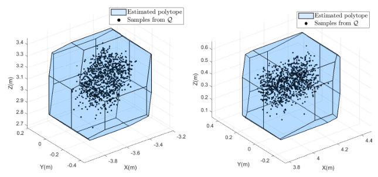
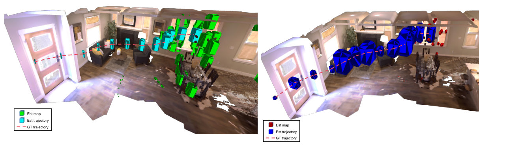

> **TL;DR** Instead of a covariance ellipse that *probably* contains the true pose, this paper computes polytopes (shapes with flat faces) that *provably* contain the true poses and landmarks of a 3D-3D landmark SLAM, as long as the per-point measurement bounds hold. Conformal prediction sets those bounds from data with a chosen probability. It is slow and the sets grow fast without loop closure, but it extends guaranteed uncertainty from a single pose to a whole SLAM pipeline.

## Why this paper

Before committing to the final parking maneuver, a planner needs to know whether the car is within, say, 10 cm and 1° of where SLAM says. Standard SLAM answers with a covariance from the Hessian, an approximation that is often overconfident. This paper answers with a set that comes with a proof.

## The problem

**Covariance, in plain words.** Say localization reports x = 10.00 m with standard deviation σ = 0.05 m (covariance σ² = 0.0025 m²). That describes a bell curve: the true x should lie in [9.85, 10.15] (±3σ) about 99.7% of the time. In 2D or 3D the same idea gives an ellipse or ellipsoid. In SLAM, σ usually comes from the inverse Hessian (Fisher information) at the optimum. Three problems: real errors are often not Gaussian; the Hessian approximation tends to *underestimate* uncertainty; and the ellipse carries no formal guarantee.

**Set-membership estimation (SME).** Assume only that each measurement error is bounded. Two readings of x: 10.10 ± 0.20 → [9.90, 10.30], and 9.95 ± 0.20 → [9.75, 10.15]. The true x must be in both, so it lies in [9.90, 10.15]. If the bounds are right, the guarantee is absolute. No distribution needed.

**Where do the bounds come from? Conformal prediction (CP).** Collect L calibration errors (estimate vs. ground truth), sort them, and take the ⌈(1−δ)(L+1)⌉-th smallest as the bound. Example: L = 99 and δ = 0.1 give the 90th smallest error. If calibration and test data are *exchangeable* (roughly, drawn from the same process), the next error stays below that bound with probability ≥ 1−δ. No Gaussian assumption.

**The hard part.** Guaranteed methods existed for a single pose, but SLAM chains everything: points set the pose, the pose places new landmarks, poses compound over time. The exact set of possible SE(3) poses is nonconvex and hard to compute, with rotation and translation errors coupled.

## Key idea

Represent every uncertainty set as a **polytope**: the set of x with Ax ≤ b, a shape bounded by flat faces, like a cut gem. Polytopes are closed under the operations SLAM needs (linear maps, sums, intersections), they are linear constraints that solvers handle well, and one polytope over the 12 numbers of a pose (9 entries of R plus t) keeps rotation and translation coupled.

SLAM is then built from three primitives. In each, the outer bound is computed so that if the input sets contain the truth, the output set does too.

1. **Forward UQ (mapping).** Known: a pose set and a local point set. Wanted: where the point is in the world, q = Rp + t. Fix the face directions of the output polytope in advance; for each direction, find the farthest q can reach. That is a nonconvex problem (bilinear in R and p, and R ∈ SO(3)), so they solve its SDP relaxation, whose answer is never smaller than the true maximum. A slightly too-large face is still safe. A lemma shows only the vertices of the point polytope need checking.
2. **Backward UQ (pose tracking).** Known: a point's local set and its world set. Wanted: all poses that map one onto the other. Trick: pick the Chebyshev center s of the local set (center of the smallest enclosing ball, radius r) and inflate the world polytope by r. Then A(Rs + t) ≤ b + r is *linear* in the pose, and the whole step takes 3.6 ms. They prove this is the tightest set possible in that template.
3. **Pose compound.** T₃ = T₁T₂ (chain a relative pose onto the previous global pose). Direct method: an SDP per face, tight but slow. Indirect method: bound rotation by a geodesic ball, where angles simply add (θ₃ = θ₁ + θ₂), and bound translation in closed form. Faster, looser.

## How it works

1. **Point bounds.** For each stereo-triangulated point, CP calibrates a bound on the covariance-scaled error ‖p̂ − p‖_Σ. Scaling by Σ matters because far points are much noisier; it keeps the calibration scores comparable. The resulting ellipsoid is wrapped in the smallest polytope with fixed face directions.
2. **Localization**, two options. *Relative*: backward UQ on frame-to-frame matches, then compound with the previous global pose set. *Global*: backward UQ directly against map landmarks.
3. **Mapping.** Forward UQ puts each new landmark in the world.
4. **Loop closure smoothing.** Alternate forward UQ (refine landmarks from all frames that see them) and backward UQ (refine poses from all visible landmarks). Sets only shrink, so this converges; they stop after at most three rounds. Bonus: an *empty* set means the constraints contradict each other, which flags a wrong loop closure.

## Results

**Backward UQ vs. pose-only methods** (6 random trials, 1,000 samples from the true pose set). Share of samples inside the estimated set:

| Method | Trials 1–6 |
|---|---|
| CLOSURE (inner approximation) | 87.1, 59.6, 32.8, 71.3, 73.2, 10.4% |
| GRCC (outer approximation) | 100% in all six |
| **Ours** | **100% in all six** |

Their full pose set is about as tight as CLOSURE's and tighter than GRCC's. Forward UQ and both compound methods also kept every sample inside; the direct compound is the tighter one.

**SLAM simulation** (landmarks in a 50 m cube, circular trajectory, 60° field of view, 0.5–5 m depth). Every ground-truth pose and landmark stayed inside its set. In the relative framework, sets grow along the trajectory, and faster with the indirect compound. The global framework is much tighter, because re-observing old, well-bounded landmarks pins the pose. Loop closure smoothing shrinks everything sharply.

Against a linear-Gaussian baseline with 99% ellipsoids (global framework, ≈15 points per frame, by frame 20), **the baseline missed the truth for 9 of 20 poses and 26 of 120 map points**; the polytopes contained all of them. The baseline's sets were usually smaller. With only ≈5 points per frame in the relative framework, its translation ellipsoid volume reached 3.12 by frame 30 versus 1.2 for the polytope.

**Runtime** (MATLAB, ≈19 points per frame): backward UQ 0.0036 s, indirect compound 0.5 s, forward UQ 9.3 s, direct compound 12 s, loop smoothing 29.55 s per frame. The repeated SDPs are the bottleneck.

**Replica** (rendered indoor scenes, RGB-D, ORB matches, δ = 0.01, 15 correspondences per frame, no loop closure): the sets enclose the ground truth and widen quickly over time.

## Limitations

- **Not real time.** Seconds per frame for forward UQ and direct compound, in MATLAB.
- **Sets grow fast** without loop closure; the authors list tighter SDPs and sliding-window bundle adjustment as future work.
- **Outliers.** The Replica run filters matches with RANSAC, and builds calibration data with the ground-truth relative pose. Outliers are allowed if they occur the same way in calibration and test, but then bounds get looser; any point whose true error escapes its bound can push the true pose out of the set. A wrong loop closure can shrink sets onto the wrong answer (or to an empty set).
- **The probability is per point.** CP gives each point's bound a 1−δ chance; the paper does not spell out the joint probability that all points in a frame hold at once, which is lower.
- **Scope.** 3D-3D landmark SLAM only (no IMU, no wheel odometry), tested in simulation and a rendered dataset. CP also needs test conditions to match calibration: a new garage or lighting can quietly void the bound.

## DYROS lens

**The go/no-go gate.** This paper answers "is localization good enough to start the final parking maneuver?" most directly. A covariance says "probably within 10 cm." A polytope says "within this region, guaranteed if the point bounds hold." Project the pose set onto the ground plane and compare it with the slot clearance: if the worst-case lateral offset and heading error fit inside the margin TargetTree-RRT\* needs, commit; if not, creep forward and collect more landmarks (pillar corners, parking-line corners) until the set shrinks.

Polytopes also suit a planner: they are linear constraints, so robust collision checking is just inflating the car footprint by the translation set and sweeping it over the rotation bound.

**What would change for us.** Our car moves in SE(2), and AVM gives metric bird's-eye points on the ground. With 3 degrees of freedom instead of 6, every SDP gets much smaller, so real time looks plausible. The hard part is calibration data: CP needs ground-truth errors from the same kind of garage, so a few runs need a reference localization (an offline LiDAR map, a total station). And repeated parking-line corners make wrong correspondences common, so a robust front-end must run *before* this guarantee means anything.

**What we could try in a week.** Implement 2D backward UQ with AVM parking-line corners as landmarks, CP bounds from logged runs with reference poses, and compare the pose polytope near the slot with our weighted GICP covariance on held-out runs: size and containment rate.

**Paper opportunity.** "Guaranteed localization sets for parking": an SE(2), real-time version with AVM landmarks, used as a hard gate and as robust constraints for the final maneuver. It would also force an answer to the open question this paper leaves: how to keep the guarantee with outliers present.

## Key terms

- **Covariance**: the spread of a Gaussian error model; its ellipse is an approximate, unguaranteed confidence region.
- **Set-membership estimation (SME)**: the set of all states consistent with bounded measurement errors.
- **Conformal prediction (CP)**: turns calibration errors into a bound that holds with probability ≥ 1−δ, with no distribution assumed.
- **Polytope**: a bounded set {x : Ax ≤ b} with flat faces.
- **Chebyshev center**: the center of the smallest ball enclosing a set.
