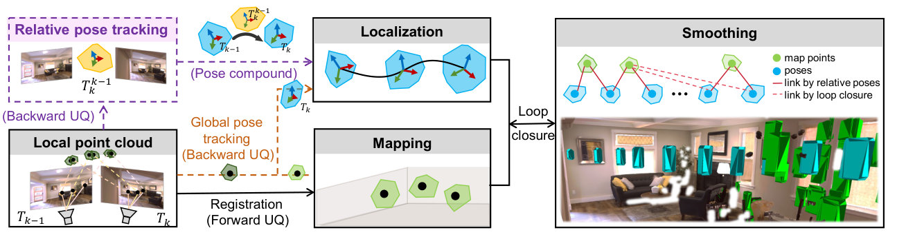
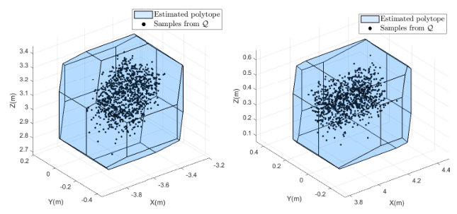
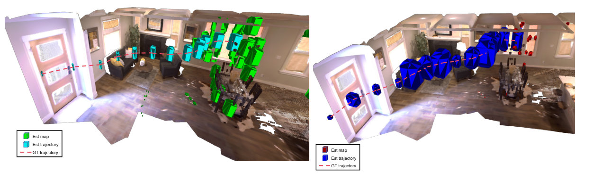

> **TL;DR** 이 논문은 실제 pose를 *아마도* 포함하는 covariance (공분산) 타원 대신, 3D-3D landmark SLAM의 실제 pose와 landmark를 *증명 가능하게* 포함하는 polytope (다면체, 평평한 면으로 둘러싸인 도형)를 계산합니다. 조건은 점마다 주어진 측정 오차 범위가 맞는 것이고, 그 범위는 conformal prediction이 데이터로부터 원하는 확률로 정합니다. 느리고 loop closure가 없으면 집합이 빨리 커지지만, 보장된 불확실성을 pose 하나에서 SLAM 전체로 넓힌 연구입니다.

## 왜 이 논문인가

마지막 주차 기동을 시작하기 전에, planner는 차가 SLAM이 말하는 위치에서 예를 들어 10 cm, 1° 안에 있는지 알아야 합니다. 일반적인 SLAM은 Hessian으로 구한 covariance로 답합니다. 근사이고, 자주 과신합니다. 이 논문은 증명이 딸린 집합으로 답합니다.

## 문제

**Covariance를 쉬운 말로.** Localization이 x = 10.00 m, 표준편차 σ = 0.05 m(covariance σ² = 0.0025 m²)라고 알려 준다고 합시다. 이것은 종 모양 분포를 뜻합니다. 실제 x는 약 99.7% 확률로 [9.85, 10.15](±3σ) 안에 있어야 합니다. 2D나 3D에서는 같은 생각이 타원이나 타원체가 됩니다. SLAM에서 σ는 보통 최적해에서의 Hessian 역행렬(Fisher information)에서 나옵니다. 문제가 세 가지 있습니다. 실제 오차는 Gaussian이 아닌 경우가 많고, Hessian 근사는 불확실성을 *과소평가*하는 경향이 있으며, 타원에는 형식적인 보장이 없습니다.

**Set-membership estimation (SME, 집합 소속 추정).** 측정 오차가 어떤 범위 안에 있다는 것만 가정합니다. x를 두 번 잽니다. 10.10 ± 0.20 → [9.90, 10.30], 9.95 ± 0.20 → [9.75, 10.15]. 실제 x는 둘 다에 들어야 하므로 [9.90, 10.15]에 있습니다. 범위가 맞다면 보장은 절대적입니다. 분포 가정이 필요 없습니다.

**범위는 어디서 오나? Conformal prediction (CP).** 보정용 오차(추정값 대 실제값) L개를 모아 정렬하고, ⌈(1−δ)(L+1)⌉번째로 작은 값을 범위로 씁니다. 예: L = 99, δ = 0.1이면 90번째로 작은 오차입니다. 보정 데이터와 시험 데이터가 *exchangeable*하면(대략 같은 과정에서 나온다면), 다음 오차가 그 범위 아래일 확률이 1−δ 이상입니다. Gaussian 가정이 없습니다.

**어려운 점.** pose 하나에 대한 보장 방법은 이미 있었습니다. 하지만 SLAM은 모든 것이 이어집니다. 점이 pose를 정하고, pose가 새 landmark를 놓고, pose가 시간에 따라 누적됩니다. 가능한 SE(3) pose의 정확한 집합은 nonconvex라 계산이 어렵고, 회전과 이동 오차가 서로 얽혀 있습니다.

## 핵심 아이디어

모든 불확실성 집합을 **polytope**로 표현합니다. Ax ≤ b를 만족하는 x의 집합, 즉 보석처럼 평평한 면으로 둘러싸인 도형입니다. Polytope는 SLAM에 필요한 연산(선형 변환, 합, 교집합)을 해도 polytope로 남고, solver가 잘 다루는 선형 제약이며, pose의 12개 숫자(R의 9개 원소와 t)에 대한 polytope 하나로 회전과 이동의 얽힘을 그대로 담습니다.

SLAM은 세 가지 기본 연산으로 만들어집니다. 각 연산은 입력 집합이 실제값을 포함하면 출력 집합도 포함하도록 바깥 경계를 계산합니다.

1. **Forward UQ (mapping).** 알려진 것: pose 집합과 로컬 점 집합. 구할 것: 그 점의 세계 좌표 q = Rp + t. 출력 polytope의 면 방향을 미리 정해 두고, 방향마다 q가 닿을 수 있는 가장 먼 거리를 찾습니다. R과 p의 곱이 있고 R ∈ SO(3)이라 nonconvex 문제이므로 SDP relaxation을 풉니다. 그 답은 실제 최댓값보다 절대 작지 않습니다. 면이 조금 크면 여전히 안전합니다. 점 polytope의 꼭짓점만 확인하면 된다는 lemma도 있습니다.
2. **Backward UQ (pose tracking).** 알려진 것: 한 점의 로컬 집합과 세계 집합. 구할 것: 하나를 다른 하나로 옮기는 모든 pose. 요령은 이렇습니다. 로컬 집합의 Chebyshev center s(가장 작은 외접구의 중심, 반지름 r)를 잡고 세계 polytope를 r만큼 부풀립니다. 그러면 A(Rs + t) ≤ b + r이 pose에 대해 *선형*이 되고, 이 단계 전체가 3.6 ms면 끝납니다. 이 형태 안에서는 가장 작은 집합이라는 것도 증명합니다.
3. **Pose compound.** T₃ = T₁T₂(상대 pose를 직전 global pose에 잇기). Direct 방법은 면마다 SDP를 풀어 tight하지만 느립니다. Indirect 방법은 회전을 geodesic ball로 묶어 각도가 그냥 더해지게 하고(θ₃ = θ₁ + θ₂), 이동은 닫힌 형태로 묶습니다. 빠르지만 더 느슨합니다.

## 작동 방식

1. **점 범위.** Stereo로 삼각측량한 점마다 CP가 covariance로 정규화한 오차 ‖p̂ − p‖_Σ의 범위를 정합니다. 먼 점일수록 노이즈가 훨씬 크므로 Σ로 정규화해야 보정 점수끼리 비교할 수 있습니다. 결과 타원체를 면 방향이 정해진 가장 작은 polytope로 감쌉니다.
2. **Localization**, 두 가지 방식이 있습니다. *Relative*: 프레임 간 매칭에 backward UQ를 쓰고, 직전 global pose 집합과 compound합니다. *Global*: 지도 landmark에 대해 바로 backward UQ를 씁니다.
3. **Mapping.** Forward UQ로 새 landmark를 세계 좌표에 놓습니다.
4. **Loop closure smoothing.** Forward UQ(그 landmark를 보는 모든 프레임으로 landmark 개선)와 backward UQ(보이는 모든 landmark로 pose 개선)를 번갈아 합니다. 집합은 줄어들기만 하므로 수렴하고, 최대 세 번 반복합니다. 덤으로, 집합이 *비면* 제약끼리 모순이라는 뜻이므로 틀린 loop closure를 알려 줍니다.

## 결과

**Backward UQ 대 pose 전용 방법** (무작위 시행 6회, 실제 pose 집합에서 표본 1,000개). 추정 집합 안에 든 표본 비율:

| 방법 | 시행 1–6 |
|---|---|
| CLOSURE (inner approximation) | 87.1, 59.6, 32.8, 71.3, 73.2, 10.4% |
| GRCC (outer approximation) | 여섯 번 모두 100% |
| **Ours** | **여섯 번 모두 100%** |

전체 pose 집합의 크기는 CLOSURE와 비슷하고 GRCC보다 tight합니다. Forward UQ와 두 compound 방법도 모든 표본을 안에 담았고, direct compound가 더 tight합니다.

**SLAM 시뮬레이션** (50 m 정육면체 안의 landmark, 원형 trajectory, 시야각 60°, 깊이 0.5–5 m). 모든 실제 pose와 landmark가 각자의 집합 안에 있었습니다. Relative 방식에서는 trajectory를 따라 집합이 커지고, indirect compound에서 더 빨리 커집니다. Global 방식은 훨씬 tight합니다. 이미 범위가 좁은 옛 landmark를 다시 보면 pose가 고정되기 때문입니다. Loop closure smoothing은 모든 집합을 크게 줄입니다.

99% 타원체를 쓰는 linear-Gaussian baseline과 비교하면(global 방식, 프레임당 점 ≈15개, 20번째 프레임까지), **baseline은 pose 20개 중 9개, 지도 점 120개 중 26개에서 실제값을 놓쳤고**, polytope는 모두 포함했습니다. Baseline의 집합은 대체로 더 작았습니다. Relative 방식에서 프레임당 점이 ≈5개뿐이면, 30번째 프레임에서 baseline의 translation 타원체 부피는 3.12, polytope는 1.2였습니다.

**실행 시간** (MATLAB, 프레임당 점 ≈19개): backward UQ 0.0036 s, indirect compound 0.5 s, forward UQ 9.3 s, direct compound 12 s, loop smoothing 프레임당 29.55 s. 반복되는 SDP가 병목입니다.

**Replica** (렌더링된 실내 장면, RGB-D, ORB 매칭, δ = 0.01, 프레임당 대응점 15개, loop closure 없음): 집합이 실제값을 감싸고, 시간이 지나며 빠르게 넓어집니다.

## 한계

- **실시간이 아닙니다.** MATLAB에서 forward UQ와 direct compound가 프레임당 몇 초 걸립니다.
- **집합이 빨리 커집니다.** Loop closure가 없으면 그렇습니다. 저자들은 더 tight한 SDP와 sliding-window bundle adjustment를 향후 과제로 듭니다.
- **Outlier.** Replica 실험은 RANSAC으로 매칭을 거르고, 보정 데이터는 실제 상대 pose로 만듭니다. Outlier가 보정과 시험에 같은 방식으로 나타나면 허용되지만 범위가 느슨해집니다. 실제 오차가 범위를 벗어난 점이 하나라도 있으면 실제 pose가 집합 밖으로 밀려날 수 있습니다. 틀린 loop closure는 집합을 틀린 답 쪽으로(또는 빈 집합으로) 줄일 수 있습니다.
- **확률은 점마다 붙습니다.** CP는 점 하나의 범위에 1−δ 확률을 줍니다. 한 프레임의 모든 점 범위가 동시에 맞을 확률은 그보다 낮은데, 논문은 이것을 따로 다루지 않습니다.
- **범위.** 3D-3D landmark SLAM만 다루고(IMU, wheel odometry 없음), 시뮬레이션과 렌더링 데이터셋에서만 시험했습니다. CP는 시험 조건이 보정 조건과 같아야 하므로, 새 주차장이나 조명이 범위를 조용히 무효로 만들 수 있습니다.

## DYROS 관점

**진행/정지 관문.** "Localization이 마지막 주차 기동을 시작해도 될 만큼 좋은가?"에 가장 직접 답하는 논문입니다. Covariance는 "아마 10 cm 안"이라고 말합니다. Polytope는 "점 범위가 맞는다면 반드시 이 영역 안"이라고 말합니다. Pose 집합을 바닥 평면에 투영해 주차 칸 여유와 비교합니다. 최악의 횡방향 오차와 heading 오차가 TargetTree-RRT\*에 필요한 여유 안에 들면 진행하고, 아니면 천천히 전진하며 landmark(기둥 모서리, 주차선 모서리)를 더 모아 집합을 줄입니다.

Polytope는 planner와도 잘 맞습니다. 선형 제약이라서, robust collision checking은 차량 외곽을 translation 집합만큼 부풀리고 rotation 범위만큼 돌려 보는 일이 됩니다.

**우리에게는 무엇이 달라지나.** 우리 차는 SE(2)에서 움직이고, AVM은 바닥 위 metric bird's-eye 점을 줍니다. 자유도가 6이 아니라 3이므로 모든 SDP가 훨씬 작아지고, 실시간도 가능해 보입니다. 어려운 점은 보정 데이터입니다. CP에는 같은 종류의 주차장에서 얻은 실제 오차가 필요하므로, 몇 번의 주행에는 기준 localization(offline LiDAR 지도, total station)이 있어야 합니다. 그리고 반복되는 주차선 모서리 때문에 틀린 대응이 흔하므로, 이 보장이 의미를 가지려면 robust front-end가 *먼저* 돌아야 합니다.

**일주일 안에 해 볼 수 있는 것.** AVM 주차선 모서리를 landmark로 하는 2D backward UQ를 구현합니다. 기준 pose가 있는 주행 로그로 CP 범위를 정하고, 따로 떼어 둔 주행에서 주차 칸 근처의 pose polytope를 우리 weighted GICP covariance와 크기, 포함률로 비교합니다.

**논문 기회.** "주차를 위한 보장된 localization 집합": AVM landmark를 쓰는 SE(2) 실시간 버전을 만들어, 마지막 기동의 관문이자 robust 제약으로 씁니다. 이 논문이 남긴 열린 질문, 즉 outlier가 있을 때 보장을 어떻게 지킬지에도 답해야 합니다.

## 용어 정리

- **Covariance**: Gaussian 오차 모델의 퍼짐. 그 타원은 근사적이고 보장 없는 신뢰 영역입니다.
- **Set-membership estimation (SME)**: 오차 범위가 정해진 측정과 모순되지 않는 모든 상태의 집합.
- **Conformal prediction (CP)**: 분포 가정 없이, 보정 오차로부터 확률 1−δ 이상으로 성립하는 범위를 만드는 방법.
- **Polytope**: 평평한 면을 가진 유계 집합 {x : Ax ≤ b}.
- **Chebyshev center**: 집합을 감싸는 가장 작은 공의 중심.
