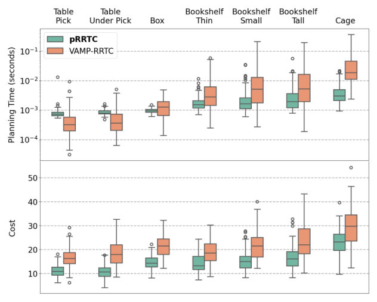

> **TL;DR** pRRTC rewrites RRT-Connect for the GPU: hundreds of GPU blocks grow the start and goal trees at once, and every point along a new edge is collision-checked in parallel. It solves every MotionBenchMaker problem, runs 5× faster than the best CPU planner on the 8-DoF Fetch and 3.9× on the 14-DoF Baxter, and its planning time hardly varies, which is what real time needs.

## Why this paper

Our parking planners (TargetTree-RRT\*, the narrow-space LA3T\* planner from T-ASE 2025) are sampling-based. On a real car the pain is rarely the *average* planning time; it is the tail, the narrow slot that usually takes 50 ms and once in a while 2 s. pRRTC's most interesting number is its consistency: on the Fetch robot the standard deviation of planning time drops 8.4× against the fastest CPU planner. The paper shows which engineering choices buy that.

## The problem

**RRT-Connect** grows two trees, one from the start and one from the goal. Each iteration samples a random configuration, extends the smaller tree toward it, and then greedily tries to connect the new node to the other tree. It is fast in open space and slow in clutter, where most extensions hit something.

The expensive part is **collision checking**: every new edge is cut into many intermediate configurations, and each one needs forward kinematics (FK) and a check against obstacles and the robot itself.

Prior work parallelizes at one level only: many independent planners (high level), many iterations of one planner (mid level), or primitives such as collision checks (low level; VAMP does this with CPU SIMD instructions and reaches sub-millisecond times). A CPU has few cores, and earlier GPU planners (cuRobo, GTMP) are slow on these problems or miss some.

## Key idea

Use the GPU's natural hierarchy for both mid- and low-level parallelism at once, and design the memory layout so the pieces do not fight:

- **Block level**: each GPU block runs its own RRT-Connect loop. Hundreds of blocks extend the same two shared trees asynchronously.
- **Thread-group level**: inside a block, all intermediate points of one edge are checked at the same time.
- **Thread level**: four threads share the 4×4 matrix work of FK for each point, and threads split nearest-neighbor search.

An analogy: instead of one road crew that builds a segment and then walks along it looking for potholes, you send out hundreds of crews, and each crew inspects every metre of its new segment at the same instant.

## How it works

**Parallel expansion.** Each block repeatedly: picks the smaller tree (balanced RRT-Connect), samples a configuration from a Halton sequence, finds its nearest neighbor, extends by at most δ, and if valid, greedily extends toward the other tree. Blocks write new nodes with atomic operations, so they never wait for each other. Dynamic-domain sampling (an existing heuristic that shrinks the sampling region around nodes near obstacles) is added on top.

**SIMT collision checking.** SIMT (single instruction, multiple threads) is the GPU execution model: many threads run the same code on different data.

- Each edge is cut into a fixed number of points, for example 32. With four threads per point, the block has 32 × 4 = 128 threads. Because the extension length is bounded, threads can be allocated once at launch.
- The robot is approximated by spheres. A coarse sphere pass flags links that might collide; only those get a fine pass.
- Intermediate FK matrices are overwritten instead of stored, cutting shared memory by up to 7× on Baxter, so more blocks fit on each GPU core.
- **Early exit**: as soon as one point collides, the whole edge is abandoned. This uses "warp" primitives (a warp is 32 threads that run in lockstep), so no block-wide synchronization is needed.

**Nearest-neighbor search.** Each of n threads scans a slice of the tree, then a parallel reduction picks the winner: about T/n + log(n/2) steps instead of T.

## Results

MotionBenchMaker: 7 scenes × 100 problems for the 7-DoF Panda and 8-DoF Fetch, 3 scenes × 500 problems for the 14-DoF Baxter (tables, shelves, a "cage" for constrained reaching). Everything runs on an RTX 4090 and a 24-core Threadripper. Times in milliseconds; cost is path length in configuration space.

| Robot | Planner | Mean time | 95% time | Worst time | Mean cost |
|---|---|---|---|---|---|
| Panda | VAMP-RRTC (CPU) | 0.17 | 0.81 | 3.08 | 8.05 |
| Panda | **pRRTC** | 0.49 | **0.65** | **2.32** | **6.46** |
| Fetch | VAMP-RRTC | 11.93 | 56.48 | 368.69 | 21.34 |
| Fetch | **pRRTC** | **2.32** | **6.90** | **56.67** | **15.26** |
| Baxter | VAMP-RRTC | 18.53 | 66.53 | 398.39 | 19.47 |
| Baxter | **pRRTC** | **4.82** | **12.49** | **95.46** | **13.12** |

What stands out:

- On easy Panda problems the CPU planner VAMP is still 3× faster on average (0.17 vs 0.49 ms). Even pRRTC's quick runs take about 0.4 ms (its first quartile is 0.42 ms): the GPU has a fixed overhead. But pRRTC has the best worst case, and it is 128× faster than cuRobo (62.63 ms) and 5× faster than OMPL's RRT-Connect (2.54 ms). GTMP is fast (0.34 ms) but solves only 79–89% of problems.
- The harder the problem, the bigger the gain. On the Fetch "Cage" scenes pRRTC is 10× faster.
- Initial paths are 1.4× shorter on average. The paper credits the many simultaneous extensions, which explore more of the space before the trees meet.

**Ablation (Baxter).** Checking edge points in parallel instead of one by one gives 9.4×, custom GPU FK and collision kernels 3.3×, four threads per point 1.8×, dynamic-domain sampling 1.3×, early exit 1.1×. Together: 41× over a naive GPU port. More blocks help up to 256 (14× faster than 8 blocks); beyond that the GPU saturates and time goes up again.

**Hardware.** On a 14-DoF dual-arm Panda, collision checks query an ESDF (a grid of distances to the nearest obstacle) built online by nvblox from a 90 fps depth camera. The full perception-plus-planning loop runs at 7.7 Hz while pool noodles are moved through the workspace.

## Limitations

- **Geometric only.** Edges are straight lines in configuration space. There is no steering function, no nonholonomic constraint and no dynamics.
- **Not asymptotically optimal.** It returns the first path. Making it converge to the optimum is listed as future work.
- **Small problems favor the CPU.** Below about 1 ms, GPU launch overhead dominates.
- **Desktop GPU only**, environment setup excluded from timings. The hardware demo is qualitative (no success rate or latency breakdown).
- The abstract quotes a 5.4× drop in standard deviation, the Fetch section 8.4×: different aggregates.

## DYROS lens

**Would it speed up our parking planner?** Partly, and the part that transfers is clear. For a car in SE(2), FK is trivial (rotate a footprint), so the 4-thread FK trick is not useful. The edges are the expensive part: a Reeds-Shepp or continuous-curvature curve has to be sampled into poses, and every pose's footprint has to be checked against the map. That is exactly the thread-group pattern, and in the ablation it was the biggest win (9.4×). A car footprint as 3–4 circles against an ESDF or occupancy grid is a very GPU-friendly check.

**Would it make narrow parking more robust?** Yes, in the sense of shorter tails. In a narrow slot most extensions are rejected; running hundreds of them at once is what turned the "Cage" problems from spread-out to tight. Bounded worst-case time is also what our real-time narrow-space planner (T-ASE 2025) cares about.

**What would break.** RRT-Connect needs an exact connection between the two trees: Reeds-Shepp gives one, but continuous-curvature connections (what TargetTree-RRT\* relies on) are harder. Our planners are RRT\*-style and anytime, and rewiring depends on insertion order, which asynchronous blocks break. And it only pays off if the car's computer has a CUDA GPU with headroom next to perception.

**What we could try in a week.** The code is open. Replace the arm with a car: state (x, y, θ), footprint as a few spheres in the plane, obstacles from our parking maps. First keep straight-line interpolation to measure raw speed, then swap in Reeds-Shepp edges. Compare mean, 95th-percentile and worst-case time against our CPU planner on the narrow-slot scenes.

**Paper opportunity.** pRRTC feeds every block the same uniform sampler. Our bidirectional learned sampling (JKRS 2026) and confidence-weighted learned samples (LA3T\*) suggest the next step: some blocks sample from a learned start-side distribution, some from a goal-side one, some uniformly, with the split set by network confidence. "GPU-parallel bidirectional planning with learned per-tree samplers for parking," reported with this paper's tail-latency metrics, would be new.

## Key terms

- **RRT-Connect**: a bidirectional RRT that grows trees from start and goal and greedily tries to join them.
- **SIMT**: single instruction, multiple threads; the GPU model where many threads run the same code on different data.
- **Warp**: a group of 32 GPU threads that execute in lockstep and can share results cheaply.
- **Dynamic-domain sampling**: a heuristic that limits sampling around tree nodes near obstacles so fewer samples are wasted.
- **ESDF**: Euclidean signed distance field, a grid that stores the distance to the nearest obstacle.
- **MotionBenchMaker**: a benchmark of manipulation planning problems (tables, shelves, cages) for several robot arms.
