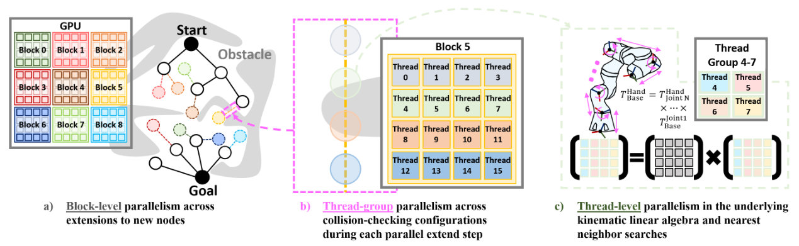
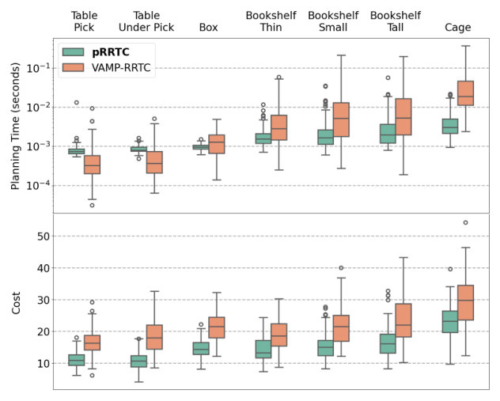

> **TL;DR** pRRTC는 RRT-Connect를 GPU에 맞게 다시 짰습니다. 수백 개의 GPU block이 start tree와 goal tree를 동시에 키우고, 새 edge 위의 모든 점을 병렬로 collision check합니다. MotionBenchMaker의 모든 문제를 풀고, 8-DoF Fetch에서는 가장 빠른 CPU planner보다 5배, 14-DoF Baxter에서는 3.9배 빠르며, planning 시간이 거의 흔들리지 않습니다. 실시간에 필요한 것이 바로 이 성질입니다.

## 왜 이 논문인가

우리 주차 planner(TargetTree-RRT\*, T-ASE 2025의 좁은 공간용 LA3T\* planner)는 sampling-based 방식입니다. 실제 차에서 아픈 것은 *평균* planning 시간이 아니라 꼬리입니다. 보통 50 ms면 되는 좁은 칸에서 가끔 2 s가 걸리는 경우입니다. pRRTC에서 가장 흥미로운 숫자는 일관성입니다. Fetch 로봇에서 planning 시간의 표준편차가 가장 빠른 CPU planner보다 8.4배 작습니다. 이 논문은 어떤 설계 선택이 이 성질을 만드는지 보여 줍니다.

## 문제

**RRT-Connect**는 start와 goal에서 tree를 하나씩 키웁니다. 매 iteration마다 무작위 configuration을 sampling하고, 작은 쪽 tree를 그쪽으로 확장한 뒤, 새 node를 반대편 tree에 탐욕적으로 이어 봅니다. 열린 공간에서는 빠르지만, 확장 대부분이 무언가에 부딪히는 복잡한 환경에서는 느립니다.

비싼 부분은 **collision checking**(충돌 검사)입니다. 새 edge마다 중간 configuration 여러 개로 잘라야 하고, 각 점마다 forward kinematics(FK)를 계산한 뒤 장애물, 그리고 로봇 자신과 부딪히는지 확인해야 합니다.

기존 연구는 한 수준에서만 병렬화합니다. 독립적인 planner 여러 개(high level), planner 하나의 iteration 여러 개(mid level), 또는 collision check 같은 기본 연산(low level)입니다. VAMP는 low level을 CPU SIMD 명령으로 처리해 1 ms 미만의 시간을 냅니다. CPU는 코어가 적고, 기존 GPU planner(cuRobo, GTMP)는 이 문제들에서 느리거나 일부를 풀지 못합니다.

## 핵심 아이디어

GPU의 계층 구조를 그대로 써서 mid level과 low level 병렬화를 동시에 하고, 서로 방해하지 않도록 메모리 배치까지 함께 설계합니다.

- **Block 수준**: GPU block마다 자기 RRT-Connect 루프를 돌립니다. 수백 개의 block이 공유된 두 tree를 비동기로 확장합니다.
- **Thread group 수준**: block 안에서 edge 하나의 중간 점을 모두 동시에 검사합니다.
- **Thread 수준**: 점마다 thread 네 개가 FK의 4×4 행렬 연산을 나눠 맡고, nearest neighbor 탐색도 thread들이 나눠 합니다.

비유하자면, 도로 공사팀 하나가 한 구간을 깔고 걸어가며 구멍을 찾는 대신, 수백 개 팀을 동시에 내보내고 각 팀이 새 구간의 모든 지점을 한순간에 점검하는 것입니다.

## 작동 방식

**병렬 확장.** 각 block은 다음을 반복합니다. 작은 쪽 tree를 고르고(balanced RRT-Connect), Halton sequence에서 configuration을 뽑고, nearest neighbor를 찾고, 최대 δ만큼 확장하고, 유효하면 반대편 tree를 향해 탐욕적으로 계속 확장합니다. Block들은 atomic 연산으로 새 node를 쓰기 때문에 서로 기다리지 않습니다. 여기에 기존 heuristic인 dynamic-domain sampling(장애물 근처 node 주변의 sampling 영역을 줄이는 방법)을 더합니다.

**SIMT collision checking.** SIMT(single instruction, multiple threads)는 많은 thread가 같은 코드를 서로 다른 데이터에 실행하는 GPU 실행 방식입니다.

- Edge를 정해진 개수, 예를 들어 32개 점으로 자릅니다. 점마다 thread 네 개를 쓰므로 block은 32 × 4 = 128 thread입니다. 확장 길이에 상한이 있으니 thread를 실행 시작 때 한 번에 할당할 수 있습니다.
- 로봇은 구(sphere)로 근사합니다. 거친 구 모델로 먼저 충돌 가능성이 있는 링크를 걸러 내고, 그 링크만 정밀한 구 모델로 다시 검사합니다.
- 중간 FK 행렬은 저장하지 않고 덮어써서 Baxter에서 shared memory를 최대 7배 줄입니다. 그만큼 GPU 코어 하나에 더 많은 block이 올라갑니다.
- **Early exit**: 한 점이라도 부딪히면 edge 전체를 바로 버립니다. 이때 "warp" 기본 연산(warp는 lockstep으로 함께 도는 thread 32개)을 써서 block 전체 동기화를 피합니다.

**Nearest neighbor 탐색.** n개 thread가 tree를 나눠 훑고, 병렬 reduction으로 가장 가까운 것을 고릅니다. T번 대신 약 T/n + log(n/2)번이면 됩니다.

## 결과

MotionBenchMaker: 7-DoF Panda와 8-DoF Fetch는 장면 7개 × 문제 100개, 14-DoF Baxter는 장면 3개 × 문제 500개입니다(테이블, 선반, 좁은 공간에 팔을 넣는 "cage"). 모두 RTX 4090과 24코어 Threadripper에서 돌렸습니다. 시간은 ms, cost는 configuration space에서의 경로 길이입니다.

| 로봇 | Planner | 평균 시간 | 95% 시간 | 최악 시간 | 평균 cost |
|---|---|---|---|---|---|
| Panda | VAMP-RRTC (CPU) | 0.17 | 0.81 | 3.08 | 8.05 |
| Panda | **pRRTC** | 0.49 | **0.65** | **2.32** | **6.46** |
| Fetch | VAMP-RRTC | 11.93 | 56.48 | 368.69 | 21.34 |
| Fetch | **pRRTC** | **2.32** | **6.90** | **56.67** | **15.26** |
| Baxter | VAMP-RRTC | 18.53 | 66.53 | 398.39 | 19.47 |
| Baxter | **pRRTC** | **4.82** | **12.49** | **95.46** | **13.12** |

눈여겨볼 점:

- 쉬운 Panda 문제에서는 CPU planner인 VAMP가 평균 3배 빠릅니다(0.17 vs 0.49 ms). pRRTC는 빨리 끝나는 경우도 약 0.4 ms가 걸립니다(1사분위 0.42 ms). GPU에는 고정 비용이 있습니다. 대신 pRRTC는 최악의 경우가 가장 좋고, cuRobo(62.63 ms)보다 128배, OMPL의 RRT-Connect(2.54 ms)보다 5배 빠릅니다. GTMP는 빠르지만(0.34 ms) 문제의 79–89%만 풉니다.
- 문제가 어려울수록 이득이 커집니다. Fetch의 "Cage" 장면에서는 10배 빠릅니다.
- 첫 경로가 평균 1.4배 짧습니다. 논문은 동시에 여러 확장을 돌려 두 tree가 만나기 전에 공간을 더 넓게 탐색하기 때문이라고 설명합니다.

**Ablation (Baxter).** Edge 위의 점을 하나씩이 아니라 병렬로 검사하는 것이 9.4배, GPU 전용 FK와 collision kernel이 3.3배, 점마다 thread 네 개가 1.8배, dynamic-domain sampling이 1.3배, early exit가 1.1배입니다. 모두 합치면 단순히 GPU로 옮긴 버전보다 41배 빠릅니다. Block 수는 256개까지 늘릴수록 좋고(8개보다 14배 빠름), 그 이상에서는 GPU가 포화되어 오히려 느려집니다.

**하드웨어.** 14-DoF 양팔 Panda에서는 90 fps depth camera로 nvblox가 실시간으로 만든 ESDF(가장 가까운 장애물까지의 거리를 저장한 격자)에 collision check를 합니다. 인식부터 planning까지 전체 루프가 7.7 Hz로 돌고, 수영장용 폼 막대를 작업 공간에 움직여 동적 장애물로 썼습니다.

## 한계

- **기하학적 planning만 합니다.** Edge는 configuration space의 직선입니다. Steering function, nonholonomic 제약, dynamics가 없습니다.
- **Asymptotically optimal이 아닙니다.** 첫 경로를 돌려줍니다. 최적해로 수렴하게 만드는 것은 향후 과제입니다.
- **작은 문제는 CPU가 유리합니다.** 1 ms 아래에서는 GPU 실행 오버헤드가 지배합니다.
- **데스크톱 GPU만** 썼고, 환경 준비 시간은 측정에서 뺐습니다. 하드웨어 시연은 정성적입니다(성공률이나 지연 시간 분석 없음).
- 초록은 표준편차가 5.4배, Fetch 절은 8.4배 줄었다고 합니다. 집계 방식이 다릅니다.

## DYROS 관점

**우리 주차 planner가 빨라질까.** 부분적으로 그렇고, 어떤 부분이 옮겨 오는지는 분명합니다. SE(2)의 차에서는 FK가 거의 공짜입니다(차 외곽선만 회전하면 됩니다). 그래서 thread 네 개로 FK를 나누는 기법은 쓸모가 없습니다. 비싼 것은 edge입니다. Reeds-Shepp이나 continuous-curvature 곡선을 pose 여러 개로 샘플링하고, pose마다 차 외곽선을 지도와 비교해야 합니다. 이것이 정확히 thread group 패턴이고, ablation에서 가장 큰 이득(9.4배)을 낸 부분입니다. 차 외곽선을 원 3–4개로 근사해 ESDF나 occupancy grid와 비교하는 검사는 GPU에 아주 잘 맞습니다.

**좁은 주차가 더 robust해질까.** 꼬리가 짧아진다는 의미에서는 그렇습니다. 좁은 칸에서는 확장 대부분이 거절됩니다. 수백 개를 동시에 돌린 것이 "Cage" 문제의 넓게 퍼진 시간 분포를 좁게 만든 이유입니다. 최악의 planning 시간을 묶어 두는 것은 우리의 실시간 좁은 공간 planner(T-ASE 2025)가 중요하게 보는 성질이기도 합니다.

**무엇이 깨질까.** RRT-Connect는 두 tree 사이를 정확히 잇는 연결이 필요합니다. Reeds-Shepp은 이를 주지만, TargetTree-RRT\*가 기대는 continuous-curvature 연결은 더 어렵습니다. 우리 planner는 RRT\* 계열의 anytime planner인데, rewiring은 node가 들어온 순서에 의존하고 비동기 block은 바로 그 순서를 깨뜨립니다. 또 차의 컴퓨터에 인식과 함께 돌릴 여유가 있는 CUDA GPU가 있어야만 이득이 있습니다.

**일주일 안에 해 볼 수 있는 것.** 코드가 공개되어 있습니다. 로봇 팔을 차로 바꿉니다. 상태는 (x, y, θ), 외곽선은 평면 위의 구 몇 개, 장애물은 우리 주차장 지도에서 가져옵니다. 먼저 직선 보간을 그대로 두고 순수 속도를 재고, 그다음 Reeds-Shepp edge로 바꿉니다. 좁은 칸 장면에서 평균, 95번째 백분위, 최악 시간을 우리 CPU planner와 비교합니다.

**논문 기회.** pRRTC는 모든 block에 같은 균일 sampler를 씁니다. 우리의 bidirectional learned sampling(JKRS 2026)과 confidence로 learned sample 비율을 정하는 LA3T\*를 보면 다음 단계가 분명합니다. 일부 block은 start 쪽 learned 분포에서, 일부는 goal 쪽 분포에서, 나머지는 균일하게 sampling하고, 그 비율을 network confidence로 정합니다. 이 논문의 꼬리 지연 지표로 보고하는 "주차를 위한, tree별 learned sampler를 쓰는 GPU 병렬 양방향 planning"은 새로운 기여가 됩니다.

## 용어 정리

- **RRT-Connect**: start와 goal에서 tree를 키우고 탐욕적으로 둘을 이으려는 양방향 RRT.
- **SIMT**: single instruction, multiple threads. 많은 thread가 같은 코드를 서로 다른 데이터에 실행하는 GPU 실행 방식.
- **Warp**: lockstep으로 함께 실행되고 결과를 싸게 공유할 수 있는 GPU thread 32개 묶음.
- **Dynamic-domain sampling**: 장애물 근처 node 주변의 sampling 영역을 제한해 버려지는 sample을 줄이는 heuristic.
- **ESDF**: Euclidean signed distance field. 가장 가까운 장애물까지의 거리를 저장한 격자.
- **MotionBenchMaker**: 여러 로봇 팔을 위한 manipulation planning 문제(테이블, 선반, cage) benchmark.
