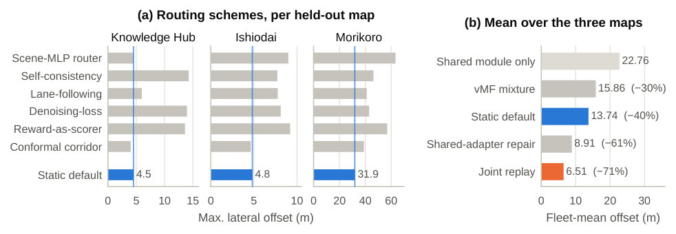

> **TL;DR** A diffusion planner with one shared adapter and four region-specific "expert" adapters is taken to three maps it has never seen. Choosing a better expert per scene barely helps: even a perfect oracle cuts the mean lateral offset by only 0.9 m, and none of eight practical routing schemes beats "always use the same expert". Fine-tuning on 20 scenes from the new region, while replaying old scenes, cuts the fleet-mean offset from 12.4 m to 6.9 m. The catch: these are open-loop numbers, and on nuPlan the same kind of fine-tuning makes closed-loop driving worse.

## Why this paper

Every lab that moves a learned planner to a new site faces this. Do you keep a library of models, one per site, and pick the right one, or do you collect a little data at the new site and update the model? The paper is unusual in two ways. It runs on a real Autoware-based stack trained on real Japanese sites, and it reports mostly negative results with careful statistics. It is a good model of how to ask "is this worth building?" before building it.

## The problem

The planner has a **shared** LoRA adapter (a small low-rank weight update on top of the base diffusion planner) plus four **per-ODD expert** adapters, one for each operational design domain it was trained on:

- ODD-Hongo (University of Tokyo campus), ODD-Kashiwa (suburban), ODD-Shalun (a test site), ODD-Nagoya (Nagoya University campus).

The held-out maps are Knowledge Hub (research campus), Ishiodai (suburban district) and Morikoro (open park), all in Aichi Prefecture. The question: at a held-out map, can a **selector** pick the right expert per scene (routing), or must the **generator** itself change (adaptation)?

**Metric.** For each 8 s plan at 10 Hz, the lateral offset is the maximum |y| in the frame of the starting lanelet. The fleet mean averages the three maps equally. Note what this measures: sideways displacement relative to the *initial* lane axis, not distance to the route or to a human trajectory.

## Key idea

**Measure the headroom first.** Before tuning routers, ask an oracle: if you always picked the lowest-offset expert for each scene, how much would you gain? If that number is small, no router can help much, and the effort should go into changing the model.

Analogy: you have four city maps and land in a fifth city. If even the best of the four, chosen street by street, is still wrong, then a smarter way of choosing between them is wasted effort. You need to draw a bit of the new map.

## How it works

**Routing schemes (choose among the 4 candidates).** Eight of them, grouped by the signal they use:

- Scene features: a two-layer MLP on lane count, curvature, neighbor speed and similar features; or distance of each candidate to the route centerline.
- Consistency and uncertainty: agreement among 5 samples per expert (plain and normalized); a split-conformal corridor calibrated on training scenes.
- Loss and reward: the denoising loss of each expert; a gate trained directly on realized offset; the planner's own training reward.
- Baseline: the **static default**, always the geographically nearest expert, which is ODD-Nagoya for all three maps (and also the best fixed expert).

**Constructive mechanisms (change the weights).**

1. **Geographic weight mixing**: average the expert weights with softmax weights based on great-circle distance to the deployment GPS position (temperature τ from 1 to 200 km).
2. **Shared-adapter repair**: fine-tune only the shared adapter for 500 steps on training scenes with synthetic perturbations: lanelet rotations up to 45°, Bezier centerline warps up to 3 m, and dropping one lane boundary with probability 0.5. No target data.
3. **Joint replay**: fine-tune the whole adapter stack for 500 steps on 20 scenes from Ishiodai plus 200 replayed training scenes (50 per ODD). The objective is the planner's trajectory-level reward (progress, route alignment, comfort, safety), optimized through a differentiable DPM-Solver++ rollout. No human driving logs are needed, only maps and routes.

## Results

**Routing does not help** (Pool A, 24 scenes; lateral offset in m):

| Scheme | Knowledge Hub | Ishiodai | Morikoro | Fleet |
|---|---|---|---|---|
| Static default (ODD-Nagoya) | 4.5 | 4.8 | 31.9 | **13.74** |
| Conformal corridor (T = 15) | 4.0 | 4.6 | 38.9 | 15.86 |
| Lane-following | 6.0 | 7.8 | 41.1 | 18.29 |
| Self-consistency | 14.3 | 7.7 | 46.3 | 22.76 |
| Scene-conditioned MLP | 4.5 | 9.0 | 63.3 | 25.61 |
| Reward-as-scorer | 13.6 | 9.2 | 56.9 | 26.57 |

- None of the schemes improves the fleet mean; six are significantly worse (paired Wilcoxon, p ≤ 0.012, still significant after Holm correction).
- Oracle headroom: 0.9 m on Pool A, 1.3 m on a 104-scene pool, 1.1 m on Pool B. Classifiers on scene features or encoder embeddings cannot predict the best expert better than always guessing the majority (p ≥ 0.29).
- Why they fail: the MLP sends most held-out scenes to ODD-Hongo; self-consistency prefers small, timid trajectories; the planner's own reward often picks ODD-Shalun; the conformal corridor abstains on every scene at T = 5 m.

**Changing the weights does help** (Pool B for joint replay, 8 seeds):

| Method (same 20 target scenes, 500 steps) | Target offset (m) ↓ | Forgetting (m) ↓ |
|---|---|---|
| Static default | 12.4 ± 3.0 | 0 |
| Fine-tune best fixed expert | 4.69 ± 1.90 | +22.6 ± 2.9 |
| Target-only + L2-SP | 4.04 ± 0.77 | +37.8 ± 13.2 |
| EWC | 8.20 ± 0.83 | +4.7 ± 1.3 |
| **Joint replay** | 6.91 ± 2.16 | **+0.9 ± 1.4** |

- Forgetting is the summed increase in offset on the four original ODDs. All methods trained on target scenes reach 4–8 m; **replay is what keeps the old ODDs intact**.
- Joint replay was trained only on Ishiodai, so gains on Knowledge Hub and Morikoro are transfer.
- Shared-adapter repair (no target data) brings Morikoro from 31.9 m to 11.1 m with the ODD-Kashiwa expert; rotations matter most. Geographic mixing does not beat the static default (15.86 m).
- Joint replay also lowers the 95th-percentile jerk by 26% and raises 8 s progress from 164 m to 187 m.

**Warnings the authors give themselves.**

- Two test-time adaptation baselines look great on offset and are useless: TENT reaches 3.37 m by producing nearly the same trajectory for every scene (cross-scene distance falls from over 100 m to about 10 m), and a hypernetwork drives only 12 m in 8 s.
- On nuPlan (leave-one-city-out), fine-tuning lowers the open-loop offset in Singapore from 8.64 to 5.60 m, but the reactive closed-loop score drops from 0.858 to 0.598 and drivable-area compliance from 0.97 to 0.76.
- On the real car (base planner, ODD-Kashiwa course), one run completed with a comfort-violation rate of 47.7% vs 37.7% for a human; a second run crept 72 m at ≤ 0.23 m/s and stopped. The adapted models were not tested on the car.

## Limitations

- **Open-loop only** on the held-out maps, and closed-loop got worse on nuPlan. The paper does not show that any adaptation produces better driving.
- **The metric is unusual.** Maximum lateral offset from the *initial* lanelet axis also grows when the car correctly follows a curved road, which may explain offsets above 30 m on the park map. Lower is not cleanly "better driving".
- **Small evaluation**: 24 scenes for the routing study, 4–10 lanelets per map, and target scenes with no other agents, so no collision metrics.
- Results concern this multi-expert design; a monolithic planner trained on pooled data was not tested. Maps are proprietary, though weights and splits are released.

## DYROS lens

**Relation to our work.** We face the same question when a learned sampler trained in one parking garage meets another: one model per site plus a selector, or a quick update with a few local scenes? The method lesson transfers directly. **Compute the oracle headroom of selection before building a selector.**

There is also an honest point about our IROS 2023 design. Here the diffusion model *generates* the trajectory, so a region shift shows up as bad trajectories, and only a downstream Safety Gate stands between them and the car. In a "learn where to sample" planner, a shifted network mostly costs planning time, as long as the planner keeps some uninformed samples and checks every edge. Distribution shift degrades speed, not safety. That is a real argument for the planner-in-the-loop design when moving between sites.

**What is attractive.** Joint replay fine-tunes with a reward computed from **maps and routes only**, with no human driving logs. For us, a SLAM map of a new garage plus slot positions could be enough to adapt a learned sampler.

**What would break.** Lateral offset from the lane axis means nothing in a parking lot. Our metrics would be time to first solution, success rate and final pose error.

**What we could try in a week.** Train our learned sampler on two garage layouts, test on a third. Measure (a) oracle headroom of choosing between the two models per scene, and (b) the gain from fine-tuning on 20 scenes of the third garage with replay. Use closed-loop planning time and success, the part this paper is missing.

**Paper opportunity.** "Map-only adaptation of learned sampling distributions for new parking garages", evaluated closed-loop and on the car. It would answer the open question this paper ends with, in a setting where the planner keeps safety.

## Key terms

- **ODD (operational design domain)**: the region and conditions a driving system was built and validated for.
- **LoRA adapter**: a small low-rank weight update added to a frozen network; cheap to train and swap.
- **Routing / expert selection**: choosing which expert's output to use for each scene at test time.
- **Oracle headroom**: the gain from a perfect per-scene selector; an upper bound for any selector over the same candidates.
- **Replay**: mixing old training data into fine-tuning to limit forgetting of earlier domains.
- **Open-loop vs closed-loop**: scoring a single planned trajectory vs letting the planner drive in simulation and scoring the result.
