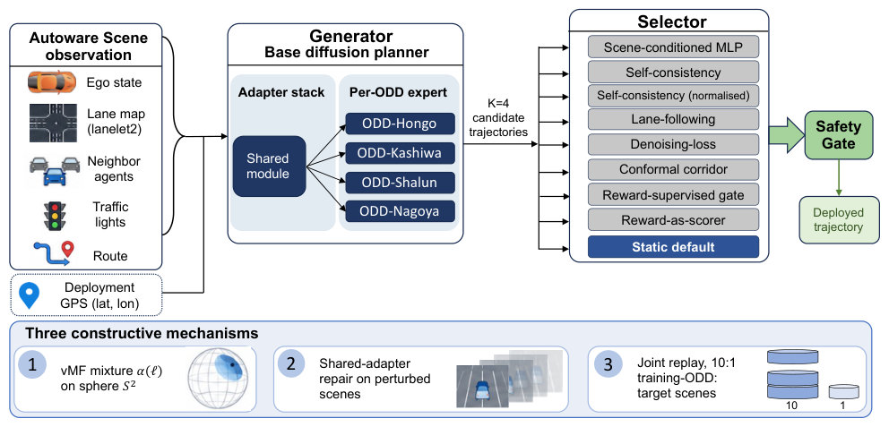
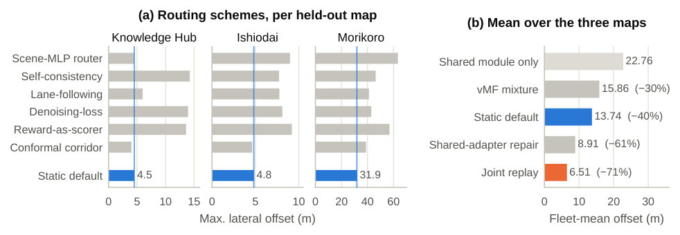

> **TL;DR** 공유 adapter 하나와 지역별 "expert" adapter 4개를 가진 diffusion planner를 처음 보는 지도 세 곳에 가져갑니다. 장면마다 더 나은 expert를 골라도 거의 도움이 안 됩니다. 완벽한 oracle조차 평균 횡방향 오프셋을 0.9 m밖에 못 줄이고, 실용적인 routing 방식 8개 중 어느 것도 "항상 같은 expert 쓰기"를 이기지 못합니다. 반면 새 지역 장면 20개로, 예전 장면을 replay하면서 fine-tuning하면 전체 평균 오프셋이 12.4 m에서 6.9 m로 줄어듭니다. 함정은 이것이 open-loop 수치라는 점입니다. nuPlan에서는 같은 종류의 fine-tuning이 closed-loop 주행을 오히려 나쁘게 만듭니다.

## 왜 이 논문인가

학습한 planner를 새 장소로 옮기는 연구실이라면 모두 이 질문을 만납니다. 장소마다 모델을 하나씩 두고 맞는 것을 고를까, 아니면 새 장소에서 데이터를 조금 모아 모델을 고칠까? 이 논문은 두 가지 점에서 특이합니다. 실제 일본 지역에서 학습한 Autoware 기반 스택 위에서 실험하고, 꼼꼼한 통계와 함께 대부분 부정적인 결과를 보고합니다. "이걸 만들 가치가 있나?"를 만들기 전에 묻는 좋은 본보기입니다.

## 문제

Planner에는 **공유** LoRA adapter(기본 diffusion planner 위에 얹는 작은 low-rank 가중치 변경)와, 학습한 ODD(운행 설계 영역)마다 하나씩 **ODD별 expert** adapter 4개가 있습니다.

- ODD-Hongo(도쿄대 캠퍼스), ODD-Kashiwa(교외), ODD-Shalun(시험장), ODD-Nagoya(나고야대 캠퍼스).

학습에 쓰지 않은 지도는 Knowledge Hub(연구 캠퍼스), Ishiodai(교외 주거지), Morikoro(넓은 공원)이고, 모두 아이치현에 있습니다. 질문은 이렇습니다. 처음 보는 지도에서 **selector**가 장면마다 맞는 expert를 고를 수 있을까(routing), 아니면 **generator** 자체가 바뀌어야 할까(adaptation)?

**지표.** 10 Hz, 8초짜리 plan마다 출발 lanelet 좌표계에서의 최대 |y|를 횡방향 오프셋으로 씁니다. 전체 평균(fleet mean)은 세 지도를 같은 비중으로 평균 냅니다. 무엇을 재는지 주의해야 합니다. *처음* 차선 축에 대한 옆 방향 이동이지, 경로나 사람 trajectory까지의 거리가 아닙니다.

## 핵심 아이디어

**먼저 여유분(headroom)을 잽니다.** Router를 다듬기 전에 oracle에게 묻습니다. 장면마다 오프셋이 가장 작은 expert를 늘 골랐다면 얼마나 좋아졌을까? 그 값이 작으면 어떤 router도 크게 도울 수 없고, 노력은 모델을 바꾸는 쪽에 써야 합니다.

비유하자면, 도시 지도 네 장을 들고 다섯 번째 도시에 내린 상황입니다. 네 장 중 가장 나은 것을 거리마다 골라 써도 여전히 틀린다면, 더 똑똑하게 고르는 방법은 헛수고입니다. 새 지도를 조금 그려야 합니다.

## 작동 방식

**Routing 방식 (후보 4개 중 고르기).** 쓰는 신호에 따라 8가지입니다.

- 장면 특징: 차선 수, 곡률, 이웃 속도 같은 특징을 받는 2층 MLP, 또는 각 후보와 경로 중심선 사이의 거리.
- 일관성과 불확실성: expert마다 sample 5개의 일치도(일반판과 정규화판), 학습 장면으로 보정한 split-conformal corridor.
- Loss와 reward: expert별 denoising loss, 실제 오프셋으로 직접 학습한 gate, planner 자신의 학습 reward.
- 기준선: **static default**, 지리적으로 가장 가까운 expert를 늘 씁니다. 세 지도 모두 ODD-Nagoya이고, 고정 expert 중에서도 가장 좋습니다.

**구성적 방법 (가중치 바꾸기).**

1. **지리적 가중치 혼합**: 배치 위치 GPS까지의 대권 거리로 softmax 가중치를 만들어 expert 가중치를 평균합니다(온도 τ는 1–200 km).
2. **공유 adapter 수리**: 공유 adapter만 500 step fine-tuning합니다. 학습 장면에 인위적 변형을 넣습니다. Lanelet을 최대 45° 회전, Bezier 곡선으로 중심선을 최대 3 m 휘기, 차선 경계 하나를 0.5 확률로 지우기. 목표 지역 데이터는 쓰지 않습니다.
3. **Joint replay**: Ishiodai 장면 20개와 다시 꺼낸 학습 장면 200개(ODD당 50개)로 adapter 전체를 500 step fine-tuning합니다. 목적함수는 planner의 trajectory 단위 reward(진행, 경로 정렬, 승차감, 안전)이고, 미분 가능한 DPM-Solver++ rollout으로 최적화합니다. 사람 주행 기록 없이 지도와 경로만 있으면 됩니다.

## 결과

**Routing은 도움이 안 됩니다** (Pool A, 24개 장면, 횡방향 오프셋 m):

| 방식 | Knowledge Hub | Ishiodai | Morikoro | 전체 |
|---|---|---|---|---|
| Static default (ODD-Nagoya) | 4.5 | 4.8 | 31.9 | **13.74** |
| Conformal corridor (T = 15) | 4.0 | 4.6 | 38.9 | 15.86 |
| Lane-following | 6.0 | 7.8 | 41.1 | 18.29 |
| Self-consistency | 14.3 | 7.7 | 46.3 | 22.76 |
| Scene-conditioned MLP | 4.5 | 9.0 | 63.3 | 25.61 |
| Reward-as-scorer | 13.6 | 9.2 | 56.9 | 26.57 |

- 어떤 방식도 전체 평균을 개선하지 못하고, 6개는 유의하게 나쁩니다(paired Wilcoxon, p ≤ 0.012, Holm 보정 후에도 유의).
- Oracle headroom은 Pool A에서 0.9 m, 104개 장면에서 1.3 m, Pool B에서 1.1 m입니다. 장면 특징이나 encoder embedding으로 만든 분류기도 늘 다수 클래스를 찍는 것보다 최적 expert를 잘 맞히지 못합니다(p ≥ 0.29).
- 실패 이유: MLP는 처음 보는 장면 대부분을 ODD-Hongo로 보내고, self-consistency는 작고 소심한 trajectory를 선호하며, planner 자신의 reward는 자주 ODD-Shalun을 고르고, conformal corridor는 T = 5 m에서 모든 장면을 기권합니다.

**가중치를 바꾸면 도움이 됩니다** (joint replay는 Pool B, seed 8개):

| 방법 (같은 목표 장면 20개, 500 step) | 목표 오프셋 (m) ↓ | 망각 (m) ↓ |
|---|---|---|
| Static default | 12.4 ± 3.0 | 0 |
| 최고 고정 expert fine-tuning | 4.69 ± 1.90 | +22.6 ± 2.9 |
| 목표만 + L2-SP | 4.04 ± 0.77 | +37.8 ± 13.2 |
| EWC | 8.20 ± 0.83 | +4.7 ± 1.3 |
| **Joint replay** | 6.91 ± 2.16 | **+0.9 ± 1.4** |

- 망각(forgetting)은 원래 ODD 4곳에서 오프셋이 늘어난 양의 합입니다. 목표 장면으로 학습한 방법은 모두 4–8 m에 도달하고, **예전 ODD를 지켜 주는 것은 replay입니다**.
- Joint replay는 Ishiodai로만 학습했으므로, Knowledge Hub와 Morikoro에서의 개선은 전이입니다.
- 공유 adapter 수리(목표 데이터 없음)는 ODD-Kashiwa expert와 함께 Morikoro를 31.9 m에서 11.1 m로 낮추고, 회전 변형이 가장 효과가 큽니다. 지리적 혼합은 static default를 이기지 못합니다(15.86 m).
- Joint replay는 95번째 백분위 jerk를 26% 줄이고, 8초 진행 거리를 164 m에서 187 m로 늘립니다.

**저자들이 스스로 남긴 경고.**

- Test-time adaptation baseline 두 개는 오프셋은 좋아 보이지만 쓸모가 없습니다. TENT는 모든 장면에서 거의 같은 trajectory를 내서 3.37 m를 얻고(장면 간 거리가 100 m 이상에서 약 10 m로 줄어듦), hypernetwork는 8초 동안 12 m밖에 가지 않습니다.
- nuPlan(도시 하나씩 빼고 학습)에서 fine-tuning은 Singapore의 open-loop 오프셋을 8.64 m에서 5.60 m로 줄이지만, reactive closed-loop 점수는 0.858에서 0.598로, 주행 가능 영역 준수율은 0.97에서 0.76으로 떨어집니다.
- 실차(기본 planner, ODD-Kashiwa 코스)에서 한 번은 완주했고 승차감 위반율은 47.7%로 사람 운전자 37.7%보다 높았습니다. 두 번째는 0.23 m/s 이하로 72 m를 기어가다 멈췄습니다. 적응한 모델은 실차에서 시험하지 않았습니다.

## 한계

- 처음 보는 지도에서는 **open-loop만** 했고, nuPlan에서는 closed-loop가 나빠졌습니다. 어떤 적응 방법도 더 나은 주행을 만든다는 것을 보여 주지 못합니다.
- **지표가 특이합니다.** *처음* lanelet 축에서의 최대 횡방향 오프셋은 차가 굽은 길을 제대로 따라가도 커집니다. 공원 지도에서 30 m가 넘는 오프셋이 나오는 이유일 수 있습니다. 낮다고 깔끔하게 "더 좋은 주행"인 것은 아닙니다.
- **평가 규모가 작습니다.** Routing 연구는 24개 장면, 지도당 lanelet 4–10개이고, 목표 장면에는 다른 agent가 없어 충돌 지표가 없습니다.
- 결과는 이 multi-expert 설계에 한정됩니다. 모든 데이터를 합쳐 학습한 단일 planner는 시험하지 않았습니다. 지도는 비공개이고, 가중치와 데이터 분할은 공개했습니다.

## DYROS 관점

**우리 연구와의 관계.** 한 주차장에서 학습한 learned sampler를 다른 주차장으로 가져가면 같은 질문을 만납니다. 장소마다 모델 하나와 selector를 둘까, 아니면 현지 장면 몇 개로 빠르게 고칠까? 방법론 교훈은 그대로 옮겨 옵니다. **Selector를 만들기 전에 선택의 oracle headroom부터 계산하라.**

IROS 2023 설계에 대해서도 정직하게 짚을 점이 있습니다. 여기서는 diffusion model이 trajectory를 *생성*하므로, 지역이 바뀌면 나쁜 trajectory로 바로 드러나고, 그것과 차 사이에는 뒤쪽 Safety Gate 하나만 있습니다. "어디를 sampling할지 학습하기" 방식의 planner에서는, planner가 정보 없는 sample도 일부 유지하고 모든 edge를 검사하는 한, 분포가 바뀐 network는 주로 planning 시간을 잃게 할 뿐입니다. 분포 이동이 안전이 아니라 속도를 떨어뜨립니다. 장소를 옮겨 다닐 때 planner를 루프 안에 두는 설계를 지지하는 실제 논거입니다.

**매력적인 부분.** Joint replay는 사람 주행 기록 없이 **지도와 경로만으로** 계산한 reward로 fine-tuning합니다. 우리라면 새 주차장의 SLAM 지도와 주차 칸 위치만으로 learned sampler를 적응시킬 수 있습니다.

**무엇이 깨질까.** 차선 축에서의 횡방향 오프셋은 주차장에서는 의미가 없습니다. 우리 지표는 첫 해까지의 시간, 성공률, 최종 pose 오차가 되어야 합니다.

**일주일 안에 해 볼 수 있는 것.** 주차장 구조 두 곳으로 learned sampler를 학습하고 세 번째 곳에서 시험합니다. (a) 장면마다 두 모델 중 하나를 고르는 oracle headroom과, (b) 세 번째 주차장 장면 20개로 replay와 함께 fine-tuning했을 때의 이득을 잽니다. 이 논문에 빠진 closed-loop planning 시간과 성공률로 평가합니다.

**논문 기회.** "새 주차장을 위한, 지도만 쓰는 learned sampling 분포 적응"을 closed-loop와 실차로 평가하는 것입니다. Planner가 안전을 지키는 환경에서, 이 논문이 마지막에 남긴 열린 질문에 답할 수 있습니다.

## 용어 정리

- **ODD (operational design domain)**: 주행 시스템이 만들어지고 검증된 지역과 조건.
- **LoRA adapter**: 고정된 network에 더하는 작은 low-rank 가중치 변경. 학습과 교체가 쌈.
- **Routing / expert 선택**: 실행 시점에 장면마다 어느 expert의 출력을 쓸지 고르는 것.
- **Oracle headroom**: 장면마다 완벽하게 고르는 selector가 얻는 이득. 같은 후보를 쓰는 모든 selector의 상한.
- **Replay**: 이전 영역을 잊지 않도록 fine-tuning에 예전 학습 데이터를 섞는 방법.
- **Open-loop vs closed-loop**: 계획된 trajectory 하나만 채점하는 것과, 시뮬레이션에서 planner가 직접 운전하게 하고 결과를 채점하는 것의 차이.
