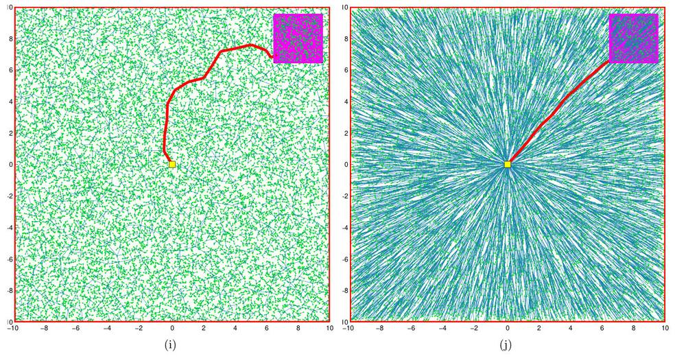
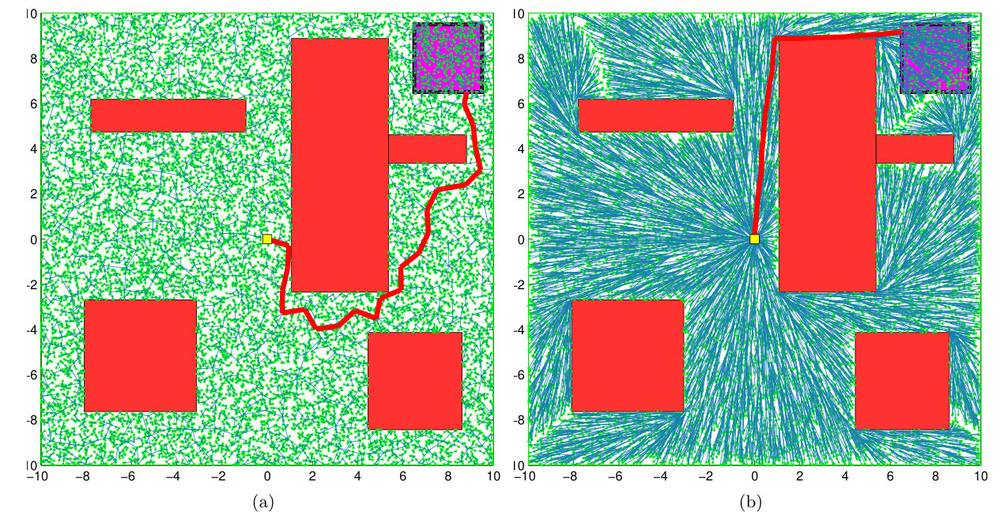
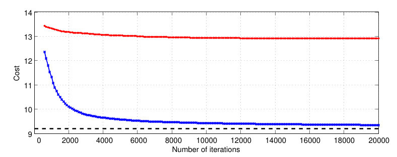

> **TL;DR** Karaman and Frazzoli prove that RRT and PRM converge to a *suboptimal* path with probability one, and introduce RRT\* and PRM\*, which converge to the optimal path. The fix is small: connect each new sample to neighbors inside a radius that shrinks like (log n / n)^(1/d), pick the cheapest parent, and rewire the neighbors through the new node. The extra cost is only a constant factor.

> **Why it is a classic:** It defined asymptotic optimality for sampling-based planning and gave the connection-radius law that later planners (Informed RRT\*, FMT\*, BIT\*, and parking planners such as TargetTree-RRT\*) still inherit.

## Why this paper

All of Minsoo's planners stand on RRT\*. The guarantees come from specific assumptions, and every change we make (a target tree instead of a goal region, continuous-curvature edges, learned sampling) keeps some of them and breaks others. Knowing which turns "based on RRT\*" into a precise claim.

## The problem

**Path planning**: find a collision-free path from x_init to a goal region X_goal in (0, 1)^d, with straight-line segments and a length-like cost. No differential constraints.

- **Probabilistic completeness**: if a solution exists, the chance of finding one goes to 1 as samples grow. PRM and RRT have it.
- **Optimality**: does the *cost* approach the best possible c\*? Nobody had analyzed it. Rerunning RRT and keeping the best carries no guarantee; grid A\* is optimal only up to resolution.

## Key idea

**First, the bad news (proved).**

- **RRT is not asymptotically optimal.** Each new node attaches to its nearest node and never changes parent, so early bad edges are permanent. The best cost converges to a random value strictly above c\* with probability one; rerunning RRT just draws more samples of it.
- **k-nearest PRM with fixed k** is never asymptotically optimal, and with k = 1 not even complete. Fixed-radius PRM is optimal but tries O(n) connections per sample.

**Then the fix: the right neighborhood.** Connect to nodes within r(n) = γ (log n / n)^(1/d), or to the k log n nearest. The rule comes from random geometric graphs: at this radius a random graph is connected with high probability. Shrink faster and it falls apart; shrink slower and it gets expensive.

Analogy: each sample is a new town. RRT builds one road to the nearest town and never reconsiders. RRT\* connects through the nearby town with the shortest trip home, then reroutes any neighbor whose trip home is shorter through the new town.

## How it works

One RRT\* iteration (Algorithm 6):

1. **Sample** x_rand, find the nearest node, **steer** toward x_rand by at most η to get x_new, and collision-check. Identical to RRT.
2. **Near set**: all nodes within r = min{γ (log |V| / |V|)^(1/d), η}.
3. **Choose parent**: the near node minimizing Cost(near) + c(near → x_new) over a free segment.
4. **Rewire**: for each near node, if going through x_new is cheaper and the segment is free, make x_new its parent.

Two structural facts carry the theory:

- **Same vertices as RRT.** With the same samples, RRT\* adds exactly RRT's nodes; only edges differ. So it inherits RRT's completeness and finds its first solution at the same iteration.
- **Same cost order.** Choose-parent and rewire touch O(log n) neighbors, so RRT\* is O(n log n) time and O(n) memory, like RRT.

The proof needs γ_RRT\* > (2(1 + 1/d))^(1/d) (μ(X_free)/ζ_d)^(1/d), with μ(X_free) the free volume and ζ_d the unit-ball volume; the k-nearest version needs k > 2^(d+1) e (1 + 1/d), independent of the map. Samples may come from any distribution whose density is **bounded away from zero**, not only uniform.

## Results

All experiments are simulated; cost is path length.

- **No obstacles, 500 runs × 20,000 iterations:** RRT levels off near √2 times the optimum (about 12.9 vs. 9.2); RRT\* keeps approaching it. Variance across runs settles near 2.5 for RRT and goes to zero for RRT\*.

- **With obstacles:** RRT\* switches to a different homotopy class, cutting cost from 21.02 to 14.51. Over 500 runs in a cluttered map, RRT averages about 1.5× the optimum, and about 2× when it commits to the wrong side first; all RRT\* runs converge.

- **Running time:** the RRT\*/RRT time ratio converges to a constant up to a million iterations. Similar results hold in 5-D and 10-D.

## Limitations

- **Holonomic only.** Straight-line steering and Euclidean distance; differential constraints are deferred to future work. Rewiring a car needs an exact two-point steering function and a matching distance, none of which this proof covers.
- **No convergence rate.** Uniform sampling wastes most samples in large maps.
- **γ needs the free-space volume**, unknown in practice; the k-nearest version avoids it.
- **Robust optimum assumed.** The optimal path needs weak δ-clearance; a passage that pinches to zero width is excluded.

## DYROS lens

**What TargetTree-RRT\* keeps.** The incremental tree from the start pose, choose-parent and rewire, and anytime improvement. Since vertices still come from the RRT extend step, "first solution as early as RRT" still applies.

**What it changes, and what that costs** (our reading):

- **Goal region → target tree.** Hitting a large tree of pre-built continuous-curvature paths is far easier than hitting a small goal set, so first solutions come fast. But the final maneuver comes from a fixed set, so the planner converges at best to the best path *ending on a target-tree branch*, unless the target tree is refined as samples grow.
- **Straight lines → continuous-curvature edges.** Both proofs assume straight-line steering and Euclidean balls. With car-like edges the near set must be a ball in the steering metric, and both properties must be re-argued.
- **Uniform → biased or learned sampling** (IV 2023, IROS 2023, JKRS 2026). Optimality survives only if the density stays bounded away from zero. Mixing a small uniform fraction ε into the learned distribution keeps it; a sampler that never visits some region loses it.
- **Narrow spaces** (T-ASE 2025). A slot barely wider than the car has tiny δ-clearance, so the asymptotic regime starts very late.

**A one-week experiment.** Reproduce Figure 3 on our parking scenarios: cost vs. iterations for TargetTree-RRT\* with and without rewiring, and with learned sampling at ε = 0, 0.05 and 0.2. If the ε = 0 curve plateaus above the others, the missing uniform floor is costing optimality.

**Paper opportunity.** Learned sampling with an ε-uniform floor plus an online-refined target tree gives a parking planner that is fast in practice *and* provably asymptotically optimal, a direct next step for our learned-sampling line.

**What a 2026 reader should take away.** Each guarantee has one knob: the RRT vertex set gives completeness; a log n neighborhood plus rewiring gives optimality; a density bounded away from zero lets you bias sampling without losing it.

## Key terms

- **Probabilistic completeness**: the chance of finding an existing solution goes to 1 as samples grow.
- **Asymptotic optimality**: the returned cost converges to the optimal cost with probability 1.
- **Rewiring**: giving a neighbor the new node as parent when that makes its path from the root cheaper.
- **Homotopy class**: paths that can be deformed into each other without crossing obstacles, e.g. left vs. right of a pillar.
