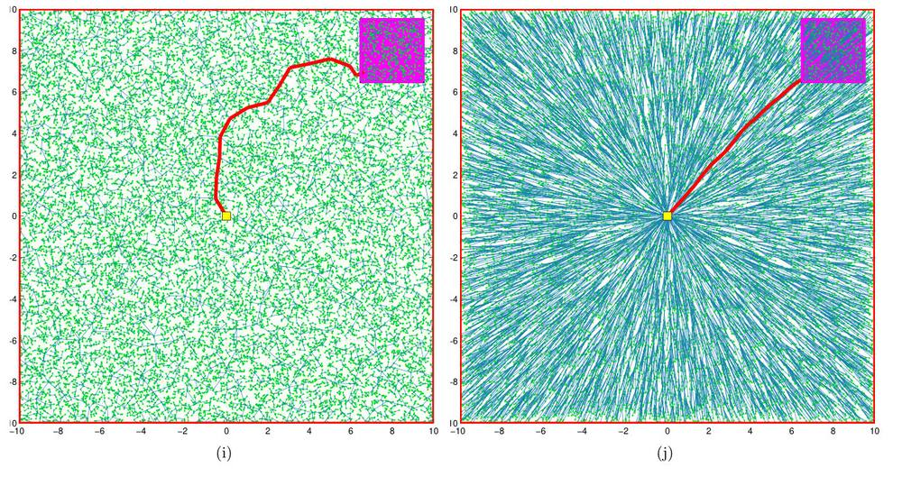
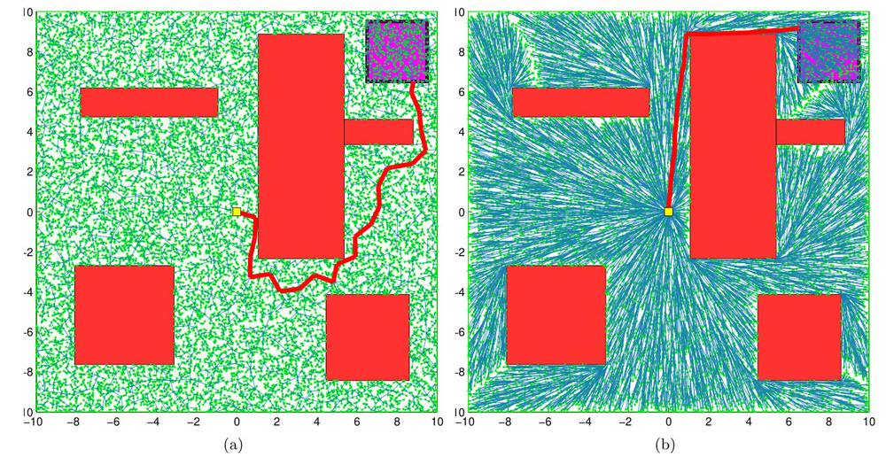
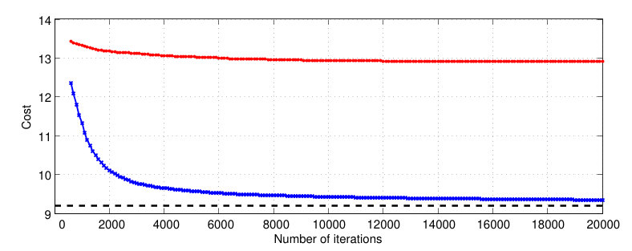

> **TL;DR** Karaman과 Frazzoli는 RRT와 PRM이 확률 1로 *최적이 아닌* path로 수렴함을 증명하고, 최적 path로 수렴하는 RRT\*와 PRM\*를 제안합니다. 고치는 방법은 간단합니다. 새 sample을 (log n / n)^(1/d)처럼 줄어드는 반경 안의 이웃과 연결하고, 가장 싼 부모를 고르고, 이웃들을 새 node를 거치도록 rewire합니다. 추가 비용은 상수배뿐입니다.

> **고전인 이유:** Sampling 기반 planning에서 asymptotic optimality를 정의했고, 이후의 planner(Informed RRT\*, FMT\*, BIT\*, 그리고 TargetTree-RRT\* 같은 주차 planner)가 여전히 물려받는 연결 반경 법칙을 주었습니다.

## 왜 이 논문인가

Minsoo의 planner는 모두 RRT\* 위에 서 있습니다. 보장은 특정 가정에서 나오고, 우리가 하는 변경(goal 영역 대신 target tree, continuous-curvature edge, 학습된 sampling)은 그 가정 중 일부는 지키고 일부는 깹니다. 어느 쪽인지 알면 "RRT\* 기반"이 정확한 주장이 됩니다.

## 문제

**Motion planning**(경로 계획): (0, 1)^d 안에서 x_init부터 goal 영역 X_goal까지 충돌 없는 path를 찾습니다. Path는 직선 구간이고 cost는 길이 같은 것입니다. 미분 제약은 없습니다.

- **Probabilistic completeness**(확률적 완전성): 해가 있으면 sample이 늘수록 해를 찾을 확률이 1로 갑니다. PRM과 RRT는 이 성질이 있습니다.
- **최적성**: *cost*가 가능한 최소값 c\*에 다가갈까요? 아무도 분석하지 않았습니다. RRT를 여러 번 돌려 가장 좋은 것을 남기는 방법에는 보장이 없고, 격자 A\*는 해상도까지만 최적입니다.

## 핵심 아이디어

**먼저 나쁜 소식(증명됨).**

- **RRT는 asymptotically optimal하지 않습니다.** 새 node는 가장 가까운 node에 붙고 부모를 바꾸지 않으므로, 초반의 나쁜 edge가 영원히 남습니다. 최적 cost는 확률 1로 c\*보다 엄격히 큰 무작위 값으로 수렴합니다. RRT를 다시 돌리는 것은 그 값을 더 뽑는 것일 뿐입니다.
- **k가 고정된 k-nearest PRM**은 절대 asymptotically optimal하지 않고, k = 1이면 완전하지도 않습니다. 반경이 고정된 PRM은 최적이지만 sample마다 O(n)번 연결을 시도합니다.

**그다음 해법: 알맞은 이웃.** r(n) = γ (log n / n)^(1/d) 안의 node, 또는 가장 가까운 k log n개와 연결합니다. 이 법칙은 random geometric graph 이론에서 나옵니다. 이 반경에서 무작위 그래프는 높은 확률로 연결되어 있습니다. 더 빨리 줄이면 그래프가 끊어지고, 더 천천히 줄이면 비싸집니다.

비유하면 sample 하나는 새 마을입니다. RRT는 가장 가까운 마을로 길을 하나 내고 다시 생각하지 않습니다. RRT\*는 집까지 가장 짧게 가는 근처 마을을 거쳐 연결하고, 새 마을을 거치면 집까지 더 짧아지는 이웃의 길을 바꿉니다.

## 작동 방식

RRT\* 반복 한 번(Algorithm 6):

1. x_rand를 **sampling**하고, 가장 가까운 node를 찾고, x_rand 쪽으로 최대 η만큼 **steer**해 x_new를 얻고, 충돌을 검사합니다. RRT와 같습니다.
2. **Near 집합**: r = min{γ (log |V| / |V|)^(1/d), η} 안의 모든 node.
3. **부모 고르기**: 충돌 없는 구간으로 이어지는 near node 중 Cost(near) + c(near → x_new)가 가장 작은 node.
4. **Rewire**: near node마다 x_new를 거치는 편이 더 싸고 구간이 비어 있으면, x_new를 그 node의 부모로 만듭니다.

이론을 받치는 구조적 사실은 두 가지입니다.

- **RRT와 같은 vertex.** 같은 sample이면 RRT\*는 RRT의 node를 정확히 그대로 추가하고 edge만 다릅니다. 그래서 RRT의 completeness를 물려받고, 같은 반복에서 첫 해를 찾습니다.
- **같은 차수의 비용.** 부모 고르기와 rewire는 이웃 O(log n)개만 보므로, RRT\*는 RRT처럼 O(n log n) 시간과 O(n) 메모리입니다.

증명에는 γ_RRT\* > (2(1 + 1/d))^(1/d) (μ(X_free)/ζ_d)^(1/d)가 필요합니다. μ(X_free)는 빈 공간의 부피, ζ_d는 단위 공의 부피입니다. k-nearest 버전은 k > 2^(d+1) e (1 + 1/d)만 있으면 되고, 이는 지도와 무관합니다. Sample은 uniform일 필요가 없고, 밀도가 **0보다 확실히 큰** 분포라면 됩니다.

## 결과

모든 실험은 시뮬레이션이고, cost는 path 길이입니다.

- **장애물 없음, 20,000번 반복 × 500회:** RRT는 최적의 약 √2배(약 12.9 vs 9.2)에서 멈추고, RRT\*는 계속 최적에 다가갑니다. 실행 간 분산은 RRT가 약 2.5에 머물고, RRT\*는 0으로 갑니다.

- **장애물 있음:** RRT\*는 다른 homotopy class로 옮겨 가 cost를 21.02에서 14.51로 줄입니다. 장애물이 많은 지도에서 500회 실행하면 RRT는 평균 최적의 약 1.5배이고, 처음에 잘못된 쪽을 택하면 약 2배입니다. RRT\*는 모든 실행이 수렴합니다.

- **실행 시간:** RRT\*/RRT 실행 시간 비율은 반복 백만 번까지 상수로 수렴합니다. 5차원과 10차원에서도 결과가 비슷합니다.

## 한계

- **Holonomic 전용.** 직선 steering과 Euclidean 거리를 쓰고, 미분 제약은 후속 과제로 미룹니다. 차량에서 rewire하려면 두 점을 정확히 잇는 steering 함수와 그에 맞는 거리가 필요한데, 이 증명은 그것을 다루지 않습니다.
- **수렴 속도가 없습니다.** 넓은 지도에서는 uniform sampling이 sample 대부분을 낭비합니다.
- **γ에 빈 공간의 부피가 필요한데**, 실제로는 모릅니다. k-nearest 버전은 이 문제를 피합니다.
- **Robust한 최적해를 가정합니다.** 최적 path가 weak δ-clearance를 가져야 하므로, 폭이 0으로 좁아지는 통로는 제외됩니다.

## DYROS 관점

**TargetTree-RRT\*가 지키는 것.** 출발 pose에서 자라는 점진적 tree, 부모 고르기와 rewire, anytime 개선입니다. Vertex가 여전히 RRT의 extend 단계에서 나오므로 "RRT만큼 빨리 첫 해를 찾는다"는 논리는 그대로 통합니다.

**무엇을 바꾸고, 그 대가는 무엇인가** (우리의 해석):

- **Goal 영역 → target tree.** 미리 만든 continuous-curvature path의 큰 tree에 닿는 것은 작은 goal 집합을 맞히는 것보다 훨씬 쉬워서 첫 해가 빨리 나옵니다. 하지만 마지막 기동은 고정된 집합에서 나오므로, planner는 기껏해야 *target tree 가지로 끝나는 path 중* 가장 좋은 path로 수렴합니다. Sample이 늘수록 target tree를 다듬지 않는다면 말입니다.
- **직선 → continuous-curvature edge.** 두 증명 모두 직선 steering과 Euclidean 공을 가정합니다. 차량 형태의 edge에서는 near 집합이 steering metric의 공이어야 하고, 두 성질을 다시 논증해야 합니다.
- **Uniform → 편향되거나 학습된 sampling** (IV 2023, IROS 2023, JKRS 2026). 최적성은 밀도가 0보다 확실히 클 때만 살아남습니다. 학습된 분포에 작은 uniform 비율 ε를 섞으면 유지되고, 어떤 영역을 절대 방문하지 않는 sampler는 잃습니다.
- **좁은 공간** (T-ASE 2025). 차보다 조금 넓은 주차 칸은 δ-clearance가 아주 작아서 점근적 영역이 아주 늦게 시작합니다.

**일주일 안에 해 볼 수 있는 것.** 우리 주차 시나리오로 Figure 3을 재현합니다. TargetTree-RRT\*에서 rewiring이 있을 때와 없을 때, 학습된 sampling에서 ε = 0, 0.05, 0.2일 때 반복 횟수에 따른 cost를 그립니다. ε = 0 곡선이 다른 곡선보다 높은 곳에서 멈추면, uniform 바닥이 없어서 최적성을 잃고 있는 것입니다.

**논문 기회.** ε-uniform 바닥을 둔 학습 sampling과 온라인으로 다듬는 target tree를 합치면, 실제로 빠르면서 *증명 가능하게* asymptotically optimal한 주차 planner가 됩니다. 우리 학습 sampling 연구의 바로 다음 단계입니다.

**2026년의 독자가 가져갈 것.** 보장마다 손잡이가 하나씩 있습니다. RRT의 vertex 집합이 completeness를 주고, log n 이웃과 rewiring이 optimality를 주며, 0보다 확실히 큰 밀도가 보장을 잃지 않고 sampling을 편향시킬 수 있게 해 줍니다.

## 용어 정리

- **Probabilistic completeness**: 존재하는 해를 찾을 확률이 sample이 늘수록 1로 가는 성질.
- **Asymptotic optimality**: 돌려받은 cost가 확률 1로 최적 cost에 수렴하는 성질.
- **Rewiring**: 새 node를 거치면 root에서 더 싸게 올 수 있을 때, 이웃의 부모를 새 node로 바꾸는 것.
- **Homotopy class**: 장애물을 넘지 않고 서로 변형할 수 있는 path의 묶음. 예: 기둥 왼쪽 vs 오른쪽.
