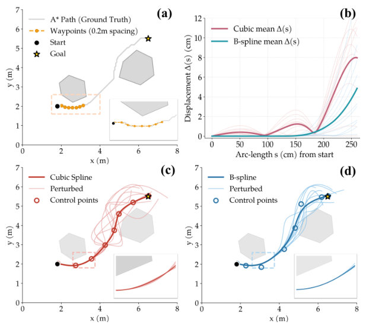
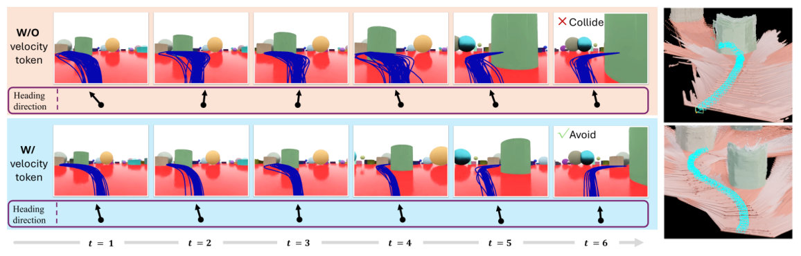

> **TL;DR** SanD-Planner는 depth 이미지 4장과 목표를 보고, waypoint 목록 대신 B-spline control point 8개를 diffusion model로 생성하는 local planner입니다. 그다음 손으로 설계한 ESDF critic이 후보 16개 중 가장 안전한 것을 고릅니다. 전문가 주행 500개(baseline NavDP가 쓴 양의 0.25%)만으로 학습해, 장애물이 빽빽한 benchmark에서 90.1%, 사실적인 실내 장면에서 72.0% 성공률을 내고, 실제 사족 보행 로봇에서도 추가 학습 없이 동작합니다.

## 왜 이 논문인가

학습 기반 planner는 보통 데이터 양으로 이깁니다. 여기서 baseline인 NavDP는 trajectory 200,000개와 A100 GPU 32장을 하루 동안 썼습니다. 우리 같은 연구실이 새 플랫폼마다 그 규모로 데이터를 만들고 학습할 수는 없습니다. 이 논문은 반대 방향으로 묻습니다. 출력 표현을 잘 고르면, 시연 몇백 개로 어디까지 갈 수 있는가? 답은 학습된 planner가 무엇을 출력해야 하는가, 그리고 학습된 부분을 명시적인 기하 검사로 어떻게 단속하는가에 있습니다.

## 문제

**Local navigation**(지역 주행, local planning이라고도 함)은 로봇이 지금 보는 것과 몇 미터 앞의 목표를 받아 짧은 충돌 없는 path를 만들고, 앞부분만 실행한 뒤 다시 계획하는 문제입니다. 여기서 로봇에게는 지도가 없고 depth 카메라만 있습니다.

**Imitation learning**(모방 학습, IL)은 이 대응 관계를 전문가 시연에서 배웁니다. 걸림돌은 두 가지입니다.

- **데이터 욕심.** 성능이 시연 수를 따라갑니다. 최신 방법은 시뮬레이션 주행 수백 km가 보통입니다.
- **나쁜 출력 표현.** 대부분의 학습 planner는 waypoint 목록을 출력합니다. 정해진 간격의 정해진 개수 waypoint는 horizon이 짧아(8개 × 0.2 m = 1.4 m) 로봇이 근시안적이 됩니다. Interpolating cubic spline은 매끄러움을 해결하지만 곡선 전체가 서로 묶여 있습니다. Depth 노이즈가 큰 먼 점에 오차가 생기면 곧 지나갈 가까운 구간까지 곡선 전체가 휩니다.

## 핵심 아이디어

**B-spline control point 공간에서 학습하고, 안전은 명시적인 기하 critic에게 맡깁니다.**

**Clamped cubic B-spline**은 control point 몇 개로 모양이 정해지는 매끄러운 곡선입니다. 휘는 자를 못 몇 개 쪽으로 당긴 모양을 떠올리면 됩니다. 학습을 쉽게 만드는 성질이 세 가지 있습니다.

1. **간결함.** Control point 8개로 약 6 m 길이의 path를 표현합니다. 출력 크기를 늘리지 않고 horizon을 늘립니다.
2. **구조적으로 매끄러움.** Cubic B-spline은 C² 연속(위치, 속도, 가속도가 매끄러움)이라, 네트워크가 매끄러움을 데이터에서 배울 필요가 없습니다.
3. **오차가 국소적이고 상한이 있음.** 곡선의 각 부분은 가까운 control point 4개에만 의존합니다(local support). 그래서 노이즈 낀 먼 점이 가까운 구간을 흔들지 못합니다. 또 곡선은 항상 control point의 convex hull 안에 있으므로, 예측한 control point 오차가 각각 δ 이하이면 path 전체 오차도 δ 이하입니다.

## 작동 방식

**입력.** 최근 depth 이미지 4장, 로봇 좌표계의 상대 목표 (x, y, z), 그리고 **velocity token**입니다. Velocity token은 이전 step에서 고른 plan의 heading 방향입니다.

**Encoding.** 각 depth 프레임은 ResNet-18을 거칩니다. 계단 모서리 같은 세밀한 기하 정보를 살리려고 중간 층의 feature를 씁니다. 목표와 velocity token은 작은 MLP에서 나옵니다. 2층 Transformer가 이를 모두 합쳐 context C_t를 만듭니다.

**생성.** 조건부 diffusion model(DDPM, control point 8개 위의 1D U-Net)이 후보 control point 집합 K개를 sampling합니다. 첫 control point는 로봇 위치(원점)에 고정합니다. 실제 로봇 실험에서는 K = 16이고, 매 주기마다 이전 해에서 warm start해 10단계 중 6단계부터만 denoising합니다.

**선택.** 후보마다 곡선 위의 점 M개를 뽑아 점수를 매깁니다.

- **안전**: 현재 depth 이미지로 ESDF(Euclidean signed distance field, 각 voxel에서 가장 가까운 장애물까지의 거리)를 만듭니다. 안전 여유보다 가까운 점에 페널티를 주되, 할인율 γ^j를 곱해 가까운 점을 먼 점보다 중요하게 봅니다. 어차피 먼 부분에 닿기 전에 다시 계획하기 때문입니다.
- **길이**: 전체 path 길이. 우회를 막습니다.
- **목표**: 곡선 끝점과 목표 사이의 거리.

가중합이 가장 작은 후보를 실행하고, 그 초기 heading이 다음 velocity token이 됩니다.

**Velocity token이 중요한 이유.** 기둥처럼 대칭인 장애물 앞에서는 왼쪽으로 돌든 오른쪽으로 돌든 둘 다 맞습니다. 기억이 없으면 diffusion model은 매 주기 두 mode를 모두 내고, critic은 매번 다른 쪽을 골라, 로봇이 흔들리다 기둥에 부딪힙니다. 이전 heading을 조건으로 주면 후보가 한쪽에 머뭅니다.

**학습 데이터.** 시뮬레이션 세계 10개(Matterport3D와 Gazebo, 계단과 낮은 장애물 포함)에서 PCT-planner를 전문가로 써서 episode 500개를 모읍니다. 각 episode를 무작위 하위 trajectory 여러 개로 자르고 control point 8개로 다시 맞춰 라벨 수를 늘립니다. Sim-to-real을 위해 depth도 무작위로 바꿉니다(RealSense식 노이즈, 픽셀 누락, 지연을 흉내 내는 프레임 정지). 학습은 RTX 4080 한 장으로 약 5시간입니다.

## 결과

**Benchmark (InternNav, point-goal navigation, baseline 수치는 NavDP 논문에서 가져옴).** Success rate (SR)와 SPL(path 길이로 가중한 성공률):

| Benchmark | 방법 | SR | SPL |
|---|---|---|---|
| ClutteredEnv (2020 episode) | iPlanner | 84.8 | 83.6 |
| | ViPlanner | 72.4 | 72.3 |
| | NavDP | 89.8 | **87.7** |
| | **SanD-Planner** | **90.1** | 84.0 |
| InternScenes (4040 episode) | iPlanner | 48.8 | 46.7 |
| | ViPlanner | 54.3 | 52.5 |
| | NavDP | 65.7 | 60.7 |
| | **SanD-Planner** | **72.0** | **63.7** |

학습 비용은 trajectory 0.5k개와 GPU 약 5시간입니다. NavDP는 trajectory 200k개에 A100 32장으로 24시간입니다.

**표현 ablation** (같은 pipeline, 모두 출력 점 8개, benchmark마다 장면 2개):

- ClutteredEnv SR: waypoint 75.5%, cubic spline 75.0%, B-spline **93.0%**.
- InternScenes SR: waypoint 75.5%, cubic spline 72.0%, B-spline **83.5%**.

**데이터 규모.** Trajectory 50개(데이터 10%)로 이미 SR 55.5%, 250개로 65.0%입니다. SPL은 전체 데이터까지 계속 오릅니다(49.6% → 78.9%). 적은 데이터는 "부딪히지 마라"를 가르치고, 더 많은 데이터는 "돌아가지 마라"를 가르칩니다.

**Velocity token.** ClutteredEnv 장면 2개의 평균 SR이 token이 없을 때 86.0%, 있을 때 93.0%입니다. Token이 없을 때의 실패는 기둥 주변에 몰려 있습니다.

**실제 로봇.** RealSense D435를 단 Unitree Go2이고, planner는 RTX 4090 노트북(유선 연결)에서 약 10 Hz로 돌며 MPC가 추종합니다. 추가 학습은 없습니다. 좁은 미로, 복잡한 사무실, 실외, 보행자, 계단 오르기를 시연합니다. 정성적인 시연이며, 실제 환경 성공률은 보고하지 않았습니다.

## 한계

- **Depth만 씁니다.** 작거나 얇거나 반사가 심한 물체(유리, 광택면)는 어렵습니다. 저자들도 인정합니다.
- **장면 기억이 없습니다.** ESDF를 현재 depth 이미지 하나로 만들기 때문에, 시야 밖의 물체는 critic에게 보이지 않습니다.
- **Critic은 순위일 뿐 보장이 아닙니다.** 후보 16개가 모두 나빠도 그중 가장 나은 것을 실행합니다. 그때 어떻게 되는지는 논문에 없습니다.
- **Velocity token의 학습/실행 불일치.** 학습 때는 전문가의 control point(privileged information)에서 가져오고, 실행 때는 로봇의 이전 선택에서 가져옵니다.
- **Baseline 수치는 NavDP 논문에서 그대로 가져왔고**, ClutteredEnv의 SPL은 여전히 NavDP가 가장 좋습니다.

## DYROS 관점

**어디에 맞는가.** 구조는 generate-and-select입니다. 학습된 모델이 후보를 많이 제안하고, 손으로 짠 기하 cost가 하나를 고릅니다. 네트워크가 sampling 분포를 만들고 sampling-based planner가 검사하는 IROS 2023 framework와 가까운 사촌입니다. 새로 배울 점은 표현입니다. 같은 네트워크로 waypoint 대신 B-spline control point를 예측했더니 ablation에서 성공률이 8–18%p 올랐습니다.

**우리 차에서는 무엇이 깨질까.**

- **Nonholonomic 제약.** Cubic B-spline은 매끄럽지만 곡률 상한이 없습니다. 차는 곡률 ≤ 1/R_min이 필요하고, TargetTree-RRT\* 같은 continuous-curvature 주차라면 곡률도 연속이어야 합니다. 여기서 convex hull 성질이 도움이 될 수 있습니다. Control polygon에 한계를 두면 곡선에 대한 보수적인 상한을 얻습니다.
- **기어 변경.** Cusp가 있는 주차 기동은 방향이 바뀌는 지점에서 이어 붙인 여러 곡선입니다. Clamped B-spline 하나로는 cusp를 표현할 수 없으므로, 구간마다 spline 하나와 기어 flag가 필요합니다.
- **센서.** 우리 입력은 전방 depth가 아니라 AVM 조감 영상이나 LiDAR occupancy grid가 될 텐데, 오히려 더 쉽습니다. Occupancy grid로 ESDF를 만드는 것은 표준적인 일입니다.

**일주일 안에 해 볼 수 있는 것.** 시뮬레이션에서 우리 planner로 주차 episode 500개를 만들고, 전진 구간마다 B-spline control point 8개로 맞춥니다. BEV occupancy 이미지와 주차 칸 pose를 조건으로 작은 diffusion model을 학습합니다. 출력으로 waypoint와 B-spline control point를 비교하고(이 논문의 Table III 방식), occupancy grid 위의 ESDF critic으로 고릅니다.

**논문 기회.** "Nonholonomic SanD"입니다. 기어 token을 붙여 구간별 B-spline control point 위에서 diffusion을 돌리고, control polygon으로 계산한 곡률 cost를 critic에 더합니다. 아니면 diffusion 샘플을 최종 path로 쓰지 않고 RRT\*의 sampling 분포로 쓸 수 있습니다. JKRS 2026 learned sampling 연구의 방향입니다. Velocity token 기법도 그대로 가져다 쓸 만합니다. 이전 선택을 생성기의 조건으로 주면, 기둥 주변에서 연속된 plan이 mode 사이를 오가지 않습니다.

## 용어 정리

- **Clamped cubic B-spline**: control point로 정의되는 매끄러운(C²) 곡선. 첫 control point와 마지막 control point에서 정확히 시작하고 끝납니다.
- **Local support**: B-spline의 각 부분이 가까운 control point 몇 개에만 의존하는 성질. 국소 오차가 국소에 머뭅니다.
- **Convex hull property**: B-spline 곡선이 항상 control point의 convex hull 안에 있는 성질. Control point 오차가 곡선 오차의 상한이 됩니다.
- **ESDF (Euclidean signed distance field)**: 각 칸에 가장 가까운 장애물까지의 거리를 저장한 격자. 여유 거리 점수에 씁니다.
- **SPL (success weighted by path length)**: path가 최단 경로보다 얼마나 긴지로 할인한 성공률.
