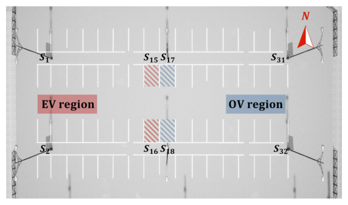

> **TL;DR** SEG-Parking trains a parking policy that goes straight from LiDAR distances to pedal, steering and gear, using only a fixed log of slightly noisy Hybrid A\* + LQR drives and no online trial-and-error. With conservative offline RL it parks in 92–98% of CARLA trials, waits for an oncoming car when it should, and keeps working on parking slots it never saw in training.

## Why this paper

Most parking planners we know, including TargetTree-RRT\* and Hybrid A\*, plan a geometric path and then hand it to a tracking controller. That works well in a static lot. It gets awkward when another car is driving down the same aisle: you replan, wait, replan again, and the rules for "who goes first" live outside the planner. This paper asks whether a single learned policy can handle the path, the timing and the interaction together, without the cost of training RL from scratch in a narrow, crash-prone environment.

## The problem

There are three standard ways to learn parking, and each has a catch:

- **Imitation learning (IL)** copies an expert. It is only as good as the demonstrations, and when the car drifts into a state the expert never visited (covariate shift), errors snowball.
- **Online reinforcement learning (RL)** learns from reward by trial and error. In a parking lot almost every random action ends in a collision, rewards come late (only when the car is finally parked), so training is slow and sample-hungry.
- **Offline RL** learns from a fixed dataset, but a naive learner overestimates the value of actions that never appear in the data, and then picks exactly those actions. In parking those are usually the ones that hit something.

The paper adds one more wrinkle: an **opposite vehicle (OV)** in the aisle that sometimes yields to the ego vehicle (EV) and sometimes has priority.

## Key idea

Make a cheap dataset from a classical planner, then learn a policy that is **allowed to be better than the data but never far from it**.

1. Drive with Hybrid A\* + LQR, but replace the expert action with a random one 20% of the time. The log now contains good maneuvers, bad detours and recoveries.
2. Pretrain the perception encoder by plain behavior cloning, so it learns features that matter for driving.
3. Train the policy with **Conservative Q-Learning (CQL)**, which pushes down the value of actions the dataset does not support. The policy can stitch together the good parts of many noisy runs, but it is discouraged from inventing moves nobody has tried.

Think of it as learning to park from a driving instructor's dashcam archive, where the instructor sometimes fumbled: you keep the good habits, avoid the fumbles, and do not try stunts the archive never showed.

## How it works

**State.** No camera images. The state has three parts:

- an **obstacle distance sequence**: the last K LiDAR scans, each squashed into a vector "distance to the nearest obstacle at every angle around the car";
- the **target pose**: Δx, Δy, Δψ to the slot in the car's own frame;
- **ego motion**: speed and acceleration.

**Action.** A discrete grid: 11 acceleration levels × 11 steering levels × 2 gears (forward/reverse). Gear is part of the action, so the policy decides when to shift into reverse.

**Encoder.** Differences between consecutive scans go through an MLP and an LSTM (this is how it notices that the other car is moving). The current scan goes through another MLP. The target pose becomes the *query* of a multi-head cross-attention block that looks over both. So the encoder answers "given where I want to go, which obstacles matter right now?"

**Training.**

- Stage I: behavior cloning loss on the encoder plus a small action head (20 epochs).
- Stage II: CQL on the policy and two Q networks (80 epochs). The encoder keeps learning with a 10× smaller learning rate. Continuous policy outputs are snapped to the nearest discrete action (Wolpertinger-style).
- Reward: a goal bonus, a progress term exp(−λ·d/d₀) on the SE(2) distance to the slot, a collision penalty, and a penalty when the action strays far from the expert action.

**Data.** CARLA Town04, two central rows of 16 slots, all other slots occupied. 100 episodes for each of three task types: (i) no OV, (ii) OV yields to the EV, (iii) OV has priority and the EV must wait.

## Results

Closed-loop CARLA tests, 24 episodes per task type and slot set. Success means final position error < 1.2 m and heading error < 15°, no collision, no timeout.

| Target slots | Method | Success (type i / ii / iii) | Collisions (i / ii / iii) |
|---|---|---|---|
| Seen (S15, S16) | BC | 60.4 / 62.5 / 66.7% | 20.8 / 20.8 / 22.9% |
| Seen | TD3-BC | 75.0 / 85.4 / 72.9% | 2.1 / 0 / 22.9% |
| Seen | **SEG-Parking** | **97.9 / 91.7 / 97.9%** | 0 / 4.2 / 0% |
| Unseen (S11, S12) | BC | 2.1 / 4.2 / 6.3% | 97.9 / 93.8 / 93.8% |
| Unseen | TD3-BC | 18.8 / 39.6 / 20.8% | 81.3 / 58.3 / 79.2% |
| Unseen | **SEG-Parking** | **91.7 / 91.7 / 97.9%** | 8.3 / 4.2 / 2.1% |

What stands out:

- Plain SAC trained offline almost never succeeds (0–6%): the overestimation problem is real.
- The gap on **unseen slots** is the headline. BC and TD3-BC collapse (they memorized the motion, not the geometry); SEG-Parking barely drops.
- In task type iii the policy really waits: it stays still until the OV finishes (13.5 s in the shown episode), then parks in reverse with smooth steering.
- Final position errors of the successful runs are about 0.27–0.58 m.

## Limitations

- **Simulation only**, one parking lot, one start region, slot choices from a set of four. "Generalization" means two slots further down the same aisle.
- The success threshold (1.2 m, 15°) is loose for real parking. A car 50 cm off the slot center is not parked in a real garage.
- Small evaluation: 24 episodes per cell, so one or two episodes move the percentages by 4–8 points.
- The state is a 2D distance ring from LiDAR plus a known target pose, so it assumes perfect localization and a known slot. No camera, no AVM, no slot detection.
- The OV follows scripted priority rules, so "interaction" means waiting or going, not negotiating.
- The unsafe-action penalty uses the expert action, so the expert planner is still needed at training time.

## DYROS lens

**Where it fits our stack.** This is close to the question behind our IROS 2023 work (learned committed trajectory distribution) but from the opposite side. We kept a sampling-based planner and used learning to tell it *where to sample*; SEG-Parking throws the planner away at run time and lets learning output controls. The good news for us is the data recipe: our TargetTree-RRT\* and narrow-space planners are exactly the kind of "expert" that can generate thousands of noisy demonstrations cheaply, including the tricky multi-point turns that Hybrid A\* struggles with.

**What would break on our car.**

- Accuracy. TargetTree-RRT\* was built for continuous curvature precisely so the car ends up *in* the slot. A policy judged at 1.2 m tolerance does not tell us anything about the last 20 cm.
- Localization. The target pose Δx, Δy, Δψ is given perfectly. In an indoor garage it comes from SLAM or slot detection on the AVM image, both noisy. Our AVM + weighted GICP SLAM work is where this would really be tested.
- Safety. A pure policy has no hard collision guarantee. In narrow spaces we would want a safety filter or a fallback planner.

**What we could try in a week.** Keep our planner as the front end and use an offline-RL policy only for the *interaction* layer: wait, creep, or go when another car enters the aisle. Generate data in CARLA with our planner plus ε-noise (ε = 0.2 as here), train CQL with their reward, and compare against our rule-based waiting logic.

**Paper opportunity.** Train the same policy with *realistic* localization noise (SLAM drift, slot-detection error) and measure the final parking error under a strict tolerance. "Offline RL parking that stays accurate under localization error" is a gap this paper leaves open, and it connects both halves of our work: planning and robust SLAM.

## Key terms

- **Offline RL**: reinforcement learning from a fixed dataset, with no new interaction during training.
- **Conservative Q-Learning (CQL)**: an offline RL method that lowers the value of actions the data does not contain, so the policy stays near supported behavior.
- **Behavior cloning (BC)**: supervised learning that copies the actions in the dataset.
- **Covariate shift**: the policy visits states the training data never covered, and its errors compound.
- **Ego vehicle (EV) / opposite vehicle (OV)**: our car / the other car in the aisle.
