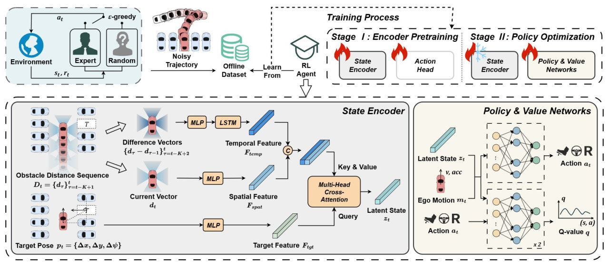
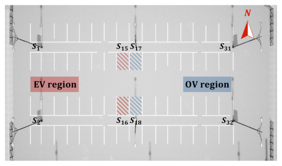

> **TL;DR** SEG-Parking은 LiDAR 거리 정보에서 바로 가속, 조향, 기어를 출력하는 주차 policy를 학습합니다. 학습 데이터는 노이즈를 조금 섞은 Hybrid A\* + LQR 주행 로그뿐이고, 온라인 시행착오는 없습니다. Conservative offline RL 덕분에 CARLA에서 92–98% 확률로 주차에 성공하고, 마주 오는 차가 있으면 기다리며, 학습 때 보지 못한 주차 칸에서도 잘 동작합니다.

## 왜 이 논문인가

TargetTree-RRT\*나 Hybrid A\*처럼 우리가 아는 주차 planner 대부분은 기하학적 path를 먼저 만들고 tracking controller에 넘깁니다. 정적인 주차장에서는 잘 됩니다. 그런데 같은 통로로 다른 차가 들어오면 어색해집니다. 다시 계획하고, 기다리고, 또 계획하고, "누가 먼저 가는가"라는 규칙은 planner 바깥에 따로 둡니다. 이 논문은 하나의 학습된 policy가 path, 타이밍, 상호작용을 한꺼번에 다룰 수 있는지 묻습니다. 그것도 좁고 충돌이 잦은 환경에서 RL을 처음부터 학습하는 비용 없이 말입니다.

## 문제

주차를 학습하는 표준 방법은 세 가지이고, 각각 약점이 있습니다.

- **Imitation learning**(모방 학습, IL)은 전문가를 따라 합니다. 시연 데이터만큼만 잘하고, 차가 전문가가 가 본 적 없는 상태로 벗어나면(covariate shift) 오차가 눈덩이처럼 커집니다.
- **Online reinforcement learning**(강화학습, RL)은 reward를 보며 시행착오로 배웁니다. 주차장에서는 무작위 행동 대부분이 충돌로 끝나고, reward는 차가 다 들어간 뒤에야 나옵니다. 그래서 학습이 느리고 샘플이 많이 듭니다.
- **Offline RL**은 고정된 데이터셋으로 배웁니다. 하지만 단순하게 학습하면 데이터에 없는 행동의 가치를 과대평가하고, 바로 그 행동을 고릅니다. 주차에서는 대개 무언가에 부딪히는 행동입니다.

이 논문은 여기에 한 가지를 더합니다. 통로에 **opposite vehicle**(OV)이 있어서, 어떤 때는 ego vehicle (EV)에 양보하고 어떤 때는 우선권을 가집니다.

## 핵심 아이디어

고전적 planner로 데이터를 싸게 만들고, **데이터보다 나아질 수는 있지만 데이터에서 멀리 벗어나지는 않는** policy를 학습합니다.

1. Hybrid A\* + LQR로 주행하되, 20% 확률로 전문가 행동을 무작위 행동으로 바꿉니다. 로그에는 좋은 기동, 엉뚱한 우회, 복구 과정이 모두 담깁니다.
2. 인식 encoder를 단순한 behavior cloning으로 먼저 학습해, 주행에 중요한 특징을 배우게 합니다.
3. **Conservative Q-Learning**(CQL)으로 policy를 학습합니다. CQL은 데이터셋이 뒷받침하지 않는 행동의 가치를 낮춥니다. 그래서 policy는 여러 노이즈 섞인 주행에서 좋은 부분만 이어 붙일 수 있지만, 아무도 해 보지 않은 기동을 새로 만들어 내지는 않습니다.

운전 강사의 블랙박스 영상 모음으로 주차를 배우는 것과 비슷합니다. 강사도 가끔 실수를 했습니다. 좋은 습관은 가져가고, 실수는 피하고, 영상에 한 번도 나오지 않은 묘기는 시도하지 않습니다.

## 작동 방식

**State.** 카메라 이미지는 쓰지 않습니다. State는 세 부분입니다.

- **장애물 거리 시퀀스**: 최근 K개의 LiDAR scan을 각각 "차 주변 각도마다 가장 가까운 장애물까지의 거리" 벡터로 압축한 것
- **목표 pose**: 차 기준 좌표계에서 주차 칸까지의 Δx, Δy, Δψ
- **ego motion**: 속도와 가속도

**Action.** 이산 격자입니다. 가속 11단계 × 조향 11단계 × 기어 2개(전진/후진). 기어가 action에 들어 있어서 언제 후진으로 바꿀지도 policy가 정합니다.

**Encoder.** 연속한 scan의 차이는 MLP와 LSTM을 거칩니다(다른 차가 움직이는 것을 알아채는 부분입니다). 현재 scan은 다른 MLP를 거칩니다. 목표 pose는 multi-head cross-attention의 *query*가 되어 두 특징을 함께 봅니다. 즉 encoder는 "내가 가려는 곳을 생각하면, 지금 어떤 장애물이 중요한가?"에 답합니다.

**학습.**

- Stage I: encoder와 작은 action head에 behavior cloning loss를 겁니다 (20 epoch).
- Stage II: policy와 두 Q network를 CQL로 학습합니다 (80 epoch). Encoder는 10배 작은 learning rate로 계속 조금씩 학습됩니다. 연속값인 policy 출력은 가장 가까운 이산 action으로 맞춥니다(Wolpertinger 방식).
- Reward: 목표 도달 보너스, 주차 칸까지의 SE(2) 거리에 대한 진행 항 exp(−λ·d/d₀), 충돌 페널티, 그리고 action이 전문가 action과 많이 다를 때 주는 페널티.

**데이터.** CARLA Town04의 가운데 두 줄(각 16칸), 나머지 칸은 모두 차로 채웁니다. 세 가지 과제 유형마다 100 episode를 모읍니다: (i) OV 없음, (ii) OV가 EV에 양보, (iii) OV가 우선이라 EV가 기다려야 함.

## 결과

CARLA closed-loop 시험으로, 과제 유형과 주차 칸 묶음마다 24 episode를 돌립니다. 성공은 최종 위치 오차 < 1.2 m, heading 오차 < 15°, 충돌 없음, 시간 초과 없음입니다.

| 목표 칸 | 방법 | 성공률 (유형 i / ii / iii) | 충돌률 (i / ii / iii) |
|---|---|---|---|
| 학습한 칸 (S15, S16) | BC | 60.4 / 62.5 / 66.7% | 20.8 / 20.8 / 22.9% |
| 학습한 칸 | TD3-BC | 75.0 / 85.4 / 72.9% | 2.1 / 0 / 22.9% |
| 학습한 칸 | **SEG-Parking** | **97.9 / 91.7 / 97.9%** | 0 / 4.2 / 0% |
| 처음 보는 칸 (S11, S12) | BC | 2.1 / 4.2 / 6.3% | 97.9 / 93.8 / 93.8% |
| 처음 보는 칸 | TD3-BC | 18.8 / 39.6 / 20.8% | 81.3 / 58.3 / 79.2% |
| 처음 보는 칸 | **SEG-Parking** | **91.7 / 91.7 / 97.9%** | 8.3 / 4.2 / 2.1% |

눈여겨볼 점:

- Offline으로 학습한 그냥 SAC는 거의 성공하지 못합니다(0–6%). 과대평가 문제는 실제로 존재합니다.
- 핵심은 **처음 보는 칸**에서의 차이입니다. BC와 TD3-BC는 무너집니다(기하 구조가 아니라 움직임 자체를 외웠기 때문입니다). SEG-Parking은 거의 떨어지지 않습니다.
- 유형 iii에서 policy는 정말로 기다립니다. 예시 episode에서는 OV가 주차를 마칠 때까지(13.5 s) 멈춰 있다가, 부드럽게 조향하며 후진 주차합니다.
- 성공한 주행의 최종 위치 오차는 약 0.27–0.58 m입니다.

## 한계

- **시뮬레이션만** 했고, 주차장 하나, 출발 영역 하나, 목표 칸은 네 개 중에서 고릅니다. 여기서 "일반화"는 같은 통로에서 두 칸 더 떨어진 곳을 뜻합니다.
- 성공 기준(1.2 m, 15°)은 실제 주차에는 느슨합니다. 칸 중심에서 50 cm 벗어난 차는 실제 주차장에서는 주차된 것이 아닙니다.
- 평가 규모가 작습니다. 칸마다 24 episode라서 한두 episode가 4–8%p를 움직입니다.
- State는 LiDAR로 만든 2D 거리 고리와 정확히 알려진 목표 pose입니다. 즉 완벽한 localization과 이미 아는 주차 칸을 가정합니다. 카메라, AVM, 주차 칸 검출이 없습니다.
- OV는 정해진 우선권 규칙을 따르므로, 여기서 "상호작용"은 협상이 아니라 기다리기 또는 가기입니다.
- 위험 행동 페널티가 전문가 action을 쓰므로, 학습할 때는 여전히 전문가 planner가 필요합니다.

## DYROS 관점

**우리 스택의 어디에 맞는가.** IROS 2023 연구(learned committed trajectory distribution)의 질문과 가깝지만 방향이 반대입니다. 우리는 sampling-based planner를 유지하고 학습으로 *어디를 sampling할지* 알려 주었습니다. SEG-Parking은 실행 시점에 planner를 버리고 학습이 직접 제어 입력을 냅니다. 우리에게 좋은 점은 데이터를 만드는 방법입니다. TargetTree-RRT\*와 좁은 공간용 planner는 노이즈 섞인 시연 수천 개를 싸게 만들 수 있는 바로 그런 "전문가"이고, Hybrid A\*가 어려워하는 여러 번 꺾는 기동도 포함할 수 있습니다.

**우리 차에서는 무엇이 깨질까.**

- 정확도. TargetTree-RRT\*는 차가 칸 *안에* 정확히 들어가도록 continuous curvature를 쓴 것입니다. 1.2 m 허용 오차로 평가한 policy는 마지막 20 cm에 대해 아무것도 알려 주지 않습니다.
- Localization. 목표 pose Δx, Δy, Δψ가 완벽하게 주어집니다. 실내 주차장에서는 SLAM이나 AVM 영상의 주차 칸 검출에서 나오고, 둘 다 노이즈가 있습니다. 우리의 AVM + weighted GICP SLAM 연구가 실제로 시험해 볼 수 있는 지점입니다.
- 안전. 순수 policy에는 충돌을 막는 확실한 보장이 없습니다. 좁은 공간에서는 safety filter나 fallback planner가 필요합니다.

**일주일 안에 해 볼 수 있는 것.** 우리 planner는 그대로 두고, offline RL policy는 *상호작용* 층에만 씁니다. 다른 차가 통로에 들어왔을 때 기다릴지, 천천히 갈지, 갈지를 정하는 부분입니다. CARLA에서 우리 planner에 ε-노이즈(여기처럼 ε = 0.2)를 넣어 데이터를 만들고, 논문의 reward로 CQL을 학습한 뒤, 지금의 규칙 기반 대기 로직과 비교합니다.

**논문 기회.** 같은 policy를 *현실적인* localization 노이즈(SLAM drift, 주차 칸 검출 오차)와 함께 학습하고, 엄격한 허용 오차에서 최종 주차 오차를 측정합니다. "Localization 오차 아래에서도 정확한 offline RL 주차"는 이 논문이 비워 둔 빈칸이고, 우리 연구의 두 축인 planning과 robust SLAM을 잇습니다.

## 용어 정리

- **Offline RL**: 학습 중 새로운 상호작용 없이 고정된 데이터셋으로 하는 강화학습.
- **Conservative Q-Learning (CQL)**: 데이터에 없는 행동의 가치를 낮춰 policy가 데이터가 뒷받침하는 행동 근처에 머물게 하는 offline RL 기법.
- **Behavior cloning (BC)**: 데이터셋의 행동을 그대로 따라 하는 지도학습.
- **Covariate shift**: policy가 학습 데이터에 없던 상태로 들어가 오차가 쌓이는 현상.
- **Ego vehicle (EV) / opposite vehicle (OV)**: 우리 차 / 통로의 다른 차.
