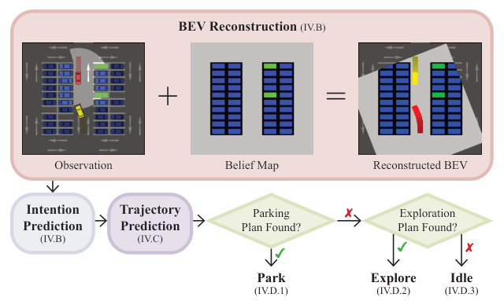
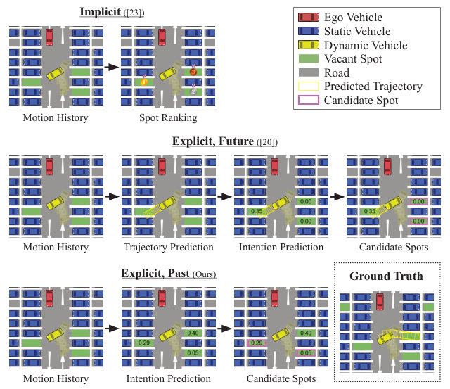

> **TL;DR** 같은 통로에서 다른 차도 자리를 찾고 있다면, 그 차가 지금까지 어떻게 움직였는지 보고 어느 칸을 노리는지 추측한 뒤 그 칸은 피합니다. Honda Research Institute의 이 pipeline은 학습된 intention 모델과 주차장의 belief map으로 바로 이 일을 합니다. 무작위로 만든 주차장 500개에서, 반응하지 않는 운전자를 상대로 99.8% 주차에 성공하고(기존 pipeline은 약 90%), 다른 차가 향하던 칸을 한 번도 가로채지 않습니다.

## 왜 이 논문인가

우리 주차 planner(TargetTree-RRT\*, 좁은 공간용 planner)는 주차 칸이 정해진 다음에 일을 시작합니다. 실제 발레 주차에서는 아무도 칸을 정해 주지 않습니다. 차가 들어와서 둘러보고, 다른 운전자들도 같은 일을 하는 동안 칸 하나를 골라야 합니다. 누군가 막 후진해 들어가려는 칸을 고르면 그 차를 막거나, 경쟁하거나, 통로에서 기다리게 됩니다.

이 논문은 motion planner (경로 계획기) 바로 위의 층, 즉 **어느 칸으로 갈 것인가**를 다룹니다. 다른 차들이 원하는 것처럼 보이는 칸을 고려해서 고릅니다. 그리고 충돌뿐 아니라 "사회적" 실패(칸 가로채기, 다른 운전자 방해)까지 측정합니다.

## 문제

**Autonomous valet parking**(자율 발레 주차, AVP): 승객을 내려 주고, 주차장을 탐색하고, 빈칸을 찾고, 다른 차와 그 칸을 두고 협상하고, 사람 없이 주차합니다. Ego 차량은 지도(입구, 칸의 pose, 도로)는 알지만 어느 칸이 비었는지, 다른 운전자가 무엇을 하려는지는 모릅니다.

칸 고르기가 어려운 이유는 세 가지입니다.

- **Intention(의도)이 많고 모호합니다.** 빈칸은 모두 목표가 될 수 있고, 주차장에서는 운전자가 차선을 무시합니다. 천천히 앞으로 가는 차는 오른쪽 칸으로 들어가려는 것일 수도 있고, 뒤쪽 칸에 후진으로 넣으려고 앞으로 빼는 중일 수도 있습니다.
- **짧은 시간의 움직임은 약한 단서입니다.** 같은 그룹의 이전 pipeline(Nawaz et al., 이 목록의 occupancy-aware AVP 논문)은 *예측한 미래 trajectory*에서 intention을 추론하고, 실험에서는 그 미래를 안다고 가정했습니다. 그런데 유일한 공개 주차 데이터셋(Dragon Lake Parking, DLP: 주차장 한 곳, 3.5시간)으로 학습한 trajectory 예측기는 그 자체가 intention을 조건으로 받으므로, 논리가 순환합니다.
- **학습된 intention 모델은 ego가 갖지 못한 데이터를 요구합니다.** DLP로 학습한 ParkPredict+는 *다른* 차 주변의 400×400 semantic BEV(bird's-eye view, 위에서 내려다본 영상)를 입력으로 받습니다. 도로, 칸, 주차된 차, 그리고 40 m 안의 모든 움직이는 차의 최근 4 s 기록이 들어갑니다. Ego는 그중 일부만 봅니다.

## 핵심 아이디어

보이는 차마다 어디에 주차하려는지 **과거** 움직임으로 **명시적으로** 예측하고, 그 차 주변에서 ego가 볼 수 없는 부분은 **belief map**으로 채웁니다. 그리고 다른 차가 원할 가능성이 높은 칸은 피합니다.

쇼핑몰 주차장을 떠올려 보면 됩니다. 어떤 차가 빈칸 옆에서 속도를 줄이고 후진등을 켭니다. 그 차의 경로를 정확히 예측하지 않아도 그 칸은 이미 임자가 있다는 것을 압니다. 이미 한 행동에서 의도를 읽는 것입니다.

## 작동 방식

매 timestep마다 다음을 합니다.

1. **Belief map.** 칸 i마다 belief bᵢ ∈ [0, 1]이 있습니다. 다른 차가 그 칸에 있거나 곧 들어갈 확률입니다. 처음에는 모두 0.5입니다. 비어 있는 것을 본 칸은 0, 찬 것을 본 칸은 1로 바꾸고, 보이지 않는 칸은 이전 값을 유지합니다.
2. **BEV 재구성.** Ego가 볼 수 있는 움직이는 차마다 그 차에 필요한 BEV를 그립니다. 알고 있는 도로와 칸, 관측한 모든 차와 그 기록을 그리고, ego가 볼 수 없는 칸은 bᵢ ≥ 0.5이면 기본 크기 차(4.97 × 1.86 m)를 그려 넣습니다.
3. **Intention 예측.** 이 영상과 간단한 특징 몇 가지(후보 칸까지의 거리와 heading, 속도, 주차장에 머문 시간)를 ParkPredict+ CNN에 넣습니다. 출력은 후보 칸마다, 그리고 "계속 탐색"에 대한 확률 η입니다.
4. **Belief 갱신.** 빈칸의 belief는 움직이는 차 중 적어도 하나가 그 칸에 들어갈 확률이 됩니다: b = 1 − Π(1 − η).
5. **Trajectory 예측.** η ≥ 0.3인 intention마다 차의 pose에서 칸까지 cubic Bézier 곡선을 그립니다. 끝 접선은 칸의 heading 방향입니다. 차는 현재 속도로 이 곡선을 따라간다고 봅니다. 보행자는 등속 운동으로 예측합니다.
6. **결정.**
   - **주차**: 후보는 b ≤ 0.3인, 비어 있는 것으로 관측된 칸입니다. Hybrid A\*로 각 칸까지 계획하되 찼다고 믿는 칸은 피합니다. 예측 trajectory와 부딪히는 계획은 버리고, 남은 것 중 비용이 가장 낮은 것을 고릅니다.
   - **탐색**: 그렇지 않으면 통로가 센서 범위를 벗어나는 지점으로 Hybrid A\* 계획을 세웁니다.
   - **대기**: 안전한 것이 하나도 없으면 기다립니다.

**시뮬레이터.** Ego는 반경 11.5 m 안에서 광선 360개로 센싱하므로 주차된 차가 시야를 가립니다. 다른 agent는 정해진 계획을 따르지만, "passiveness" 2–6 step 안에 ego와의 충돌이 예상되면 브레이크를 밟습니다. 반응하지 않는(non-reactive) 버전은 절대 멈추지 않으므로 더 어려운 시험입니다.

## 결과

**설정.** 40칸짜리 작은 주차장입니다. 다른 차 한두 대가 아래쪽 칸 근처에 생성되어, DLP에서 관찰된 사람의 주차 기동 8가지 중 하나로 주차합니다. 무작위 설정 500개를 reactive agent와 non-reactive agent로 각각 돌리고, 보행자는 없습니다. 방법끼리는 칸을 고르는 규칙만 다릅니다.

**Baseline.**

- **Explicit, Future**(Nawaz et al.): 등속 trajectory 예측에서 intention을 추론합니다.
- **Implicit**(ego에만 ParkPredict+ 적용): ego를 위한 칸 순위만 매기고, 다른 운전자의 목표는 따지지 않습니다.
- 이 pipeline에서 trajectory 예측기만 바꾼 변형: 등속, Hybrid A\*, ParkPredict+의 transformer.

| Agent | 방법 | 성공률 | 칸 가로채기 | minADE / minFDE |
|---|---|---|---|---|
| Non-reactive | **Ours (Bézier)** | **99.8%** | 0.0% | 2.02 / 2.40 m |
| Non-reactive | Explicit, Future | 90.8% | 0.0% | 3.13 / 5.64 m |
| Non-reactive | Implicit | 90.4% | 0.2% | 2.77 / 5.00 m |
| Reactive | **Ours (Bézier)** | **100.0%** | **0.0%** | 2.02 / 2.39 m |
| Reactive | Explicit, Future | 98.8% | 4.6% | 2.90 / 5.28 m |
| Reactive | Implicit | 98.6% | 3.4% | 2.52 / 4.59 m |

눈여겨볼 점:

- **Non-reactive 운전자**: 과거 기록에 기반한 명시적 intention이 성공률을 약 9%p 올리고, 최종 예측 오차(minFDE)는 절반 아래로 줄어듭니다.
- **Reactive 운전자**: 다른 차가 브레이크를 밟으므로 모든 방법이 거의 항상 성공합니다. 차이는 사회적 측면에서 납니다. 이 pipeline은 다른 차가 향하던 칸을 한 번도 가로채지 않았고, 다른 운전자를 덜 방해했습니다(실행당 방해한 timestep 0.07 대 0.41, 0.21).
- **단순한 것이 이깁니다.** Bézier 예측기는 네 예측기 중 성공률이 가장 높고, 정확도는 학습된 transformer와 비슷합니다(minADE 2.02 대 1.82 m, minFDE 2.40 대 2.46 m). 칸 선택은 약 10배 빠릅니다(0.005 s 대 0.054 s).
- **비용.** 칸 선택이 더하는 시간은 약 4 ms뿐입니다. 진짜 병목은 계획당 약 1–1.5 s 걸리는 Hybrid A\*입니다. 주차 시간은 모든 방법이 비슷합니다(19–21 s).

## 한계

- **실시간이 아닙니다.** Hybrid A\*가 한 주기에 약 1–1.5 s 걸립니다. 목표로 언급한 것은 10 Hz입니다.
- **시뮬레이션만 했습니다.** 다른 운전자는 단순한 브레이크 규칙이 붙은 정해진 경로를 따릅니다. 주차장은 40칸, 다른 차는 한두 대, 주요 실험에는 보행자가 없습니다. 여분의 빈칸 두 개가 항상 있으므로 성공률은 혹독한 시험이 아닙니다.
- **시야 안에서는 완벽한 인식.** 빈칸/찬 칸, 주차/주행 여부, 보이는 차마다 4 s 기록이 모두 정확하다고 가정합니다. 노이즈도, 거리에 따른 성능 저하도 없습니다.
- Intention 모델은 보행자, 칸에서 나가는 차, 다른 종류의 차량을 다루지 않습니다.

## DYROS 관점

**우리 스택의 어디에 맞는가.** TargetTree-RRT\* 바로 위의 층입니다. 이 pipeline은 매 주기 후보 칸마다 Hybrid A\*를 한 번씩 부르고, 그것이 병목입니다. 저자들도 sampling-based planner를 포함해 더 빠른 planner로 바꾸는 것을 당연한 다음 단계로 꼽습니다. Target tree는 후보 칸이 많을 때 잘 맞습니다. 칸마다 continuous-curvature 진입 경로를 미리 만들어 두고, RRT\* tree 하나가 그 전부를 향해 자라게 하고, belief bᵢ를 각 목표의 비용으로 넣으면 됩니다. "N개 칸에 각각 계획한 뒤 고르기"가 planning 질의 한 번으로 바뀝니다.

**우리 차에서는 무엇이 깨질까.**

- **칸의 정체성.** Belief map은 칸 단위로 저장됩니다. 실내 주차장에서 칸 위치는 AVM 주차 칸 검출과 SLAM에서 나옵니다. 기둥과 주차선이 반복되는 곳에서는 작은 drift만으로 belief가 엉뚱한 칸에 붙습니다. 우리의 AVM + weighted GICP SLAM 연구가 바로 여기서 중요합니다.
- **다른 차의 기록.** Intention 모델은 움직이는 차마다 4 s 기록이 필요합니다. 주차된 차와 기둥에 가려지면 기록이 끊기고, AVM만으로는 차 주변 몇 미터밖에 보지 못합니다.

**일주일 안에 해 볼 수 있는 것.** 학습이 필요 없는 부분은 싸게 만들 수 있습니다. Belief map, Bézier 예측기, 주차/탐색/대기 로직을 우리 시뮬레이터에 넣고, 주차 planner로 TargetTree-RRT\*(또는 Biased Target-tree\*)를 써서 주기당 planning 시간을 이들의 1–1.5 s Hybrid A\*와 비교합니다. 두 번째 확인: 붐비는 주차장을 몇 번 주행하며 기록하고, 다른 차가 들어간 칸을 표시한 뒤, 등속 예측과 intention별 Bézier 예측 중 어느 쪽이 맞혔을지 봅니다.

**논문 기회.** "Belief-aware multi-goal target-tree planning": sampling tree 하나와 후보 칸마다 target tree 하나를 두고, 각 칸의 비용에 다른 차가 그 칸을 차지할 확률을 반영해 10 Hz로 돌립니다. 이 논문이 남긴 숙제는 planning 속도이고, 그것은 우리 planner가 가장 강한 부분입니다. 실차 실험까지 하면 이 논문보다 한 걸음 더 나갑니다.

## 용어 정리

- **Autonomous valet parking (AVP)**: 승객이 내린 뒤 차가 스스로 칸을 찾아 주차하는 기능.
- **Intention**: 여기서는 다른 운전자가 주차하려는 칸(또는 "계속 탐색").
- **Belief map**: 칸마다 다른 차가 있거나 곧 들어올 확률을 담은 지도.
- **Bird's-eye view (BEV)**: 차 주변 장면을 위에서 내려다본 영상.
- **minADE / minFDE**: 여러 예측 trajectory 중 가장 좋은 것의 평균 / 최종 위치 오차.
- **Passiveness**: 시뮬레이션 운전자가 브레이크를 밟기 전에 충돌을 몇 step 앞까지 살피는지.
