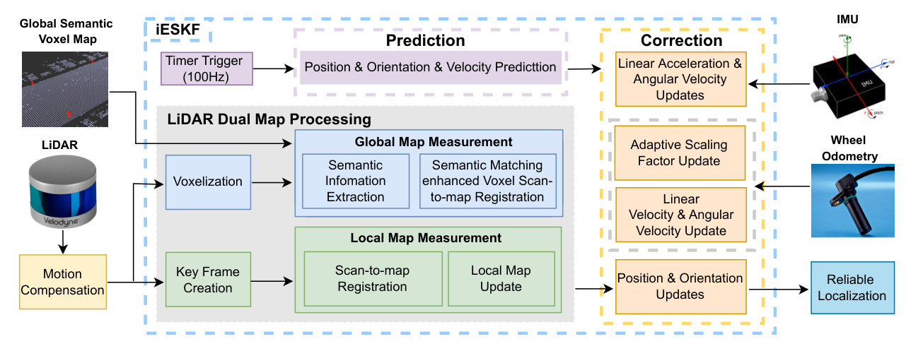
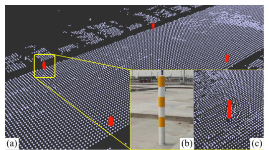

> **TL;DR** A map-based localizer for 15 m port vehicles that fuses LiDAR, IMU and wheel odometry in one iterated error-state Kalman filter. Map voxels are labeled by shape (pole, plane, other), pole voxels get more weight in matching, and a scale factor on wheel speed is estimated online. On six real trajectories (11.7 km) the mean error is 8–16 cm, while LiDAR-inertial odometry baselines drift by meters.

## Why this paper

An automated port looks a lot like a huge outdoor parking lot: flat ground, few tall structures, rows of identical containers, and large vehicles moving everywhere. This paper is an industrial answer to "how do I localize reliably there every day": a prior map, tight fusion of LiDAR, IMU and **wheel odometry**, and a simple way to tell the matcher which parts of the map to trust. Two links to us: our car has wheel odometry, and weighting registration by structure is close to our weighted GICP work.

## The problem

- **LiDAR-inertial odometry drifts.** FAST-LIO2 and Point-LIO are excellent locally, but over kilometers in an open, repetitive yard they pile up meters of error.
- **Dynamic scenes corrupt matching.** Cranes, trucks and other vehicles move. Points on them do not belong in the map, and matching against them pulls the estimate away.
- **Few good features.** In a port, the vehicles' 16-line LiDARs mostly see ground. Without vertical structure the horizontal position is weakly constrained (a degeneracy problem).
- **Wheel odometry sometimes lies.** Slopes, slippery ground and tire slip make the speed reading wrong by a varying factor.

## Key idea

Three pieces, all inside one filter:

1. **A "semantic" voxel map.** Each 0.5 m voxel of the prior map stores a mean and a covariance. An SVD of the covariance classifies it as a **cylinder** (one dominant direction, close to vertical: a pole), a **plane** (two large directions, normal close to vertical) or **other**. Note that "semantic" here means a geometric shape label, not a neural network.
2. **Weighted global matching.** During scan-to-map registration, each point's residual is weighted by the label of the voxel it falls in, with w_cylinder > w_plane > w_other. Poles are rare, fixed and give strong horizontal constraints, so they are trusted most.
3. **Wheel odometry with an adaptive scale.** The state includes a 3D scale vector v_S that multiplies the wheel-speed measurement element by element. The filter estimates it online, so slip or tire wear shows up as a changed scale instead of a position error.

The port operators also helped the algorithm: they **installed pillars** (at least 20 cm in diameter and 1.5 m tall) every 35 m along both sides of the lanes.

## How it works

**State** of the iterated error-state Kalman filter (iESKF, as in FAST-LIO): position, velocity, orientation, IMU biases, the vehicle's linear acceleration and angular velocity, the wheel scale v_S, gravity, and the LiDAR–IMU and wheel–IMU extrinsics.

**Prediction.** The state is propagated with the *estimated* acceleration and angular velocity, assumed constant between updates, rather than by integrating raw IMU samples. The authors argue this survives IMU dropouts and time-sync glitches better.

**Corrections.**

- **IMU as a measurement**: gyro and accelerometer readings, rotated into the wheel frame, correct the estimated angular velocity and acceleration.
- **Wheel odometry**: the scaled wheel velocity (plus the lever-arm effect of rotation) must match the filter's velocity, and the wheel yaw rate must match the estimated yaw rate.
- **LiDAR, dual map**:
  - *Global*: the voxelized scan is matched to the prior semantic voxel map with a voxelized GICP-style residual, weighted by voxel label. This bounds long-term drift.
  - *Local*: the scan is matched point-to-plane to a local map built from recent key frames, which adapts to changes such as moved equipment.
  - Both residuals go into the same iESKF update.

**Map building.** The global map is built offline with FAST-LIO2 plus loop closure and GPS factors (LIO-SAM style), with dynamic objects removed so that only static structure remains. Voxel covariances are then regularized per label, GICP-style.

## Results

**Setup.** A real port of about 1 km² with a 1538 m × 596 m map. The vehicles are 15 m long, with two 16-line LiDARs, four wheel encoders, four steering-angle sensors and an INS. Ground truth comes from RTK-aided multi-sensor fusion. Six test trajectories from six vehicles, 11.7 km in total. Baselines: Light-LOAM, FAST-LIO2, Point-LIO, and their own filter with a conventional iKD-Tree point map instead of the semantic voxel map ("Ours-iKD-Tree").

Absolute pose error, max / mean:

| Trajectory | FAST-LIO2 | Point-LIO | Ours-iKD-Tree | **Ours (semantic voxel)** |
|---|---|---|---|---|
| traj-1 (1.8 km) | 4.26 / 2.38 m | 21.28 / 1.68 m | 10.93 / 5.58 m | **0.28 / 0.13 m** |
| traj-3 (1.9 km) | 5.05 / 2.55 m | 6.61 / 2.03 m | 13.49 / 5.31 m | **0.70 / 0.13 m** |
| traj-4 (3.0 km) | 4.87 / 2.65 m | 14.31 / 3.24 m | 11.06 / 3.57 m | **0.67 / 0.16 m** |
| traj-6 (1.4 km) | 1.04 / 0.43 m | 18.22 / 0.54 m | 0.40 / 0.12 m | 0.42 / **0.08 m** |

- With the semantic voxel map, the mean error is 0.08–0.16 m on every trajectory and the max is 0.28–0.70 m. Mean lateral error is 2–4 cm.
- Light-LOAM fails on five of the six trajectories; on the one it completes (traj-3), its max error (0.62 m) is slightly lower than this system's.
- The most telling comparison is with **Ours-iKD-Tree**: the same filter and sensors with a plain point map reach up to 13.5 m max error. So the gain comes mostly from the map representation and the weighting, not from adding the wheel.
- The paper also reports deployment on 35 vehicles with 3,575 hours of operation, but the numbers above come only from the six test trajectories.

## Limitations

- **Unequal comparison.** FAST-LIO2, Point-LIO and Light-LOAM are odometry methods without a prior map; this system matches against a prior global map. Meters of drift vs centimeters is expected. A fair baseline would be another map-based localizer (for example NDT or GICP against the same map).
- **No ablation** of the wheel odometry or the 3D adaptive scale. We cannot tell how much each helps, or how the scale behaves on slopes.
- **The environment was modified.** Poles every 35 m are infrastructure, not an algorithm. Without them the cylinder class may be nearly empty.
- **Dynamic objects** are mainly handled by cleaning the prior map and by the weights; the paper shows no specific test with moving vehicles close to the ego vehicle.
- The weights are hand-set (only their order is given), and some table entries look odd (e.g., a baseline with 4 m max but 0.001 m mean longitudinal error).

## DYROS lens

**Garage pillars are free "semantic" landmarks.** An indoor parking garage already has what this port had to install: concrete pillars on a regular grid. Algorithm 1 (SVD per voxel, label vertical cylinders and horizontal planes) is a few dozen lines on top of any voxel map, and weighting pillar voxels higher in GICP is a direct extension of our weighted GICP for AVM SLAM. The catch is the classic garage pain point: pillars are **repetitive**. Upweighting them strengthens constraints when the prior pose is good, but it could also strengthen a wrong match one bay over. That trade-off is worth measuring.

**Wheel odometry.** Our car has wheel odometry. Putting a scale vector on wheel speed into the filter state is a cheap way to absorb tire-radius error and slip, and slow parking maneuvers with full steering lock are exactly where wheel odometry errors show up. The paper never isolates this effect, so we would have to measure it ourselves.

**What would break.** In a garage the troublesome objects are often *parked* cars that were not there when the map was built. The local map helps, but a prior map full of yesterday's parked cars is a known failure mode. Dynamic removal during mapping must also remove these "semi-static" cars.

**What we could try in a week.** Take a voxel map of a garage, run the SVD labeling, and count how many voxels become "cylinder" and whether they line up with the pillars. Then add the label weights to our GICP and compare registration accuracy and the rate of wrong-bay matches, with and without the weights.

**Paper opportunity.** Replace the hand-set weights with weights derived from each voxel's information content and the current degeneracy direction (for example, upweight pillars only along the axis that the parking lines do not constrain). "Structure-aware weighting for repetitive garages" combines this paper's idea with our GICP work and with robust SLAM.

## Key terms

- **iESKF**: iterated error-state Kalman filter; it estimates a small error around a nominal state and re-linearizes several times per update.
- **Semantic voxel**: here, a map voxel labeled cylinder, plane or other from the shape of its point covariance.
- **Wheel odometry scale factor**: an estimated multiplier on wheel speed that absorbs slip and tire-radius error.
- **Dual map**: matching each scan to both a fixed global map (no drift) and a fresh local map (adapts to change).
- **Degeneracy**: a direction in which scan matching has little or no information, so the pose can slide along it.
