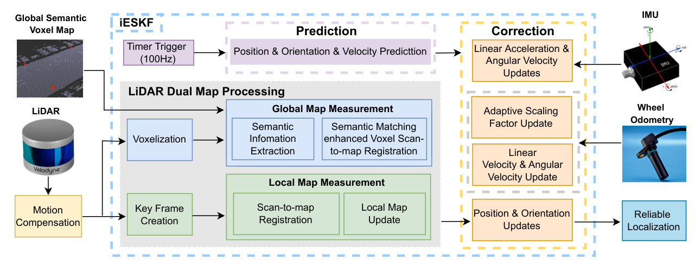
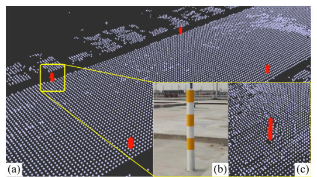

> **TL;DR** 길이 15 m짜리 항만 차량을 위한 지도 기반 localization 시스템입니다. LiDAR, IMU, wheel odometry (휠 주행 거리 추정)를 iterated error-state Kalman filter 하나로 융합합니다. 지도 voxel에 모양 라벨(기둥, 평면, 기타)을 붙여 기둥 voxel에 matching 가중치를 더 주고, 휠 속도의 scale factor를 온라인으로 추정합니다. 실제 trajectory 6개(11.7 km)에서 평균 오차가 8–16 cm이고, LiDAR-inertial odometry baseline은 수 미터씩 drift합니다.

## 왜 이 논문인가

자동화 항만은 거대한 야외 주차장과 많이 닮았습니다. 평평한 바닥, 높은 구조물이 거의 없는 공간, 똑같이 생긴 컨테이너 줄, 그리고 곳곳을 움직이는 큰 차량들입니다. 이 논문은 "그런 곳에서 매일 안정적으로 위치를 추정하려면 어떻게 하나"에 대한 산업 현장의 답입니다. 사전 지도, LiDAR, IMU, **wheel odometry**의 긴밀한 융합, 그리고 지도의 어느 부분을 믿을지 matcher에게 알려 주는 간단한 방법입니다. 우리와의 연결 고리는 두 가지입니다. 우리 차에도 wheel odometry가 있고, 구조에 따라 registration 가중치를 주는 아이디어는 우리 weighted GICP 연구와 가깝습니다.

## 문제

- **LiDAR-inertial odometry는 drift합니다.** FAST-LIO2와 Point-LIO는 국소적으로는 훌륭하지만, 탁 트이고 반복적인 야적장을 몇 km 달리면 수 미터의 오차가 쌓입니다.
- **동적인 장면이 matching을 망칩니다.** 크레인, 트럭, 다른 차량이 움직입니다. 그 위의 점은 지도에 속하지 않고, 이들과 matching하면 추정이 끌려갑니다.
- **좋은 특징이 적습니다.** 항만에서 차량의 16채널 LiDAR는 대부분 바닥만 봅니다. 수직 구조가 없으면 수평 위치가 약하게만 제약됩니다(degeneracy (퇴화) 문제).
- **Wheel odometry는 가끔 틀립니다.** 경사, 미끄러운 바닥, 타이어 슬립 때문에 속도 값이 일정하지 않은 비율로 틀어집니다.

## 핵심 아이디어

세 가지 요소가 모두 하나의 filter 안에 들어 있습니다.

1. **"Semantic" voxel 지도.** 사전 지도의 0.5 m voxel마다 평균과 공분산을 저장합니다. 공분산을 SVD해서 **cylinder**(지배적인 방향 하나가 수직에 가까움: 기둥), **plane**(큰 방향 둘, 법선이 수직에 가까움), **other**로 분류합니다. 여기서 "semantic"은 신경망이 아니라 기하학적 모양 라벨이라는 점에 주의해야 합니다.
2. **가중 global matching.** Scan-to-map registration에서 각 점의 residual에 그 점이 떨어진 voxel의 라벨에 따른 가중치를 곱합니다. w_cylinder > w_plane > w_other입니다. 기둥은 드물고, 움직이지 않으며, 수평 방향으로 강한 제약을 주므로 가장 많이 믿습니다.
3. **Adaptive scale을 붙인 wheel odometry.** 상태에 3D scale 벡터 v_S가 있고, 휠 속도 측정에 성분별로 곱해집니다. Filter가 이것을 온라인으로 추정하므로, 슬립이나 타이어 마모가 위치 오차가 아니라 scale 변화로 흡수됩니다.

항만 운영자도 알고리즘을 도왔습니다. 차선 양쪽에 35 m 간격으로 **기둥을 설치**했습니다(지름 20 cm 이상, 높이 1.5 m 이상).

## 작동 방식

Iterated error-state Kalman filter(iESKF, FAST-LIO 방식)의 **상태**: 위치, 속도, 자세, IMU bias, 차량의 선가속도와 각속도, 휠 scale v_S, 중력, 그리고 LiDAR–IMU와 휠–IMU extrinsic.

**예측.** 원시 IMU 샘플을 적분하는 대신, 업데이트 사이에 일정하다고 가정한 *추정* 가속도와 각속도로 상태를 전파합니다. 저자들은 이 방식이 IMU 데이터 끊김이나 시간 동기화 문제에 더 강하다고 주장합니다.

**보정.**

- **측정으로서의 IMU**: 휠 좌표계로 돌린 자이로와 가속도계 값이 추정 각속도와 가속도를 보정합니다.
- **Wheel odometry**: scale을 곱한 휠 속도(회전에 따른 lever-arm 효과 포함)가 filter의 속도와 맞아야 하고, 휠 yaw rate가 추정 yaw rate와 맞아야 합니다.
- **LiDAR, dual map**:
  - *Global*: voxel화한 scan을 사전 semantic voxel 지도에 voxelized GICP 형태의 residual로 맞추고, voxel 라벨로 가중합니다. 장기 drift를 막아 줍니다.
  - *Local*: 최근 key frame으로 만든 local 지도에 point-to-plane으로 맞춥니다. 옮겨진 장비 같은 변화에 적응합니다.
  - 두 residual이 같은 iESKF 업데이트에 들어갑니다.

**지도 만들기.** Global 지도는 FAST-LIO2에 loop closure (루프 폐합)와 GPS factor를 더해(LIO-SAM 방식) 오프라인으로 만들고, 동적 물체를 지워 정적 구조만 남깁니다. 그다음 voxel 공분산을 라벨별로 GICP 방식으로 정규화합니다.

## 결과

**실험 환경.** 약 1 km² 넓이의 실제 항만, 1538 m × 596 m 지도. 차량은 길이 15 m이고, 16채널 LiDAR 2개, 휠 엔코더 4개, 조향각 센서 4개, INS를 답니다. 정답은 RTK 기반 다중 센서 융합 결과입니다. 차량 여섯 대에서 얻은 시험 trajectory 6개, 총 11.7 km입니다. Baseline은 Light-LOAM, FAST-LIO2, Point-LIO, 그리고 semantic voxel 지도 대신 일반 iKD-Tree 점 지도를 쓴 자기 filter("Ours-iKD-Tree")입니다.

절대 pose 오차, 최대 / 평균:

| Trajectory | FAST-LIO2 | Point-LIO | Ours-iKD-Tree | **Ours (semantic voxel)** |
|---|---|---|---|---|
| traj-1 (1.8 km) | 4.26 / 2.38 m | 21.28 / 1.68 m | 10.93 / 5.58 m | **0.28 / 0.13 m** |
| traj-3 (1.9 km) | 5.05 / 2.55 m | 6.61 / 2.03 m | 13.49 / 5.31 m | **0.70 / 0.13 m** |
| traj-4 (3.0 km) | 4.87 / 2.65 m | 14.31 / 3.24 m | 11.06 / 3.57 m | **0.67 / 0.16 m** |
| traj-6 (1.4 km) | 1.04 / 0.43 m | 18.22 / 0.54 m | 0.40 / 0.12 m | 0.42 / **0.08 m** |

- Semantic voxel 지도를 쓰면 모든 trajectory에서 평균 오차가 0.08–0.16 m, 최대 오차가 0.28–0.70 m입니다. 평균 횡방향 오차는 2–4 cm입니다.
- Light-LOAM은 여섯 개 중 다섯 개에서 실패합니다. 끝까지 간 하나(traj-3)에서는 최대 오차(0.62 m)가 이 시스템보다 조금 작습니다.
- 가장 의미 있는 비교는 **Ours-iKD-Tree**입니다. 같은 filter와 센서에 일반 점 지도만 쓰면 최대 오차가 13.5 m까지 나옵니다. 즉 성능 향상은 휠을 더한 것보다 지도 표현과 가중치에서 대부분 나옵니다.
- 논문은 차량 35대, 3,575시간 운영에 배치했다고도 보고하지만, 위 숫자는 시험 trajectory 6개에서만 나온 것입니다.

## 한계

- **공정하지 않은 비교.** FAST-LIO2, Point-LIO, Light-LOAM은 사전 지도가 없는 odometry 방법이고, 이 시스템은 사전 global 지도에 맞춥니다. 수 미터 drift 대 수 센티미터는 당연한 결과입니다. 공정한 baseline은 같은 지도에 대한 다른 지도 기반 localizer(예: NDT나 GICP)일 것입니다.
- Wheel odometry와 3D adaptive scale에 대한 **ablation이 없습니다.** 각각이 얼마나 도움이 되는지, 경사에서 scale이 어떻게 변하는지 알 수 없습니다.
- **환경을 바꿨습니다.** 35 m마다 선 기둥은 알고리즘이 아니라 인프라입니다. 기둥이 없으면 cylinder 클래스가 거의 비어 있을 수 있습니다.
- **동적 물체**는 주로 사전 지도를 정리하고 가중치를 주는 것으로 처리합니다. Ego 차량 가까이에서 움직이는 차량에 대한 별도 시험은 없습니다.
- 가중치는 손으로 정했고(크기 순서만 나옵니다), 표의 일부 값이 이상합니다(예: 최대 4 m인데 평균 종방향 오차가 0.001 m인 baseline).

## DYROS 관점

**주차장 기둥은 공짜 "semantic" landmark입니다.** 실내 주차장에는 이 항만이 일부러 설치해야 했던 것이 이미 있습니다. 규칙적인 격자로 선 콘크리트 기둥입니다. Algorithm 1(voxel마다 SVD, 수직 cylinder와 수평 plane에 라벨)은 어떤 voxel 지도 위에든 수십 줄이면 되고, GICP에서 기둥 voxel에 가중치를 더 주는 것은 AVM SLAM을 위한 우리 weighted GICP의 직접적인 확장입니다. 함정은 주차장의 고전적인 골칫거리입니다. 기둥은 **반복적**입니다. 사전 pose가 좋을 때 기둥 가중치를 올리면 제약이 강해지지만, 한 칸 옆의 잘못된 matching을 강하게 만들 수도 있습니다. 이 trade-off는 측정해 볼 가치가 있습니다.

**Wheel odometry.** 우리 차에는 wheel odometry가 있습니다. 휠 속도에 거는 scale 벡터를 filter 상태에 넣는 것은 타이어 반경 오차와 슬립을 흡수하는 값싼 방법이고, 조향을 끝까지 꺾는 저속 주차 기동이 바로 wheel odometry 오차가 드러나는 곳입니다. 논문은 이 효과를 따로 떼어 보지 않으므로 우리가 직접 측정해야 합니다.

**무엇이 깨질까.** 주차장에서 골치 아픈 물체는 지도를 만들 때 없었던 *주차된* 차인 경우가 많습니다. Local 지도가 도움이 되지만, 어제 주차된 차로 가득한 사전 지도는 잘 알려진 실패 원인입니다. 지도를 만들 때 동적 물체 제거가 이런 "준정적" 차까지 지워야 합니다.

**일주일 안에 해 볼 수 있는 것.** 주차장 voxel 지도에 SVD 라벨링을 돌려서, "cylinder"가 되는 voxel이 몇 개인지, 그리고 실제 기둥과 맞는지 셉니다. 그다음 라벨 가중치를 우리 GICP에 넣고, 가중치가 있을 때와 없을 때의 registration 정확도와 옆 칸으로 잘못 맞는 비율을 비교합니다.

**논문 기회.** 손으로 정한 가중치 대신, 각 voxel의 정보량과 현재 degeneracy 방향에서 가중치를 끌어냅니다(예: 주차선이 제약하지 못하는 축 방향으로만 기둥 가중치를 올림). "반복적인 주차장을 위한 구조 인지 가중치"는 이 논문의 아이디어, 우리 GICP 연구, robust SLAM을 한데 묶습니다.

## 용어 정리

- **iESKF**: iterated error-state Kalman filter. 기준 상태 주변의 작은 오차를 추정하고, 업데이트마다 여러 번 다시 선형화합니다.
- **Semantic voxel**: 여기서는 점 공분산의 모양으로 cylinder, plane, other 라벨을 붙인 지도 voxel.
- **Wheel odometry scale factor**: 슬립과 타이어 반경 오차를 흡수하도록 추정하는 휠 속도 배율.
- **Dual map**: 각 scan을 고정된 global 지도(drift 없음)와 새로 만드는 local 지도(변화에 적응) 둘 다에 맞추는 방식.
- **Degeneracy**: scan matching이 정보를 거의 주지 못해 pose가 미끄러질 수 있는 방향.
