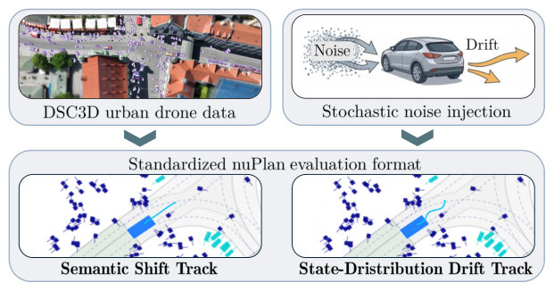
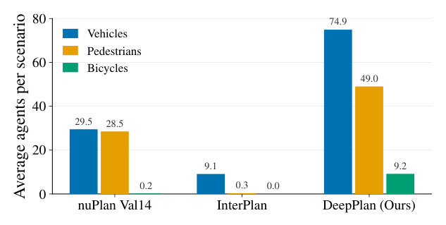

> **TL;DR** Shift & Drift stress-tests nuPlan-trained planners in two ways. First, zero-shot on 1,182 scenarios converted from drone recordings in four German cities and San Francisco, full of pedestrians and cyclists. Second, with noise injected into the ego's acceleration and steering commands. Imitation-learned planners lose up to 76% of their score, the rule-based PDM-Closed stays safe but makes little progress, and the RL-trained CaRL degrades the least.

## Why this paper

Every planner we read about is trained and tested on the same few cities, with a perfect simulated actuator. Our car drives elsewhere, and its steering and throttle do not do exactly what the planner commands. This paper measures both gaps directly: a new place, and an imperfect body. It also includes parking lots and pedestrian zones among its "new" layouts, which is close to our home ground.

## The problem

Closed-loop benchmarks like nuPlan test on held-out scenes from the *same* cities as the training data (Las Vegas, Boston, Pittsburgh, Singapore). That hides two weaknesses:

- **Semantic shift.** A model can memorize map-specific patterns or local traffic habits instead of learning general driving. It may also latch onto spurious cues (causal confusion). New layouts and dense pedestrian–cyclist traffic expose this.
- **State-distribution drift.** A model trained only on expert trajectories has never seen how to recover from its own small errors. Simulators use ideal vehicle models, so small, accumulating execution errors never happen. Closed-loop scores are then an optimistic upper bound.

There is a third, subtler issue. Datasets recorded from a car are **occluded**: agents hidden behind a truck were never logged. When the simulated ego deviates from the recorded path, it can drive into "phantom empty space" where real people actually were.

## Key idea

Build two separate tracks on top of the standard nuPlan simulator and metrics:

1. **Semantic Shift Track**: convert DeepScenario Open 3D (DSC3D), a drone dataset with occlusion-free trajectories, into nuPlan format. The result, **DeepPlan**, lets any nuPlan planner be tested zero-shot in new cities.
2. **State-Distribution Drift Track**: add random noise to the ego's commanded acceleration and steering rate, either uncorrelated jitter or slowly drifting bias.

## How it works

**Turning drone data into nuPlan scenarios.**

1. **Maps.** OpenDRIVE maps are converted to nuPlan's vector map format: lane boundaries, centerlines, roadblocks and speed limits; intersections are detected from overlapping lane polygons; coordinates are moved to UTM.
2. **Episodes and ego choice.** The 12.5 Hz recordings are cut into 18 s windows with 6 s overlap. There is no ego in drone data, so any tracked vehicle qualifies if it is a car (not a pedestrian, cyclist or truck), reaches at least 1.0 m/s, and never overlaps another box. Each qualifying vehicle gives its own episode, upsampled to 20 Hz, with 3 s of history and 15 s of future.
3. **Logs.** All agents' positions, speeds, accelerations and headings are written into nuPlan's database format.
4. **Cleaning.** Each scenario is replayed with the human log as the planner; scenarios where even the human collides, leaves the drivable area or makes no progress are dropped. A person then inspects the rest and fixes route assignments.

Result: 1,182 scenarios (Sindelfingen 490, Stuttgart 206, Munich 205, San Francisco 180, Berlin 101), with roughly 2.5× the vehicles and 1.7× the pedestrians of nuPlan Val14, and many cyclists.

**Adjusted thresholds.** Dense European streets need tighter margins. Some nuPlan thresholds are relaxed, e.g. drivable-area violation 0.3 → 3.0 m, minimum time-to-collision 1.0 → 0.5 s, and looser acceleration and jerk bounds. Their sanity check: with default thresholds the human log scores about 65 on DeepPlan, mostly for "violations" that were safe human maneuvers; with the new ones, about 90. The scoring formulas are unchanged.

**Noise models.** Commands are u = [a, δ̇] (acceleration, steering rate).

- **AWGN** (additive white Gaussian noise): fresh noise every step. Low σ = (0.5 m/s², 0.1 rad/s), mid (1.0, 0.2), high (1.5, 0.3).
- **Ornstein–Uhlenbeck (OU) process**: noise that wanders and is pulled back to zero, with mean-reversion rate θ = 2.0 s⁻¹ (correlation time 0.5 s) and the same three σ levels. It mimics a slow bias like a misaligned wheel or crosswind, so the planner must actively correct a drift that lasts several frames.

Three random seeds per setting.

**Planners.** PDM-Closed (rule-based), PlanTF and Diffusion Planner (imitation learning), PLUTO (imitation learning plus a rule-based refinement layer), and CaRL (reinforcement learning with PPO in closed-loop nuPlan simulation).

## Results

**Track 1: new cities (non-reactive closed-loop score, Val14 → DeepPlan):**

| Planner | Val14 | DeepPlan | Worst city |
|---|---|---|---|
| Human log | 96.39 | 90.71 | 85.03 (Berlin) |
| PDM-Closed | 92.84 | 48.07 | 27.22 (Sindelfingen) |
| PlanTF | 84.27 | 34.00 | 28.84 (Sindelfingen) |
| PLUTO | 92.88 | 36.74 | 11.94 (Sindelfingen) |
| Diffusion Planner | 89.87 | 37.49 | 21.50 (Munich) |
| **CaRL** | 93.87 | **72.57** | 57.59 (Munich) |

- On Val14 the five planners sit within 10 points of each other. On DeepPlan they spread over almost 40.
- Diffusion Planner falls 76% in Munich, where pedestrian interactions dominate. PlanTF has the worst progress.
- PDM-Closed fails *conservatively*: highest non-collision rate (89.25) but progress along route of only 50.21.
- CaRL keeps both: progress 83.29, non-collision 89.25. It beats the next best planner by 24.5 points.
- With IDM-reactive background traffic, PLUTO jumps from 36.74 to 63.03. Its rule layer seems to benefit from IDM cars leaving larger gaps than real humans.

**Track 2: actuation noise (non-reactive, Val14):**

| Planner | No noise | AWGN high | OU high |
|---|---|---|---|
| PDM-Closed | 92.84 | 76.46 | 70.45 |
| PlanTF | 84.27 | 51.97 | 42.69 |
| PLUTO | 92.88 | 67.87 | 63.39 |
| Diffusion Planner | 89.87 | 63.40 | 52.90 |
| **CaRL** | 93.87 | **88.40** | **87.08** |

- Under correlated OU drift, PlanTF and Diffusion Planner lose roughly another 10 points compared with white noise. IL planners can correct one bad step; they cannot correct a bias that persists for seconds.
- CaRL stays above 85 everywhere on Val14. The authors credit training under exploration noise: the policy has learned to recover from off-policy states.

**Both at once.** On DeepPlan with high OU noise: CaRL 68.63, PDM-Closed 40.93, Diffusion Planner 30.03, PLUTO 29.77, PlanTF 23.07. The two stresses compound.

## Limitations

- **One RL planner.** "RL is more robust" rests on CaRL alone. The authors admit they cannot yet separate the effect of reward design, closed-loop training and policy flexibility.
- **Partly by construction.** CaRL's reward is aligned with nuPlan's metrics, and the benchmark uses nuPlan's metrics.
- **Relaxed thresholds** (a 3 m drivable-area tolerance) make DeepPlan scores incomparable to standard nuPlan scores, and more permissive.
- **Background agents do not react to the ego.** Pedestrians and cyclists are replayed from the drone log; only vehicles can be IDM-controlled.
- **Synthetic noise.** AWGN and OU are proxies, not identified from a real vehicle. Delay and latency are not modeled.
- **Object-level.** Perception is perfect. Sindelfingen alone is 41% of the scenarios.

## DYROS lens

**The most transferable piece is the drift track.** It costs almost nothing to adopt. Measure the steering-rate and acceleration tracking error of our car from logs, fit an OU process to it (θ and σ), and inject that noise into our planner + tracker in simulation. That turns "our car is not ideal" into a number. Parking maneuvers are slow but long, with many direction changes, so a correlated steering bias is exactly the kind of error that accumulates into a final pose offset.

**When the classical planner still wins.** PDM-Closed had the highest safety in new cities and failed by being slow, not by hitting people. For a research car with a safety driver, that is the right way to fail. A replanning, search-based planner like TargetTree-RRT\* also recovers from drift by construction, because every cycle starts from the measured state. The interesting result is that a *learned* planner (CaRL) can beat that, but only when trained in closed loop with noise, not by imitation.

**What transfers to parking.** DeepPlan explicitly contains parking lots and pedestrian areas, and the conversion pipeline is open source. Drone or fixed-camera recordings of a parking lot would give occlusion-free agents, which matters in garages where pillars hide pedestrians and a car-mounted log would miss them.

**A link to SLAM (our hypothesis).** OU noise looks a lot like localization drift: low-frequency, correlated, bounded. A planner that survives OU actuation drift may also survive slowly drifting SLAM poses. Testing that in one benchmark would connect our planning and robust SLAM work.

**One-week experiment.** Add an OU perturbation, with σ fitted to our car's logs, to the narrow-space planner benchmark in simulation. Report final position and heading error, collision rate and planning time at three noise levels, alongside a learned baseline.

**Paper opportunity.** A "Shift & Drift for parking": train on one simulated garage layout, test zero-shot on a different garage, with OU actuation noise and SLAM-like pose drift at the same time.

## Key terms

- **Semantic shift**: test scenes differ in meaning from training scenes (new layouts, road users, local habits).
- **State-distribution drift / compounding error**: small execution errors push the vehicle into states the planner never saw, and errors grow.
- **AWGN**: independent Gaussian noise added at every time step.
- **Ornstein–Uhlenbeck (OU) process**: random noise with memory that drifts and is pulled back to a mean.
- **Zero-shot evaluation**: testing on a new domain without any retraining or fine-tuning.
- **CLS (closed-loop score)**: nuPlan's 0–100 score combining progress, comfort and safety, zeroed by at-fault collisions.
