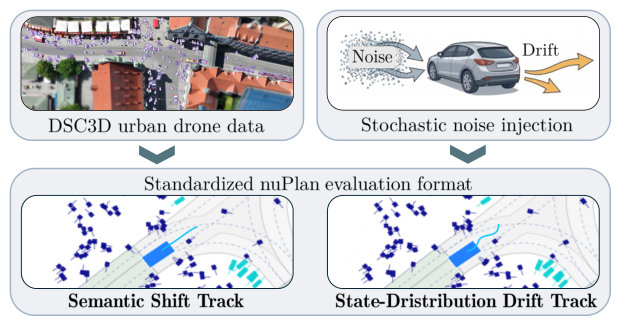
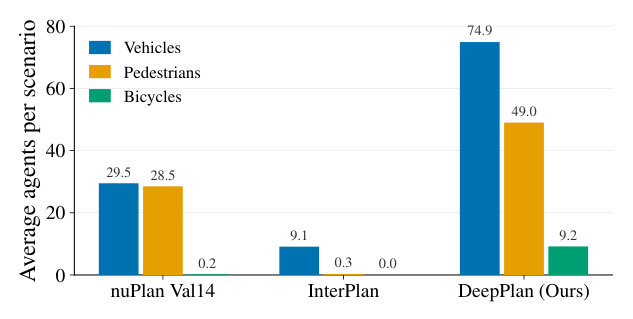
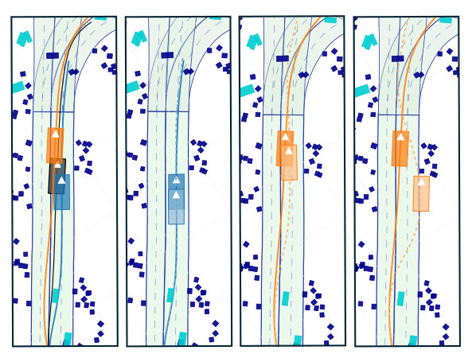

> **TL;DR** Shift & Drift는 nuPlan으로 학습한 planner를 두 가지로 괴롭힙니다. 첫째, 독일 네 도시와 샌프란시스코의 드론 영상에서 변환한, 보행자와 자전거가 가득한 1,182개 시나리오에서 zero-shot으로 시험합니다. 둘째, ego의 가속과 조향 명령에 노이즈를 넣습니다. Imitation learning planner는 점수의 최대 76%를 잃고, 규칙 기반 PDM-Closed는 안전하지만 진행이 더디며, RL로 학습한 CaRL이 가장 적게 무너집니다.

## 왜 이 논문인가

우리가 읽는 planner는 모두 같은 몇몇 도시에서 학습하고 시험하며, 시뮬레이션 속 구동기는 완벽합니다. 우리 차는 다른 곳을 달리고, 조향과 가속도 planner의 명령을 정확히 따르지 않습니다. 이 논문은 두 차이를 직접 잽니다. 새로운 장소, 그리고 불완전한 차체입니다. "새로운" 배치에는 주차장과 보행자 구역도 들어 있어서 우리 연구 현장과 가깝습니다.

## 문제

nuPlan 같은 closed-loop benchmark는 학습 데이터와 *같은* 도시(라스베이거스, 보스턴, 피츠버그, 싱가포르)에서 따로 떼어 둔 장면으로 시험합니다. 이 방식은 두 약점을 가립니다.

- **Semantic shift**(의미적 분포 이동). 모델이 일반적인 운전 대신 지도별 패턴이나 지역 교통 습관을 외울 수 있습니다. 엉뚱한 단서에 기대기도 합니다(causal confusion). 새 도로 배치와 보행자·자전거가 많은 교통이 이를 드러냅니다.
- **State-distribution drift**(상태 분포 표류). 전문가 trajectory로만 학습한 모델은 자기의 작은 오차에서 회복하는 법을 본 적이 없습니다. 시뮬레이터는 이상적인 차량 모델을 쓰므로 작고 쌓이는 실행 오차가 생기지 않습니다. 그래서 closed-loop 점수는 낙관적인 상한이 됩니다.

세 번째, 더 미묘한 문제도 있습니다. 차에서 기록한 데이터셋은 **가려짐**(occlusion)이 있습니다. 트럭 뒤에 숨은 agent는 아예 기록되지 않았습니다. 시뮬레이션 속 ego가 기록된 경로에서 벗어나면, 실제로는 사람이 있었던 "유령 빈 공간"으로 들어갈 수 있습니다.

## 핵심 아이디어

표준 nuPlan 시뮬레이터와 지표 위에 두 개의 독립된 track을 만듭니다.

1. **Semantic Shift Track**: 가려짐 없는 trajectory를 가진 드론 데이터셋 DeepScenario Open 3D (DSC3D)를 nuPlan 형식으로 바꿉니다. 그 결과인 **DeepPlan**으로 어떤 nuPlan planner든 새 도시에서 zero-shot으로 시험할 수 있습니다.
2. **State-Distribution Drift Track**: ego의 가속 명령과 조향 속도 명령에 무작위 노이즈를 더합니다. 상관없는 떨림이거나 천천히 떠도는 편향입니다.

## 작동 방식

**드론 데이터를 nuPlan 시나리오로.**

1. **지도.** OpenDRIVE 지도를 nuPlan vector map 형식으로 바꿉니다. 차선 경계, 중심선, roadblock, 제한 속도를 뽑고, 차선 polygon이 겹치는 곳에서 교차로를 찾고, 좌표를 UTM으로 옮깁니다.
2. **Episode와 ego 선택.** 12.5 Hz 기록을 6 s씩 겹치는 18 s 창으로 자릅니다. 드론 데이터에는 ego가 없으므로, 추적된 차량 중 승용차이고(보행자, 자전거, 트럭 제외), 최고 속도가 1.0 m/s 이상이며, 다른 상자와 한 번도 겹치지 않는 차량을 ego로 씁니다. 조건을 만족하는 차량마다 episode가 하나씩 생기고, 20 Hz로 upsample하며, 과거 3 s와 미래 15 s를 둡니다.
3. **로그.** 모든 agent의 위치, 속도, 가속도, heading을 nuPlan 데이터베이스 형식으로 씁니다.
4. **정리.** 사람 로그를 planner로 두고 각 시나리오를 재생합니다. 사람조차 충돌하거나, 주행 가능 영역을 벗어나거나, 진행하지 못하는 시나리오는 버립니다. 남은 것은 사람이 직접 보고 경로 지정을 고칩니다.

결과는 1,182개 시나리오입니다(Sindelfingen 490, Stuttgart 206, Munich 205, San Francisco 180, Berlin 101). nuPlan Val14보다 차량은 약 2.5배, 보행자는 약 1.7배 많고 자전거도 많습니다.

**조정한 기준값.** 붐비는 유럽 도로에서는 여유가 더 좁아야 합니다. 그래서 nuPlan 기준 일부를 완화합니다. 예를 들어 주행 가능 영역 이탈 0.3 → 3.0 m, 최소 time-to-collision 1.0 → 0.5 s, 가속도와 jerk 한계도 넓힙니다. 검증도 했습니다. 기본 기준이면 사람 로그가 DeepPlan에서 약 65점인데, 대부분 실제로는 안전한 사람 기동을 "위반"으로 센 것이었습니다. 새 기준에서는 약 90점입니다. 점수 공식은 그대로입니다.

**노이즈 모델.** 명령은 u = [a, δ̇] (가속도, 조향 속도)입니다.

- **AWGN**(additive white Gaussian noise): 매 단계 새로운 노이즈. 낮음 σ = (0.5 m/s², 0.1 rad/s), 중간 (1.0, 0.2), 높음 (1.5, 0.3).
- **Ornstein–Uhlenbeck (OU) process**: 떠돌다가 0으로 끌려 돌아오는 노이즈. 평균 회귀율 θ = 2.0 s⁻¹ (상관 시간 0.5 s), σ는 같은 세 단계. 휠 정렬 불량이나 옆바람 같은 느린 편향을 흉내 내므로, planner는 여러 프레임 동안 이어지는 표류를 능동적으로 바로잡아야 합니다.

설정마다 random seed 세 개로 돌립니다.

**Planner.** PDM-Closed (규칙 기반), PlanTF와 Diffusion Planner (imitation learning, 모방 학습), PLUTO (imitation learning + 규칙 기반 보정 층), CaRL (nuPlan closed-loop 시뮬레이션에서 PPO로 학습한 reinforcement learning, 강화학습).

## 결과

**Track 1: 새 도시 (non-reactive closed-loop score, Val14 → DeepPlan):**

| Planner | Val14 | DeepPlan | 가장 나쁜 도시 |
|---|---|---|---|
| 사람 로그 | 96.39 | 90.71 | 85.03 (Berlin) |
| PDM-Closed | 92.84 | 48.07 | 27.22 (Sindelfingen) |
| PlanTF | 84.27 | 34.00 | 28.84 (Sindelfingen) |
| PLUTO | 92.88 | 36.74 | 11.94 (Sindelfingen) |
| Diffusion Planner | 89.87 | 37.49 | 21.50 (Munich) |
| **CaRL** | 93.87 | **72.57** | 57.59 (Munich) |

- Val14에서 다섯 planner는 10점 안에 모여 있습니다. DeepPlan에서는 거의 40점 폭으로 흩어집니다.
- Diffusion Planner는 보행자 상호작용이 많은 Munich에서 76% 떨어집니다. PlanTF는 진행도가 가장 나쁩니다.
- PDM-Closed는 *보수적으로* 실패합니다. 비충돌률은 가장 높지만 (89.25) 경로 진행도는 50.21뿐입니다.
- CaRL은 둘 다 지킵니다. 진행도 83.29, 비충돌 89.25. 2위보다 24.5점 앞섭니다.
- 배경 차량을 IDM-reactive로 바꾸면 PLUTO는 36.74에서 63.03으로 뜁니다. 규칙 층이 실제 사람보다 틈을 넓게 두는 IDM 차량 덕을 보는 것으로 보입니다.

**Track 2: 구동 노이즈 (non-reactive, Val14):**

| Planner | 노이즈 없음 | AWGN 높음 | OU 높음 |
|---|---|---|---|
| PDM-Closed | 92.84 | 76.46 | 70.45 |
| PlanTF | 84.27 | 51.97 | 42.69 |
| PLUTO | 92.88 | 67.87 | 63.39 |
| Diffusion Planner | 89.87 | 63.40 | 52.90 |
| **CaRL** | 93.87 | **88.40** | **87.08** |

- 상관이 있는 OU 표류에서 PlanTF와 Diffusion Planner는 white noise보다 약 10점을 더 잃습니다. IL planner는 한 번의 나쁜 단계는 바로잡지만, 몇 초 동안 이어지는 편향은 바로잡지 못합니다.
- CaRL은 Val14 모든 설정에서 85점 위에 머뭅니다. 저자들은 탐험 노이즈 아래에서 학습한 덕분이라고 봅니다. Policy가 off-policy 상태에서 회복하는 법을 배운 것입니다.

**둘을 함께.** DeepPlan에 높은 OU 노이즈를 더하면 CaRL 68.63, PDM-Closed 40.93, Diffusion Planner 30.03, PLUTO 29.77, PlanTF 23.07입니다. 두 압력이 겹쳐 쌓입니다.

## 한계

- **RL planner가 하나뿐입니다.** "RL이 더 강건하다"는 결론은 CaRL 하나에 기댑니다. 저자들도 reward 설계, closed-loop 학습, policy 유연성의 효과를 아직 분리하지 못한다고 인정합니다.
- **일부는 구조상 유리합니다.** CaRL의 reward는 nuPlan 지표에 맞춰져 있고, 이 benchmark도 nuPlan 지표를 씁니다.
- **완화한 기준값**(주행 가능 영역 허용 3 m) 때문에 DeepPlan 점수는 표준 nuPlan 점수와 비교할 수 없고, 더 너그럽습니다.
- **배경 agent는 ego에 반응하지 않습니다.** 보행자와 자전거는 드론 로그를 재생하고, IDM으로 움직일 수 있는 것은 차량뿐입니다.
- **합성 노이즈입니다.** AWGN과 OU는 대리 모델이지 실제 차량에서 식별한 것이 아닙니다. 지연과 latency는 모델링하지 않습니다.
- **Object-level입니다.** 인식은 완벽하다고 가정합니다. Sindelfingen 하나가 시나리오의 41%를 차지합니다.

## DYROS 관점

**가장 옮겨 오기 쉬운 것은 drift track입니다.** 도입 비용이 거의 없습니다. 로그에서 우리 차의 조향 속도와 가속도 추종 오차를 재고, OU process(θ와 σ)를 맞춘 뒤, 시뮬레이션에서 planner + tracker에 그 노이즈를 넣습니다. "우리 차는 이상적이지 않다"가 숫자가 됩니다. 주차 기동은 느리지만 길고 방향 전환이 많아서, 상관 있는 조향 편향이야말로 최종 pose 오차로 쌓이는 종류의 오차입니다.

**고전 planner가 여전히 이기는 경우.** PDM-Closed는 새 도시에서 안전성이 가장 높았고, 사람을 치는 대신 느린 방식으로 실패했습니다. 안전 운전자가 있는 연구용 차에서는 그것이 올바른 실패 방식입니다. TargetTree-RRT\* 같은 재계획형 탐색 planner도 매 주기 측정된 상태에서 다시 시작하므로 구조적으로 표류에서 회복합니다. 흥미로운 점은 *학습* planner(CaRL)가 이를 넘을 수 있다는 것인데, 모방이 아니라 노이즈가 있는 closed-loop에서 학습했을 때만 그렇습니다.

**주차로 옮겨 올 것.** DeepPlan에는 주차장과 보행자 구역이 명시적으로 들어 있고, 변환 파이프라인은 오픈소스입니다. 주차장을 드론이나 고정 카메라로 기록하면 가려짐 없는 agent를 얻습니다. 기둥이 보행자를 가리는 주차장에서는 차에서 기록한 로그가 그들을 놓치기 때문에 이 점이 중요합니다.

**SLAM과의 연결 (우리의 가설).** OU 노이즈는 localization 표류와 많이 닮았습니다. 저주파이고, 상관이 있고, 유계입니다. OU 구동 표류를 견디는 planner는 천천히 떠도는 SLAM pose도 견딜 수 있을지 모릅니다. 이를 한 benchmark에서 시험하면 planning과 robust SLAM 연구가 이어집니다.

**일주일 안에 해 볼 수 있는 것.** 시뮬레이션의 좁은 공간 planner benchmark에 우리 차 로그로 σ를 맞춘 OU 섭동을 넣습니다. 노이즈 세 단계에서 최종 위치·heading 오차, 충돌률, planning 시간을 학습 baseline과 함께 보고합니다.

**논문 기회.** "주차용 Shift & Drift": 시뮬레이션 주차장 배치 하나로 학습하고, 다른 주차장에서 zero-shot으로 시험하되, OU 구동 노이즈와 SLAM 같은 pose 표류를 동시에 넣습니다.

## 용어 정리

- **Semantic shift**: 시험 장면이 학습 장면과 의미상 다른 것 (새 도로 배치, 도로 사용자, 지역 습관).
- **State-distribution drift / compounding error**: 작은 실행 오차가 차를 planner가 본 적 없는 상태로 밀어 넣고, 오차가 커지는 현상.
- **AWGN**: 매 시점 독립적으로 더하는 가우시안 노이즈.
- **Ornstein–Uhlenbeck (OU) process**: 기억이 있어 떠돌다가 평균으로 끌려 돌아오는 무작위 노이즈.
- **Zero-shot 평가**: 재학습이나 미세 조정 없이 새 도메인에서 시험하는 것.
- **CLS (closed-loop score)**: 진행도, 승차감, 안전을 합친 nuPlan의 0–100 점수. 과실 충돌이 있으면 0이 됩니다.
