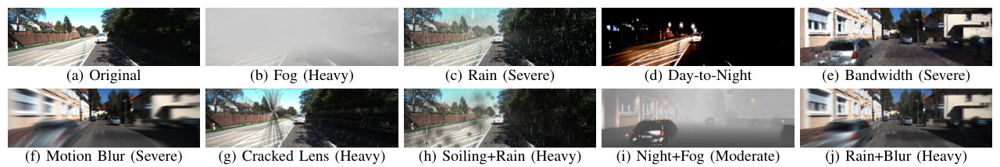

> **TL;DR** SAL is a test bench for visual SLAM. It takes a clean dataset, adds fog, rain, night, lens soiling, a cracked lens, motion blur, video compression or frame drops with severity in real-world units (fog visibility in meters, rain in mm/h), runs any of seven SLAM systems on the result, and bisects to find the exact severity where a system fails. ORB-SLAM3 on KITTI, for example, goes from 0.30 m to 28 m ATE between 24 m and 21 m of night-time fog visibility.

## Why this paper

The other papers in this batch ask "how uncertain is the estimate right now?" This one asks the offline question: "under which conditions does my SLAM work at all?" For a parking product that question becomes a spec sheet. A garage has low light, headlight glare, lens dirt on low-mounted surround-view cameras, and video that may be compressed or dropped on its way to the computer. Recording a new dataset for every combination is impossible; SAL makes them from clean data in a controlled, repeatable way.

## The problem

Testing robustness today usually means one of two things, and both fall short:

- **Record new adverse-condition data** (Oxford RobotCar, 4Seasons, SubT-MRS). You get whatever weather happened that day, at one severity, often mixed with other effects (a foggy run that is also dark). You cannot sweep severity or isolate one cause.
- **Write one-off perturbation code** for one dataset and one SLAM system. It breaks when you change the dataset's file layout or the algorithm's output format, so results across papers are rarely comparable.

And neither tells you *where* the system breaks. "Works at light fog, fails at heavy fog" leaves the whole range in between unknown.

The authors list three needs: severity in real-world units, pluggable components, and automatic search for the failure boundary.

## Key idea

Treat each adverse condition as a **perturbation module** that transforms a dataset into an adversarial copy, behind three standard interfaces, and add a bisection search over the severity parameter.

**Real-world units, with a small example.** The fog module uses the Koschmieder scattering model: each pixel becomes I = J·t + A·(1 − t), where J is the clean pixel, A the fog brightness, and t = exp(−β·d) the transmission at depth d. The extinction coefficient comes from the meteorological visibility V: β = 3.912 / V. With V = 50 m, β ≈ 0.078 per meter. An object 10 m away keeps t ≈ 0.46 of its contrast; one at 50 m keeps only 2%, which is what "visibility 50 m" means. So "fog at 50 m visibility" is something a safety engineer can read off a weather report, unlike "corruption level 3 of 5."

**Depth-aware.** Fog, rain and blur all depend on distance. SAL uses the dataset's depth if it has one, computes stereo depth with FoundationStereo if it has a stereo pair, and otherwise estimates monocular depth with Depth Anything V2.

## How it works

**Three extension points.**

- **Dataset adapter**: where the images are, how frames are ordered in time, where depth lives. KITTI and TUM differ in all three; the adapter hides that.
- **Perturbation module**: `setup()`, `apply(image, depth, frame index, camera)`, `cleanup()`. Built-in modules: fog, rain (physics-based streaks in mm/h), day-to-night (CycleGAN-Turbo), lens soiling, cracked lens (fracture simulation in newtons), motion blur (from camera speed in km/h and exposure in ms, forward motion only), H.264 bandwidth compression, frame drops. Modules can be chained into composites (rain + soiling, night + fog).
- **SLAM wrapper**: stages the data in the layout the algorithm expects, runs it in its own environment, and converts the trajectory to TUM format. Seven systems are wrapped: ORB-SLAM3, S3PO-GS, GigaSLAM, MASt3R-SLAM, DROID-SLAM, VGGT-SLAM and Photo-SLAM.

**Boundary search.** Pick a parameter range and a failure rule, such as ATE RMSE > 1.5 m. Evaluate both ends, then keep testing the midpoint of the current fail/pass pair until the gap is below a tolerance. The paper's example: fog visibility 10 m fails (ATE 2.3 m), 20 m passes (0.8 m), 15 m passes, 12 m passes, so the boundary is between 10 and 12 m after four runs. The number of runs grows with the logarithm of the range instead of linearly.

A **feature-tracking pipeline** (built on PySLAM) also reports how long ORB or SuperPoint features survive under each perturbation, which helps explain *why* a SLAM fails.

## Results

Short sequences, 3 runs averaged: KITTI-07 (200 frames, outdoor), TUM fr1/xyz (indoor), EuRoC V1_01 (500 frames). ATE RMSE in meters, clean → severe (or → heavy if severe failed):

| Dataset | System | Perturbation | Clean → worst | Change |
|---|---|---|---|---|
| KITTI | ORB-SLAM3 (stereo) | Rain | 0.133 → 0.174 | +31% |
| KITTI | ORB-SLAM3 | Night + fog | 0.133 → 30.26 (heavy), fails (severe) | +22,000% |
| KITTI | GigaSLAM (mono) | Rain + blur | 0.275 → 8.19 | +2,878% |
| KITTI | S3PO-GS (mono) | Night + fog | 1.097 → 8.54 | +679% |
| TUM | ORB-SLAM3 (RGB-D) | Soiling + crack | 0.010 → 0.177 | +1,620% |
| TUM | DROID-SLAM (mono) | Soiling + crack | 0.114 → 0.097 | −15% |
| EuRoC | Photo-SLAM (stereo) | Frame drop | 0.073 → 0.161 (heavy), fails (severe) | +122% |

What stands out:

- **Combinations are worse than their parts.** Night + fog hurts every system badly; rain + soiling exceeds either effect alone for all three outdoor systems.
- **No system wins everywhere.** ORB-SLAM3 is the most stable outdoors until night + fog, where it collapses. DROID-SLAM barely reacts to soiling or cracks, but its clean error is about 10× ORB-SLAM3's.
- **Failure is abrupt.** ORB features track stably through heavy rain (50 mm/h), then fail completely at 200 mm/h. SuperPoint survives severe rain and severe compression where ORB fails, but ORB keeps longer tracks on clean data.
- **Boundaries are narrow.** ORB-SLAM3 on KITTI night + fog: the boundary is between 21 and 24 m visibility, where ATE jumps from 0.304 m to 28.255 m. Bisection found it in 8 runs instead of 37 for a sweep (4.6× faster). Photo-SLAM on EuRoC frame drop: boundary between 45% and 47%, 6 runs instead of 14.

## Limitations

- **Short sequences.** 200–500 frames and one sequence per dataset: too short for loop closure or long-term drift to matter. Long-run behavior is untested.
- **Synthetic realism is unvalidated.** No comparison against real fog or rain recordings at the same visibility. Day-to-night is a per-frame image translation with some flicker; motion blur assumes pure forward motion and a global shutter.
- **Bisection assumes a single boundary.** Their own table shows non-monotonic cases (ORB-SLAM3 on EuRoC: 0.121 m at moderate frame drop, 0.074 m at heavy). Bisection finds *a* pass/fail switch, not necessarily the first one.
- **ATE as the only failure signal.** It needs ground truth and summarizes a whole run; it does not tell you when during the run things broke.
- **Cameras only.** No fisheye or surround-view models, no LiDAR, no IMU.

## DYROS lens

**Where it fits.** SAL is the offline half of the "is localization good enough?" question. Online methods (certified backends, calibrated covariance) tell you about *this* moment; SAL tells you the operating envelope before you deploy. For parking, the boundary search could produce statements like "our AVM SLAM keeps final slot error under 10 cm up to N soiling particles and down to X lux." That is the kind of number a vehicle team can write into a requirement.

**What would break.** SAL's perturbations are tuned for forward-facing pinhole cameras on roads. Our AVM uses fisheye cameras close to the ground, stitched into a bird's-eye image: soiling looks different on a fisheye lens, glare from ceiling lights and wet floors is a garage-specific effect, and a perturbation must be applied *before* stitching to be realistic. ATE over a trajectory is also the wrong failure signal for parking; we care about pose error near the slot.

**What we could try in a week.** Write a dataset adapter for one of our garage logs, wrap ORB-SLAM3 and our weighted GICP AVM SLAM, and run soiling, low light (day-to-night) and frame drops. Then run boundary search with a parking-specific rule, such as "pose error at the slot above 0.2 m." Comparing the two systems' boundaries is already a useful internal result.

**Paper opportunity.** An AVM-specific perturbation suite (fisheye soiling, IPM distortion from calibration error, wet-floor reflections, headlight glare) plus slot-error boundary search for automated valet parking. A second angle ties this batch together: use SAL to sweep severity and check whether an online uncertainty estimate (SVN-ICP's covariance, a MUSE-style model) rises *before* the failure boundary. An uncertainty estimate that warns ahead of the boundary is exactly what a parking go/no-go gate needs.

## Key terms

- **Perturbation module**: a plug-in that transforms clean images into degraded ones with a real-world severity parameter.
- **Koschmieder model**: fog as a depth-dependent blend between the scene and the fog brightness; visibility V sets β = 3.912 / V.
- **Composite perturbation**: several perturbations applied in order (e.g. rain + soiling).
- **Robustness boundary**: the severity at which a SLAM run switches from pass to fail under a chosen metric threshold.
- **ATE RMSE**: root-mean-square absolute trajectory error against ground truth.
