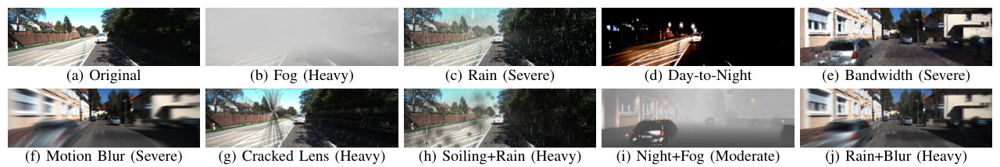
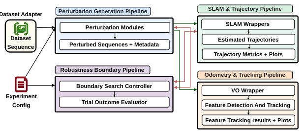

> **TL;DR** SAL은 visual SLAM용 시험대입니다. 깨끗한 데이터셋에 안개, 비, 야간, 렌즈 오염, 깨진 렌즈, motion blur, 영상 압축, 프레임 누락을 실제 단위(안개 가시거리 m, 비 mm/h)의 심각도로 입히고, 일곱 가지 SLAM 시스템 중 아무것이나 돌린 뒤, 시스템이 실패하는 정확한 심각도를 이분 탐색으로 찾습니다. 예를 들어 KITTI에서 ORB-SLAM3의 ATE는 야간 안개 가시거리가 24 m에서 21 m로 줄어드는 사이에 0.30 m에서 28 m로 뜁니다.

## 왜 이 논문인가

이 묶음의 다른 논문들은 "지금 이 추정이 얼마나 불확실한가?"를 묻습니다. 이 논문은 offline 질문을 던집니다. "내 SLAM은 어떤 조건에서 동작하기는 하는가?" 주차 제품에서는 이 질문이 사양서가 됩니다. 주차장에는 낮은 조도, 전조등 반사, 낮게 달린 surround-view 카메라의 렌즈 오염, 컴퓨터로 오는 도중 압축되거나 빠지는 영상이 있습니다. 조합마다 새 데이터셋을 녹화할 수는 없습니다. SAL은 깨끗한 데이터에서 이런 조건을 통제되고 반복 가능한 방식으로 만들어 냅니다.

## 문제

지금 robustness를 시험하는 방법은 보통 둘 중 하나이고, 둘 다 부족합니다.

- **악조건 데이터를 새로 녹화합니다** (Oxford RobotCar, 4Seasons, SubT-MRS). 그날 일어난 날씨를, 하나의 심각도로, 종종 다른 효과와 섞인 채로(안개 낀 주행이 어둡기도 한) 얻게 됩니다. 심각도를 바꿔 가거나 원인 하나만 떼어 볼 수 없습니다.
- **일회용 perturbation 코드를 씁니다.** 데이터셋 하나, SLAM 시스템 하나에만 맞춘 코드입니다. 데이터셋 파일 구조나 알고리즘 출력 형식이 바뀌면 깨지고, 그래서 논문끼리 결과를 비교하기 어렵습니다.

그리고 둘 다 *어디서* 시스템이 깨지는지 알려 주지 않습니다. "옅은 안개에서는 되고 짙은 안개에서는 안 된다"는 말은 그 사이 전체를 모른다는 뜻입니다.

저자들은 세 가지 요구를 듭니다. 실제 단위의 심각도, 끼워 넣을 수 있는 구성 요소, 실패 경계의 자동 탐색입니다.

## 핵심 아이디어

각 악조건을 데이터셋을 악조건 사본으로 바꾸는 **perturbation 모듈**로 다루고, 세 가지 표준 인터페이스 뒤에 두며, 심각도 파라미터에 대한 이분 탐색을 더합니다.

**실제 단위를 작은 예로.** 안개 모듈은 Koschmieder 산란 모델을 씁니다. 각 픽셀은 I = J·t + A·(1 − t)가 됩니다. J는 깨끗한 픽셀, A는 안개의 밝기, t = exp(−β·d)는 깊이 d에서의 투과율입니다. 소산 계수는 기상학적 가시거리 V에서 나옵니다: β = 3.912 / V. V = 50 m이면 β ≈ 0.078 /m입니다. 10 m 떨어진 물체는 대비의 약 0.46을 유지하고, 50 m 떨어진 물체는 2%만 남습니다. 이것이 "가시거리 50 m"의 뜻입니다. 그래서 "가시거리 50 m 안개"는 "오염 단계 5 중 3"과 달리, 안전 엔지니어가 기상 예보에서 바로 읽을 수 있는 숫자입니다.

**깊이 반영.** 안개, 비, 블러는 모두 거리에 따라 다릅니다. SAL은 데이터셋에 깊이가 있으면 그것을 쓰고, stereo 쌍이 있으면 FoundationStereo로 stereo 깊이를 계산하고, 둘 다 없으면 Depth Anything V2로 단안 깊이를 추정합니다.

## 작동 방식

**세 가지 확장 지점.**

- **Dataset adapter**: 영상이 어디 있는지, 프레임이 시간순으로 어떻게 정렬되는지, 깊이가 어디 있는지 알려 줍니다. KITTI와 TUM은 이 세 가지가 모두 다르고, adapter가 그 차이를 감춥니다.
- **Perturbation 모듈**: `setup()`, `apply(영상, 깊이, 프레임 번호, 카메라)`, `cleanup()`. 내장 모듈은 안개, 비(mm/h 단위의 물리 기반 빗줄기), 주간→야간(CycleGAN-Turbo), 렌즈 오염, 깨진 렌즈(뉴턴 단위의 파손 시뮬레이션), motion blur(km/h 단위 카메라 속도와 ms 단위 노출 시간, 전진 운동만), H.264 대역폭 압축, 프레임 누락입니다. 모듈을 이어 붙여 복합 perturbation(비 + 오염, 야간 + 안개)을 만들 수 있습니다.
- **SLAM wrapper**: 알고리즘이 기대하는 구조로 데이터를 배치하고, 별도 환경에서 실행하고, trajectory를 TUM 형식으로 바꿉니다. ORB-SLAM3, S3PO-GS, GigaSLAM, MASt3R-SLAM, DROID-SLAM, VGGT-SLAM, Photo-SLAM 일곱 개가 들어 있습니다.

**경계 탐색.** 파라미터 범위와 실패 규칙(예: ATE RMSE > 1.5 m)을 정합니다. 양 끝을 평가한 뒤, 현재 실패/통과 쌍의 중간점을 계속 시험해 간격이 허용치보다 작아지면 멈춥니다. 논문의 예: 가시거리 10 m는 실패(ATE 2.3 m), 20 m는 통과(0.8 m), 15 m 통과, 12 m 통과. 네 번 만에 경계가 10 m와 12 m 사이로 좁혀집니다. 시행 횟수가 범위에 선형이 아니라 로그로 늘어납니다.

PySLAM 기반 **feature tracking 파이프라인**은 perturbation마다 ORB나 SuperPoint 특징이 얼마나 오래 살아남는지도 알려 주어, SLAM이 *왜* 실패하는지 설명하는 데 도움을 줍니다.

## 결과

짧은 시퀀스, 3회 평균: KITTI-07(200 프레임, 실외), TUM fr1/xyz(실내), EuRoC V1_01(500 프레임). ATE RMSE (m), 깨끗함 → 가장 심함(severe가 실패하면 heavy까지):

| 데이터셋 | 시스템 | Perturbation | 깨끗함 → 최악 | 변화 |
|---|---|---|---|---|
| KITTI | ORB-SLAM3 (stereo) | 비 | 0.133 → 0.174 | +31% |
| KITTI | ORB-SLAM3 | 야간 + 안개 | 0.133 → 30.26 (heavy), 실패 (severe) | +22,000% |
| KITTI | GigaSLAM (mono) | 비 + 블러 | 0.275 → 8.19 | +2,878% |
| KITTI | S3PO-GS (mono) | 야간 + 안개 | 1.097 → 8.54 | +679% |
| TUM | ORB-SLAM3 (RGB-D) | 오염 + 깨진 렌즈 | 0.010 → 0.177 | +1,620% |
| TUM | DROID-SLAM (mono) | 오염 + 깨진 렌즈 | 0.114 → 0.097 | −15% |
| EuRoC | Photo-SLAM (stereo) | 프레임 누락 | 0.073 → 0.161 (heavy), 실패 (severe) | +122% |

눈여겨볼 점:

- **조합은 각각보다 나쁩니다.** 야간 + 안개는 모든 시스템을 크게 망가뜨리고, 비 + 오염은 실외 세 시스템 모두에서 각 효과 하나보다 나쁩니다.
- **모든 곳에서 이기는 시스템은 없습니다.** ORB-SLAM3는 실외에서 가장 안정적이다가 야간 + 안개에서 무너집니다. DROID-SLAM은 오염이나 깨진 렌즈에 거의 반응하지 않지만, 깨끗한 조건의 오차가 ORB-SLAM3의 약 10배입니다.
- **실패는 갑작스럽습니다.** ORB 특징은 heavy 비(50 mm/h)까지 안정적으로 추적되다가 200 mm/h에서 완전히 실패합니다. SuperPoint는 ORB가 실패하는 severe 비와 severe 압축에서도 살아남지만, 깨끗한 데이터에서는 ORB의 추적이 더 깁니다.
- **경계는 좁습니다.** KITTI 야간 + 안개에서 ORB-SLAM3의 경계는 가시거리 21–24 m 사이이고, 여기서 ATE가 0.304 m에서 28.255 m로 뜁니다. 이분 탐색은 sweep의 37번 대신 8번 만에 찾았습니다(4.6배 빠름). EuRoC 프레임 누락에서 Photo-SLAM의 경계는 45%와 47% 사이이고, 14번 대신 6번 만에 찾았습니다.

## 한계

- **시퀀스가 짧습니다.** 200–500 프레임, 데이터셋마다 시퀀스 하나라서 loop closure나 장기 drift가 영향을 줄 만큼 길지 않습니다. 긴 주행에서의 거동은 시험하지 않았습니다.
- **합성의 사실성이 검증되지 않았습니다.** 같은 가시거리의 실제 안개나 비 녹화와 비교하지 않습니다. 주간→야간은 프레임별 영상 변환이라 약간 깜박이고, motion blur는 순수 전진 운동과 global shutter를 가정합니다.
- **이분 탐색은 경계가 하나라고 가정합니다.** 논문 자신의 표에도 단조롭지 않은 경우가 있습니다(EuRoC의 ORB-SLAM3: moderate 프레임 누락에서 0.121 m, heavy에서 0.074 m). 이분 탐색은 통과/실패가 바뀌는 *한* 지점을 찾을 뿐, 첫 지점이라는 보장은 없습니다.
- **실패 신호가 ATE 하나뿐입니다.** Ground truth가 필요하고 주행 전체를 하나로 요약하므로, 주행 중 언제 깨졌는지 알려 주지 않습니다.
- **카메라만 다룹니다.** Fisheye나 surround-view 모델, LiDAR, IMU가 없습니다.

## DYROS 관점

**어디에 맞는가.** SAL은 "localization이 충분히 좋은가?"라는 질문의 offline 절반입니다. Online 방법(증명된 backend, 보정된 covariance)은 *지금 이 순간*을 알려 주고, SAL은 배치 전에 동작 범위를 알려 줍니다. 주차에서는 경계 탐색으로 "우리 AVM SLAM은 오염 입자 N개까지, 조도 X lux까지 최종 주차 칸 오차를 10 cm 아래로 유지한다" 같은 문장을 만들 수 있습니다. 차량 팀이 요구사항에 그대로 적을 수 있는 숫자입니다.

**무엇이 깨질까.** SAL의 perturbation은 도로 위 전방 pinhole 카메라에 맞춰져 있습니다. 우리 AVM은 바닥 가까이 달린 fisheye 카메라를 bird's-eye 영상으로 이어 붙입니다. Fisheye 렌즈의 오염은 다르게 보이고, 천장 조명과 젖은 바닥의 반사는 주차장 고유의 효과이며, 사실적이려면 perturbation을 이어 붙이기 *전에* 적용해야 합니다. 또 trajectory 전체의 ATE는 주차에 맞는 실패 신호가 아닙니다. 우리에게 중요한 것은 주차 칸 근처의 pose 오차입니다.

**일주일 안에 해 볼 수 있는 것.** 우리 주차장 로그 하나에 대한 dataset adapter를 쓰고, ORB-SLAM3와 우리 weighted GICP AVM SLAM을 wrapper로 감싼 뒤, 오염, 저조도(주간→야간), 프레임 누락을 돌립니다. 그다음 "주차 칸에서 pose 오차 0.2 m 초과" 같은 주차용 규칙으로 경계 탐색을 합니다. 두 시스템의 경계를 비교하는 것만으로도 쓸모 있는 내부 결과입니다.

**논문 기회.** AVM 전용 perturbation 세트(fisheye 오염, 캘리브레이션 오차로 인한 IPM 왜곡, 젖은 바닥 반사, 전조등 glare)와 automated valet parking을 위한 주차 칸 오차 기반 경계 탐색입니다. 이 묶음을 하나로 잇는 두 번째 각도도 있습니다. SAL로 심각도를 훑으면서 online 불확실성 추정(SVN-ICP의 covariance, MUSE 같은 모델)이 실패 경계 *전에* 올라가는지 확인하는 것입니다. 경계보다 먼저 경고하는 불확실성 추정이 바로 주차 진행/정지 관문에 필요한 것입니다.

## 용어 정리

- **Perturbation 모듈**: 깨끗한 영상을 실제 단위 심각도로 열화시키는 plug-in.
- **Koschmieder 모델**: 안개를 장면과 안개 밝기 사이의 깊이 의존적 혼합으로 보는 모델. 가시거리 V로 β = 3.912 / V를 정합니다.
- **복합 perturbation**: 여러 perturbation을 차례로 적용한 것(예: 비 + 오염).
- **Robustness boundary**: 정한 metric 임계값에서 SLAM 주행이 통과에서 실패로 바뀌는 심각도.
- **ATE RMSE**: ground truth 대비 absolute trajectory error의 제곱평균제곱근.
