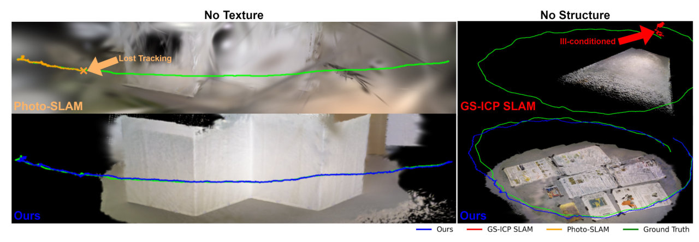
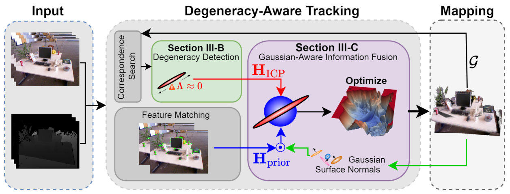
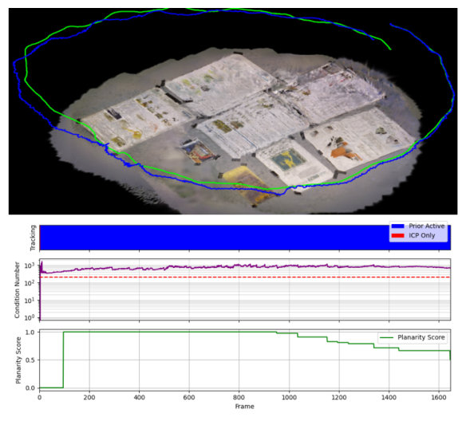

> **TL;DR** 실시간 3D Gaussian Splatting SLAM은 카메라를 feature matching으로 추적하거나(빈 벽에서 실패), G-ICP로 추적합니다(평평한 바닥에서 실패). Spectral GS-SLAM은 G-ICP를 돌리면서 매 프레임 Hessian의 eigenvalue를 확인하고, 약한 방향에만 값싼 ORB feature 자세 추정을 더합니다. TUM RGB-D의 "no structure"와 "no texture" 장면 모두에서 추적을 유지하는 유일한 실시간 방법이고, 40 FPS로 돕니다.

## 왜 이 논문인가

robust SLAM에서 계속 쓰게 될 패턴을 작고 깔끔하게 보여 주는 예입니다. **첫 번째 정보원이 보지 못하는 곳에만 두 번째 정보원을 더한다**는 것입니다. 여기서는 첫 번째가 기하(ICP), 두 번째가 영상 feature지만, 식 자체는 센서와 무관합니다. 또 Gaussian 지도가 ICP의 degeneracy(퇴화)를 왜 *더 나쁘게* 만드는지 미묘한 이유를 설명합니다. 언젠가 차량에 3DGS 지도를 올린다면 알아야 할 내용입니다.

## 문제

**3DGS SLAM 한 문단 요약.** 3D Gaussian Splatting은 장면을 작은 3D Gaussian 여러 개로 나타냅니다. 각 Gaussian은 평균, 공분산(모양), 색, 불투명도를 가지고, 이를 렌더링해 사진 같은 영상을 만듭니다. 초기 3DGS-SLAM(SplaTAM, MonoGS)은 *추적*도 렌더링한 영상을 비교해서 합니다. 정확하지만 느립니다. 이 논문의 실험에서 0.5–1.9 FPS입니다.

**실시간 시스템은 tracker를 바꾸고**, 그 약점까지 물려받습니다.

- **Photo-SLAM**은 ORB feature(ORB-SLAM3)로 추적합니다. 빈 벽에는 keypoint가 없어서 추적을 잃습니다.
- **GS-ICP SLAM**은 Gaussian 자체에 G-ICP를 걸어 추적합니다(68 FPS). 평평한 바닥에서는 모든 면의 법선이 같아서 ICP가 옆 방향 움직임을 구별하지 못합니다. 이것이 degeneracy입니다. registration의 6×6 Hessian H에서 "바닥을 따라 미끄러짐"과 "법선 둘레 회전"의 eigenvalue(고유값)가 0에 가까워집니다.

**Gaussian 특유의 문제.** Mapper는 여러 시점에서 각 Gaussian을 계속 다듬는데, 그러면서 Gaussian을 납작하게 눌러 버립니다. 법선 방향 두께는 아주 작은 ε로 줄고 옆 방향 크기는 크게 남습니다. G-ICP는 각 대응을 공분산의 역행렬로 가중하므로, 납작한 Gaussian은 법선 방향으로 엄청난 가중치(1/ε²)를, 옆 방향으로는 거의 0을 줍니다. "평면에서 얼마나 떨어졌나"에는 아주 좋지만 "평면 위 어디인가"에는 쓸모가 없습니다. 평면 하나가 지배하는 장면에서 H는 극단적으로 한쪽에 치우칩니다. 저자들은 Gaussian이 두께를 유지하도록 강제해 보았지만, 추적과 지도 모두 나빠졌습니다. Mapper와 tracker가 서로 싸우기 때문입니다.

## 핵심 아이디어

지도는 그대로 두고 tracker를 고칩니다.

1. ICP Hessian의 eigenvalue로 약한 방향을 **검출**합니다.
2. feature 기반 자세 추정의 정보를 그 방향에*만* **주입**합니다.
3. Gaussian 법선에서 공짜로 얻는 planarity 점수로 주입량을 **조절**(gating)합니다.

강한 ICP 방향은 순수 ICP로 남으므로, 평범한 장면에서는 GS-ICP SLAM처럼 동작합니다.

## 작동 방식

**1. G-ICP 추적.** 새 프레임의 각 Gaussian을 가장 가까운 지도 Gaussian과 대응시킵니다. Residual은 평균의 차이이고, 두 공분산의 합으로 가중합니다. 선형화하면 Hessian H_ICP = Σ Jᵀ Σ⁻¹ J를 얻습니다.

**2. Spectral 검출.** H_ICP = V diag(λ1…λ6) Vᵀ로 eigen 분해합니다. 고전적 방법은 λk가 절대 임계값보다 작으면 약하다고 보는데, 그 임계값은 장면 크기와 점 개수에 따라 달라집니다. 이 논문은 대신 비율을 씁니다. λmax/λk > τdeg이면 방향 k가 약하다고 보고, 모든 실험에서 τdeg = 200으로 고정합니다.

**3. Planarity 점수.** 각 Gaussian의 법선은 가장 얇은 축이므로 이웃 탐색이 필요 없습니다. 보이는 법선들의 불투명도 가중 공분산을 구하고, 그 eigenvalue로 점수 η를 만듭니다. 한 가지 면 방향이 시야를 지배할수록 높습니다.

**4. Feature prior.** ORB 대응과 robust loss로 구한 가벼운 frame-to-frame 자세입니다. 대응이 너무 적으면 나쁜 RANSAC 결과를 믿는 대신 prior를 버리고 "움직임 없음"으로 둡니다.

**5. 주입.** 약한 eigenvector v_k마다:

H = H_ICP + Σ w_k · (v_kᵀ Ω_prior v_k) · v_k v_kᵀ

"feature prior가 v_k 방향에 대해 얼마나 아는지 재고, 정확히 그만큼을 v_k 방향에만 더한다"로 읽으면 됩니다. 가중치 w_k = exp(−α(1 − η))는 [0, 1] 사이의 soft gate입니다. 장면이 확실히 평면이면 prior 전체가 들어갑니다.

## 결과

**TUM RGB-D structure/texture 장면**, ATE RMSE (cm, X = 실패):

| 방법 | FPS | 추적 비율 (%) | NoStruct near | NoStruct far | NoTex near | NoTex far |
|---|---|---|---|---|---|---|
| SplaTAM | 0.54 | 100 | 4.49 | 9.49 | 2.27 | 4.54 |
| MonoGS | 1.89 | 100 | 11.86 | **4.10** | 26.91 | 10.39 |
| Photo-SLAM | 31.48 | 68.4 | **2.27** | 5.36 | X | X |
| GS-ICP SLAM | 67.90 | 41.0 | 194.93 | 116.16 | **1.55** | 6.07 |
| **Spectral GS-SLAM** | 40.14 | **100** | 7.79 | 16.85 | **1.55** | **2.19** |

- 두 장면 유형 모두에서 살아남는 유일한 실시간 시스템입니다.
- "no structure"에서는 feature 추적이 여전히 약 3배 정확합니다(2.27 vs 7.79 cm). 저자들은 어디서도 무너지지 않는 대가로 이 손해를 받아들입니다.
- "no structure near"의 렌더링 PSNR은 22.61 dB로 GS-ICP SLAM(18.02 dB)보다 높습니다. 제대로 된 trajectory 위에서 지도를 만들었기 때문입니다.

**Ablation** ("no structure far" / "no texture near", cm):

- 전체 방법: 16.85 / 1.55.
- Planarity 점수 제거(eigenvalue로만 켜고 끔): 75.78 / 1.63.
- Soft gating 제거: 22.43 / 1.88.
- Feature prior만 사용: 45.29 / 103.67. Prior를 등속 모델로 대체: 55.87 / 1.68. 즉 이득은 어느 한쪽이 아니라 *조합*에서 나옵니다.

**평범한 장면에서의 비용.** Replica에서 평균 오차가 0.16 cm(GS-ICP SLAM)에서 0.24 cm로 늘어납니다. 방 두 곳에서 검출기가 잠깐씩 켜졌기 때문입니다. TUM fr3/office에서는 prior가 자주 켜졌다 꺼지며 2.46 cm에서 3.82 cm로 늘어납니다. τdeg를 바꿔 보면, 실패는 임계값이 너무 높을 때(prior가 켜지지 않음) 생기고 너무 낮을 때는 생기지 않습니다.

## 한계

- 작은 실내 핸드헬드 RGB-D 시퀀스(TUM, Replica)뿐입니다. 큰 장면, 차량, LiDAR가 없습니다.
- 오검출 때문에 평범한 장면에서 정확도를 잃고, texture가 있는 평평한 장면에서는 여전히 feature 추적에 한참 뒤집니다.
- Prior가 Hessian에 들어가는 방식은 보여 주지만, 갱신식의 우변(gradient)에 어떻게 들어가는지는 보여 주지 않습니다. Planarity 점수는 비례식으로만 주어지고 α 값도 없습니다.
- 두 단서가 동시에 실패하면 자세를 그 자리에 고정합니다. 카메라가 실제로 멈춰 있을 때만 안전한 선택이고, 저자들은 IMU 추가를 제안합니다.

## DYROS 관점

**TUM "no structure" 장면은 사실상 우리 AVM이 보는 주차장 바닥입니다.** 평평한 바닥 위의 포스터는 texture는 풍부하고 기하는 없습니다. Around view monitor로 본 주차층도 똑같습니다. 평면 위에 선, 화살표, 주차 칸 번호가 있습니다. 넓은 주차층에서 LiDAR 쪽은 여기의 GS-ICP SLAM과 같은 처지입니다. 벽은 멀고 바닥이 지배하니 x, y, yaw가 약해집니다.

**가져갈 것은 주입 식입니다.** H = H_main + Σ w (vᵀΩv) v vᵀ는 어떤 Gauss-Newton tracker에도 몇 줄로 넣을 수 있습니다. 우리 경우: LiDAR GICP를 주 tracker로 두고, AVM 기반 또는 wheel odometry 기반 상대 자세를 Ω_prior로 삼아, 약한 eigen 방향에만 주입합니다. 우리의 weighted GICP는 이미 AVM 측정 하나하나를 얼마나 믿을지 정합니다. 이 논문은 *어느 방향*에 도움이 필요한가라는 질문을 더합니다.

**무엇이 깨질까.** τdeg = 200은 책상 크기의 RGB-D 데이터에서 정한 값입니다. 60 m 주차층의 LiDAR Hessian은 규모가 전혀 다르니 다시 튜닝해야 할 것입니다. 또 비율 검사는 반복되는 기둥을 보지 못합니다. 그 경우 cost는 평평한 것이 아니라 좋은 최솟값이 여러 개입니다.

**일주일 안에 해 볼 수 있는 것.** 주차장 한 바퀴 동안 우리 GICP의 λmax/λk를 기록해, 주차층과 경사로가 어디서 임계값을 넘는지 봅니다. 그다음 wheel odometry를 prior로 하는 주입 항을 넣고(feature 파이프라인 불필요), 넣기 전후의 drift를 비교합니다.

**논문 기회.** "주차장을 위한 AVM과 LiDAR registration의 방향 선택적 융합": AVM이 보는 바닥 texture는 바닥이 지배하는 LiDAR scan이 약하게 남긴 평면 내 방향을 정확히 채우고, planarity gate가 그 시점을 알려 줍니다.

## 용어 정리

- **3D Gaussian Splatting (3DGS)**: 장면을 3D Gaussian 여러 개로 나타내 빠르게 사실적인 영상으로 렌더링하는 표현.
- **G-ICP**: generalized ICP. 점 하나가 아니라 국소 Gaussian 분포끼리 정렬합니다.
- **Condition number**: Hessian의 λmax/λmin. 여기서는 λmax/λk가 200을 넘으면 그 방향을 약하다고 봅니다.
- **약한(degenerate) 부분공간**: 정보가 거의 없는 Hessian의 eigen 방향들.
- **Soft gating**: 추가 정보를 켜고 끄는 대신 0과 1 사이 가중치로 서서히 섞는 방법.
- **ORB feature**: ORB-SLAM이 쓰는 빠른 이진 keypoint. 보이는 texture가 있어야 합니다.
