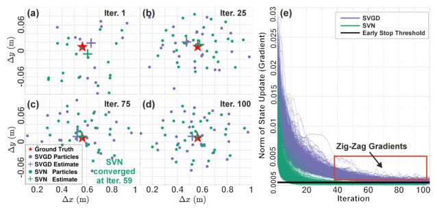

> **TL;DR** SVN-ICP solves LiDAR scan matching with a small cloud of pose "particles" instead of one pose. The particles are pulled toward good alignments by Newton steps and pushed apart from each other, so their spread becomes an honest covariance for each ICP result. Fed into a simple error-state Kalman filter with an IMU, that covariance automatically shifts trust to the IMU in long corridors and roughly halves average error on SubT-MRS compared with the same filter using a fixed ICP noise.

## Why this paper

Every LiDAR-inertial system has a knob nobody likes: how much to trust the scan matcher. Too much, and the filter follows ICP as it slides along a featureless corridor; too little, and good LiDAR is wasted. Garage ramps and long aisles are where this knob fails for us. This paper replaces the knob with a per-scan estimate of ICP uncertainty.

## The problem

**Covariance and the Kalman gain, with numbers.** A Kalman filter blends a prediction (here from the IMU) with a measurement (here the ICP pose) using their variances. In one dimension the blend weight is K = P / (P + R), where P is the prediction variance and R the measurement variance. With P = 0.04 m² and R = 0.01 m², K = 0.8: trust ICP. Now enter a corridor. Along the corridor axis ICP has nothing to lock onto, so its true variance might be 1.0 m². The right gain is then 0.04 / 1.04 ≈ 0.04: trust the IMU. A filter that still believes R = 0.01 keeps K = 0.8 and follows ICP as it slides. The whole game is getting R right, per scan and per direction.

**Why ICP covariance is hard.** ICP minimizes Σ‖qₙ − (Rpₙ + t)‖² between matched points. The classic covariance comes from the curvature of that cost at the optimum (the inverse Hessian). It is known to be overconfident: it ignores wrong correspondences, local minima and a bad initial guess, which are exactly the failure modes in degenerate scenes. Closed-form models that add these terms need careful modeling; learned ones may not generalize.

**Particles as a distribution.** Treat ICP as Bayesian inference: the pose has a posterior distribution, and we want its spread. Stein ICP (prior work) represents it with K particles moved by Stein variational gradient descent (SVGD). Each particle feels two forces: the gradient of the log-posterior (go toward good alignments) and a kernel repulsion (don't sit on top of your neighbors). At convergence the particles cover the posterior, and their sample covariance is the uncertainty. No noise model needed.

The catch is that SVGD is a first-order method. In a corridor the cost is a long, flat valley: steep across the corridor, almost flat along it. Gradient descent zig-zags in such ill-conditioned valleys and converges slowly. Anyone who has tuned a trajectory optimizer knows the cure: use second-order information.

## Key idea

Replace SVGD with **Stein Variational Newton (SVN)**: the same particles and repulsion, but each update is preconditioned by a kernel-weighted Hessian, like a Newton step instead of a gradient step. Do it on the manifold, with a right-hand perturbation of the pose, so rotation and translation share one gradient and one kernel instead of separate hand-designed ones.

## How it works

Algorithm per scan (odometry part):

1. **Prior.** The error-state Kalman filter predicts the pose with the IMU and gives its covariance.
2. **Particles.** Sample K pose perturbations around the prior (K = 30 by default).
3. **Sub-target.** For each source point, keep only its nearest neighbors in the target map (KNN), once. This replaces Stein ICP's mini-batches and cuts cost.
4. **Per-particle Newton terms.** Transform the scan with each particle's pose, find correspondences, and compute the point-to-point Jacobian, gradient b and Gauss–Newton Hessian H on the manifold.
5. **SVN update.** Combine neighbors' gradients and Hessians through an RBF kernel. The kernel-gradient term pushes particles apart; the preconditioned direction H̃⁻¹φ gives a Newton-like step. Everything runs in parallel on the GPU.
6. **Early stop** when the average step norm across particles falls below a threshold.
7. **Output.** Mean of the particles = pose correction; their sample covariance = ICP covariance, mapped to the global frame with the adjoint of the prior pose.

The Kalman filter (15-dimensional error state: position, velocity, orientation, accelerometer and gyro biases) then uses that covariance as the measurement noise for this scan. This is loosely coupled fusion: ICP produces a pose and covariance, the filter fuses them.

## Results

Datasets: SubT-MRS (tunnels, caves, nuclear plant, sewers, a long corridor; UGV, drone, hand-held, RC car, legged robot) and GEODE (off-road, tunnel, waterways, stairs, a bridge). Metric: absolute pose error (APE). Hardware: i7-8086K CPU and GTX 1080 Ti.

**SubT-MRS, average APE / RPE (m) over 11 sequences:**

| Method | APE / RPE |
|---|---|
| LIO-EKF (odometry) | 4.312 / 0.186 |
| SVN-ICP + Kalman filter, fixed ICP noise | 2.995 / 0.055 |
| **SVN-ICP + Kalman filter, estimated noise** | **1.369 / 0.046** |
| Best competition "system" (multi-method pipeline, often tuned with loop closures) | 0.588 / 0.091 |

- KISS-ICP, GenZ-ICP, Stein ICP, and LiDAR-only SVN-ICP or SVGD-ICP fail (APE > 100 m or divergence) on several sequences. The full SVN-ICP + filter runs on all of them.
- Using the estimated covariance instead of a fixed one matters most where LiDAR degrades: Ocean 0.047 vs 1.173 m, Long Corridor 0.650 vs 1.567 m, Sewerage 2.933 vs 11.51 m.
- Pure LiDAR odometry is fine for smooth ground vehicles; aggressive motion (drones, hand-held) needs the IMU.

**GEODE.** Gains are smaller because scenes are easier, except Waterway Long: 15.58 m APE versus 36.80 m with fixed noise and about 68–70 m for FAST-LIO2 and DLIO. On Bridge1 every baseline fails; SVN-ICP + filter reaches 44.27 m, poor but not divergent.

**Is the covariance honest?** Against 1,000 Monte Carlo ICP runs on Long Corridor, the normalized norm error (NNE, ideally about 1) for translation / rotation is 126.5 / 565.4 for Censi's classic Hessian method (very overconfident), 1.486 / 2.292 for the closed-form COV-3D, 1.281 / 1.855 for SVN-ICP, and 1.196 / 1.559 for SVN-ICP inside the filter. KL divergence to the Monte Carlo distribution tells the same story: 1.996 for SVN-ICP versus 1.2×10⁵ for Censi's method (translation). The particle cloud also shows the distribution along the corridor is non-Gaussian, with multiple modes and long tails.

**Runtime.** About 0.47 s per scan with 30 particles; 0.34–0.37 s with 5–10 particles, which the authors say is enough because the distribution shape barely changes. SVN needs about 60–65 iterations against about 99 for SVGD, so it is faster despite the Hessian.

## Limitations

- **Not real time at 10 Hz.** Around 0.3–0.5 s per scan on a desktop GPU.
- **Loosely coupled and simple.** A basic Kalman filter and naive map management. Under aggressive motion in unstructured caves, or with moving objects in a degraded tunnel, the map gets corrupted and the larger covariance alone cannot save the estimate.
- **Point-to-point ICP only.** No point-to-plane or GICP variant.
- **Covariance still a Gaussian summary.** The particles see multi-modality, but the filter receives only mean and covariance.
- **"No tuning" is relative.** Kernel bandwidth, initial particle spread and IMU noise settings still matter.

## DYROS lens

**Where it fits.** Our garage SLAM uses weighted GICP for AVM and LiDAR alignment (Sensors 2023). Weighting decides how much each *point* counts; SVN-ICP answers the next question, how much the *whole alignment* should count against wheel odometry and IMU. A parking garage is full of the degeneracy this paper targets: long aisles, ramps, flat walls, and repeated pillars that create multiple near-equal alignments, exactly what a particle cloud can show and a Hessian cannot.

**Calibrated uncertainty for the go/no-go decision.** If localization is about to drive the final parking maneuver, a per-scan covariance that is roughly honest (NNE near 1) can serve as a gate: if the lateral and heading σ near the slot are below what TargetTree-RRT\* needs, proceed; if the cloud is stretched or multi-modal, slow down and wait for more structure to come into view.

**What would break.** Runtime on an onboard computer: 0.3–0.5 s per scan on a GTX 1080 Ti is too slow for a 10 Hz loop, though 5 particles and keyframe-only use could help. Point-to-point ICP on AVM bird's-eye points with distortion may be worse than our weighted GICP, so the right move is to put the SVN particle machinery around a GICP cost, not to replace GICP.

**What we could try in a week.** Run the released code on a garage log with LiDAR and IMU, plot the estimated σ along the aisle and on the ramp, and compare the filter with fixed versus estimated ICP noise against a reference trajectory.

**Paper opportunity.** "SVN-GICP" with wheel odometry for parking: a particle-based uncertainty for weighted GICP, tested on AVM and LiDAR in garages, with the estimated covariance used as the localization gate before the final maneuver.

## Key terms

- **ICP (Iterative Closest Point)**: alternately match points between two scans and solve for the rigid transform that aligns them.
- **Kalman gain**: the weight a filter gives a measurement versus its prediction, set by their covariances.
- **Degeneracy**: the scene does not constrain some pose directions (e.g. along a corridor), so ICP can slide.
- **SVGD (Stein variational gradient descent)**: moves a set of particles with gradient attraction plus kernel repulsion so they approximate a distribution.
- **Stein Variational Newton (SVN)**: SVGD with a Hessian-preconditioned, Newton-like update.
- **NNE (normalized norm error)**: estimation error divided by predicted uncertainty; about 1 means the uncertainty is consistent.
