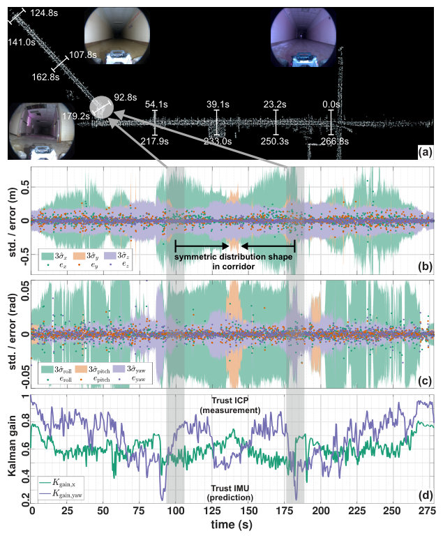
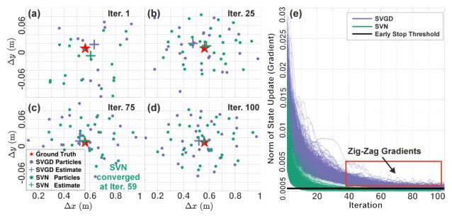

> **TL;DR** SVN-ICP는 LiDAR scan matching을 pose 하나가 아니라 pose "particle" 여러 개로 풉니다. Particle들은 Newton step으로 좋은 정합 쪽으로 끌려가면서 서로 밀어내기 때문에, 그 퍼짐이 ICP 결과마다 정직한 covariance (공분산)가 됩니다. 이 covariance를 IMU와 함께 단순한 error-state Kalman filter에 넣으면, 긴 복도에서 자동으로 IMU를 더 믿게 되고, SubT-MRS 평균 오차가 고정 ICP 노이즈를 쓴 같은 filter보다 약 절반으로 줄어듭니다.

## 왜 이 논문인가

LiDAR-inertial 시스템에는 모두가 싫어하는 손잡이가 있습니다. Scan matcher를 얼마나 믿을 것인가입니다. 너무 믿으면 특징 없는 복도에서 ICP가 미끄러질 때 filter가 따라가고, 너무 안 믿으면 좋은 LiDAR 정보를 버립니다. 주차장 경사로와 긴 통로가 바로 이 손잡이가 실패하는 곳입니다. 이 논문은 손잡이 대신 scan마다 ICP 불확실성을 추정합니다.

## 문제

**Covariance와 Kalman gain을 숫자로.** Kalman filter는 예측(여기서는 IMU)과 측정(여기서는 ICP pose)을 각각의 분산으로 섞습니다. 1차원에서 섞는 비율은 K = P / (P + R)입니다. P는 예측 분산, R은 측정 분산입니다. P = 0.04 m², R = 0.01 m²이면 K = 0.8이고 ICP를 믿습니다. 이제 복도에 들어갑니다. 복도 축 방향으로는 ICP가 붙잡을 것이 없어서 실제 분산이 1.0 m²쯤 될 수 있습니다. 그러면 맞는 gain은 0.04 / 1.04 ≈ 0.04, 즉 IMU를 믿어야 합니다. 여전히 R = 0.01이라고 믿는 filter는 K = 0.8을 유지하고, ICP가 미끄러지는 대로 따라갑니다. 핵심은 R을 scan마다, 방향마다 맞게 정하는 것입니다.

**ICP covariance가 어려운 이유.** ICP는 매칭된 점들 사이의 Σ‖qₙ − (Rpₙ + t)‖²를 최소화합니다. 고전적인 covariance는 최적점에서 이 비용의 곡률(Hessian 역행렬)로 구합니다. 이 값은 과신하는 것으로 알려져 있습니다. 틀린 대응, local minimum, 나쁜 초기값을 무시하는데, 이것이 바로 degeneracy (퇴화) 장면의 실패 원인입니다. 이런 항을 더하는 닫힌 형태 모델은 세심한 모델링이 필요하고, 학습 기반 모델은 일반화가 안 될 수 있습니다.

**Particle로 분포 표현하기.** ICP를 Bayesian 추론으로 봅니다. Pose에는 posterior 분포가 있고, 우리는 그 퍼짐을 원합니다. 이전 연구인 Stein ICP는 이 분포를 Stein variational gradient descent (SVGD)로 움직이는 particle K개로 나타냅니다. 각 particle은 두 힘을 받습니다. Log-posterior의 gradient(좋은 정합 쪽으로)와 kernel 반발력(이웃 위에 겹치지 말 것)입니다. 수렴하면 particle들이 posterior를 덮고, 그 표본 covariance가 불확실성이 됩니다. 노이즈 모델이 필요 없습니다.

함정은 SVGD가 1차 방법이라는 점입니다. 복도에서 비용 함수는 길고 평평한 골짜기입니다. 복도를 가로지르는 방향은 가파르고, 복도를 따라가는 방향은 거의 평평합니다. Gradient descent는 이런 ill-conditioned 골짜기에서 지그재그로 움직이며 느리게 수렴합니다. Trajectory optimizer를 튜닝해 본 사람이라면 해법을 압니다. 2차 정보를 쓰면 됩니다.

## 핵심 아이디어

SVGD를 **Stein Variational Newton**(SVN)으로 바꿉니다. Particle과 반발력은 같지만, 매 갱신을 kernel로 가중한 Hessian으로 preconditioning해서 gradient step 대신 Newton step처럼 움직입니다. 그리고 manifold 위에서 pose의 right-hand perturbation으로 풀어, 회전과 이동이 따로 설계한 gradient와 kernel 대신 하나의 gradient와 kernel을 공유하게 합니다.

## 작동 방식

Scan마다 하는 일(odometry 부분):

1. **Prior.** Error-state Kalman filter가 IMU로 pose와 그 covariance를 예측합니다.
2. **Particle.** Prior 주변에서 pose perturbation K개를 뽑습니다(기본 K = 30).
3. **Sub-target.** Source 점마다 target 지도에서 가까운 이웃(KNN)만 한 번 골라 둡니다. Stein ICP의 mini-batch를 대신하고 계산을 줄입니다.
4. **Particle별 Newton 항.** 각 particle의 pose로 scan을 옮기고, 대응점을 찾고, manifold 위에서 point-to-point Jacobian, gradient b, Gauss–Newton Hessian H를 계산합니다.
5. **SVN 갱신.** 이웃 particle들의 gradient와 Hessian을 RBF kernel로 합칩니다. Kernel-gradient 항이 particle을 서로 밀어내고, preconditioning된 방향 H̃⁻¹φ가 Newton 같은 step을 줍니다. 모두 GPU에서 병렬로 돕니다.
6. **조기 종료.** Particle들의 평균 step 크기가 임계값 아래로 내려가면 멈춥니다.
7. **출력.** Particle 평균 = pose 보정량, 표본 covariance = ICP covariance이며, prior pose의 adjoint로 global 좌표계로 옮깁니다.

그다음 Kalman filter(15차원 error state: 위치, 속도, 자세, 가속도계와 자이로 bias)가 이 covariance를 이번 scan의 측정 노이즈로 씁니다. Loosely coupled 융합입니다. ICP가 pose와 covariance를 내고, filter가 이를 합칩니다.

## 결과

데이터셋: SubT-MRS(터널, 동굴, 원자력 시설, 하수도, 긴 복도; UGV, 드론, 핸드헬드, RC카, 보행 로봇)와 GEODE(비포장 도로, 터널, 수로, 계단, 다리). Metric: absolute pose error (APE). 하드웨어: i7-8086K CPU, GTX 1080 Ti.

**SubT-MRS, 11개 시퀀스 평균 APE / RPE (m):**

| 방법 | APE / RPE |
|---|---|
| LIO-EKF (odometry) | 4.312 / 0.186 |
| SVN-ICP + Kalman filter, 고정 ICP 노이즈 | 2.995 / 0.055 |
| **SVN-ICP + Kalman filter, 추정 노이즈** | **1.369 / 0.046** |
| 대회용 최고 "system" (여러 방법을 엮은 파이프라인, 주로 loop closure로 튜닝) | 0.588 / 0.091 |

- KISS-ICP, GenZ-ICP, Stein ICP, 그리고 LiDAR만 쓰는 SVN-ICP나 SVGD-ICP는 여러 시퀀스에서 실패합니다(APE > 100 m 또는 발산). SVN-ICP + filter 전체는 모든 시퀀스를 끝까지 갑니다.
- 고정 covariance 대신 추정 covariance를 쓰는 효과는 LiDAR가 나빠지는 곳에서 가장 큽니다. Ocean 0.047 대 1.173 m, Long Corridor 0.650 대 1.567 m, Sewerage 2.933 대 11.51 m.
- 부드럽게 움직이는 지상 차량에서는 LiDAR만으로도 괜찮고, 드론이나 핸드헬드처럼 움직임이 거칠면 IMU가 필요합니다.

**GEODE.** 장면이 쉬워서 이득이 작습니다. 예외는 Waterway Long으로, APE 15.58 m 대 고정 노이즈 36.80 m, FAST-LIO2와 DLIO는 약 68–70 m입니다. Bridge1에서는 모든 baseline이 실패하고, SVN-ICP + filter는 44.27 m로 나쁘지만 발산하지는 않습니다.

**Covariance는 정직한가?** Long Corridor에서 Monte Carlo ICP 1,000회와 비교한 normalized norm error (NNE, 이상적으로 약 1)는 translation / rotation 기준으로 Censi의 고전적 Hessian 방법 126.5 / 565.4(심한 과신), 닫힌 형태 COV-3D 1.486 / 2.292, SVN-ICP 1.281 / 1.855, filter 안의 SVN-ICP 1.196 / 1.559입니다. Monte Carlo 분포에 대한 KL divergence도 같은 이야기를 합니다. Translation에서 SVN-ICP는 1.996, Censi 방법은 1.2×10⁵입니다. Particle 분포를 보면 복도 방향 분포가 Gaussian이 아니라 봉우리가 여러 개이고 꼬리가 깁니다.

**실행 시간.** Particle 30개로 scan당 약 0.47 s, 5–10개로 0.34–0.37 s입니다. 저자들은 분포 모양이 거의 바뀌지 않으므로 5–10개면 충분하다고 말합니다. SVN은 약 60–65번 반복하고 SVGD는 약 99번이라, Hessian을 계산하는데도 더 빠릅니다.

## 한계

- **10 Hz 실시간이 아닙니다.** 데스크톱 GPU에서 scan당 약 0.3–0.5 s입니다.
- **Loosely coupled이고 단순합니다.** 기본 Kalman filter와 단순한 지도 관리입니다. 구조 없는 동굴에서 거칠게 움직이거나, 퇴화된 터널에 움직이는 물체가 있으면 지도가 망가지고, 커진 covariance만으로는 추정을 구할 수 없습니다.
- **Point-to-point ICP뿐입니다.** Point-to-plane이나 GICP 버전이 없습니다.
- **Covariance는 여전히 Gaussian 요약입니다.** Particle은 봉우리 여러 개를 보지만, filter는 평균과 covariance만 받습니다.
- **"튜닝 불필요"는 상대적입니다.** Kernel bandwidth, 초기 particle 퍼짐, IMU 노이즈 설정은 여전히 중요합니다.

## DYROS 관점

**어디에 맞는가.** 우리 주차장 SLAM은 AVM과 LiDAR 정합에 weighted GICP를 씁니다(Sensors 2023). Weighting은 각 *점*이 얼마나 중요한지 정합니다. SVN-ICP는 그다음 질문, 즉 *정합 전체*를 wheel odometry와 IMU 대비 얼마나 믿을지에 답합니다. 주차장은 이 논문이 노리는 degeneracy로 가득합니다. 긴 통로, 경사로, 평평한 벽, 그리고 거의 같은 정합을 여러 개 만드는 반복된 기둥입니다. Particle 분포는 이것을 보여 줄 수 있고 Hessian은 못 합니다.

**진행/정지 판단을 위한 보정된 불확실성.** Localization이 곧 마지막 주차 기동을 이끌어야 한다면, 대체로 정직한(NNE가 1 근처인) scan별 covariance를 관문으로 쓸 수 있습니다. 주차 칸 근처에서 횡방향과 heading σ가 TargetTree-RRT\*에 필요한 값보다 작으면 진행하고, particle 분포가 길게 늘어지거나 봉우리가 여러 개면 속도를 줄이고 구조물이 더 보일 때까지 기다립니다.

**무엇이 깨질까.** 차량 탑재 컴퓨터에서의 실행 시간입니다. GTX 1080 Ti에서 scan당 0.3–0.5 s는 10 Hz 루프에 너무 느립니다. Particle 5개, keyframe에만 쓰기 같은 방법이 도움이 될 수 있습니다. 왜곡이 있는 AVM bird's-eye 점에 point-to-point ICP를 쓰면 우리 weighted GICP보다 나쁠 수 있습니다. 그러니 GICP를 바꾸는 것이 아니라, GICP 비용 주위에 SVN particle 장치를 씌우는 것이 맞습니다.

**일주일 안에 해 볼 수 있는 것.** 공개 코드를 LiDAR와 IMU가 있는 주차장 로그에 돌려, 통로와 경사로에서 추정 σ를 그려 봅니다. 그리고 고정 ICP 노이즈와 추정 노이즈를 쓴 filter를 기준 trajectory에 대해 비교합니다.

**논문 기회.** 주차용 "SVN-GICP" + wheel odometry: weighted GICP에 particle 기반 불확실성을 붙이고, 주차장의 AVM과 LiDAR로 시험하며, 추정 covariance를 마지막 기동 전 localization 관문으로 씁니다.

## 용어 정리

- **ICP (Iterative Closest Point)**: 두 scan 사이의 점 대응 찾기와, 이를 맞추는 강체 변환 풀기를 번갈아 하는 방법.
- **Kalman gain**: filter가 예측 대비 측정에 주는 비중. 두 covariance로 정해집니다.
- **Degeneracy**: 장면이 pose의 어떤 방향(예: 복도 축)을 구속하지 못해 ICP가 미끄러질 수 있는 상태.
- **SVGD (Stein variational gradient descent)**: gradient 인력과 kernel 반발력으로 particle 집합을 움직여 분포를 근사하는 방법.
- **Stein Variational Newton (SVN)**: Hessian으로 preconditioning한 Newton 같은 갱신을 쓰는 SVGD.
- **NNE (normalized norm error)**: 추정 오차를 예측 불확실성으로 나눈 값. 약 1이면 불확실성이 일관됩니다.
