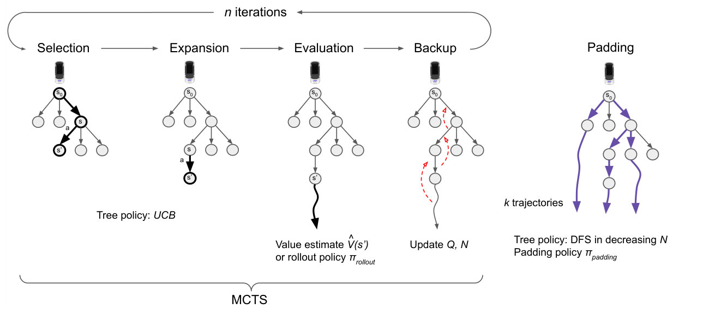
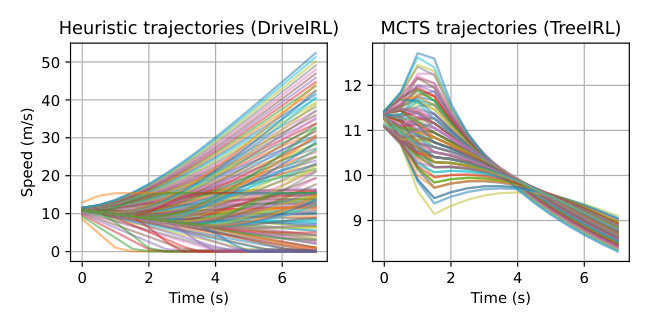

> **TL;DR** TreeIRL, from Motional, splits planning into two jobs. Monte Carlo tree search (MCTS) generates 100 candidate trajectories around a safe behavior (slow down, follow, stop), and a deep scorer trained with inverse reinforcement learning on human driving picks the most human-like one. It was tested on 7,000+ nuPlan scenarios, 700+ full-stack simulations and 536 miles on Las Vegas roads, where it had zero takeovers for following or cut-in failures in 268 miles.

## Why this paper

Our IROS 2023 framework used learning to tell a sampling-based planner *where to look*. TreeIRL is the mirror image: a classical search *generates* candidates and learning only *chooses* among them. It is one of very few papers that take such a hybrid onto public roads and report honest real-world metrics.

## The problem

Each family of planners fails in its own way:

- **Classical search / optimization** (IDM, A\*, MCTS, MPC): explicit safety checks and flexible, but the behavior can be jerky or unnatural, and it is hard to improve with data because there are few parameters and nothing is differentiable.
- **Imitation learning (IL)**: human-like and scales with data, but unsafe in rare cases (aggressive cut-ins) and suffers from distribution shift in closed loop.
- **Reinforcement learning (RL)**: robust, but you must design a reward and a realistic simulator, both as hard as planning itself.

Their previous planner, **DriveIRL**, used a fixed generator of 143 jerk-optimal trajectories to hand-picked targets plus a learned scorer. Most candidates are absurd for the scene (accelerating to 50 m/s), and sometimes all are bad. A safety filter on top (DriveIRL-Safe) removes unsafe ones but then brakes too early and too hard.

MCTS could generate better candidates, but on a real car it has a latency problem: using a neural network inside every MCTS iteration is too slow.

## Key idea

Let MCTS do what it is good at and nothing more. MCTS only has to find the right *region* of trajectory space (the behavior mode); it does not have to find the single best trajectory. The IRL scorer then picks the most human-like variant inside that region. So MCTS can be cheap: no neural network in the loop, simple IDM rollouts, about 10 ms.

## How it works

**Scope.** Only 1-D longitudinal control along the lane centerline: lane following, adaptive cruise control (ACC), cut-ins and traffic lights. Lateral control is left to downstream post-processing.

**The search problem (MDP).**

- State: position, speed and acceleration of the ego and of the lead agent, time, a stop point (goal or red light) and the speed limit.
- Action: jerk in {−2, −1, 0, 1, 2} m/s³. Step 0.5 s, horizon 8 s (tree depth 16). Acceleration is clamped to [−7, 2] m/s²; no reverse.
- Other agents: not reactive. The lead agent comes from the top-mode prediction of the PBP prediction model.
- Reward: a weighted cost for jerk, acceleration, speed-limit tracking, collision (squared speed difference), a clearance buffer (1 m in training, 2 m in evaluation), and terms that stop the car at a sensible distance.

**MCTS as a trajectory generator.** Standard MCTS runs selection, expansion, evaluation and backup for n iterations and then picks one action. TreeIRL instead walks the tree depth-first, visiting the most-visited children first, takes the first k leaves, and "pads" each to 8 s with a simple policy. That gives k full trajectories, all near the behavior MCTS found most promising.

**Choosing the cheap configuration.** They compared an RL policy (trained with PPO) inside the search against simple hand-written rollouts. Measured on one CPU thread of a laptop i9, with k = 100:

- RL prior + RL rollouts + RL padding: 911.79 ms.
- Uniform prior + IDM rollouts + IDM padding: **10.05 ms** (chosen; n = 400, where performance plateaus).

The 10 Hz budget is 100 ms, so any network in the loop was out. The RL policy was also too conservative: it only sees the lead car, so it brakes for cut-ins it cannot anticipate. MCTS, using predictions, can.

**The IRL scorer.** Same as DriveIRL: frozen PBP scene encoder, a transformer that embeds scene + candidate, and a scoring head. Trained on 1,360 hours of human driving as a classification problem: the "correct" candidate is the one closest to what the human did (excluding colliding ones), with a softmax over candidates and focal loss. For TreeIRL, near-term waypoints get more weight than far ones, and speed error counts 5×.

**Deployment detail that mattered.** The planner output is post-processed by either Lab2Car, a heavier MPC (73 ms average loop with DriveIRL), or a light Smoother MPC (15 ms). MCTS did *worse* with Lab2Car: it assumes its own jerk commands were executed and runs faster, so it kept stacking −2 m/s³ while Lab2Car lagged, and the car suddenly braked hard. MCTS and TreeIRL therefore use the Smoother.

## Results

**nuPlan (7,051 Las Vegas scenarios, log replay).** Collisions are near 0.01 for most planners, so the metric saturates. Gigaflow (their own re-implementation of a self-play RL planner) leaves the drivable area often (0.11) and is uncomfortable (0.38). TreeIRL: comfort 0.98, progress 0.92.

**Challenging cut-ins (134 scenarios).** Collisions: MCTS 0.31, DriveIRL 0.34, DriveIRL-Safe 0.16, TreeIRL 0.19. Comfort: 0.84 / 0.86 / 0.75 / **0.87**. DriveIRL-Safe is slightly safer but much less comfortable.

**High-fidelity full-stack simulation (717 runs, 30 s each).** Front collisions: 0.04 / 0.05 / 0.03 / 0.03. Red-light violations: 0.01 / 0.04 / 0.04 / 0.01. TreeIRL is as safe as the safest and more comfortable than MCTS.

**Public roads (Hyundai IONIQ 5, Las Vegas), miles per event, higher is better:**

| Metric | MCTS | DriveIRL | DriveIRL-Safe | TreeIRL |
|---|---|---|---|---|
| Miles driven | 115.8 | 64.3 | 87.9 | 268.4 |
| Safety takeovers | 7.68 | 1.43 | 6.76 | **17.89** |
| ACC failures | 57.9 | 2.57 | 87.9 | **none** |
| Cut-in failures | none | 5.36 | 43.95 | **none** |
| Slow driving | none | 5.85 | 2.84 | 134.2 |
| Jerky driving | 2.83 | 6.43 | 2.20 | **13.42** |

On the road TreeIRL's advantage was far larger than in simulation: about two orders of magnitude fewer ACC failures than DriveIRL. Part of that is because takeovers are the safety driver's judgment: re-simulation showed that a substantial number of takeovers would not have ended in a collision. The authors argue that perceived safety is still what passengers feel.

## Limitations

- **1-D only.** No lane changes, nudging or lateral decisions. The authors expect 2-D search guided by IDM to need far too many iterations.
- **Non-reactive world model** with a single predicted mode per agent; no prediction uncertainty.
- **On-road numbers are not a controlled test.** Different planners drove different mileages on similar routes, and the main safety metric is a human judgment call.
- **Hand-tuned reward** with six weights and a clearance buffer; the safety half of the system is still classical engineering.
- **Data-hungry scorer:** 1,360 hours of human driving plus a pre-trained prediction model.

## DYROS lens

**This is our design pattern.** TargetTree-RRT\* already produces a tree of feasible continuous-curvature paths to the goal. TreeIRL says: do not take only the cost-minimal one; extract the top-k branches and let a learned scorer pick the one a human would drive (fewer gear changes, a natural approach angle). Safety stays in the search, style moves to learning.

**When the classical planner still wins.** Compare MCTS with TreeIRL: MCTS alone was already competitive on safety in nuPlan, and the biggest gain from adding IRL was comfort (safety improved too). With modest data, the safety part should stay classical. A scorer only needs to rank a handful of candidates, which is a much easier learning problem than generating a trajectory from scratch. Whether a few hundred human parking maneuvers would be enough is an open question; this paper used 1,360 hours.

**Evaluation lessons for a real car.**

- They budget latency on one CPU thread "as on the car" and reject anything over 100 ms. We should report planner latency on our onboard computer, not on a desktop GPU.
- Planner and tracker must be tested together: the same MCTS was comfortable with one controller and braked harshly with another, purely because of latency and bookkeeping.
- No single score: safety, progress, comfort and human-likeness are reported separately.
- A small win in simulation became a large win on the road. Early real-car tests are worth the effort.

**What would break in parking.** MCTS with 5 jerk actions in 1-D is cheap. In SE(2) with steering, gear and multi-point turns the tree explodes. For us the generator should be our own sampling-based planner, not MCTS.

**One-week experiment.** From our narrow-space planner, export the top 20 distinct trajectories per query instead of one. Record a few dozen human parking maneuvers in the same lot. Train a small scorer with the same softmax-over-candidates loss (label = candidate closest to the human). Compare picked vs cost-minimal trajectories on gear changes, curvature rate and final pose error.

**Paper opportunity.** "Human-like parking with a sampling-based generator and an IRL scorer," evaluated on our car with the same split of safety, progress and comfort metrics.

## Key terms

- **MCTS (Monte Carlo tree search)**: builds a search tree by repeatedly simulating futures and backing up their returns.
- **Inverse reinforcement learning (IRL)**: learning a reward or scoring function from expert demonstrations, then using it to choose actions.
- **Padding policy**: the simple policy that extends a partial tree branch into a full-length trajectory.
- **ACC (adaptive cruise control)**: following a lead vehicle at a safe gap and speed.
- **Takeover**: the safety driver taking control; reported as autonomous miles per event.
