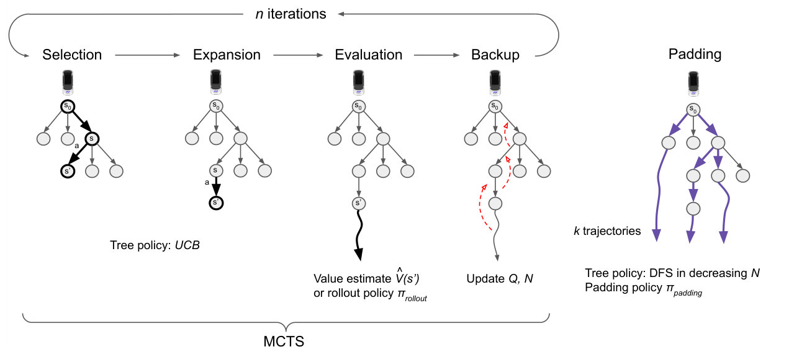
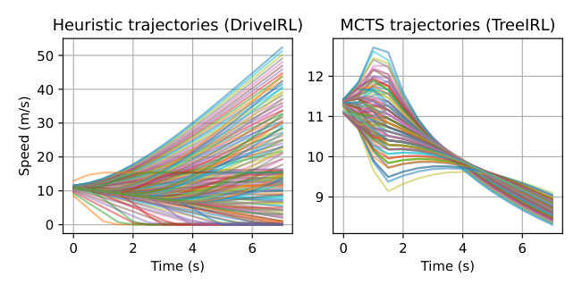

> **TL;DR** Motional의 TreeIRL은 planning을 두 가지 일로 나눕니다. Monte Carlo tree search (MCTS)가 안전한 행동(감속, 추종, 정지) 주변에서 후보 trajectory 100개를 만들고, 사람 주행으로 inverse reinforcement learning (역강화학습)을 한 deep scorer가 가장 사람다운 것을 고릅니다. nuPlan 7,000여 시나리오, 전체 스택 시뮬레이션 700여 회, 라스베이거스 도로 536마일에서 시험했고, 그중 TreeIRL이 달린 268마일 동안 앞차 추종이나 cut-in 실패로 인한 takeover가 한 번도 없었습니다.

## 왜 이 논문인가

IROS 2023 프레임워크는 학습으로 sampling-based planner에게 *어디를 볼지* 알려 주었습니다. TreeIRL은 그 거울상입니다. 고전적 탐색이 후보를 *만들고*, 학습은 그중에서 *고르기만* 합니다. 이런 하이브리드를 공공 도로까지 가져가 솔직한 실차 지표를 보고한 몇 안 되는 논문입니다.

## 문제

Planner 계열마다 실패하는 방식이 다릅니다.

- **고전적 탐색 / 최적화** (IDM, A\*, MCTS, MPC): 안전 검사가 확실하고 유연하지만, 움직임이 거칠거나 부자연스러울 수 있습니다. 파라미터가 적고 미분이 안 되어 데이터로 개선하기 어렵습니다.
- **Imitation learning**(모방 학습, IL): 사람답고 데이터에 따라 좋아지지만, 드문 상황(공격적인 cut-in)에서 위험하고 closed-loop에서 분포 이동을 겪습니다.
- **Reinforcement learning**(강화학습, RL): 강건하지만 reward와 현실적인 시뮬레이터를 설계해야 하고, 둘 다 planning만큼 어렵습니다.

이전 planner인 **DriveIRL**은 손으로 고른 목표점까지 가는 jerk-optimal trajectory 143개를 고정 생성기로 만들고, 학습된 scorer로 골랐습니다. 후보 대부분은 지금 장면에 터무니없고(50 m/s까지 가속), 가끔은 전부 나쁩니다. 그 위에 safety filter를 얹은 DriveIRL-Safe는 위험한 후보를 지우지만, 너무 일찍 너무 세게 브레이크를 밟습니다.

MCTS라면 더 좋은 후보를 만들 수 있지만, 실차에서는 지연 시간 문제가 있습니다. MCTS 반복마다 신경망을 돌리면 너무 느립니다.

## 핵심 아이디어

MCTS에게 잘하는 일만 시킵니다. MCTS는 trajectory 공간에서 올바른 *영역*(행동 모드)만 찾으면 되고, 단 하나의 최적 trajectory를 찾을 필요는 없습니다. 그 영역 안에서 가장 사람다운 변형은 IRL scorer가 고릅니다. 그래서 MCTS는 가벼워도 됩니다. 반복 안에 신경망이 없고, 단순한 IDM rollout만 쓰며, 약 10 ms면 됩니다.

## 작동 방식

**범위.** 차선 중심선을 따른 1차원 종방향 제어만 다룹니다. 차선 유지, adaptive cruise control (ACC), cut-in, 신호등입니다. 횡방향 제어는 뒤쪽 후처리에 맡깁니다.

**탐색 문제 (MDP).**

- 상태: ego와 앞차의 위치, 속도, 가속도, 시간, 정지점(목표 또는 빨간불), 제한 속도.
- 행동: jerk ∈ {−2, −1, 0, 1, 2} m/s³. 한 단계 0.5 s, horizon 8 s (tree 깊이 16). 가속도는 [−7, 2] m/s²로 자르고, 후진은 없습니다.
- 다른 agent: 반응하지 않습니다. 앞차는 PBP 예측 모델의 최상위 모드에서 가져옵니다.
- Reward: jerk, 가속도, 제한 속도 추종, 충돌(속도 차의 제곱), 여유 거리(학습 1 m, 평가 2 m), 적당한 거리에서 멈추게 하는 항의 가중합 비용.

**Trajectory 생성기로서의 MCTS.** 보통 MCTS는 selection, expansion, evaluation, backup을 n번 반복한 뒤 행동 하나를 고릅니다. TreeIRL은 대신 tree를 깊이 우선으로 훑되 방문 횟수가 많은 자식부터 보고, 처음 만나는 leaf k개를 고른 뒤, 단순한 policy로 각각을 8 s까지 "채웁니다(padding)". 그러면 MCTS가 가장 유망하다고 본 행동 근처의 완전한 trajectory k개를 얻습니다.

**가벼운 설정 고르기.** 탐색 안에서 RL policy(PPO로 학습)를 쓰는 경우와 손으로 만든 단순한 rollout을 쓰는 경우를 비교했습니다. 노트북 i9의 CPU thread 하나에서 k = 100으로 잰 결과:

- RL prior + RL rollout + RL padding: 911.79 ms
- Uniform prior + IDM rollout + IDM padding: **10.05 ms** (선택. 성능이 포화되는 n = 400)

10 Hz 예산은 100 ms이므로, 반복 안에 신경망을 넣는 설정은 모두 탈락했습니다. RL policy는 너무 보수적이기도 했습니다. 앞차만 보기 때문에 예상하지 못하는 cut-in에 대비해 브레이크를 밟습니다. 예측을 쓰는 MCTS는 이를 예상할 수 있습니다.

**IRL scorer.** DriveIRL과 같습니다. 고정한 PBP 장면 encoder, 장면과 후보를 함께 embedding하는 transformer, 점수 head입니다. 사람 주행 1,360시간으로 분류 문제처럼 학습합니다. "정답" 후보는 사람이 실제로 한 주행에 가장 가까운 것(충돌 후보 제외)이고, 후보들에 softmax를 씌워 focal loss로 학습합니다. TreeIRL에서는 가까운 미래 waypoint에 먼 것보다 큰 가중치를 주고, 속도 오차는 5배로 셉니다.

**중요했던 배포 세부 사항.** Planner 출력은 무거운 MPC인 Lab2Car (DriveIRL 기준 평균 73 ms) 또는 가벼운 Smoother MPC (15 ms)로 후처리합니다. MCTS는 Lab2Car와 함께일 때 *더 나빴습니다*. MCTS는 자기 jerk 명령이 실행됐다고 가정하고 더 빨리 돌기 때문에, Lab2Car가 늦는 동안 −2 m/s³를 계속 쌓았고, 차가 갑자기 세게 섰습니다. 그래서 MCTS와 TreeIRL은 Smoother를 씁니다.

## 결과

**nuPlan (라스베이거스 7,051 시나리오, 로그 재생).** 대부분 planner의 충돌이 0.01 근처라 지표가 포화됩니다. Gigaflow (self-play RL planner를 저자들이 다시 구현한 것)는 주행 가능 영역을 자주 벗어나고 (0.11) 승차감이 나쁩니다 (0.38). TreeIRL: 승차감 0.98, 진행도 0.92.

**어려운 cut-in (134 시나리오).** 충돌: MCTS 0.31, DriveIRL 0.34, DriveIRL-Safe 0.16, TreeIRL 0.19. 승차감: 0.84 / 0.86 / 0.75 / **0.87**. DriveIRL-Safe가 조금 더 안전하지만 승차감이 훨씬 나쁩니다.

**고충실도 전체 스택 시뮬레이션 (각 30 s, 717회).** 전방 충돌: 0.04 / 0.05 / 0.03 / 0.03. 신호 위반: 0.01 / 0.04 / 0.04 / 0.01. TreeIRL은 가장 안전한 쪽과 같고, MCTS보다 승차감이 좋습니다.

**공공 도로 (Hyundai IONIQ 5, 라스베이거스), 사건당 주행 마일, 클수록 좋음:**

| 지표 | MCTS | DriveIRL | DriveIRL-Safe | TreeIRL |
|---|---|---|---|---|
| 주행 마일 | 115.8 | 64.3 | 87.9 | 268.4 |
| 안전 takeover | 7.68 | 1.43 | 6.76 | **17.89** |
| ACC 실패 | 57.9 | 2.57 | 87.9 | **없음** |
| Cut-in 실패 | 없음 | 5.36 | 43.95 | **없음** |
| 너무 느린 주행 | 없음 | 5.85 | 2.84 | 134.2 |
| 거친 주행 | 2.83 | 6.43 | 2.20 | **13.42** |

도로에서 TreeIRL의 우위는 시뮬레이션보다 훨씬 컸습니다. ACC 실패는 DriveIRL보다 약 100배 적습니다. 일부는 takeover가 안전 운전자의 판단이기 때문입니다. 재시뮬레이션해 보니 takeover 중 상당수는 실제 충돌로 이어지지 않았을 것입니다. 저자들은 그래도 승객이 느끼는 것은 체감 안전이라고 주장합니다.

## 한계

- **1차원뿐입니다.** 차선 변경, 비켜 가기, 횡방향 판단이 없습니다. 저자들은 IDM이 이끄는 2차원 탐색은 반복이 너무 많이 필요할 것으로 봅니다.
- **반응하지 않는 world model**이고 agent마다 예측 모드가 하나뿐입니다. 예측 불확실성을 다루지 않습니다.
- **도로 수치는 통제된 실험이 아닙니다.** Planner마다 비슷한 경로를 다른 거리만큼 달렸고, 주요 안전 지표는 사람의 판단입니다.
- **손으로 조정한 reward**에 가중치 6개와 여유 거리가 있습니다. 시스템의 안전 절반은 여전히 고전적 엔지니어링입니다.
- **데이터가 많이 드는 scorer**: 사람 주행 1,360시간과 사전 학습된 예측 모델이 필요합니다.

## DYROS 관점

**우리의 설계 패턴입니다.** TargetTree-RRT\*는 이미 목표까지 가는 continuous-curvature path의 tree를 만듭니다. TreeIRL의 제안은 이렇습니다. 비용이 가장 작은 하나만 쓰지 말고, 상위 k개 가지를 꺼내 학습된 scorer가 사람이라면 운전할 것을 고르게 하라(기어 변경이 적고, 진입 각도가 자연스러운 것). 안전은 탐색에 남고, 스타일은 학습으로 옮겨 갑니다.

**고전 planner가 여전히 이기는 경우.** MCTS와 TreeIRL을 비교하면 MCTS만으로도 nuPlan 안전성은 이미 경쟁력이 있었고, IRL을 더해 가장 크게 얻은 것은 승차감이었습니다(안전도 함께 좋아졌습니다). 데이터가 적다면 안전 부분은 고전적으로 두어야 합니다. Scorer는 후보 몇 개의 순위만 매기면 되므로, trajectory를 처음부터 생성하는 것보다 훨씬 쉬운 학습 문제입니다. 사람 주차 기동 몇백 개로 충분할지는 열린 질문입니다. 이 논문은 1,360시간을 썼습니다.

**실차 평가에서 배울 점.**

- 지연 시간 예산을 "차에서처럼" CPU thread 하나로 잡고, 100 ms를 넘는 설정은 버립니다. 우리도 데스크톱 GPU가 아니라 차량 탑재 컴퓨터에서 잰 planner 지연 시간을 보고해야 합니다.
- Planner와 tracker는 함께 시험해야 합니다. 같은 MCTS가 한 controller와는 부드러웠고, 다른 controller와는 지연과 기록 방식 때문에 급제동했습니다.
- 점수 하나로 압축하지 않고 안전, 진행, 승차감, 사람다움을 따로 보고합니다.
- 시뮬레이션의 작은 우위가 도로에서 큰 우위가 되었습니다. 이른 실차 시험은 그만한 가치가 있습니다.

**주차에서 무엇이 깨질까.** 1차원에서 jerk 행동 5개짜리 MCTS는 가볍습니다. 조향, 기어, 여러 번 꺾기가 있는 SE(2)에서는 tree가 폭발합니다. 우리에게 생성기는 MCTS가 아니라 우리 sampling-based planner여야 합니다.

**일주일 안에 해 볼 수 있는 것.** 좁은 공간 planner에서 query마다 하나가 아니라 서로 다른 trajectory 상위 20개를 꺼냅니다. 같은 주차장에서 사람 주차 기동 수십 개를 기록합니다. 같은 softmax-over-candidates loss(정답 = 사람에 가장 가까운 후보)로 작은 scorer를 학습합니다. 고른 trajectory와 비용 최소 trajectory를 기어 변경 횟수, 곡률 변화율, 최종 pose 오차로 비교합니다.

**논문 기회.** "Sampling-based 생성기와 IRL scorer로 사람답게 주차하기"를 우리 차에서, 안전·진행·승차감 지표를 나누어 평가합니다.

## 용어 정리

- **MCTS (Monte Carlo tree search)**: 미래를 반복해서 시뮬레이션하고 그 return을 거슬러 올려 탐색 tree를 키우는 방법.
- **Inverse reinforcement learning (IRL)**: 전문가 시연에서 reward나 점수 함수를 배우고, 이를 행동 선택에 쓰는 방법.
- **Padding policy**: tree의 일부 가지를 끝까지 이어 완전한 trajectory로 만드는 단순한 policy.
- **ACC (adaptive cruise control)**: 앞차를 안전한 거리와 속도로 따라가는 기능.
- **Takeover**: 안전 운전자가 제어를 넘겨받는 것. 사건당 자율 주행 마일로 보고합니다.
