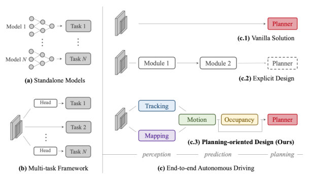
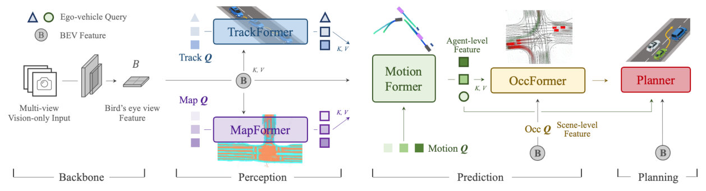

> **TL;DR** UniAD는 주행 스택 전체, 즉 tracking(추적), online mapping(지도 작성), motion forecasting(움직임 예측), occupancy prediction(점유 예측), planning(경로 계획)을 카메라만 쓰는 하나의 네트워크에 넣고, 모든 부분을 최종 plan을 위해 학습합니다. 모듈끼리는 box나 목록 대신 학습된 query 벡터로 정보를 주고받습니다. nuScenes에서 plan의 L2 오차와 충돌률이 이전 end-to-end 방법의 약 절반으로 줄었습니다.
>
> **고전인 이유:** CVPR 2023 Best Paper를 받았고, "모듈은 있지만 end-to-end로 학습하는" 주행 모델의 기준 구조가 되었습니다. 이후 end-to-end planner 대부분이 UniAD와 비교하며, 그 open-loop 수치는 나중에 이런 planner를 어떻게 평가해야 하는가에 대한 논쟁의 중심이 되었습니다.

## 왜 이 논문인가

우리 planner는 지도, 장애물, 목표를 주어진 것으로 보고 시작합니다. UniAD는 반대쪽에서 묻습니다. 결국 차를 움직이는 것이 planner라면, planner에게 정말 필요한 인식과 예측 과제는 무엇이고, 그 정보를 어떻게 넘겨야 할까요? UniAD를 직접 학습할 일이 없더라도, "모든 앞단 모듈은 plan에 무엇을 해 주는지로 평가한다"는 답은 우리 SLAM과 주차 스택을 보는 좋은 렌즈입니다.

## 문제

흔한 설계는 세 가지였고, 각각 약점이 있습니다.

- **독립 모듈** (a). 대부분의 산업용 스택이 이렇습니다. 팀별로 나누기 쉽지만, 모듈마다 자기 지표만 최적화하고, 인터페이스마다 정보가 사라지고, 오차가 쌓입니다.
- **Multi-task learning** (b). Backbone 하나를 공유하고 head를 여러 개 둡니다. 계산은 싸지만 과제끼리 서로 방해할 수 있고("negative transfer"), head끼리 협력하지 않습니다.
- **직접 end-to-end planning** (c.1). 픽셀을 넣으면 trajectory가 나옵니다. 단순하지만 실패했을 때 들여다볼 중간 결과가 없고, 안전을 걸 장치도 없습니다.

이전의 명시적 end-to-end 시스템(c.2)은 중간 과제 일부만 두고 나머지는 빼먹었습니다. 문제는 planner에게 어떤 앞단 과제가 필요하고, 그것들을 어떻게 연결하느냐입니다.

## 핵심 아이디어

Planning에서 거꾸로 설계하고, 모든 모듈을 **query**로 연결합니다. Query는 각 모듈이 다듬어 다음 모듈에 넘기는 학습된 특징 벡터입니다.

Bounding box는 "(x, y)에 차가 있고 heading은 θ"라고만 말합니다. Query는 거기에 더해 네트워크가 그 차에 대해 쓸모 있다고 본 정보를 모두 담습니다. 그래서 detector가 heading을 조금 틀려도 motion 모듈이 바로잡을 수 있습니다. Ego 차량도 자기 query를 갖고, 다른 agent들과 같은 상호작용 추론에 참여합니다.

## 작동 방식

1. **Backbone.** 주변 카메라 6대의 이미지를 BEVFormer encoder로 하나의 BEV 특징 지도로 바꿉니다.
2. **TrackFormer.** Detection query는 새 agent를 찾고, track query는 이전 프레임의 agent를 따라갑니다. 검출과 추적을 함께 하므로 손으로 만든 연결 단계가 없습니다. Ego 차량을 위한 query가 하나 더 있습니다.
3. **MapFormer.** Map query로 차선, 경계선, 횡단보도, 주행 가능 영역을 분할합니다.
4. **MotionFormer.** Agent마다 motion query가 다른 agent, 지도 요소, 그리고 예측한 목표 지점 주변의 BEV 특징을 attention으로 봅니다. 모든 agent의 top-k 미래 trajectory를 한 번에 냅니다. 학습할 때는 정답 trajectory를 jerk와 curvature 기준으로 먼저 매끄럽게 다듬어, 부정확한 시작점에서 물리적으로 불가능한 목표를 배우지 않게 합니다.
5. **OccFormer.** 각 BEV 셀이 그 셀을 차지한 agent만 보도록 attention을 걸어, agent 구분을 유지한 채 미래 occupancy grid를 예측합니다.
6. **Planner.** Ego query에 주행 명령(좌회전, 우회전, 직진)을 더해 "plan query"를 만들고, 이 query가 BEV 특징을 읽어 3 s 길이의 waypoint를 냅니다. **추론할 때만** 이 waypoint를 Newton법으로 최적화합니다. 네트워크의 plan 근처에 머물되, occupancy 모듈이 차 있다고 예측한 셀에서는 밀려나게 합니다.

학습은 두 단계입니다. Tracking과 mapping을 6 epoch 학습한 뒤, 전체를 end-to-end로 20 epoch 학습합니다.

## 결과

모든 결과는 nuScenes validation set 기준입니다. Planning은 **open-loop**으로 평가합니다. 예측한 trajectory를 기록된 사람의 trajectory와 비교할 뿐, 모델이 실제로 차를 몰지는 않습니다.

**Planning** (1–3 s 평균):

| 방법 | L2 (m) | 충돌률 |
|---|---|---|
| ST-P3 (카메라) | 2.11 | 0.71% |
| FF (LiDAR) | 1.43 | 0.43% |
| EO (LiDAR) | 1.60 | 0.33% |
| **UniAD** (카메라) | **1.03** | **0.31%** |

ST-P3보다 L2가 51.2%, 충돌률이 56.3% 낮고, 평균으로는 LiDAR 기반 방법보다도 좋습니다.

**어떤 모듈이 중요한가** (논문 Table 2):

- Planning만: L2 1.13 m, 충돌률 0.77%.
- Tracking, mapping, motion 추가: 1.01 m, 0.72%.
- Occupancy까지 추가(전체 UniAD): 1.00 m, **0.43%**. 충돌을 줄이는 것은 occupancy입니다.
- 같은 head를 둔 단순 multi-task 모델: 1.15 m, 0.94%.
- Tracking과 mapping이 있으면 motion forecasting의 minADE가 9.7% 좋아집니다.

**과제별:** motion forecasting minADE는 0.71 m로 PnPNet의 1.15 m보다 낮고, tracking AMOTA는 0.359로 MUTR3D의 0.294보다 높습니다. Occupancy 기반 최적화 단계 하나만으로 3 s 충돌률이 1.39%에서 1.05%로 내려갑니다.

## 한계

- **Open-loop 평가.** 사람 주행 기록과의 L2, 기록 데이터 위의 충돌률로는 closed-loop 주행 성능을 거의 알 수 없습니다. 이후 연구에서 nuScenes에서는 ego 차량의 속도와 과거 궤적을 주로 쓰는 모델도 비슷한 open-loop 점수를 낸다는 것이 드러났습니다. Diffusion Planner가 ego 속도와 가속도를 입력에서 빼고 closed-loop 결과를 보고하는 것도 같은 지름길 문제 때문입니다.
- **계산량.** 저자들 스스로 학습에 많은 계산이 필요하다고 밝히고, 가벼운 배포는 과제로 남깁니다.
- **안전은 덧붙인 것입니다.** 충돌 회피는 학습된 policy가 아니라, 예측한 occupancy에 대한 추론 시점 최적화에서 나옵니다.
- 논문에 나온 **실패 사례**: 대형 트레일러 같은 long-tail 물체, 어둡고 좁은 길에서 지나치게 조심하는 행동.

## DYROS 관점

**2026년에 가져갈 것.** 두 가지입니다. 첫째, 틀입니다. 센서 → BEV → agent와 지도 token → 함께 하는 예측 → planning query. 이후 end-to-end 주행 모델 대부분이 아직 이 틀을 따릅니다. 둘째, 경고입니다. Open-loop L2는 주행이 아닙니다. 우리가 평가하는 학습 기반 planner는 모두 closed loop에서 시험해야 합니다.

**우리에게 현실적인가?** 우리 차로 UniAD 같은 모델을 학습하는 것은 현실적이지 않습니다. nuScenes 규모의 label(매 프레임의 box, track ID, 지도, occupancy)과 많은 GPU가 필요합니다. 설정도 우리 관심사와 다릅니다. 주차 기동과 기어 변경이 없고, horizon은 3 s이며, 명령은 "15번 칸에 후진 주차"가 아니라 "좌회전"이고, 카메라는 AVM fisheye가 아니라 pinhole입니다.

**가져올 수 있는 것.**

- **Planning 중심 평가.** 우리 AVM + weighted GICP SLAM과 주차 칸 검출을 ATE나 검출 IoU만이 아니라 주차 planner의 최종 오차에 미치는 영향으로 평가합니다.
- **학습이 제안하고, 고전적 방법이 다듬기.** UniAD의 planner는 trajectory를 낸 뒤 occupancy에 대해 최적화합니다. 우리 IROS 2023 planner의 "학습이 제안하고 최적화나 sampling이 결정한다"는 분업과 같습니다.
- **Ego도 agent로.** Ego query를 motion prediction에 통과시키는 것은 예측과 planning을 함께 하는 것입니다. 마주 오는 차가 있는 주차 통로에 쓸모가 있습니다.

**일주일 안에 해 볼 실험.** 시뮬레이션에서 주차 파이프라인에 SLAM 같은 pose drift와 주차 칸 검출 노이즈를 넣고, 최종 주차 오차와 재계획 빈도를 측정합니다. Planner가 실제로 어떤 인식 오차에 민감한지 찾습니다.

**논문 기회.** "주차를 위한 planning 중심 SLAM". SLAM back-end를 trajectory 오차만이 아니라 주차 성공에 미치는 영향으로 조정하거나 가중합니다. 우리 연구의 두 축을 잇는 주제입니다.

## 용어 정리

- **BEV (bird's-eye view) 특징**: 주변 카메라로 만든 위에서 내려다본 특징 지도.
- **Query**: agent 하나, 지도 요소 하나, 또는 ego 차량을 나타내며 모듈을 거치며 다듬어지는 학습된 특징 벡터.
- **Occupancy prediction**: 앞으로 몇 초 동안 어떤 격자 셀이 차 있을지 예측하는 것.
- **Open-loop vs closed-loop 평가**: plan을 기록된 주행과 비교하는 것 vs 모델이 시뮬레이션에서 실제로 운전하게 하는 것.
- **minADE / AMOTA**: k개 예측 중 가장 좋은 것의 평균 위치 오차 / 다중 물체 추적 정확도의 표준 점수.
