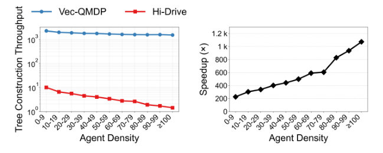

> **TL;DR** Vec-QMDP takes a POMDP driving planner that reasons over many possible futures of the other cars, and rewrites it so that a normal CPU can run those futures side by side: across 8 cores, and 8 at a time inside each core with SIMD instructions. Tree building gets 227–1073× faster than the serial version, and the planner tops the nuPlan benchmark with 9–14 ms of planning time, no GPU needed.

## Why this paper

Real-time limits on an onboard computer are a constant pain for us (see our T-ASE 2025 planner). This paper is a masterclass in the other half of speed: not a smarter algorithm, but laying out data so that the CPU you already have does 8 things per instruction. It also shows what planning under uncertainty can look like when it is cheap: thousands of simulated futures in 14 ms, enough to catch a rare aggressive cut-in. A parking lot full of pedestrians and cars backing out of slots is exactly that kind of problem.

## The problem

A **POMDP** (partially observable Markov decision process) is the textbook model for planning when you do not know everything. Here, the unknown is what the other road users intend to do. The planner keeps a **belief**: a probability distribution over possible futures, which in practice comes from a multimodal trajectory predictor (QCNet). It then searches a tree of ego actions and their outcomes under many sampled futures.

The catch is cost. Even a strong serial POMDP planner (Hi-Drive) needed about 500 ms per plan on nuPlan. Earlier attempts to parallelize hit hardware walls:

- **Hybrid CPU–GPU** (HyP-DESPOT): sending work back and forth between CPU and GPU costs synchronization time.
- **GPU-only** (VOPP): GPU threads run in lockstep groups (SIMT). When one future says "yield" and another says "overtake", the branches run one after another, and throughput collapses. This is called branch divergence.
- **CPU SIMD** (single instruction, multiple data: one instruction on 8 numbers at once) gave up to 500× for sampling-based motion planning in static scenes (VAMP). But POMDP search has many trees, hard-to-vectorize multi-agent dynamics, and moving agents whose spatial index changes every step.

## Key idea

**Use the QMDP approximation to split the problem into independent pieces, then lay out the data so each piece fits a SIMD lane.**

**QMDP** assumes that uncertainty is resolved after the first action. Concretely: sample K = 64 futures ("scenarios") from the belief; in each scenario, other agents follow one fixed predicted trajectory, so the problem becomes an ordinary fully observable MDP. Search each scenario tree separately, then average the action values across scenarios to choose the first action.

After the first action, the 64 trees never talk to each other. That is perfect for parallel hardware: 8 CPU threads × 8 SIMD lanes (AVX2) = 64 scenarios at once.

The analogy: instead of one chess player thinking about 64 possible opponents one at a time, you seat 64 players in 8 rows of 8, and give each row the same instruction at the same moment.

## How it works

**1. Data-Oriented Design.** Normal tree code uses objects and pointers: each node is a struct somewhere in memory. SIMD wants the same field of 8 items next to each other. So:

- Trees are pre-allocated as flat arrays with fixed branching. The i-th child of node v is at index |A|·v + i, no pointers.
- Node statistics (Q-values, visit counts, rewards, ego states) are stored as **Structure of Arrays (SoA)**: all x values together, all y values together, instead of (x, y) pairs.
- Each thread owns its own scenarios, so there are no locks.

**2. Actions and simulation.** The ego chooses from 9 macro-actions: 3 reference paths (keep lane, change left/right) × 3 lateral nudges (−1, 0, +1 m), each lasting 2 s, over an 8 s horizon. Inside a macro-action, the ego follows the path with IDM (speed) and a Stanley controller (steering); lane changes pass a MOBIL check. Other agents follow their sampled trajectory.

**3. Global vectorization (across scenarios).** Each thread picks one node to expand in each of its 8 scenario trees and simulates all 8 in lockstep in the SIMD registers. Because macro-actions are simple, control flow is almost the same in every lane; only lanes doing a lane change run the MOBIL check, the others are masked.

**4. Local vectorization (within one node).** Collision checking is two-stage:

- **Broad phase**: an STR-tree (a balanced spatial index of agent boxes) built in the Frenet frame (s along the road, d across). The tree is flattened into arrays, and 8 child boxes are tested against the ego box at once.
- **Narrow phase**: an exact oriented-box test (Separating Axis Theorem), one ego–agent pair per SIMD lane.

**5. Load-balancing UCB.** All 8 lanes wait for the slowest one. If one tree expands a node at depth 1 (long rollout) and another at depth 3 (short rollout), lanes sit idle. So they first run normal UCB in each tree, take a majority vote on the depth, and rerun selection with a penalty for straying from that depth.

**6. Belief-space trajectory optimization.** The best action sequence is refined into a continuous trajectory. Scenarios are resampled with importance sampling that over-weights dangerous intentions of risk-relevant agents. Each candidate trajectory is tested in other scenarios too, but only inside its minibatch of 8 (block-diagonal), so the cost is O(N²) per thread instead of O(K²).

## Results

nuPlan closed-loop simulation, three test sets (Val14: 1,118 scenes; Test14-random: 268; Test14-hard: 272), each run in reactive (R) and non-reactive (NR) mode. All POMDP planners use the same 64 scenarios; HyP-DESPOT and Vec-QMDP use 8 threads. CPU: Intel Xeon Gold 6530 with AVX2.

| Planner | Val14 R / NR | Test14-hard R / NR | Planning time |
|---|---|---|---|
| Diffusion Planner | 82.86 / 89.67 | 68.77 / 75.30 | 80 ms |
| PDM-Hybrid | 92.14 / 92.77 | 76.12 / 66.09 | 171 ms |
| Hi-Drive (serial POMDP) | 93.01 / 93.22 | 83.07 / 81.22 | 503 ms |
| HyP-DESPOT | 93.07 / 93.26 | 82.83 / 81.82 | 259 ms |
| **Vec-QMDP (match)** | 93.15 / 94.16 | 84.23 / 82.30 | **9 ms** |
| **Vec-QMDP (best)** | **93.22 / 94.36** | **84.23 / 82.84** | 14 ms |

- **Speed.** Tree construction throughput is 227× faster than Hi-Drive in sparse traffic and 1073× in dense traffic (100+ agents). Against HyP-DESPOT it builds 1683 vs 11 edges/ms (about 155×).

- **End-to-end** including the QCNet predictor: 65 ms, still below the Diffusion Planner's 80 ms.
- **Safety Score and TTC score** (not-at-fault collision, time-to-collision) are slightly higher than HyP-DESPOT on Val14 and Test14-hard, so the QMDP shortcut did not cost safety here.
- **Ablations.** 8 threads give about 8× (near-linear scaling). Load-balancing UCB gives up to 1.24× more throughput when trees are badly imbalanced, with essentially the same driving score. Driving score plateaus at about 14 ms of planning.

## Limitations

- **QMDP cannot plan to gather information.** It assumes the future becomes known after the first step, so it never chooses an action *because* it would reveal something (for example, creeping forward to see around an occluding car). The authors show a partial fix (an entropy-reduction bonus) on a toy problem, not on driving.
- **Lane-based actions.** 9 macro-actions built from reference lanes, Frenet boxes and IDM/MOBIL all assume a road with lanes.
- **Planning time excludes perception and prediction.** nuPlan gives clean object states. With the QCNet predictor the loop is 65 ms.
- **No real vehicle.** All results are nuPlan simulation. The claim that it would run on an NVIDIA Orin is extrapolated from another paper's SIMD numbers (about 2.2× slower than their AVX2 setup), not measured.
- **Gains over HyP-DESPOT and Hi-Drive in score are small** (about 1 point); the big win is speed.

## DYROS lens

**Where it fits.** Two separate lessons for us.

First, **engineering**: sampling-based planners like ours typically spend most of their time in collision checking and edge evaluation. The recipe here (SoA layout, flat pointer-less trees, AVX2 broad phase + SAT narrow phase on 8 candidates per instruction) applies directly to RRT\*-style planners, as VAMP already showed for manipulators.

Second, **interaction**: in a parking lot the uncertainty is "will that car back out?", "will that pedestrian cross?". A QMDP over sampled futures with macro-actions like wait / creep / go is a principled replacement for hand-written waiting rules. Each scenario can also sample our own initial state, so localization uncertainty from SLAM can enter the belief.

**What would break on our car.**

- No lanes in a parking lot. Frenet frames, lane-change macro-actions and IDM do not describe a parking maneuver with reverse gear. Macro-actions would have to be our planner's candidate paths instead.
- QMDP's blind spot is the parking lot's main problem: occlusion by parked cars and pillars. A planner that never values "creep to see" will either be too timid or too bold at blind corners.
- Prediction models like QCNet are trained on roads, not on cars leaving parking slots.

**What we could try in a week.** Take the collision checker of our narrow-space planner and port it to SoA + AVX2: 8 vehicle footprints against obstacle boxes per instruction, broad phase with a flat array STR-tree. Measure edges per millisecond before and after on our parking scenarios. This is low-risk and helps every planner we have.

**Paper opportunity.** Vectorized QMDP for parking-lot interaction where the scenarios include both other agents' intentions and our own pose uncertainty from SLAM, and macro-actions are certified paths from TargetTree-RRT\*. Adding a cheap information-gathering term (the entropy bonus they mention) for occluded corners would address the main limitation they admit.

## Key terms

- **POMDP**: a planning model where the robot does not know the full state and must reason over a belief (distribution of possible states).
- **QMDP**: an approximation that assumes uncertainty disappears after the first action; each sampled future becomes a separate, fully known problem.
- **SIMD**: CPU instructions that apply one operation to several numbers at once (8 floats with AVX2).
- **Data-Oriented Design / Structure of Arrays (SoA)**: storing each field contiguously across many items so the CPU can load them into SIMD registers in one go.
- **Separating Axis Theorem (SAT)**: two convex shapes do not collide if some axis exists along which their projections do not overlap.
