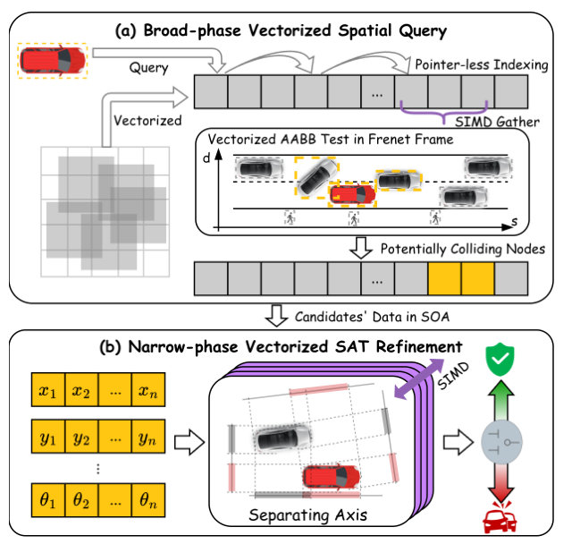
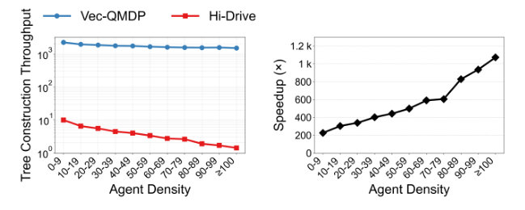

> **TL;DR** Vec-QMDP는 다른 차들이 어떻게 움직일지 여러 가능한 미래를 따져 보는 POMDP 주행 planner를, 평범한 CPU가 그 미래들을 나란히 돌릴 수 있게 다시 짠 것입니다. 코어 8개에 나누고, 각 코어 안에서는 SIMD 명령으로 8개씩 한꺼번에 계산합니다. Tree 구축이 직렬 버전보다 227–1073배 빨라지고, GPU 없이 9–14 ms 계획 시간으로 nuPlan benchmark 최고 점수를 냅니다.

## 왜 이 논문인가

온보드 컴퓨터의 실시간 제약은 우리에게 늘 골칫거리입니다(T-ASE 2025 planner가 그 예입니다). 이 논문은 속도의 나머지 절반을 제대로 보여 줍니다. 더 똑똑한 알고리즘이 아니라, 이미 가진 CPU가 명령 하나로 8가지 일을 하도록 데이터를 배치하는 방법입니다. 또 불확실성 아래의 계획이 싸지면 어떤 모습인지도 보여 줍니다. 14 ms 안에 수천 개의 미래를 시뮬레이션해, 드물게 일어나는 공격적인 끼어들기까지 잡아냅니다. 보행자가 많고 주차 칸에서 차가 후진해 나오는 주차장이 바로 그런 문제입니다.

## 문제

**POMDP**(partially observable Markov decision process, 부분 관측 마르코프 결정 과정)는 모든 것을 알지 못할 때의 계획을 다루는 교과서적 모델입니다. 여기서 모르는 것은 다른 도로 사용자의 의도입니다. Planner는 **belief**를 유지합니다. 가능한 미래에 대한 확률 분포이고, 실제로는 multimodal trajectory 예측기(QCNet)에서 나옵니다. 그다음 여러 미래를 sampling해, 그 아래에서 ego 행동과 결과의 tree를 탐색합니다.

문제는 비용입니다. 좋은 직렬 POMDP planner인 Hi-Drive도 nuPlan에서 plan 하나에 약 500 ms가 걸렸습니다. 병렬화하려던 이전 시도들은 하드웨어의 벽에 부딪혔습니다.

- **CPU–GPU 혼합**(HyP-DESPOT): CPU와 GPU 사이에 작업을 주고받는 동기화 시간이 듭니다.
- **GPU 전용**(VOPP): GPU thread는 묶음 단위로 같은 명령을 실행합니다(SIMT). 한 미래는 "양보"를, 다른 미래는 "추월"을 요구하면 두 분기가 차례로 실행되어 처리량이 무너집니다. 이를 branch divergence라고 합니다.
- **CPU SIMD**(single instruction, multiple data: 명령 하나로 숫자 8개를 한꺼번에 처리)는 정적인 장면의 sampling-based motion planning (경로 계획)에서 최대 500배를 냈습니다(VAMP). 하지만 POMDP 탐색에는 tree가 여러 개이고, 벡터화하기 어려운 다중 에이전트 동역학이 있으며, 움직이는 에이전트의 공간 색인이 매 step 바뀝니다.

## 핵심 아이디어

**QMDP 근사로 문제를 독립된 조각으로 나누고, 각 조각이 SIMD lane 하나에 들어가도록 데이터를 배치합니다.**

**QMDP**는 첫 행동 이후에는 불확실성이 사라진다고 가정합니다. 구체적으로, belief에서 미래("scenario") K = 64개를 sampling합니다. 각 scenario에서 다른 에이전트는 예측된 trajectory 하나를 그대로 따르므로, 문제는 완전히 관측 가능한 평범한 MDP가 됩니다. Scenario tree마다 따로 탐색하고, scenario 전체에 걸쳐 행동 가치를 평균 내 첫 행동을 고릅니다.

첫 행동 이후 64개 tree는 서로 정보를 주고받지 않습니다. 병렬 하드웨어에 딱 맞습니다. CPU thread 8개 × SIMD lane 8개(AVX2) = scenario 64개를 동시에 처리합니다.

비유하자면, 체스 기사 한 명이 가능한 상대 64명을 한 명씩 차례로 생각하는 대신, 기사 64명을 8명씩 8줄로 앉히고 한 줄에 같은 순간 같은 지시를 내리는 것입니다.

## 작동 방식

**1. Data-Oriented Design.** 보통의 tree 코드는 객체와 포인터를 씁니다. 노드 하나하나가 메모리 어딘가의 구조체입니다. SIMD는 항목 8개의 같은 필드가 나란히 붙어 있기를 원합니다. 그래서 다음처럼 바꿉니다.

- Tree는 고정 분기 수를 가진 평평한 배열로 미리 할당합니다. 노드 v의 i번째 자식은 인덱스 |A|·v + i에 있고, 포인터가 없습니다.
- 노드 통계(Q-value, 방문 횟수, reward, ego 상태)는 **Structure of Arrays**(SoA)로 저장합니다. (x, y) 쌍이 아니라 x 값끼리, y 값끼리 모읍니다.
- Thread마다 자기 scenario를 따로 가지므로 lock이 없습니다.

**2. 행동과 시뮬레이션.** Ego는 macro-action 9개 중에서 고릅니다. 기준 경로 3개(차선 유지, 좌/우 차선 변경) × 횡방향 nudge 3개(−1, 0, +1 m)이고, 각각 2 s 동안 지속되며 horizon은 8 s입니다. Macro-action 안에서 ego는 IDM(속도)과 Stanley controller(조향)로 경로를 따르고, 차선 변경은 MOBIL 검사를 통과해야 합니다. 다른 에이전트는 sampling된 trajectory를 따릅니다.

**3. Global vectorization (scenario 간).** 각 thread는 자기 scenario tree 8개에서 확장할 노드를 하나씩 고르고, 8개를 SIMD 레지스터 안에서 함께 시뮬레이션합니다. Macro-action이 단순해서 lane마다 제어 흐름이 거의 같습니다. 차선을 바꾸는 lane만 MOBIL 검사를 하고 나머지는 mask로 가립니다.

**4. Local vectorization (노드 내부).** 충돌 검사는 두 단계입니다.

- **Broad phase**: Frenet 좌표계(s는 도로 방향, d는 가로 방향)에서 만든 STR-tree(에이전트 상자의 균형 잡힌 공간 색인)를 씁니다. Tree를 배열로 펼쳐, 자식 상자 8개를 ego 상자와 한 번에 비교합니다.
- **Narrow phase**: 정확한 회전 상자 검사(Separating Axis Theorem)를 lane 하나당 ego–에이전트 쌍 하나씩 합니다.

**5. Load-balancing UCB.** Lane 8개는 가장 느린 lane을 기다립니다. 한 tree는 깊이 1의 노드를 확장하고(긴 rollout) 다른 tree는 깊이 3의 노드를 확장하면(짧은 rollout) lane이 놀게 됩니다. 그래서 먼저 tree마다 일반 UCB를 돌리고, 깊이를 다수결로 정한 뒤, 그 깊이에서 벗어나면 페널티를 주는 방식으로 선택을 다시 합니다.

**6. Belief-space trajectory optimization.** 최선의 행동 순서를 연속 trajectory로 다듬습니다. 위험과 관련된 에이전트의 위험한 의도에 가중치를 더 주는 importance sampling으로 scenario를 다시 뽑습니다. 후보 trajectory는 다른 scenario에서도 평가하지만, 자기 minibatch 8개 안에서만 합니다(block-diagonal). 그래서 비용이 O(K²)가 아니라 thread당 O(N²)입니다.

## 결과

nuPlan closed-loop 시뮬레이션이고, 시험 세트는 세 가지입니다(Val14: 1,118개 장면, Test14-random: 268개, Test14-hard: 272개). 각각 reactive (R)와 non-reactive (NR) 모드로 돌립니다. 모든 POMDP planner가 같은 scenario 64개를 쓰고, HyP-DESPOT과 Vec-QMDP는 thread 8개를 씁니다. CPU는 AVX2를 쓰는 Intel Xeon Gold 6530입니다.

| Planner | Val14 R / NR | Test14-hard R / NR | 계획 시간 |
|---|---|---|---|
| Diffusion Planner | 82.86 / 89.67 | 68.77 / 75.30 | 80 ms |
| PDM-Hybrid | 92.14 / 92.77 | 76.12 / 66.09 | 171 ms |
| Hi-Drive (직렬 POMDP) | 93.01 / 93.22 | 83.07 / 81.22 | 503 ms |
| HyP-DESPOT | 93.07 / 93.26 | 82.83 / 81.82 | 259 ms |
| **Vec-QMDP (match)** | 93.15 / 94.16 | 84.23 / 82.30 | **9 ms** |
| **Vec-QMDP (best)** | **93.22 / 94.36** | **84.23 / 82.84** | 14 ms |

- **속도.** Tree 구축 처리량이 한산한 교통에서 Hi-Drive보다 227배, 밀집 교통(에이전트 100개 이상)에서 1073배 빠릅니다. HyP-DESPOT과 비교하면 edges/ms가 1683 대 11로 약 155배입니다.

- **End-to-end**: QCNet 예측기까지 포함하면 65 ms로, Diffusion Planner의 80 ms보다 여전히 짧습니다.
- **Safety Score와 TTC score**(과실 없는 충돌, time-to-collision)는 Val14와 Test14-hard에서 HyP-DESPOT보다 조금 높습니다. 여기서는 QMDP 근사가 안전을 깎지 않았습니다.
- **Ablation.** Thread 8개로 약 8배(거의 선형 확장)입니다. Load-balancing UCB는 tree 사이 불균형이 심할 때 처리량을 최대 1.24배 높이고, 주행 점수는 사실상 같습니다. 주행 점수는 계획 시간 약 14 ms에서 포화됩니다.

## 한계

- **QMDP는 정보를 얻기 위한 계획을 하지 못합니다.** 첫 step 이후 미래가 알려진다고 가정하므로, 무언가를 *알아내기 위해* 행동을 고르는 일이 없습니다(예: 가린 차 너머를 보려고 천천히 앞으로 나가기). 저자들은 entropy 감소 보너스라는 부분적인 해법을 장난감 문제에서 보였을 뿐, 주행에서는 보이지 않았습니다.
- **차선 기반 행동.** 기준 차선으로 만든 macro-action 9개, Frenet 상자, IDM/MOBIL은 모두 차선이 있는 도로를 가정합니다.
- **계획 시간에 인지와 예측이 빠져 있습니다.** nuPlan은 깨끗한 물체 상태를 줍니다. QCNet 예측기를 넣으면 한 주기가 65 ms입니다.
- **실차 실험이 없습니다.** 모든 결과는 nuPlan 시뮬레이션입니다. NVIDIA Orin에서 돌아갈 것이라는 주장은 다른 논문의 SIMD 수치(AVX2 환경보다 약 2.2배 느림)로 추정한 것이지 측정한 것이 아닙니다.
- **점수 향상은 작습니다.** HyP-DESPOT, Hi-Drive 대비 약 1점이고, 큰 이득은 속도입니다.

## DYROS 관점

**어디에 맞는가.** 우리에게 주는 교훈은 두 가지입니다.

첫째, **엔지니어링**입니다. 우리 것 같은 sampling-based planner는 보통 대부분의 시간을 충돌 검사와 edge 평가에 씁니다. 여기서 쓴 방법(SoA 배치, 포인터 없는 평평한 tree, 명령 하나에 후보 8개를 처리하는 AVX2 broad phase + SAT narrow phase)은 RRT\* 계열 planner에도 바로 적용됩니다. VAMP가 매니퓰레이터에서 이미 보여 준 방향입니다.

둘째, **상호작용**입니다. 주차장의 불확실성은 "저 차가 후진해 나올까?", "저 보행자가 건널까?"입니다. Sampling한 미래 위에서 기다림 / 서행 / 진행 같은 macro-action으로 QMDP를 풀면, 손으로 짠 대기 규칙을 원칙 있는 방법으로 대신할 수 있습니다. 각 scenario는 우리 자신의 초기 상태도 sampling할 수 있으므로, SLAM의 localization 불확실성을 belief에 넣을 수도 있습니다.

**우리 차에서는 무엇이 깨질까.**

- 주차장에는 차선이 없습니다. Frenet 좌표계, 차선 변경 macro-action, IDM은 후진이 들어가는 주차 기동을 설명하지 못합니다. Macro-action은 우리 planner의 후보 경로로 바꿔야 합니다.
- QMDP의 사각지대가 곧 주차장의 핵심 문제입니다. 주차된 차와 기둥에 가려지는 것입니다. "보기 위해 천천히 나간다"에 가치를 두지 않는 planner는 사각 모퉁이에서 너무 소심하거나 너무 대담해집니다.
- QCNet 같은 예측 모델은 도로에서 학습했지, 주차 칸에서 나오는 차로 학습하지 않았습니다.

**일주일 안에 해 볼 수 있는 것.** 좁은 공간용 planner의 충돌 검사기를 SoA + AVX2로 옮깁니다. 명령 하나로 차량 footprint 8개를 장애물 상자와 비교하고, broad phase는 배열로 펼친 STR-tree로 합니다. 주차 시나리오에서 전후 edges/ms를 측정합니다. 위험이 적고, 우리가 가진 모든 planner에 도움이 됩니다.

**논문 기회.** 주차장 상호작용을 위한 vectorized QMDP입니다. Scenario에 다른 에이전트의 의도와 SLAM에서 온 우리 pose 불확실성을 함께 넣고, macro-action은 TargetTree-RRT\*가 만든 검증된 path로 둡니다. 가려진 모퉁이에 저렴한 정보 획득 항(저자들이 언급한 entropy 보너스)을 더하면, 저자들이 인정한 핵심 한계도 다룰 수 있습니다.

## 용어 정리

- **POMDP**: 로봇이 전체 상태를 모르고 belief(가능한 상태의 분포)를 바탕으로 판단해야 하는 계획 모델.
- **QMDP**: 첫 행동 이후 불확실성이 사라진다고 가정하는 근사. Sampling한 미래 하나하나가 완전히 알려진 별개의 문제가 됩니다.
- **SIMD**: 연산 하나를 여러 숫자에 동시에 적용하는 CPU 명령(AVX2에서는 float 8개).
- **Data-Oriented Design / Structure of Arrays (SoA)**: 각 필드를 여러 항목에 걸쳐 연속으로 저장해, CPU가 한 번에 SIMD 레지스터로 불러오게 하는 방식.
- **Separating Axis Theorem (SAT)**: 두 볼록 도형의 투영이 겹치지 않는 축이 하나라도 있으면 두 도형은 충돌하지 않는다는 정리.
