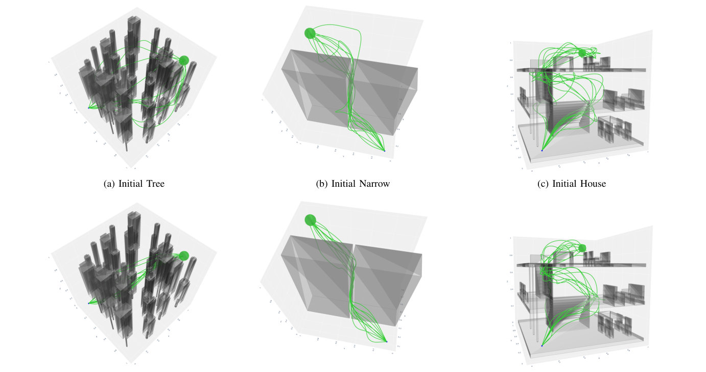
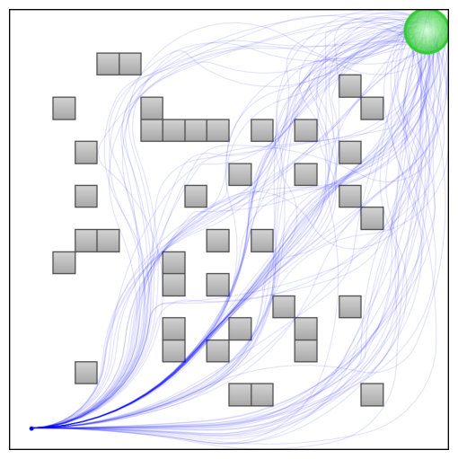

> **TL;DR** PAKR is a kinodynamic RRT, written in plain JAX, that grows thousands of branches per step on the GPU. Instead of rewiring like RRT\*, it restarts again and again under a tighter cost bound (AO-x), so fast, rough plans converge toward optimal ones. On a unicycle it finds a first solution in 1.3 ms; iDb-A\* and SST\* need 254–600 ms.

## Why this paper

A car is a kinodynamic system: it cannot move sideways, and its steering angle cannot jump. For the plain kinematic car, Reeds-Shepp curves connect any two poses exactly, which is what makes RRT\* rewiring work in parking and lets TargetTree-RRT\* use continuous-curvature (CC) segments. Once speed, acceleration or steering rate enter the state, there is no closed-form connection and rewiring stops working. PAKR shows how to get optimality *without* any steering function and stay fast, by brute force on a GPU. It is the kinodynamic sibling of pRRTC, from the same lab.

## The problem

**Kinodynamic planning** finds trajectories that obey the dynamics ẋ = f(x, u), not just avoid obstacles. Connecting two given states exactly is a **two-point boundary value problem (BVP)**, which for most nonlinear systems has no closed-form answer.

Kinodynamic RRT avoids it with **forward propagation**: apply a random control to a tree node for a short time and add wherever you land. The result is always dynamically feasible.

Getting *optimal* solutions is harder. RRT\* rewiring needs the BVP for every rewire; SST\* avoids it by keeping only the best node in small "witness" regions. Both depend on **order**: each new node is placed using the current tree. On a GPU, thousands of nodes arrive in one batch and cannot see each other, so a node may attach to a worse parent because the better one is still being computed. Fixing that with synchronization kills the speed. The existing GPU kinodynamic planner, Kino-PAX, is fast but not asymptotically optimal, and it is hand-written CUDA.

## Key idea

Do not fight the staleness. Accept fast, sub-optimal plans, and get optimality from **AO-x**, a wrapper that turns any probabilistically complete planner into an asymptotically optimal one:

1. Run the planner until it finds any solution with cost c_best.
2. Restart from scratch, but reject every node whose cost-so-far plus a heuristic is already ≥ c_best.
3. Each new round must find a cheaper path or nothing. Repeat.

With seconds per round you get a few rounds; with milliseconds, dozens. Think of a speedrunner who restarts the game every time with a stricter rule: "only keep going if you are ahead of your best time."

## How it works

One inner round of PAKR, with batch size B and branching factor A:

1. Sample B/A random target states.
2. Find the nearest tree node for each (vectorized distances).
3. Sample A random controls per parent, so fewer nearest-neighbor searches are needed for the same number of branches.
4. Propagate all B (parent, control) pairs in parallel with 4th-order Runge-Kutta, holding the control for T time steps, and collision-check every step.
5. Keep a new node only if g + h < c_best, where g is cost-to-come and h is the Euclidean distance to the goal.
6. If a node reaches the goal region, record the path, lower c_best and restart.

**Implementation.** JAX traces this loop and the XLA compiler fuses it into a single GPU kernel, with no CPU–GPU back-and-forth. The price is static shapes: maximum tree size and batch size are fixed at compile time. The tree is four flat arrays (states, actions, parents, costs) plus a node counter, and nearest-neighbor search has separate kernels for tree sizes 4⁶ to 4¹⁰. Dynamics are a plug-in function, including the MuJoCo-XLA physics simulator.

**Theory.** Batching only delays when a new node becomes visible (by at most one batch) and does not change the sample distribution, so probabilistic completeness carries over from sequential kinodynamic RRT; branching only adds control samples. With Lipschitz dynamics and cost, AO-x then gives asymptotic optimality.

## Results

All GPU runs on an RTX 4090; median of 100 trials.

**Against Kino-PAX** (PAKR without AO-x, one round, Kino-PAX's own environments; all success rates 100%): PAKR is faster on the 6D double integrator in all three environments (e.g., 2.5 vs 5.0 ms) and on two of three quadcopter environments; Kino-PAX is faster on the Dubins airplane in all three and on the hardest quadcopter one (24.6 vs 51.4 ms). PAKR's trees are always smaller (9k vs 164k nodes on the double integrator in Env A). "Comparable runtime, much smaller trees" is the fair summary.

**Convergence.** On the double integrator in Env A, cost drops from 1.76 (first solution, 2.3 ms) to 1.51 in 28 ms; on the quadcopter in the hardest environment, from 3.98 at 55.6 ms to 3.62 at 165.4 ms.

**Against iDb-A\* and SST\*** (DynoBench, cost = trajectory duration in seconds; the CPU baselines get 300 s):

| Problem | Planner | Success | First solution | First cost | Final cost |
|---|---|---|---|---|---|
| Unicycle 1 | iDb-A\* | 100% | 254 ms | 5.80 | 5.10 |
| Unicycle 1 | SST\* | 100% | 600 ms | 8.34 | **4.41** |
| Unicycle 1 | **PAKR** | 100% | **1.3 ms** | **4.62** | 4.46 |
| Unicycle 2 | iDb-A\* | 12% | 4637 ms | 8.70 | 8.70 |
| Unicycle 2 | SST\* | 100% | 398 ms | 14.15 | 6.95 |
| Unicycle 2 | **PAKR** | 100% | **1.4 ms** | **5.40** | **4.75** |
| Quadcopter | iDb-A\* | 100% | 1387 ms | **2.56** | **2.21** |
| Quadcopter | **PAKR** | 100% | **175 ms** | 7.54 | 6.23 |

Unicycle 1 has state (x, y, θ) with velocity control; Unicycle 2 adds (v, ω) with acceleration control. PAKR reaches a first solution two to three orders of magnitude sooner, and its final cost is best or near best on the unicycles and the acrobot. On the quadcopter, iDb-A\*'s final cost is almost 3× lower, so "superior solution quality" does not hold everywhere.

**Batch size and branching.** On the quadcopter, A = 16 is the sweet spot (13.1 ms at batch 8k). At A = 128 too many branches share too few parents, and success drops to 86–94%.

**Heavy simulation.** With MuJoCo-XLA dynamics: cartpole 22.8 ms, a 10D block push 283.7 ms, a soft vine robot 360.3 ms.

## Limitations

- **Restarting throws away the tree.** Every AO-x round re-explores from scratch, including the hard narrow passage it already found once.
- **Piecewise-constant random controls.** The paper does not discuss smoothness; a real controller would likely want the trajectory smoothed or re-optimized.
- **The pruning heuristic is plain Euclidean distance** in state space. When the cost is time, that mixes units, and the paper does not discuss whether it can over-estimate (which could prune good paths).
- **Static shapes.** Tree and batch size are fixed at compile time; changing them means recompiling.
- **Easy goals.** Unicycle tests use goal regions among scattered squares: no reversing, no tight final pose. No comparison with Kino-PAX+ (no public code) and no embedded-GPU timing.

## DYROS lens

**This is the paper in the batch closest to a car.** Unicycle 2 is basically a car state with speed and turn rate, and the first solution arrives in 1.4 ms instead of 398 ms for SST\*. A kinematic bicycle model (x, y, θ, steering angle) with bounded steering rate as the control gives continuous curvature *by construction*, the property TargetTree-RRT\* gets from CC paths, and it is about ten lines of JAX.

**Would it speed up narrow parking?** The first-solution speed would carry over. The goal would not: random forward propagation almost never lands inside a tight parking pose (a few cm, a few degrees). That is exactly the problem the target tree solves. Treat "any node that reaches the target tree" as the goal region, and PAKR supplies the speed while the target tree supplies the precise final approach.

**Would it make it more robust?** Mixed. Thousands of random controls per step help where most propagations collide, but every AO-x restart must rediscover the narrow entry. For anytime improvement like our T-ASE 2025 planner's, keeping the tree and only tightening the bound might work better.

**What would break.** Reverse gear must be in the control samples, JAX compilation must happen at start-up, and the Euclidean heuristic should become a Reeds-Shepp distance, which never over-estimates a kinematic car's path length.

**What we could try in a week.** Clone the code, write a bicycle-model propagator with gear and steering-rate controls, check the footprint as a few circles against our parking occupancy grid, and treat the target tree as the goal. Measure time-to-first-solution and cost after 50 and 100 ms against our CPU planner.

**Paper opportunity.** The authors list "learned action proposals instead of random sampling" as future work. That is our IROS 2023 and JKRS 2026 line, with network confidence setting how many learned proposals to use (LA3T\*). A car-specific twist: the kinematic car is time-reversible (flip the gear and drive the path backwards), so a *backward* tree from the slot is as easy as the forward one. A bidirectional, learned-proposal GPU kinodynamic planner for parking would be a clean contribution.

## Key terms

- **Kinodynamic planning**: planning that respects the system's dynamics (velocity, acceleration, steering limits), not only collisions.
- **Two-point BVP**: finding controls that drive the system exactly from one given state to another.
- **Forward propagation**: growing a tree by applying a control to an existing node and simulating, which is always dynamically feasible.
- **AO-x**: a wrapper that makes any complete planner asymptotically optimal by re-planning with a decreasing cost bound.
- **Branching factor (A)**: number of random controls tried per selected parent node.
- **JAX / XLA**: a Python library and its compiler that turn array code into fused GPU kernels.
