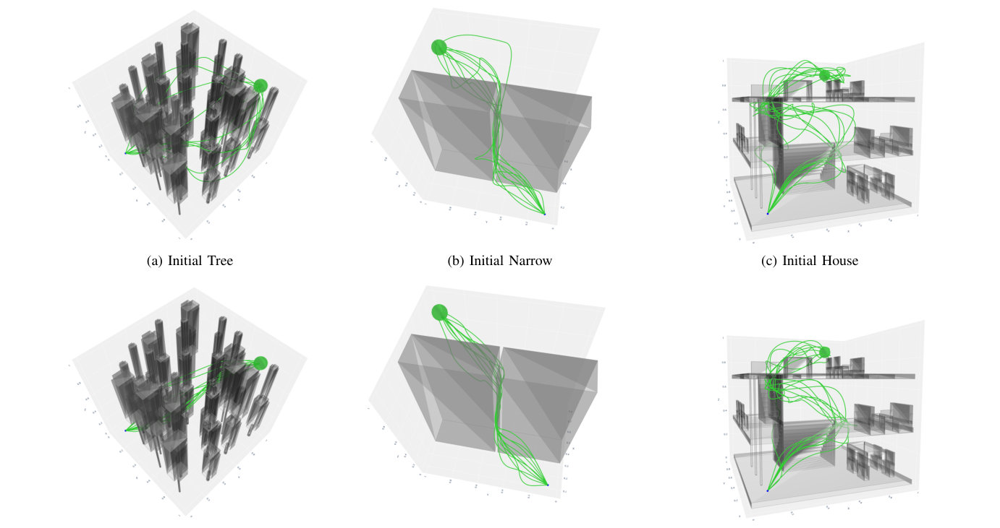
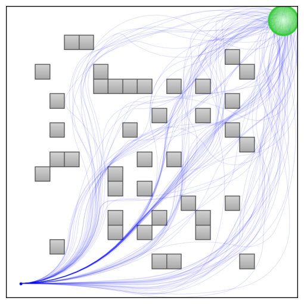

> **TL;DR** PAKR는 순수 JAX로 작성해 GPU에서 한 단계마다 수천 개의 가지를 뻗는 kinodynamic RRT입니다. RRT\*처럼 rewiring하지 않고, 더 빡빡한 cost 상한을 걸고 다시 푸는 일을 반복합니다(AO-x). 그래서 빠르고 거친 첫 해가 최적해 쪽으로 수렴합니다. Unicycle에서 첫 해를 1.3 ms에 찾고, iDb-A\*와 SST\*는 254–600 ms가 걸립니다.

## 왜 이 논문인가

차는 kinodynamic 시스템입니다. 옆으로 움직일 수 없고, 조향각이 순간적으로 바뀌지도 않습니다. 단순한 kinematic car라면 Reeds-Shepp 곡선이 어떤 두 pose든 정확히 이어 줍니다. 그래서 주차에서 RRT\* rewiring이 되고, TargetTree-RRT\*가 continuous-curvature(CC) 조각을 쓸 수 있습니다. 하지만 속도, 가속도, 조향 속도가 상태에 들어가면 닫힌 형태의 연결이 없고 rewiring도 멈춥니다. PAKR는 steering function *없이* 최적성을 얻으면서도 빠르게 도는 방법을 GPU의 물량으로 보여 줍니다. 같은 연구실에서 나온 pRRTC의 kinodynamic 형제입니다.

## 문제

**Kinodynamic planning**은 장애물을 피하는 것뿐 아니라 dynamics ẋ = f(x, u)를 지키는 trajectory를 찾습니다. 주어진 두 상태를 정확히 잇는 것은 **two-point boundary value problem**(BVP)이고, 대부분의 비선형 시스템에서는 닫힌 형태의 해가 없습니다.

Kinodynamic RRT는 **forward propagation**으로 이를 피합니다. Tree node에 무작위 제어 입력을 잠깐 적용하고, 도착한 곳을 그대로 추가합니다. 결과는 항상 dynamics를 만족합니다.

*최적* 해는 더 어렵습니다. RRT\* rewiring은 rewire할 때마다 BVP가 필요하고, SST\*는 작은 "witness" 영역마다 가장 좋은 node만 남겨 BVP를 피합니다. 둘 다 **순서**에 의존합니다. 새 node는 그 순간의 tree를 보고 자리를 잡습니다. GPU에서는 node 수천 개가 한 batch로 들어와 서로를 보지 못하므로, 더 좋은 부모가 아직 계산 중이라 더 나쁜 부모에 붙을 수 있습니다. 이를 동기화로 막으면 속도가 사라집니다. 기존 GPU kinodynamic planner인 Kino-PAX는 빠르지만 asymptotically optimal이 아니고, 손으로 짠 CUDA 코드입니다.

## 핵심 아이디어

오래된 정보(staleness)와 싸우지 않습니다. 빠르고 최적이 아닌 해를 받아들이고, 최적성은 **AO-x**로 얻습니다. AO-x는 probabilistically complete한 어떤 planner든 asymptotically optimal하게 바꿔 주는 래퍼입니다.

1. 아무 해나 찾을 때까지 planner를 돌립니다. 그 cost를 c_best라 합니다.
2. 처음부터 다시 시작하되, 지금까지의 cost에 heuristic을 더한 값이 이미 c_best 이상인 node는 모두 버립니다.
3. 새 라운드는 더 싼 경로를 찾거나 아무것도 못 찾습니다. 이를 반복합니다.

라운드 하나가 몇 초면 몇 라운드밖에 못 돌고, 몇 ms면 수십 라운드를 돕니다. "최고 기록보다 앞서 있을 때만 계속한다"는 규칙으로 매번 게임을 재시작하는 스피드러너를 떠올리면 됩니다.

## 작동 방식

Batch 크기 B, branching factor A일 때 PAKR의 내부 라운드 하나는 다음과 같습니다.

1. 무작위 목표 상태 B/A개를 sampling합니다.
2. 각각의 가장 가까운 tree node를 찾습니다(벡터화된 거리 계산).
3. 부모마다 무작위 제어 입력 A개를 sampling합니다. 같은 수의 가지를 만들면서 nearest neighbor 탐색은 줄어듭니다.
4. (부모, 제어 입력) 쌍 B개를 4차 Runge-Kutta로 병렬 전파합니다. 제어 입력은 T 시간 단계 동안 고정하고, 매 단계 collision check를 합니다.
5. g + h < c_best인 새 node만 남깁니다. g는 cost-to-come, h는 goal까지의 유클리드 거리입니다.
6. Goal 영역에 닿은 node가 있으면 경로를 기록하고 c_best를 낮춘 뒤 다시 시작합니다.

**구현.** JAX가 이 루프를 추적하고 XLA 컴파일러가 GPU kernel 하나로 합치므로, CPU와 GPU 사이를 오가지 않습니다. 대가는 고정된 배열 크기입니다. 최대 tree 크기와 batch 크기를 컴파일할 때 정해야 합니다. Tree는 평평한 배열 네 개(상태, 제어 입력, 부모, cost)와 node 카운터이고, nearest neighbor 탐색은 tree 크기 4⁶부터 4¹⁰까지 구간별로 별도 kernel을 씁니다. Dynamics는 갈아 끼울 수 있는 함수이고, MuJoCo-XLA 물리 시뮬레이터도 쓸 수 있습니다.

**이론.** Batch 처리는 새 node가 보이는 시점을 최대 한 batch 늦출 뿐이고 sample 분포는 바꾸지 않으므로, probabilistic completeness가 순차 kinodynamic RRT에서 그대로 이어집니다. Branching은 제어 입력 sample을 더할 뿐입니다. Dynamics와 cost가 Lipschitz 연속이면 AO-x가 asymptotic optimality를 보장합니다.

## 결과

GPU 실험은 모두 RTX 4090, 100회 시행의 중앙값입니다.

**Kino-PAX와 비교** (AO-x 없이 한 라운드, Kino-PAX 논문의 환경, 성공률은 모두 100%): 6D double integrator에서는 세 환경 모두(예: 2.5 vs 5.0 ms), quadcopter에서는 세 환경 중 둘에서 PAKR가 빠릅니다. Dubins airplane 세 환경과 가장 어려운 quadcopter 환경(24.6 vs 51.4 ms)에서는 Kino-PAX가 빠릅니다. PAKR의 tree는 항상 더 작습니다(Env A의 double integrator에서 9k vs 164k node). 공정하게 요약하면 "실행 시간은 비슷하고, tree는 훨씬 작다"입니다.

**수렴.** Env A의 double integrator에서 cost가 1.76(첫 해, 2.3 ms)에서 28 ms 만에 1.51로, 가장 어려운 환경의 quadcopter에서는 55.6 ms의 3.98에서 165.4 ms의 3.62로 내려갑니다.

**iDb-A\*, SST\*와 비교** (DynoBench, cost는 trajectory 지속 시간(초), CPU baseline에는 300 s를 줍니다):

| 문제 | Planner | 성공률 | 첫 해 시간 | 첫 해 cost | 최종 cost |
|---|---|---|---|---|---|
| Unicycle 1 | iDb-A\* | 100% | 254 ms | 5.80 | 5.10 |
| Unicycle 1 | SST\* | 100% | 600 ms | 8.34 | **4.41** |
| Unicycle 1 | **PAKR** | 100% | **1.3 ms** | **4.62** | 4.46 |
| Unicycle 2 | iDb-A\* | 12% | 4637 ms | 8.70 | 8.70 |
| Unicycle 2 | SST\* | 100% | 398 ms | 14.15 | 6.95 |
| Unicycle 2 | **PAKR** | 100% | **1.4 ms** | **5.40** | **4.75** |
| Quadcopter | iDb-A\* | 100% | 1387 ms | **2.56** | **2.21** |
| Quadcopter | **PAKR** | 100% | **175 ms** | 7.54 | 6.23 |

Unicycle 1은 상태 (x, y, θ)에 속도 제어, Unicycle 2는 (v, ω)를 더한 가속도 제어입니다. PAKR는 첫 해까지 두세 자릿수 빠르고, unicycle과 acrobot에서는 최종 cost도 가장 좋거나 거의 같습니다. 하지만 quadcopter에서는 iDb-A\*의 최종 cost가 거의 3배 낮습니다. "더 좋은 해 품질"이 모든 경우에 맞지는 않습니다.

**Batch 크기와 branching.** Quadcopter에서는 A = 16이 가장 좋습니다(batch 8k에서 13.1 ms). A = 128이면 너무 많은 가지가 너무 적은 부모를 나눠 써서 성공률이 86–94%로 떨어집니다.

**무거운 시뮬레이션.** MuJoCo-XLA dynamics로 cartpole 22.8 ms, 10차원 block push 283.7 ms, soft vine robot 360.3 ms입니다.

## 한계

- **다시 시작할 때 tree를 버립니다.** AO-x 라운드마다 처음부터 다시 탐색하므로, 이미 한 번 찾은 어려운 좁은 통로도 다시 찾아야 합니다.
- **구간별로 고정된 무작위 제어 입력.** 논문은 부드러움을 다루지 않습니다. 실제 제어기에 넣으려면 smoothing이나 재최적화가 필요할 가능성이 큽니다.
- **Pruning heuristic이 상태 공간의 단순한 유클리드 거리입니다.** Cost가 시간이면 단위가 섞이고, 이것이 과대추정을 일으켜 좋은 경로를 잘라낼 수 있는지 논문은 다루지 않습니다.
- **고정된 배열 크기.** Tree와 batch 크기는 컴파일할 때 정해지고, 바꾸려면 다시 컴파일해야 합니다.
- **쉬운 goal.** Unicycle 실험은 흩어진 사각형 사이의 goal 영역이라 후진도 정밀한 최종 pose도 없습니다. Kino-PAX+(공개 코드 없음)와의 비교, 임베디드 GPU 측정도 없습니다.

## DYROS 관점

**이번 묶음에서 차에 가장 가까운 논문입니다.** Unicycle 2는 사실상 속도와 회전 속도를 가진 차 상태이고, 첫 해가 SST\*의 398 ms 대신 1.4 ms에 나옵니다. 조향 속도에 상한을 둔 kinematic bicycle model(x, y, θ, 조향각)은 *구조적으로* continuous curvature를 보장합니다. TargetTree-RRT\*가 CC 경로로 얻는 성질과 같고, JAX로 열 줄 정도면 됩니다.

**좁은 주차가 빨라질까.** 첫 해 속도는 그대로 옮겨 올 것입니다. Goal은 그렇지 않습니다. 무작위 forward propagation은 몇 cm, 몇 도 안의 정밀한 주차 pose에 거의 도달하지 못합니다. Target tree가 푸는 문제가 바로 이것입니다. "Target tree에 닿은 node"를 goal 영역으로 보면, PAKR가 속도를 맡고 target tree가 정밀한 마지막 접근을 맡습니다.

**더 robust해질까.** 반반입니다. 대부분의 전파가 부딪히는 곳에서는 단계마다 수천 개의 무작위 제어 입력이 도움이 되지만, AO-x가 다시 시작할 때마다 좁은 입구를 다시 찾아야 합니다. 우리 T-ASE 2025 planner 같은 anytime 개선에는, tree를 유지한 채 상한만 줄이는 쪽이 더 나을 수 있습니다.

**무엇이 깨질까.** 후진 기어가 제어 입력 sample에 들어가야 하고, JAX 컴파일은 시작할 때 끝내야 하며, 유클리드 heuristic은 Reeds-Shepp 거리로 바꿔야 합니다. Reeds-Shepp 거리는 kinematic car의 경로 길이를 과대추정하지 않습니다.

**일주일 안에 해 볼 수 있는 것.** 코드를 받아 기어와 조향 속도를 제어 입력으로 하는 bicycle model 전파 함수를 쓰고, 차 외곽선을 원 몇 개로 근사해 우리 주차장 occupancy grid와 비교하고, target tree를 goal로 둡니다. 첫 해까지의 시간과 50 ms, 100 ms 시점의 cost를 우리 CPU planner와 비교합니다.

**논문 기회.** 저자들은 "무작위 sampling 대신 learned action proposal"을 향후 과제로 꼽습니다. 이것이 바로 우리 IROS 2023, JKRS 2026 연구 줄기이고, learned proposal을 몇 개 쓸지는 network confidence로 정할 수 있습니다(LA3T\*). 차에만 있는 장점도 있습니다. Kinematic car는 시간 역전이 가능합니다(기어만 바꾸면 같은 경로를 거꾸로 달립니다). 그래서 주차 칸에서 시작하는 *backward* tree도 forward tree만큼 쉽습니다. 주차용 양방향, learned proposal 기반 GPU kinodynamic planner는 깔끔한 기여가 될 것입니다.

## 용어 정리

- **Kinodynamic planning**: 충돌뿐 아니라 시스템의 dynamics(속도, 가속도, 조향 한계)까지 지키는 planning.
- **Two-point BVP**: 주어진 한 상태에서 다른 상태로 시스템을 정확히 보내는 제어 입력을 찾는 문제.
- **Forward propagation**: 기존 node에 제어 입력을 적용해 시뮬레이션하며 tree를 키우는 방식. 결과는 항상 dynamics를 만족합니다.
- **AO-x**: cost 상한을 줄여 가며 다시 planning해서, complete한 planner를 asymptotically optimal하게 만드는 래퍼.
- **Branching factor (A)**: 고른 부모 node 하나당 시도하는 무작위 제어 입력 수.
- **JAX / XLA**: 배열 코드를 합쳐진 GPU kernel로 바꿔 주는 Python 라이브러리와 그 컴파일러.
