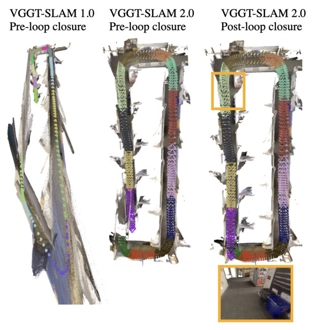
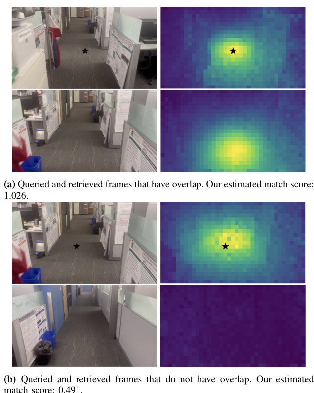

> **TL;DR** VGGT-SLAM 2.0 builds dense 3D maps from an uncalibrated RGB camera by running the VGGT foundation model on short chunks of video and gluing the resulting submaps together with a factor graph. A smarter graph removes version 1's warping drift and its failure on flat scenes, and one attention layer inside VGGT turns out to be a free, training-free check for false loop closures. It reaches 4.1 cm ATE on TUM RGB-D (23% lower than VGGT-SLAM) and runs online on a Jetson Thor.

## Why this paper

In visual SLAM, a large network now does a job that used to be a hand-built pipeline. This paper shows exactly which parts the network replaces and which are still classical. It also hits our pain points: repetitive scenes that cause false loop closures (their office cubicles are our parking pillars), flat floors that make geometry degenerate, and camera calibration that may be wrong.

## The problem

**What a classic visual SLAM front end does.** In ORB-SLAM-style systems, every frame goes through:

1. detect keypoints and match them to previous frames,
2. estimate camera motion from those matches (using intrinsics from an offline calibration),
3. triangulate 3D points, and
4. refine poses and points with local bundle adjustment.

The result is a sparse point map. Each step can fail: few features on a white wall, wrong matches on repeated textures, a wrong calibration file.

**What feed-forward reconstruction replaces.** A **geometric foundation model** such as DUSt3R, MASt3R or VGGT takes raw images and, in one forward pass of a large transformer, outputs for every image the camera intrinsics, the camera pose, a dense depth map and a confidence map. No keypoint matching, no triangulation, no iterative optimization, no calibration. Steps 1–4 collapse into one network call, and the map is dense instead of sparse.

**What it does not replace.** VGGT can only take about 60 frames at once (24 GB GPU); a SLAM run has thousands. So you still need a back end: split the video into **submaps**, align consecutive submaps, detect loop closures, and optimize everything in a factor graph. That back end is what this paper is about.

**Why aligning VGGT submaps is hard.** With an uncalibrated camera, a reconstruction is only defined up to a **projective ambiguity**: each submap can differ from the true scene by a 4×4 homography with 15 degrees of freedom (3 rotation, 3 translation, 1 scale, 5 calibration, 3 projective). VGGT-SLAM (version 1) estimated all 15 between submaps from the 3D points of one shared frame. This caused:

- **High-dimensional drift.** Errors pile up in 15 dimensions, so the map bends and warps between loop closures, sometimes beyond repair.
- **Planar degeneracy.** If the shared frame sees only a wall or a flat floor, the 15-DoF fit is undetermined and the map diverges. VGGT-SLAM failed on KITTI for this reason (most points lie on the road).

## Key idea

1. **Use what you know for sure.** Consecutive submaps share one image. Both submaps' copies of that frame are the *same camera at the same moment*, so their rotation, translation and calibration must be identical. The only real unknown between them is one scale factor (plus the calibration mismatch, which VGGT reports). Alignment shrinks from 15 parameters fitted to points to 1 scale estimated from points.
2. **Ask VGGT whether it sees overlap.** Layer 22 of VGGT's attention shows a sharp "spotlight" on the matching spot in the other image when two images overlap, and nothing when they do not. Turned into a score, this is a free check for loop-closure candidates.

## How it works

**Nodes and edges.** Every keyframe is a node in the factor graph, holding a 4×4 matrix on SL(4) (determinant 1; SE(3) and Sim(3) are special cases). Two edge types:

- **Intra-submap edges** link keyframes inside one submap and carry only rotation and translation, read from VGGT's poses. Projective distortion is shared within a submap, so it needs no per-keyframe fix.
- **Inter-submap edges** link the two copies of a shared frame. Relative rotation and translation are fixed to zero; the edge carries only the calibration difference K_i⁻¹K_j and a scale s.

**Scale.** Points are stored in each frame's own camera coordinates, so the two copies of the shared frame have trivially known pixel correspondences. After warping both to the same calibration, s is the median ratio of corresponding point distances over high-confidence pixels.

**Loop closures.**

1. SALAD, a learned place-recognition network, proposes old frames that look like current ones.
2. VGGT runs on just the two images (query + retrieved), making a tiny two-frame **loop-closure submap** that is linked into the graph with inter-submap edges.
3. Before adding it, the pair is verified with layer 22: for each key token of image 1, compare how strongly image 2's tokens attend to it against how strongly image 1's own tokens do. The match score α_match is the mean of the top 25% of these ratios (images overlap only partly). The edge is added only if α_match ≥ 0.85.

Because verification catches false matches, SALAD's threshold can be loosened to get more candidates.

**Optimization.** GTSAM on the SL(4) manifold (the solver is now in the official GTSAM release), with no robust loss: verification is the only outlier filter. Poses are recovered by decomposing each node's projection matrix. Scale stays unknown (monocular), so the map is correct up to a similarity transform.

**Bonus.** With CLIP embeddings per keyframe and SAM 3, the map answers open-set text queries ("backpack") with a 3D bounding box in about 0.36 s.

## Results

**Pose accuracy, TUM RGB-D** (ATE RMSE averaged over 9 sequences, submaps of 32 frames):

| Method | Calibration | Avg ATE |
|---|---|---|
| DROID-SLAM | uncalibrated | 0.158 m |
| VGGT-SLAM Sim(3) | uncalibrated | 0.074 m |
| MASt3R-SLAM | uncalibrated | 0.060 m |
| VGGT-SLAM SL(4) | uncalibrated | 0.053 m |
| ViSTA-SLAM | uncalibrated | 0.052 m |
| **VGGT-SLAM 2.0** | uncalibrated | **0.041 m** |
| MASt3R-SLAM | calibrated | 0.030 m |
| GO-SLAM | calibrated | 0.035 m |
| DROID-SLAM | calibrated | 0.038 m |

Best among uncalibrated methods and 23% lower than VGGT-SLAM, but calibrated systems are still more accurate.

**Loop-closure verification.**

- Clio datasets, loop closures found (old SALAD setting without verification → relaxed SALAD with verification): cubicle 2 → 5, apartment 0 → 9, office: false positives that made the map diverge → 4 correct ones, no false positives.
- LaMAR HGE phone scene, Recall@1 after reranking the top-5 retrievals by α_match: SALAD 88.45 → 90.13, NetVLAD 85.92 → 89.08.

**Scale and speed.**

- A 4,200 sq ft barn (34 submaps of 16 frames, iPhone video) and KITTI sequence 05 (over 2.2 km), where VGGT-SLAM 1 diverges. Both are shown qualitatively.
- 8.4 FPS on an RTX 3090 with 16-frame submaps (6.3 FPS with open-set features), vs 7.2 FPS for MASt3R-SLAM and 6.9 FPS for VGGT-SLAM on the same machine. VGGT inference takes 1248 ms of each submap; back-end optimization only 8 ms.
- Onboard a Jackal robot with a Jetson Thor and a RealSense D455: 3.5 FPS with 4-frame submaps, mapping live.

## Limitations

- **When VGGT fails, the SLAM fails.** In an empty house, keyframes seeing only a white wall broke VGGT and the map diverged. There is no lost-tracking recovery.
- **Poses only.** The back end does not refine 3D points, so misaligned points leave artifacts.
- **The first frame of each submap matters too much.** VGGT reconstructs relative to it and it sets the submap's scale.
- **No robust kernel.** A false positive that passes α_match goes straight into a non-robust optimization.
- **No metric scale, no other sensors.** Monocular RGB only; no IMU or wheel odometry.
- **Thin evaluation.** Pose accuracy is measured only on TUM (small rooms); large scenes are qualitative. The KITTI caption says 42 submaps, the text says 44.

## DYROS lens

**Where it fits.** VGGT is a dense, calibration-free *front end*; the contribution is a careful *back end* around it. Two pieces can be lifted on their own:

- **Attention-based loop verification.** Indoor garages with identical pillars and parking lines are a perceptual-aliasing nightmare, just like their cubicles. A training-free α_match check on top of whatever place recognition we use is cheap to test.
- **"Same frame, same pose" constraints.** Instead of fitting a high-DoF transform between overlapping chunks, constrain what must be equal and estimate only what is uncertain. A general lesson for degeneracy. Garages have the same flat-floor problem that broke VGGT-SLAM 1 on KITTI.

**What would break on our car.**

- **AVM / fisheye images.** VGGT predicts a pinhole-like calibration; strongly distorted fisheye views are likely out of distribution. Our weighted GICP work shows how much AVM distortion matters. A front pinhole camera is the safer first test.
- **Metric scale and rate.** A parking planner needs meters and more than a few FPS. Wheel odometry would have to enter the SL(4) graph as extra factors.
- **Dynamic objects.** Nothing handles moving cars or pedestrians inside a submap.

**What we could try in a week.** VGGT itself is public. Take a recorded garage sequence, hand-label 50 true and 50 false loop pairs (look-alike pillars in different rows), and compute α_match for each. If it separates them better than our current place-recognition score, that is useful on its own, before the full SLAM code (promised on publication) is out.

**Paper opportunity.** Robust feed-forward SLAM for garages: attention-based verification plus a robust back end (M-estimators or graduated non-convexity) and wheel-odometry factors for metric scale, evaluated on repetitive, planar, GNSS-denied parking structures, which neither VGGT-SLAM paper tests. It sits between our AVM SLAM work and the robust SLAM direction we are moving into.

## Key terms

- **Feed-forward reconstruction**: a network that outputs camera poses, intrinsics and dense depth from images in one pass, replacing feature matching, triangulation and bundle adjustment.
- **VGGT**: Visual Geometry Grounded Transformer, a geometric foundation model that processes many images at once (about 60 on a 24 GB GPU).
- **Projective ambiguity**: with unknown calibration, a reconstruction is only determined up to a 15-DoF 4×4 homography.
- **SL(4)**: 4×4 matrices with determinant 1; contains SE(3) and Sim(3), used here to optimize homographies in a factor graph.
- **Retrieval verification**: checking that a place-recognition match really overlaps before adding a loop closure.
