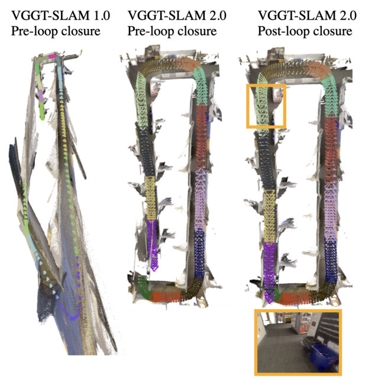
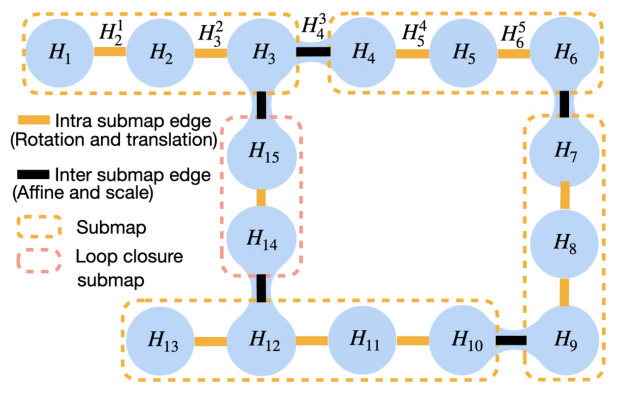
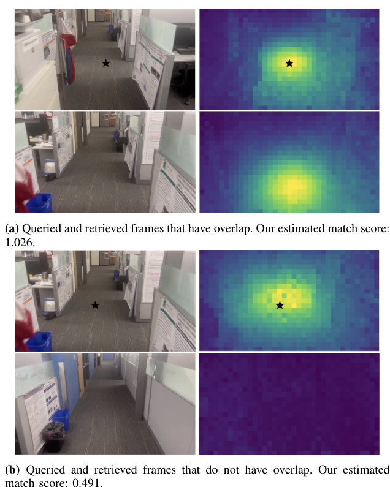

> **TL;DR** VGGT-SLAM 2.0은 보정(calibration)되지 않은 RGB 카메라로 dense 3D 지도를 만듭니다. 영상을 짧게 끊어 VGGT foundation model에 넣고, 그 결과인 submap들을 factor graph로 이어 붙입니다. 더 영리한 graph 설계로 버전 1의 지도 휘어짐(drift)과 평평한 장면에서의 실패를 없앴고, VGGT 내부의 attention layer 하나가 잘못된 loop closure를 추가 학습 없이 걸러 낸다는 것을 보였습니다. TUM RGB-D에서 ATE 4.1 cm(VGGT-SLAM보다 23% 낮음)를 내고, Jetson Thor에서 online으로 동작합니다.

## 왜 이 논문인가

Visual SLAM에서는 손으로 짠 pipeline이 하던 일을 큰 네트워크 하나가 대신하고 있습니다. 이 논문은 네트워크가 정확히 어느 부분을 대체하고, 어느 부분이 여전히 고전적인지 보여 줍니다. 우리 문제와도 직접 닿아 있습니다. 반복되는 장면 때문에 생기는 잘못된 loop closure (루프 폐합), 기하를 degenerate하게 만드는 평평한 바닥, 틀릴 수 있는 카메라 보정입니다. 그들의 사무실 칸막이가 곧 우리의 주차장 기둥입니다.

## 문제

**고전적인 visual SLAM front end가 하는 일.** ORB-SLAM 계열에서는 프레임마다 다음을 거칩니다.

1. keypoint를 검출하고 이전 프레임과 matching합니다.
2. 그 match로 카메라 움직임을 추정합니다(offline 보정으로 얻은 intrinsics 사용).
3. 3D 점을 삼각측량합니다.
4. local bundle adjustment로 pose와 점을 다듬습니다.

결과는 sparse한 점 지도입니다. 단계마다 실패할 수 있습니다. 흰 벽에는 특징점이 적고, 반복 무늬에서는 match가 틀리고, 보정 파일이 틀릴 수도 있습니다.

**Feed-forward reconstruction이 대체하는 것.** DUSt3R, MASt3R, VGGT 같은 **geometric foundation model**은 원본 이미지를 받아, 큰 transformer의 forward pass 한 번으로 이미지마다 카메라 intrinsics, 카메라 pose, dense depth map, confidence map을 출력합니다. Keypoint matching도, 삼각측량도, 반복 최적화도, 보정도 없습니다. 위의 1–4단계가 네트워크 호출 한 번으로 줄어들고, 지도는 sparse가 아니라 dense입니다.

**대체하지 못하는 것.** VGGT는 한 번에 약 60프레임만 받습니다(24 GB GPU). SLAM 한 번에는 수천 프레임이 들어옵니다. 그래서 여전히 back end가 필요합니다. 영상을 **submap**으로 나누고, 이웃 submap을 정렬하고, loop closure를 찾고, 전체를 factor graph로 최적화합니다. 이 논문은 바로 그 back end에 관한 것입니다.

**VGGT submap 정렬이 어려운 이유.** 보정되지 않은 카메라로 만든 복원은 **projective ambiguity**(사영 모호성)까지만 정해집니다. 즉 각 submap은 실제 장면과 15 자유도(DoF)의 4×4 homography만큼 다를 수 있습니다(회전 3, 이동 3, scale 1, 보정 5, 사영 3). VGGT-SLAM(버전 1)은 공유 프레임 하나의 3D 점으로 submap 사이의 15개를 모두 추정했습니다. 그 결과는 다음과 같습니다.

- **고차원 drift.** 오차가 15차원에서 쌓여, loop closure 사이에서 지도가 휘고 뒤틀리며 때로는 복구가 안 됩니다.
- **Planar degeneracy (평면 퇴화).** 공유 프레임이 벽이나 평평한 바닥만 보면 15-DoF 추정이 정해지지 않아 지도가 발산합니다. VGGT-SLAM이 KITTI에서 실패한 이유입니다(대부분의 점이 도로 위에 있습니다).

## 핵심 아이디어

1. **확실히 아는 것을 씁니다.** 이웃한 submap은 이미지 하나를 공유합니다. 두 submap에 들어 있는 그 프레임은 *같은 순간의 같은 카메라*이므로 회전, 이동, 보정이 모두 같아야 합니다. 둘 사이에 진짜로 모르는 것은 scale 하나뿐입니다(보정 차이는 VGGT가 알려 줍니다). 정렬이 "점으로 맞추는 15개 파라미터"에서 "점으로 추정하는 scale 1개"로 줄어듭니다.
2. **VGGT에게 겹침이 보이는지 묻습니다.** 두 이미지가 겹치면, VGGT attention의 22번째 layer는 다른 이미지의 대응 위치에 또렷한 "spotlight"를 보이고, 겹치지 않으면 아무 반응이 없습니다. 이를 점수로 바꾸면 loop closure 후보를 공짜로 검사할 수 있습니다.

## 작동 방식

**노드와 edge.** 모든 keyframe이 factor graph의 노드이고, SL(4) 위의 4×4 행렬(행렬식 1, SE(3)와 Sim(3)를 특수한 경우로 포함)을 가집니다. Edge는 두 종류입니다.

- **Intra-submap edge**는 한 submap 안의 keyframe을 잇고, VGGT pose에서 읽은 회전과 이동만 담습니다. 사영 왜곡은 submap 안에서 공통이므로 keyframe마다 따로 고칠 필요가 없습니다.
- **Inter-submap edge**는 공유 프레임의 두 사본을 잇습니다. 상대 회전과 이동은 0으로 고정하고, 보정 차이 K_i⁻¹K_j와 scale s만 담습니다.

**Scale.** 점을 각 프레임 자신의 카메라 좌표로 저장하므로, 공유 프레임의 두 사본 사이 픽셀 대응은 자명합니다. 둘을 같은 보정으로 맞춘 뒤, confidence가 높은 픽셀에서 대응점 거리 비율의 중앙값을 s로 씁니다.

**Loop closure.**

1. 학습된 place recognition 네트워크인 SALAD가 현재 프레임과 비슷해 보이는 예전 프레임을 제안합니다.
2. VGGT를 두 이미지(query + 검색된 프레임)에만 돌려 작은 2프레임 **loop closure submap**을 만들고, inter-submap edge로 graph에 연결합니다.
3. 추가하기 전에 22번째 layer로 검증합니다. 이미지 1의 key token마다, 이미지 2의 token이 그것에 주는 attention을 이미지 1 자신의 token이 주는 attention과 비교합니다. 이미지는 일부만 겹치므로, 이 비율 중 상위 25%의 평균을 match score α_match로 씁니다. α_match ≥ 0.85일 때만 edge를 추가합니다.

검증이 잘못된 match를 걸러 주므로, SALAD의 threshold를 느슨하게 해 후보를 더 많이 받을 수 있습니다.

**최적화.** SL(4) manifold 위에서 GTSAM으로 풉니다(이 solver는 이제 공식 GTSAM 배포판에 들어 있습니다). Robust loss는 쓰지 않습니다. Outlier를 거르는 것은 검증 단계뿐입니다. 각 노드의 projection matrix를 분해해 pose를 얻습니다. 단안 카메라라 scale은 알 수 없으므로, 지도는 similarity transform까지만 정확합니다.

**덤.** Keyframe마다 CLIP embedding을 저장하고 SAM 3를 쓰면, 지도가 텍스트 질의("backpack")에 약 0.36 s 만에 3D bounding box로 답합니다.

## 결과

**Pose 정확도, TUM RGB-D** (9개 시퀀스의 ATE RMSE 평균, submap 32프레임):

| 방법 | 보정 | 평균 ATE |
|---|---|---|
| DROID-SLAM | 보정 없음 | 0.158 m |
| VGGT-SLAM Sim(3) | 보정 없음 | 0.074 m |
| MASt3R-SLAM | 보정 없음 | 0.060 m |
| VGGT-SLAM SL(4) | 보정 없음 | 0.053 m |
| ViSTA-SLAM | 보정 없음 | 0.052 m |
| **VGGT-SLAM 2.0** | 보정 없음 | **0.041 m** |
| MASt3R-SLAM | 보정 있음 | 0.030 m |
| GO-SLAM | 보정 있음 | 0.035 m |
| DROID-SLAM | 보정 있음 | 0.038 m |

보정 없는 방법 중 가장 좋고 VGGT-SLAM보다 23% 낮지만, 보정을 쓰는 시스템이 여전히 더 정확합니다.

**Loop closure 검증.**

- Clio 데이터셋에서 찾은 loop closure 수(예전 SALAD 설정, 검증 없음 → 느슨한 SALAD + 검증): cubicle 2 → 5, apartment 0 → 9, office는 잘못된 loop closure로 지도가 발산 → 올바른 것 4개, 잘못된 것 0개.
- LaMAR HGE phone 장면에서 상위 5개 검색 결과를 α_match로 다시 정렬한 Recall@1: SALAD 88.45 → 90.13, NetVLAD 85.92 → 89.08.

**규모와 속도.**

- 4,200 sq ft 헛간(16프레임 submap 34개, iPhone 영상)과 KITTI 시퀀스 05(2.2 km 이상). KITTI에서 VGGT-SLAM 1은 발산합니다. 둘 다 정성적 결과입니다.
- 16프레임 submap 기준 RTX 3090에서 8.4 FPS(open-set feature를 켜면 6.3 FPS)이고, 같은 기계에서 MASt3R-SLAM은 7.2 FPS, VGGT-SLAM은 6.9 FPS입니다. Submap 하나에서 VGGT 추론이 1248 ms를 쓰고, back end 최적화는 8 ms뿐입니다.
- Jetson Thor와 RealSense D455를 단 Jackal 로봇에서 4프레임 submap으로 3.5 FPS, 실시간으로 지도를 만듭니다.

## 한계

- **VGGT가 실패하면 SLAM도 실패합니다.** 빈 집에서 흰 벽만 보는 keyframe이 VGGT를 망가뜨려 지도가 발산했습니다. Tracking을 잃었을 때 복구하는 모듈이 없습니다.
- **Pose만 최적화합니다.** Back end가 3D 점을 다듬지 않아, 어긋난 점이 흔적으로 남습니다.
- **각 submap의 첫 프레임이 너무 중요합니다.** VGGT가 그 프레임 기준으로 복원하고, submap의 scale도 그 프레임으로 정합니다.
- **Robust kernel이 없습니다.** α_match를 통과한 잘못된 loop closure는 그대로 robust하지 않은 최적화에 들어갑니다.
- **Metric scale도, 다른 센서도 없습니다.** 단안 RGB뿐이고 IMU나 wheel odometry (휠 주행 거리계)가 없습니다.
- **평가가 얇습니다.** Pose 정확도는 TUM(작은 방)에서만 측정했고, 큰 장면은 정성적입니다. KITTI 그림 설명은 submap 42개, 본문은 44개라고 해서 서로 다릅니다.

## DYROS 관점

**어디에 맞는가.** VGGT는 dense하고 보정이 필요 없는 *front end*이고, 이 논문의 기여는 그 주변의 꼼꼼한 *back end*입니다. 두 가지는 따로 떼어 쓸 수 있습니다.

- **Attention 기반 loop 검증.** 똑같은 기둥과 주차선이 있는 실내 주차장은 perceptual aliasing의 악몽이고, 그들의 칸막이 사무실과 똑같습니다. 지금 쓰는 place recognition 위에 학습이 필요 없는 α_match 검사를 얹어 보는 것은 비용이 적습니다.
- **"같은 프레임이면 같은 pose" 제약.** 겹치는 구간 사이에 고자유도 변환을 맞추는 대신, 반드시 같아야 하는 것은 제약으로 묶고 불확실한 것만 추정합니다. Degeneracy에 대한 일반적인 교훈입니다. 주차장에도 KITTI에서 VGGT-SLAM 1을 무너뜨린 평평한 바닥 문제가 똑같이 있습니다.

**우리 차에서는 무엇이 깨질까.**

- **AVM / fisheye 영상.** VGGT는 pinhole에 가까운 보정을 예측합니다. 왜곡이 심한 fisheye 영상은 학습 분포 밖일 가능성이 큽니다. Weighted GICP 연구에서 AVM 왜곡이 얼마나 중요한지 이미 보았습니다. 첫 시험은 전방 pinhole 카메라가 안전합니다.
- **Metric scale과 주기.** 주차 planner는 미터 단위와 몇 FPS보다 높은 주기가 필요합니다. Wheel odometry를 SL(4) graph에 factor로 추가해야 합니다.
- **동적 물체.** Submap 안에서 움직이는 차나 보행자를 다루는 부분이 없습니다.

**일주일 안에 해 볼 수 있는 것.** VGGT 자체는 공개되어 있습니다. 녹화해 둔 주차장 시퀀스에서 진짜 loop 쌍 50개와 가짜 쌍 50개(다른 줄의 비슷한 기둥)를 손으로 라벨링하고, 각각의 α_match를 계산합니다. 지금 쓰는 place recognition 점수보다 둘을 잘 가르면, 전체 SLAM 코드(출판 후 공개 예정)가 나오기 전에도 그 자체로 쓸모 있는 결과입니다.

**논문 기회.** 주차장을 위한 robust feed-forward SLAM입니다. Attention 기반 검증에 robust back end(M-estimator나 graduated non-convexity)와 metric scale을 위한 wheel odometry factor를 더하고, 반복적이고 평평하며 GNSS가 안 되는 주차 구조물에서 평가합니다. 두 VGGT-SLAM 논문 모두 시험하지 않은 환경입니다. 우리의 AVM SLAM 연구와 앞으로의 robust SLAM 방향 사이에 정확히 놓입니다.

## 용어 정리

- **Feed-forward reconstruction**: 이미지에서 카메라 pose, intrinsics, dense depth를 한 번의 forward pass로 출력하는 네트워크. Feature matching, 삼각측량, bundle adjustment를 대신합니다.
- **VGGT**: Visual Geometry Grounded Transformer. 여러 이미지를 한 번에 처리하는 geometric foundation model(24 GB GPU에서 약 60장).
- **Projective ambiguity**: 보정을 모를 때 복원이 15-DoF 4×4 homography까지만 정해지는 현상.
- **SL(4)**: 행렬식이 1인 4×4 행렬의 group. SE(3)와 Sim(3)를 포함하며, 여기서는 factor graph에서 homography를 최적화하는 데 씁니다.
- **Retrieval verification**: loop closure를 추가하기 전에 place recognition 결과가 정말 겹치는지 확인하는 것.
