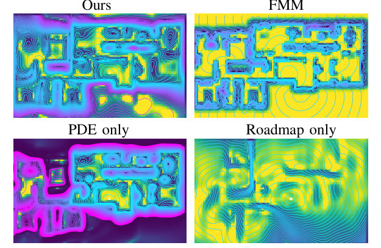
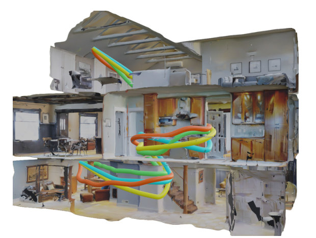

> **TL;DR** H-NTFields는 neural "이동 시간 지도" T(start, goal)를 학습합니다. 두 configuration 사이를 충돌 없이 가장 빨리 가는 데 걸리는 시간입니다. 그러면 planning은 이 지도를 따라 내리막으로 굴러가는 일이 됩니다. 이전 physics-informed 방법은 Eikonal equation만으로 이 지도를 배웠고, 방이 많은 건물에서 길을 잃었습니다. 이 논문은 sparse roadmap에서 싸고 느슨한 label(이동 시간의 하한과 상한)을 더해, Gibson 18개 장면의 성공률을 76.8%에서 90.8%로 올립니다. Query 하나에 약 0.1 s가 걸립니다.

## 왜 이 논문인가

우리의 학습 연구(IROS 2023, JKRS 2026, LA3T\*)는 network에게 *어디를 sampling할지* 가르쳐서 sampling-based planner가 경로를 더 빨리 찾게 합니다. 이 논문은 세 번째 방식입니다. 모든 configuration 쌍에 대한 **cost-to-go**(남은 비용)를 학습합니다. 좋은 cost-to-go는 planner가 heuristic이나 sampling bias로 가장 원하는 것입니다. 하지만 가져올 만한 아이디어는 더 일반적입니다. 값싼 고전 planner에게서 정확한 label 대신 **상한과 하한**만 받고, 세부는 물리 법칙이 채우게 하는 것입니다.

## 문제

Neural planner는 두 부류입니다.

- **Supervised** 방식(예: MPNet)은 전문가 경로를 따라 합니다. 복잡한 공간에서 전문가 경로를 충분히 만드는 일은 비쌉니다.
- **Self-supervised, physics-informed** 방식(NTFields와 후속 연구)은 전문가 데이터가 필요 없습니다. T가 **Eikonal equation** ‖∇T‖ = 1/S(q)를 만족하도록 학습합니다. 어느 점에서든 이동 시간 지도의 기울기가 그 점의 속도의 역수와 같아야 한다는 뜻입니다. 속도 S는 장애물까지의 거리로 정하므로(장애물 근처는 느리게, 열린 공간은 최고 속도로), 시간 지도는 자연스럽게 벽에서 떨어집니다.

함정이 있습니다. Eikonal loss는 *국소적*입니다. 이웃한 값끼리 맞는지만 확인합니다. 방이 많은 건물에서는 모든 곳에서 국소적으로는 맞지만 전체로는 틀린 지도를 network가 찾을 수 있습니다. 막힌 방에서 끝나는 골짜기가 생기거나, 값이 벽을 "새어" 지나가서 이동 시간이 너무 짧게 나옵니다. 학습 sample을 늘려도 해결되지 않습니다.

모든 등고선이 이웃과 맞아떨어지지만 두 산이 엉뚱한 곳에서 이어 붙여진 등산 지도를 떠올리면 됩니다. 작은 조각마다 멀쩡해 보이지만, 지도를 가로지르는 경로는 틀립니다.

## 핵심 아이디어

Network에 **뼈대**를 줍니다. Sparse roadmap의 그래프 거리가 "여기서 저기까지는 *적어도* 이만큼, *많아야* 저만큼 걸린다"고 알려 줍니다. 정확한 label은 필요 없습니다. T가 그 범위 안에 있는 한 loss는 0입니다. Roadmap은 전체 위상(어느 방이 어느 방과 이어지는지)을 잡고, PDE loss는 국소 기하(테이블 다리 주변에서 지도가 어떻게 휘는지)를 잡습니다.

## 작동 방식

**1. 구 채우기로 sparse roadmap을 만듭니다.**

- 충돌 없는 configuration을 sampling하고, 각각에 장애물이 없는 가장 큰 구를 붙입니다.
- 새 node는 기존 구 바깥에 있을 때만 받아들여서, 중복 없이 고르게 퍼지게 합니다(실험에서는 장면당 5,000개 node).
- Node끼리는 직선 collision check로 잇습니다.

**2. 상한과 하한이 붙은 학습 쌍을 만듭니다.** Roadmap node 두 개를 골라 각각 자기 구 안의 무작위 점으로 옮깁니다. 상한은 그래프 거리에 두 구의 반지름을 더한 값, 하한은 뺀 값입니다. Hinge loss L_R = max(0, T − T_ub) + max(0, T_lb − T)는 T가 이 통로를 벗어날 때만 작동합니다.

**3. 물리 loss를 더합니다** (TD-NTFields에서 가져옴).

- **Eikonal loss**: start와 goal에서 T의 기울기 크기가 1/S와 같아야 합니다.
- **Temporal-difference loss**: 유한한 한 걸음에 대한 Bellman 검사 T(s, g) ≈ Δt/S + T(s, g + u·Δt)입니다. 무한소 조건을 넘어 일관성을 퍼뜨립니다.
- **Normal-alignment loss**: 장애물 근처에서 T의 기울기가 장애물 표면의 법선 방향을 따라야 합니다.
- **Causality weight** exp(−λT): 짧은 이동을 긴 이동보다 먼저 배우게 하는 내장 커리큘럼입니다. Roadmap 상한·하한도 같은 "작은 값부터" 원리를 따르고, 저자들은 이것이 학습을 안정시킨다고 말합니다.

**4. 장면마다 network 하나를 학습합니다** (PirateNets를 쓴 TD-NTFields 구조, AdamW, 2,000 epoch, batch 2,000).

**5. Sampling-based MPC로 planning합니다.** 매 단계 Gaussian에서 후보 행동을 sampling하고, 굴려 보고, 예측 이동 시간으로 점수를 매기고, softmax로 좋은 쪽에 가중치를 둔 뒤 한 걸음 움직입니다(receding horizon). T에 대한 단순 gradient descent보다 robust합니다. Gradient descent는 국소적인 움푹한 곳에서 멈출 수 있기 때문입니다.

## 결과

**실험 설정.** Gibson 18개 장면입니다. 방이 최대 19개, 면적 약 700 m²인 3층짜리 실내 주택이고, 계단, 문, 좁은 통로가 있습니다. 장면마다 무작위 start–goal 쌍 100개, 모두 1,800개 query입니다. Neural 방법은 RTX 3090 GPU에서, 고전 방법은 CPU에서 돌리고, 모두 KD-tree collision checker를 씁니다. Sampling-based planner의 제한 시간은 10 s입니다.

**Ablation (학습 쌍 50k).**

| 변형 | 성공률 | 시간 (s) |
|---|---|---|
| PDE만 | 60.0% | 0.089 |
| Roadmap만 | 68.5% | 0.105 |
| **둘 다 (H-NTFields)** | **90.8%** | 0.115 |

**데이터 효율.** H-NTFields는 학습 쌍 10k로 이미 61.4%(PDE만: 20.0%), 20k로 82.5%, 50k로 90.8%에 이릅니다. 그 이상은 거의 늘지 않습니다(100k에서 92.7%, 200k에서 92.0%). PDE만 쓰면 200k 쌍이 있어야 76.8%에 닿습니다.

**다른 planner와 비교.**

| 방법 | 성공률 | 시간 (s) |
|---|---|---|
| NTFields | 27.2% | 0.076 |
| P-NTFields | 37.2% | 0.076 |
| TD-NTFields | 76.8% | 0.081 |
| **H-NTFields** | **90.8%** | **0.115** |
| RRT-Connect | 98.8% | 1.165 |
| LazyPRM | 99.7% | 0.496 |
| FMM (격자) | 99.0% | 0.822 |

경로 길이는 모든 방법이 비슷합니다(논문 단위로 0.68–0.75). 즉 H-NTFields는 neural field planner 중에서는 큰 차이로 가장 좋고 고전 planner보다 4–10배 빠르지만, 고전 planner는 여전히 100개 중 8–9개를 더 풉니다.

**실제 로봇.** 빽빽한 캐비닛 안으로 팔을 뻗는 UR5e: planning 0.07 s. Z1 팔을 단 Unitree B1 사족 로봇(합쳐서 10 DoF)이 부엌에서 의자를 피해 캔을 옮기는 작업: planning 0.15 s.

## 한계

- **여전히 고전 planner보다 덜 믿을 만합니다.** Query 11개 중 약 1개가 실패하고, RRT-Connect, LazyPRM, FMM은 100개 중 약 1개가 실패합니다. Completeness 보장도 없습니다.
- **장면마다 network 하나.** 장면 간 일반화는 명시적으로 남은 과제입니다. 새 건물이면 다시 학습해야 하고, 학습에는 GPU 시간이 꽤 듭니다(논문은 epoch당 약 2.7분이라고 보고합니다).
- **Holonomic, 기하학적 planning.** Eikonal 모델은 로봇이 어느 configuration에서든 모든 방향으로 똑같이 빠르게 움직일 수 있다고 가정합니다. Dynamics도, nonholonomic 제약도 없습니다.
- **하드웨어 조건이 다릅니다.** Neural field는 GPU, 고전 planner는 CPU에서 돌았습니다.
- 작은 불일치: UR5e를 한 곳에서는 6-DOF, 다른 곳에서는 7-DOF라고 부르고, roadmap 오버헤드를 본문에서는 "몇 초"라고 하지만 Table II의 roadmap 열에는 14–18 s로 나옵니다.

## DYROS 관점

**좁은 칸에서 nonholonomic 차 planner를 빠르게 하거나 robust하게 할까.** Planner 자체로는 아닙니다. Eikonal 모델은 등방성입니다. 어느 방향으로든 바로 출발할 수 있다고 가정합니다. 차의 움직임은 강하게 비등방적입니다. 옆으로 50 cm 떨어진 주차 칸은 Eikonal field에게는 "0.5 m 거리"지만, 실제 답은 세 번 꺾는 기동입니다. 좁은 주차에서는 이 비등방성이 어려움의 전부라서, 이런 field는 가장 필요한 곳에서 오해를 부르는 cost-to-go를 줍니다.

**잘 맞는 곳.** 여러 층짜리 실내 주차장은 Gibson 주택과 꽤 닮았습니다. 계단 대신 경사로, 복도 대신 통로가 있습니다. *주차장 전체 규모*에서는 (x, y) 위의 등방성 이동 시간이 괜찮은 전역 안내가 됩니다. Hybrid A\*가 격자 위 Dijkstra로 계산하는 장애물 반영 2D heuristic과 비슷합니다. 학습된 field는 어떤 start–goal 쌍이든, GPU에서 대량으로 query할 수 있습니다. 구체적인 쓰임 하나: Rural Postman 전역 planner(ITSC 2019)는 주차장 도로 위 여러 점 사이의 이동 비용이 필요한데, 이런 field가 그 표를 빠르게 채울 수 있습니다.

**가져올 기법: label 대신 상한·하한으로 학습하기.** 차에서는 두 bound를 공짜로 얻습니다.

- 하한: 장애물을 무시한 Reeds-Shepp 길이. 과소추정만 할 수 있습니다.
- 상한: 우리 planner(TargetTree-RRT\*)가 실제로 찾은 경로의 cost.

둘 사이의 hinge loss로, 정확한 최적 cost를 한 번도 계산하지 않고 *nonholonomic* cost-to-go network T(x, y, θ | 주차 칸)를 학습할 수 있습니다.

**일주일 안에 해 볼 수 있는 것.** 주차장 지도 하나에서 (출발 pose, 주차 칸) 쌍을 수천 개 뽑고, Reeds-Shepp 하한을 계산하고, 우리 planner를 한 번씩 돌려 상한을 얻은 뒤, hinge loss로 작은 MLP를 학습합니다. 이것을 RRT\*의 heuristic으로 쓰거나 T가 낮은 영역으로 sampling을 치우치게 합니다. 단순 Reeds-Shepp heuristic과 첫 해까지의 시간을 비교합니다.

**논문 기회.** "Reeds-Shepp 하한과 planner 상한으로 weak supervision한, 주차용 learned nonholonomic cost-to-go"는 우리 learned sampling 연구와 바로 이어지고, 차에 대한 이 논문의 가장 큰 빈칸을 메웁니다. Query 근처에서 bound가 얼마나 좁았는지를 confidence로 삼아, LA3T\*처럼 learned sample 비율을 정할 수도 있습니다.

## 용어 정리

- **Eikonal equation**: ‖∇T‖ = 1/S. 파면이 퍼지듯, 이동 시간 지도가 그 지점의 속도로 정해지는 비율로 커진다는 식.
- **Travel-time field / cost-to-go**: 한 configuration에서 다른 configuration까지의 최소 시간(또는 비용)을 주는 함수.
- **Physics-informed learning**: label을 맞추는 대신 알려진 방정식을 어기는 정도를 벌점으로 주어 network를 학습하는 방법.
- **Weak supervision**: 정확한 정답 대신 느슨한 정보(여기서는 상한과 하한)로 하는 학습.
- **Sparse roadmap**: 자유 공간의 영역들이 어떻게 이어지는지 담은, 충돌 없는 node와 edge로 된 작은 그래프.
- **Sampling-based MPC**: 여러 행동 시퀀스를 sampling해 점수를 매기고, 가장 좋은 것의 첫 걸음만 실행하는 model predictive control.
