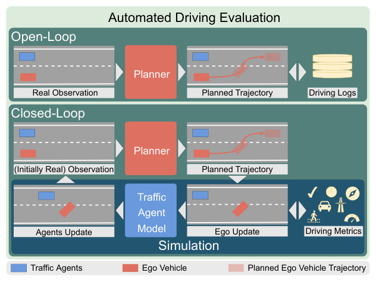
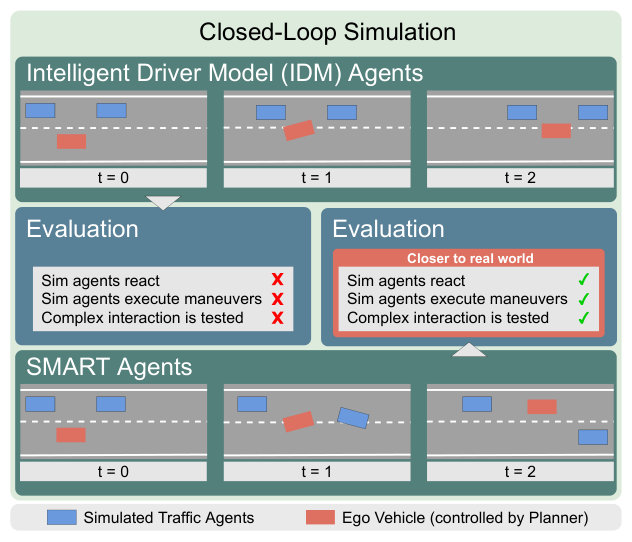

> **TL;DR** nuPlan's "reactive" closed-loop benchmark moves the other cars with IDM, a rule that only watches the car directly ahead. The authors swap in SMART, a learned traffic model, and re-run 14 planners. Almost every score drops, the ranking changes, the RL-trained planner CaRL comes out on top, and learned planners collapse abruptly in dense edge cases while rule-based ones degrade gracefully.

## Why this paper

A benchmark is only as honest as the other road users in it. When we test a parking planner, the "other car" in the aisle is usually scripted: it drives, stops, or yields by rule. This paper measures, on the biggest public planning benchmark, how much such a passive background flatters the planner and how much it changes which method looks best. The lesson carries straight over to any lab that evaluates in simulation before putting a planner on a real car.

## The problem

There are three common ways to score a driving planner:

- **Open-loop**: the planner sees a real scene and its plan is compared with what the human did. Cheap, but it does not correlate with real driving quality.
- **Closed-loop, non-reactive**: the planner drives in simulation, but other cars replay the log. If you slow down, the car behind you still drives into you.
- **Closed-loop, reactive**: other cars react. In nuPlan they are controlled by the **Intelligent Driver Model (IDM)**, which keeps a safe gap to the lead vehicle in its own lane.

IDM has blind spots. It does not see cars in adjacent lanes, so it ignores a lane-change attempt, and then it brakes too hard when the ego merges anyway. It never changes lanes or turns on its own initiative. A planner can exploit this passivity, and interaction skills are never really tested.

## Key idea

Replace IDM with a **learned, reactive traffic model** and see what changes. They pick **SMART**, a strong model from the Waymo 2024 Sim Agents Challenge. It turns map and trajectories into discrete tokens and predicts the next motion token with a small decoder-only Transformer, much like a language model predicts the next word. It is fast enough for thousands of rollouts. The resulting score is called **CLS-SR** (SMART-reactive closed-loop score), next to nuPlan's usual CLS-NR (non-reactive) and CLS-R (IDM-reactive).

## How it works

**Training SMART on nuPlan.**

- The 7M-parameter SMART model, unchanged, with 1024 road tokens and 1024 motion tokens at 2 Hz.
- nuPlan data preprocessed to look like the Waymo data SMART was designed for. 1 s history, 8 s future, next-token cross-entropy.
- During tokenization the matched token is randomly replaced by one of its 6 nearest neighbors, so the model sees slightly wrong states and learns to recover.
- 8 epochs on the 150k-scenario training split: 4 days on one H200.

**Running it inside nuPlan.** The simulator runs at 10 Hz, SMART at 2 Hz. Every 0.5 s SMART re-encodes the scene with 1 s of history, takes one decoding step, picks the most likely token (so runs are deterministic), upsamples it to 10 Hz, and lets nuPlan's tracker execute it. It is packaged as a drop-in replacement for IDM in the simulator config.

**Benchmarks.**

- **Val14**: up to 100 scenarios for each of 14 types, 1,090 in total.
- **Test14-hard**: 280 scenarios where the strong rule-based planner PDM-Closed scored worst.
- **interPlan lane change**: 30 hand-augmented scenarios, 10 each at low, mid and high traffic density.

**Score.** nuPlan's closed-loop score combines progress, time-to-collision and comfort, and is multiplied by zero after an at-fault collision or leaving the drivable area. Averaged over scenarios, 0–100.

**Planners.** 14 entries: the human log replay; rule-based IDM and PDM-Closed; hybrids (learned + rules) PDM-Hybrid, GameFormer, DTPP and PLUTO; imitation-learned Urban Driver, GC-PGP, PlanCNN, PlanTF, PDM-Open and Diffusion Planner; and CaRL, an RL planner trained in closed-loop nuPlan simulation. All use the authors' released checkpoints.

## Results

**Is SMART more realistic?** On nuPlan Val14, average displacement error over 8 s vs the real logs is 0.75 m for SMART and 9.60 m for IDM. On the Waymo realism meta-metric: 0.76 vs 0.62, with a large gain in map compliance (0.86 vs 0.56) and interaction (0.80 vs 0.72), and equal kinematic realism (0.48).

**Scores (selected), IDM-reactive → SMART-reactive:**

| Planner | Type | Val14 | Test14-hard |
|---|---|---|---|
| Log replay | human | 80 → 76 | 69 → 64 |
| IDM | rule | 77 → 77 | 62 → 55 |
| PDM-Closed | rule | 93 → 89 | 76 → 74 |
| PLUTO | hybrid | 87 → 84 | 76 → 69 |
| PlanTF | IL | 77 → 72 | 59 → 58 |
| Diffusion Planner | IL | 83 → 78 | 68 → 63 |
| **CaRL** | RL | 93 → **90** | 85 → **82** |

What the numbers say:

- **IDM inflates scores.** On Val14, imitation-learned planners lose 5.17 points on average, hybrids 3.25, rule-based 2.0. Time-to-collision, progress, comfort and at-fault collisions drop the most; drivable-area and speed-limit compliance barely move.
- **But IDM also hides interaction skill.** In lane changes, starting turns and pickup/dropoff areas, scores fall less or even rise under SMART. When the IDM planner drives among IDM agents, neither side sees the adjacent lane; switching to SMART raises that planner's score by up to 12%.
- **On hard scenarios the trend flips.** On Test14-hard, IL planners lose only 2.83, while hybrids lose 4.75 and rule-based 4.5. Fixed rules struggle with gap negotiation and unprotected turns.
- **Closed-loop training wins.** CaRL is first on Val14 under SMART and leads Test14-hard by 8 points over PDM-Closed. After years of PDM-Closed topping nuPlan, a learned planner clearly beats it.
- **Beyond the limit, learned planners tip over.** In high-density interPlan lane changes, rule-based planners fail politely (they decline to change lanes): IDM 63 → 53, PDM-Closed 62 → 46. Learned ones fall off a cliff: DTPP 73 → 24, PlanTF 74 → 42, PlanCNN and GC-PGP 61 → 0, and CaRL 66 → 29. CaRL was trained with IDM agents, which the authors read as a sign that the training background matters too.

## Limitations

- **Object-level only.** Perfect perception; camera-based end-to-end models are excluded.
- **Deterministic agents.** SMART always picks its most likely token, so each scenario has one future. The stochastic mode is supported but not evaluated.
- SMART is trained on the same nuPlan data as most planners, so the "reality" is still nuPlan-flavored. Its kinematic realism is no better than IDM's.
- The interPlan study has 10 scenarios per density level; a drop to 0 can be a handful of failures.
- Even the human log replay scores only 76 under SMART, because the log cannot react. The absolute score is not "distance to human".
- No retraining: CaRL against SMART agents is left for future work.

## DYROS lens

**The transferable lesson: report the delta.** Run every planner against at least two background models (scripted and something more active) and report the score change, not only the score. The change itself is a robustness signal: a planner whose score barely moves is not exploiting the background. For our parking experiments, the oncoming or reversing car is usually a script; this paper is a warning that such numbers flatter us.

**When the classical planner still wins.** Look at the high-density rows. Rule-based planners lose a few points; learned ones drop to zero. In a narrow garage aisle, "no safe maneuver, wait" is the correct behavior, and a search-based planner like TargetTree-RRT\* gives it naturally: when the tree finds no collision-free path, it does not invent one. For a lab with a real car and a safety driver, graceful failure is worth more than a few benchmark points.

**What does not transfer yet.** SMART learns from nuPlan roads. Parking-lot behavior (cars backing out of slots, pedestrians walking between parked cars, a driver stopping to wait for a slot) is not in that data. nuPlan's "traversing pickup/dropoff" scenario type is the closest thing, and it is one of the types where scores held up or even rose under SMART.

**One-week experiment.** In our simulator, evaluate our narrow-space planner against three versions of the other car: (a) log or scripted replay, (b) a lead-follower like IDM, (c) a version that also reacts to the ego from the side (for example, yielding when the ego's footprint enters its path). Report the score shift between (b) and (c). If the ranking between our planner and a learned baseline flips, that is already a finding.

**Paper opportunity.** A learned reactive agent model for parking lots, trained from our own car logs or drone footage, and released as a drop-in background, the way this paper did for nuPlan. Nobody seems to have one, and it would make every parking benchmark, including ours, harder to game.

## Key terms

- **IDM (Intelligent Driver Model)**: a rule that sets a car's acceleration to keep a safe gap to the vehicle ahead in its own lane.
- **SMART**: a learned traffic model that predicts each agent's next motion token with a small Transformer.
- **CLS-NR / CLS-R / CLS-SR**: nuPlan closed-loop score with log-replay, IDM-reactive, and SMART-reactive traffic.
- **Covariate shift**: a planner trained on expert states drifts into states it never saw and its errors compound.
- **Val14 / Test14-hard / interPlan**: standard, hardest-case, and hand-augmented edge-case nuPlan scenario sets.
