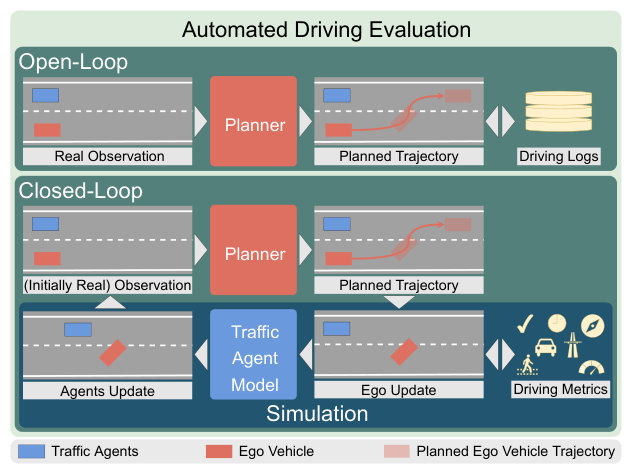
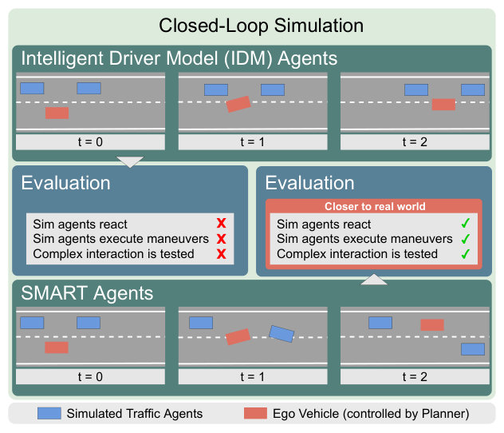

> **TL;DR** nuPlan의 "reactive" closed-loop benchmark는 다른 차들을 IDM으로 움직입니다. IDM은 바로 앞차만 보는 규칙입니다. 저자들은 이를 학습된 교통 모델 SMART로 바꾸고 planner 14개를 다시 돌립니다. 거의 모든 점수가 떨어지고, 순위가 바뀌고, RL로 학습한 CaRL이 1위가 됩니다. 붐비는 극단 상황에서는 학습 planner가 갑자기 무너지는 반면, 규칙 기반 planner는 완만하게 성능이 떨어집니다.

## 왜 이 논문인가

Benchmark는 그 안의 다른 도로 사용자만큼만 정직합니다. 우리가 주차 planner를 시험할 때 통로의 "다른 차"는 대개 스크립트로 움직입니다. 정해진 규칙대로 가고, 서고, 양보합니다. 이 논문은 가장 큰 공개 planning benchmark에서, 이런 수동적인 배경이 planner 점수를 얼마나 부풀리는지, 그리고 어떤 방법이 좋아 보이는지를 얼마나 바꾸는지 측정합니다. 실제 차에 올리기 전에 시뮬레이션으로 평가하는 모든 연구실에 그대로 적용되는 교훈입니다.

## 문제

주행 planner를 평가하는 흔한 방법은 세 가지입니다.

- **Open-loop**: 실제 장면을 보고 낸 계획을 사람이 실제로 한 주행과 비교합니다. 싸지만 실제 주행 품질과 상관관계가 없습니다.
- **Closed-loop, non-reactive**: planner가 시뮬레이션에서 운전하지만 다른 차는 로그를 재생합니다. 내가 속도를 줄여도 뒤차는 그대로 와서 박습니다.
- **Closed-loop, reactive**: 다른 차가 반응합니다. nuPlan에서는 **Intelligent Driver Model**(IDM)이 이들을 움직이며, 같은 차선의 앞차와 안전거리를 유지합니다.

IDM에는 사각지대가 있습니다. 옆 차선의 차를 보지 못하므로 차선 변경 시도를 무시하고, ego가 그래도 끼어들면 너무 세게 브레이크를 밟습니다. 스스로 차선을 바꾸거나 회전하지도 않습니다. Planner는 이 수동성을 이용할 수 있고, 상호작용 능력은 제대로 시험받지 않습니다.

## 핵심 아이디어

IDM을 **학습된 reactive 교통 모델**로 바꾸고 무엇이 달라지는지 봅니다. 고른 모델은 Waymo 2024 Sim Agents Challenge에서 강했던 **SMART**입니다. 지도와 trajectory를 이산 token으로 바꾸고, 작은 decoder-only Transformer로 다음 움직임 token을 예측합니다. 언어 모델이 다음 단어를 예측하는 것과 비슷합니다. 수천 번의 rollout을 돌릴 만큼 빠릅니다. 이렇게 얻은 점수를 **CLS-SR**(SMART-reactive closed-loop score)이라 부르고, nuPlan의 기존 CLS-NR (non-reactive), CLS-R (IDM-reactive)과 나란히 봅니다.

## 작동 방식

**nuPlan에서 SMART 학습.**

- 7M 파라미터 SMART 모델을 그대로 쓰고, 2 Hz의 road token 1024개와 motion token 1024개를 씁니다.
- nuPlan 데이터를 SMART가 원래 쓰던 Waymo 데이터 형식에 맞춰 전처리합니다. 1 s 과거, 8 s 미래, 다음 token cross-entropy입니다.
- Tokenization 때 맞춘 token을 가장 가까운 6개 중 하나로 무작위로 바꿉니다. 모델이 조금 틀린 상태를 보고 회복하는 법을 배웁니다.
- 15만 시나리오 학습 split으로 8 epoch, H200 한 장으로 4일 걸립니다.

**nuPlan 안에서 실행.** 시뮬레이터는 10 Hz, SMART는 2 Hz입니다. 0.5 s마다 SMART가 1 s 과거와 함께 장면을 다시 encode하고, 한 번 decode한 뒤 가장 확률 높은 token을 고릅니다(그래서 실행이 결정적입니다). 이를 10 Hz로 upsample하고 nuPlan tracker가 실행합니다. 시뮬레이터 설정에서 IDM 대신 고르면 되는 drop-in 형태로 제공합니다.

**Benchmark.**

- **Val14**: 14개 유형마다 최대 100개, 총 1,090 시나리오.
- **Test14-hard**: 강한 규칙 기반 planner PDM-Closed가 가장 못한 280 시나리오.
- **interPlan lane change**: 사람이 손으로 보강한 30 시나리오, 교통 밀도 저·중·고 각 10개.

**점수.** nuPlan closed-loop score는 진행도, time-to-collision, 승차감을 합치고, 과실 충돌이나 주행 가능 영역 이탈이 있으면 0을 곱합니다. 시나리오 평균으로 0–100입니다.

**Planner.** 14개입니다. 사람 로그 재생, 규칙 기반 IDM과 PDM-Closed, 하이브리드(학습 + 규칙) PDM-Hybrid, GameFormer, DTPP, PLUTO, imitation learning (모방 학습) 기반 Urban Driver, GC-PGP, PlanCNN, PlanTF, PDM-Open, Diffusion Planner, 그리고 nuPlan closed-loop 시뮬레이션에서 reinforcement learning (강화학습)으로 학습한 CaRL입니다. 모두 저자들이 공개한 checkpoint를 씁니다.

## 결과

**SMART가 더 현실적인가?** nuPlan Val14에서 실제 로그 대비 8 s 평균 변위 오차는 SMART 0.75 m, IDM 9.60 m입니다. Waymo realism meta-metric은 0.76 vs 0.62이고, map compliance (0.86 vs 0.56)와 상호작용 (0.80 vs 0.72)에서 크게 앞서며, 기구학 현실성은 같습니다 (0.48).

**점수 (일부), IDM-reactive → SMART-reactive:**

| Planner | 유형 | Val14 | Test14-hard |
|---|---|---|---|
| 로그 재생 | 사람 | 80 → 76 | 69 → 64 |
| IDM | 규칙 | 77 → 77 | 62 → 55 |
| PDM-Closed | 규칙 | 93 → 89 | 76 → 74 |
| PLUTO | 하이브리드 | 87 → 84 | 76 → 69 |
| PlanTF | IL | 77 → 72 | 59 → 58 |
| Diffusion Planner | IL | 83 → 78 | 68 → 63 |
| **CaRL** | RL | 93 → **90** | 85 → **82** |

수치가 말하는 것:

- **IDM은 점수를 부풀립니다.** Val14에서 IL planner는 평균 5.17점, 하이브리드는 3.25점, 규칙 기반은 2.0점 떨어집니다. Time-to-collision, 진행도, 승차감, 과실 충돌이 가장 크게 떨어지고, 주행 가능 영역과 제한 속도 준수는 거의 그대로입니다.
- **하지만 IDM은 상호작용 능력도 가립니다.** 차선 변경, 출발 직후 회전, 승하차 구역에서는 SMART 아래 점수가 덜 떨어지거나 오히려 오릅니다. IDM planner가 IDM agent 사이를 달리면 양쪽 다 옆 차선을 못 봅니다. SMART로 바꾸면 이 planner의 점수가 최대 12% 오릅니다.
- **어려운 시나리오에서는 경향이 뒤집힙니다.** Test14-hard에서 IL planner는 2.83점만 잃고, 하이브리드는 4.75점, 규칙 기반은 4.5점을 잃습니다. 고정된 규칙은 틈 협상이나 비보호 회전을 어려워합니다.
- **Closed-loop 학습이 이깁니다.** CaRL은 SMART 아래 Val14에서 1위이고, Test14-hard에서 PDM-Closed보다 8점 앞섭니다. 수년간 nuPlan 1위였던 PDM-Closed를 학습 planner가 확실히 넘어섰습니다.
- **한계를 넘으면 학습 planner는 넘어집니다.** 고밀도 interPlan 차선 변경에서 규칙 기반 planner는 점잖게 실패합니다(차선 변경을 포기합니다): IDM 63 → 53, PDM-Closed 62 → 46. 학습 planner는 절벽처럼 떨어집니다: DTPP 73 → 24, PlanTF 74 → 42, PlanCNN과 GC-PGP 61 → 0, CaRL 66 → 29. CaRL은 IDM agent로 학습했기 때문에, 저자들은 학습 때의 배경 교통도 중요하다는 신호로 봅니다.

## 한계

- **Object-level만 다룹니다.** 인식은 완벽하다고 가정하고, 카메라 기반 end-to-end 모델은 제외합니다.
- **결정적 agent입니다.** SMART는 항상 가장 확률 높은 token을 고르므로 시나리오마다 미래가 하나뿐입니다. 확률적 모드는 지원하지만 평가하지 않았습니다.
- SMART는 대부분의 planner와 같은 nuPlan 데이터로 학습했으므로, 이 "현실"도 여전히 nuPlan의 색이 묻어 있습니다. 기구학 현실성은 IDM보다 낫지 않습니다.
- interPlan 실험은 밀도마다 시나리오 10개입니다. 0점으로의 하락은 몇 번의 실패일 수 있습니다.
- 사람 로그 재생도 SMART 아래 76점뿐입니다. 로그는 반응할 수 없기 때문입니다. 절대 점수가 "사람과의 거리"를 뜻하지는 않습니다.
- 재학습은 없습니다. SMART agent를 상대로 CaRL을 학습하는 것은 향후 과제입니다.

## DYROS 관점

**가져갈 교훈: 차이를 보고하라.** 모든 planner를 최소 두 가지 배경 모델(스크립트와 더 능동적인 것)에 대해 돌리고, 점수만이 아니라 점수 변화를 보고합니다. 변화 자체가 robustness 신호입니다. 점수가 거의 안 변하는 planner는 배경을 이용하고 있지 않은 것입니다. 우리 주차 실험에서 마주 오거나 후진하는 차는 대개 스크립트입니다. 이 논문은 그런 수치가 우리를 좋게 보이게 한다는 경고입니다.

**고전 planner가 여전히 이기는 경우.** 고밀도 행을 보십시오. 규칙 기반 planner는 몇 점 잃고, 학습 planner는 0점까지 떨어집니다. 좁은 주차장 통로에서는 "안전한 기동이 없으니 기다린다"가 정답이고, TargetTree-RRT\* 같은 탐색 기반 planner는 이를 자연스럽게 해냅니다. Tree가 충돌 없는 path를 못 찾으면 없는 것을 지어내지 않습니다. 실제 차와 안전 운전자가 있는 연구실에서는 점잖은 실패가 benchmark 몇 점보다 값집니다.

**아직 옮겨 오기 어려운 것.** SMART는 nuPlan 도로에서 배웁니다. 주차장 행동(칸에서 후진해 나오는 차, 주차된 차 사이를 걷는 보행자, 빈 칸을 기다리며 멈춘 운전자)은 그 데이터에 없습니다. nuPlan의 "traversing pickup/dropoff" 시나리오 유형이 가장 가깝고, SMART 아래 점수가 버티거나 오히려 오른 유형 중 하나입니다.

**일주일 안에 해 볼 수 있는 것.** 우리 시뮬레이터에서 좁은 공간 planner를 세 가지 다른 차에 대해 평가합니다: (a) 로그 또는 스크립트 재생, (b) IDM 같은 앞차 추종, (c) 옆에서 ego에도 반응하는 버전(예: ego footprint가 자기 경로에 들어오면 양보). (b)와 (c) 사이의 점수 변화를 보고합니다. 우리 planner와 학습 baseline의 순위가 뒤집힌다면 그것만으로도 결과입니다.

**논문 기회.** 우리 차 로그나 드론 영상으로 학습한 주차장용 학습 reactive agent 모델을 만들고, 이 논문이 nuPlan에 한 것처럼 drop-in 배경으로 공개합니다. 아직 없는 것으로 보이고, 우리 것을 포함한 모든 주차 benchmark를 속이기 어렵게 만들 것입니다.

## 용어 정리

- **IDM (Intelligent Driver Model)**: 같은 차선 앞차와 안전거리를 유지하도록 가속도를 정하는 규칙.
- **SMART**: 작은 Transformer로 각 agent의 다음 움직임 token을 예측하는 학습 교통 모델.
- **CLS-NR / CLS-R / CLS-SR**: 로그 재생, IDM-reactive, SMART-reactive 교통에서의 nuPlan closed-loop score.
- **Covariate shift**: 전문가 상태로 학습한 planner가 본 적 없는 상태로 흘러가 오차가 쌓이는 현상.
- **Val14 / Test14-hard / interPlan**: 표준, 가장 어려운 사례, 손으로 보강한 극단 사례의 nuPlan 시나리오 집합.
