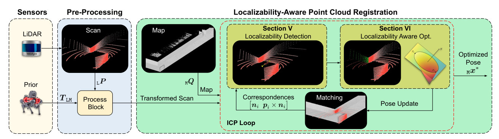
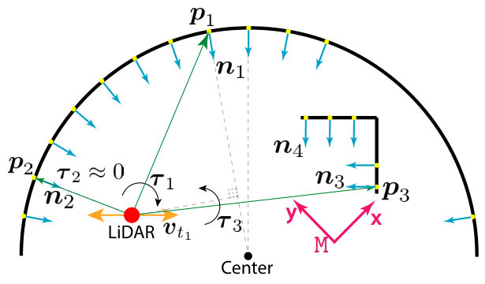
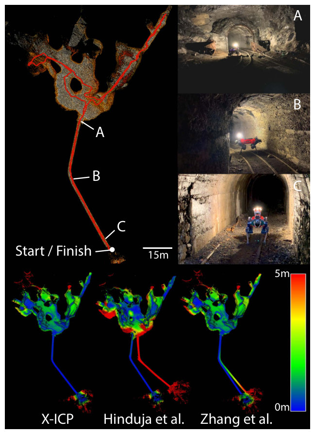

> **TL;DR** X-ICP checks, inside every ICP iteration, which of the six pose directions the LiDAR correspondences can actually pin down. Directions with no information keep the odometry prior, partly informative ones get a constrained update, and the rest are optimized as usual. In a 522 m mine run with a legged robot it ends 0.27 m from the true end point, against 6.37 m and 24.17 m for two baselines.

> **Why it is a classic:** It moved LiDAR degeneracy handling from "threshold the smallest eigenvalue" to a per-direction, three-level analysis that acts *inside* the ICP solver.

## Why this paper

A LiDAR in a long tunnel sees two walls, a floor and a ceiling. Every scan looks the same wherever you are along it, so ICP has nothing to hold on to in that direction, yet still returns a full 6-DoF pose. This is **LiDAR degeneracy**; it shows up as "LiDAR slip", a map that stretches while the robot walks straight.

Garages, ramps and open lots are degenerate in exactly this way. X-ICP is the clearest recipe for knowing *which* directions to trust, and what to do about the rest.

## The problem

Point-to-plane ICP linearizes to a 6×6 system A′x = b′; x = [r, t] is a small rotation and translation, A′ the Hessian. A degenerate direction is an eigenvector of A′ with a tiny eigenvalue.

The standard method (Zhang et al.) calls a direction degenerate when its eigenvalue falls below a threshold, then projects the solution onto the good directions. Three problems:

- **The threshold is not portable.** Eigenvalues grow with the number of points, so a denser LiDAR needs a new threshold.
- **Rotation and translation have different scales**, yet share one threshold.
- **It is binary and after the fact.** A partly informative direction is trusted fully or discarded, and the projection comes after the optimizer may have drifted.

## Key idea

Measure localizability by **counting how many correspondences push along each direction**, not by the size of an eigenvalue, then turn the answer into hard constraints inside the ICP solve.

Think of each point-normal pair as a hand pushing the robot along the normal n and twisting it with torque p × n. In a tunnel, no hand pushes along the axis. X-ICP counts the hands per principal direction and labels it **full**, **partial** or **none**.

## How it works

**1. Principal directions.** Split the Hessian into its translation block A′_tt and rotation block A′_rr and eigen-decompose each separately. This removes the scale mismatch, and working in eigenspace finds a tunnel at any angle to the map axes.

**2. Score every correspondence.** Project the normals nᵢ (translation) and the normalized torques (pᵢ × nᵢ)/‖pᵢ × nᵢ‖ (rotation) onto each eigenvector and take the absolute value. A score of 1 means "this pair pushes exactly along this direction".

**3. Filter.** Drop scores below κ_f = cos 80° ≈ 0.17 as noise (cos 60° = 0.5 for the noisier Ouster OS0-128). Sum the rest into L_c, and only strong ones (≥ cos 45°) into L_s.

**4. Categorize** each direction (κ₁ = 250, κ₂ = 180, κ₃ = 35, used everywhere): **full** if L_c ≥ κ₁ or L_s ≥ κ₂ (roughly "250 perfectly aligned pairs"); **partial** if L_c ≥ κ₂ or L_s ≥ κ₃; otherwise **none**.

**5. Constrain the solve.**
- **none**: add vᵀ(t − 0) = 0. ICP makes no update along v; the odometry prior stands.
- **partial**: re-sample the pairs that contribute most along v, solve a tiny least squares for a trustworthy t₀ (or r₀), and add vᵀ(t − t₀) = 0.
- **full**: no constraint.

The constrained problem is solved with Lagrange multipliers, and everything is redone every ICP iteration.

## Results

Setup: ANYmal C quadruped, Velodyne VLP-16, leg odometry as the prior, scan-to-map ICP at 5 Hz. Zhang et al. (threshold 120) and Hinduja et al. run in the same pipeline.

- **Simulation.** In a tunnel X-ICP flags one direction; Zhang flags three.
- **Seemühle mine, 521.8 m, VLP-16** (laser-scanned ground truth):

| Method | APE trans. [m] | APE rot. [°] | RPE /10 m [m] | End error [m] |
|---|---|---|---|---|
| **X-ICP** | **2.05** | **2.55** | **0.17** | **0.27** |
| Zhang et al. | 3.36 | 4.06 | 0.20 | 6.37 |
| Hinduja et al. | 5.79 | 7.67 | 0.26 | 24.17 |

- **Same mine, Ouster OS0-128.** Denser points inflate eigenvalues, so Zhang's threshold no longer detects the tunnel. X-ICP still does, with only κ_f changed.
- **Construction site and park** (153 m, 235 m): Zhang fails or needs its threshold retuned from 120 to 200; X-ICP keeps the map sharp.
- **Ablation.** Without the partial class, and categorizing only once per scan, the mine end error grows from 0.27 m to 5.34 m.
- **Runtime.** 32.19 ms per registration on a laptop CPU, single-threaded (baseline 20.05 ms).

## Limitations

- **The prior must be good.** In "none" directions X-ICP keeps the odometry prior; if the prior slips, so does the pose.
- **Still some thresholds.** κ_f changed with the LiDAR and κ₁–κ₃ come from intuition; counts transfer better than eigenvalues, but this is not zero tuning.
- **No uncertainty output.** Factor-graph integration is future work.
- **Walking robot only.** All tests use a quadruped; none use a car.

## DYROS lens

**Where it fits.** Our garages are textbook degenerate: aisles and ramps look like tunnels, and repeated pillars constrain little along the aisle. The good news is our prior: on a flat floor, wheel odometry is usually more reliable than slipping legs, exactly where "keep the prior in blind directions" works best.

**What would break.** On a car, categories would flip at every aisle intersection, changing where the pose comes from; these transitions need smoothing. Ramps couple pitch with translation along the slope, which the separate rotation/translation analysis may miss.

**A one-week experiment.** Run steps 1–4 offline on garage LiDAR logs and plot the categories along the trajectory next to Zhang's smallest eigenvalue. If aisles show "none" along the driving direction, add the constraints to our ICP/GICP and compare drift on an aisle and a ramp.

**Paper opportunity.** The same counting works for AVM features. Parking lines are mostly parallel, so AVM registration is blind along the lines, while LiDAR may be blind along the aisle. A localizability-aware LiDAR + AVM fusion (building on our weighted GICP, Sensors 2023) would use each sensor only where it sees something. A localizability map could also tell a parking planner which approach paths keep the car localized.

**What a 2026 reader should take away.** Analyze degeneracy per direction in eigenspace, treat rotation and translation separately, count informative correspondences instead of thresholding eigenvalues, and act inside the optimizer, not after it.

## Key terms

- **LiDAR degeneracy**: some pose directions are not constrained by the geometry the LiDAR sees, e.g. along a tunnel.
- **Localizability**: how well a direction can be estimated from the current correspondences; here full, partial or none.
- **Point-to-plane ICP**: registration that minimizes each point's distance to the tangent plane of its match.
- **Equality constraint**: a rule vᵀ(t − t₀) = 0 that fixes the update along one direction during the solve.
