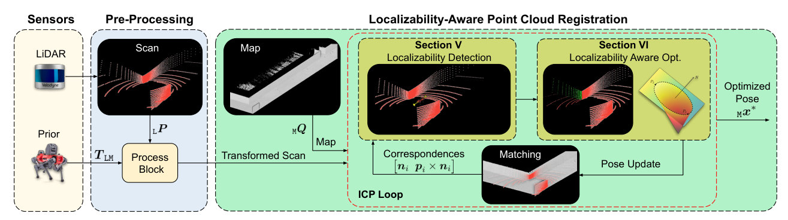
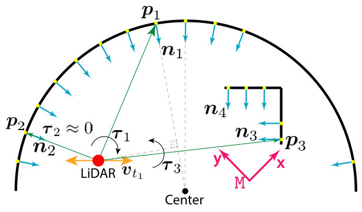
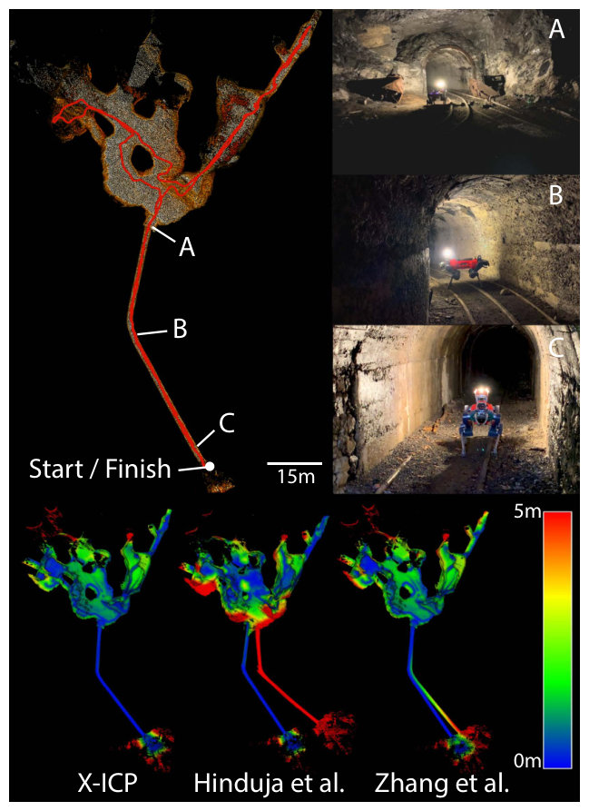

> **TL;DR** X-ICP는 ICP 반복마다, LiDAR 대응점이 여섯 pose 방향 중 어느 방향을 실제로 붙잡을 수 있는지 확인합니다. 정보가 없는 방향은 odometry(주행 거리 추정) prior를 그대로 두고, 정보가 조금 있는 방향은 제한된 update를 받으며, 나머지는 평소처럼 최적화합니다. 보행 로봇으로 522 m 광산을 걸은 실험에서 최종 위치 오차는 0.27 m이고, 두 baseline은 6.37 m와 24.17 m입니다.

> **고전인 이유:** LiDAR degeneracy 처리를 "가장 작은 eigenvalue에 임계값 걸기"에서, ICP solver *안에서* 작동하는 방향별 3단계 분석으로 바꾸었습니다.

## 왜 이 논문인가

긴 터널 안의 LiDAR는 벽 두 개, 바닥, 천장을 봅니다. 터널 어디에 있든 scan이 똑같아 보이므로 ICP는 그 방향으로 붙잡을 것이 없는데도, 6-DoF pose를 모두 내놓습니다. 이것이 **LiDAR degeneracy**(퇴화)이고, 로봇은 똑바로 걷는데 지도가 늘어나는 "LiDAR slip"으로 드러납니다.

주차장, 경사로, 트인 야외 주차장이 바로 이런 식으로 degenerate합니다. X-ICP는 *어느* 방향을 믿을지, 나머지는 어떻게 할지에 대한 가장 명확한 처방입니다.

## 문제

Point-to-plane ICP(점-평면 정합)를 선형화하면 6×6 시스템 A′x = b′가 됩니다. x = [r, t]는 작은 회전과 이동이고, A′는 Hessian입니다. Degenerate 방향은 eigenvalue가 아주 작은 A′의 eigenvector입니다.

표준 방법(Zhang et al.)은 eigenvalue가 임계값보다 작으면 그 방향을 degenerate로 판단하고, 해를 좋은 방향으로 projection합니다. 문제는 세 가지입니다.

- **임계값을 옮겨 쓸 수 없습니다.** Eigenvalue는 점 개수에 따라 커지므로, 더 촘촘한 LiDAR에는 새 임계값이 필요합니다.
- **회전과 이동은 스케일이 다른데** 임계값 하나를 함께 씁니다.
- **이분법이고 사후 처리입니다.** 정보가 조금 있는 방향은 전부 믿거나 버리고, projection은 optimizer가 이미 drift한 뒤에 일어납니다.

## 핵심 아이디어

Eigenvalue의 크기가 아니라 **각 방향으로 미는 대응점이 몇 개인지 세어서** localizability를 재고, 그 답을 ICP 안의 hard constraint로 바꿉니다.

점과 법선 쌍 하나하나를, 법선 n 방향으로 로봇을 밀고 p × n이라는 torque로 비트는 손이라고 생각하면 됩니다. 터널에서는 축 방향으로 미는 손이 없습니다. X-ICP는 주축 방향마다 손을 세어 **full**, **partial**, **none**으로 나눕니다.

## 작동 방식

**1. 주축 방향.** Hessian을 이동 블록 A′_tt와 회전 블록 A′_rr로 나누어 각각 eigen-decomposition합니다. 스케일 차이가 사라지고, eigenspace에서 분석하므로 지도 축과 어떤 각도를 이룬 터널도 찾습니다.

**2. 대응점마다 점수 매기기.** 법선 nᵢ(이동용)와 정규화한 torque (pᵢ × nᵢ)/‖pᵢ × nᵢ‖(회전용)를 각 eigenvector에 projection하고 절댓값을 취합니다. 점수 1은 "이 쌍이 정확히 이 방향으로 민다"는 뜻입니다.

**3. 거르기.** κ_f = cos 80° ≈ 0.17보다 작은 점수는 노이즈로 버립니다(노이즈가 더 큰 Ouster OS0-128에서는 cos 60° = 0.5). 남은 점수의 합이 L_c이고, 강한 점수(cos 45° 이상)만 더한 값이 L_s입니다.

**4. 분류.** 방향마다 다음처럼 나눕니다(κ₁ = 250, κ₂ = 180, κ₃ = 35, 모든 실험에 같은 값). L_c ≥ κ₁ 또는 L_s ≥ κ₂이면 **full**(대략 "완벽히 정렬된 쌍 250개"), L_c ≥ κ₂ 또는 L_s ≥ κ₃이면 **partial**, 그 밖에는 **none**입니다.

**5. 제약을 건 최적화.**
- **none**: vᵀ(t − 0) = 0을 겁니다. ICP는 v 방향으로 update하지 않고 odometry prior가 그대로 남습니다.
- **partial**: v 방향 기여가 가장 큰 쌍을 다시 뽑아 작은 least squares를 풀고, 믿을 만한 t₀(또는 r₀)를 얻어 vᵀ(t − t₀) = 0을 겁니다.
- **full**: 제약이 없습니다.

제약이 걸린 문제는 Lagrange multiplier로 풀고, 모든 과정을 ICP 반복마다 다시 합니다.

## 결과

실험 구성: 4족 보행 로봇 ANYmal C, Velodyne VLP-16, prior로 다리 odometry, 5 Hz scan-to-map ICP. Zhang et al.(임계값 120)과 Hinduja et al.을 같은 파이프라인에서 돌립니다.

- **시뮬레이션.** 터널에서 X-ICP는 한 방향만 표시하고, Zhang은 세 방향을 표시합니다.
- **Seemühle 광산, 521.8 m, VLP-16** (레이저 스캐너로 만든 ground truth):

| 방법 | APE 이동 [m] | APE 회전 [°] | RPE /10 m [m] | 최종 오차 [m] |
|---|---|---|---|---|
| **X-ICP** | **2.05** | **2.55** | **0.17** | **0.27** |
| Zhang et al. | 3.36 | 4.06 | 0.20 | 6.37 |
| Hinduja et al. | 5.79 | 7.67 | 0.26 | 24.17 |

- **같은 광산, Ouster OS0-128.** 점이 촘촘해지면 eigenvalue가 커져서 Zhang의 임계값은 터널을 잡지 못합니다. X-ICP는 κ_f만 바꾸고도 잡습니다.
- **공사장과 공원** (153 m, 235 m): Zhang은 실패하거나 임계값을 120에서 200으로 다시 맞춰야 하고, X-ICP는 지도를 선명하게 유지합니다.
- **Ablation.** Partial 범주를 빼고 분류를 scan당 한 번만 하면 광산 최종 오차가 0.27 m에서 5.34 m로 커집니다.
- **실행 시간.** 노트북 CPU 단일 스레드에서 registration 한 번에 32.19 ms입니다(baseline 20.05 ms).

## 한계

- **Prior가 좋아야 합니다.** None 방향에서 X-ICP는 odometry prior를 그대로 씁니다. Prior가 미끄러지면 pose도 미끄러집니다.
- **임계값이 여전히 있습니다.** LiDAR가 바뀌자 κ_f를 바꿔야 했고, κ₁–κ₃는 직관에서 나왔습니다. 개수는 eigenvalue보다 잘 옮겨 가지만 튜닝이 0은 아닙니다.
- **불확실성을 내놓지 않습니다.** Factor graph와의 통합은 후속 과제입니다.
- **보행 로봇뿐입니다.** 모든 실험이 4족 로봇이고, 차량 실험은 없습니다.

## DYROS 관점

**어디에 맞는가.** 우리 주차장은 교과서적으로 degenerate합니다. 통로와 경사로는 터널처럼 보이고, 반복되는 기둥은 통로 방향을 거의 붙잡지 못합니다. 좋은 소식은 우리 prior입니다. 평평한 바닥에서 wheel odometry는 미끄러지는 다리보다 대개 믿을 만하고, 바로 "보이지 않는 방향은 prior 유지"가 가장 잘 통하는 상황입니다.

**무엇이 깨질까.** 차량에서는 통로 교차점마다 범주가 바뀌고, 그때마다 pose의 출처가 달라집니다. 이 전환을 부드럽게 해야 합니다. 경사로에서는 pitch와 경사 방향 이동이 엮이는데, 회전과 이동을 따로 보는 분석이 이를 놓칠 수 있습니다.

**일주일 안에 해 볼 수 있는 것.** 주차장 LiDAR 로그에 1–4단계만 오프라인으로 돌리고, trajectory를 따라 범주를 Zhang의 최소 eigenvalue와 나란히 그립니다. 통로에서 주행 방향이 "none"으로 나오면, 우리 ICP/GICP에 제약을 넣고 통로와 경사로에서 drift를 비교합니다.

**논문 기회.** 같은 세기 방식은 AVM 특징에도 통합니다. 주차선은 대부분 평행해서 AVM registration은 선 방향으로 보지 못하고, LiDAR는 통로 방향으로 보지 못할 수 있습니다. Localizability를 고려한 LiDAR + AVM 융합(우리 Sensors 2023의 weighted GICP 위에)은 각 센서를 볼 수 있는 방향에서만 쓰게 됩니다. Localizability 지도는 주차 planner에게 어떤 진입 경로가 위치 추정을 잘 유지하는지도 알려 줄 수 있습니다.

**2026년의 독자가 가져갈 것.** Degeneracy는 eigenspace에서 방향별로 분석하고, 회전과 이동을 따로 다루며, eigenvalue에 임계값을 거는 대신 정보 있는 대응점을 세고, 최적화가 끝난 뒤가 아니라 최적화 안에서 대응합니다.

## 용어 정리

- **LiDAR degeneracy**: LiDAR가 보는 기하 구조가 일부 pose 방향을 붙잡지 못하는 상태. 예: 터널 방향.
- **Localizability**: 현재 대응점으로 한 방향을 얼마나 잘 추정할 수 있는지. 여기서는 full, partial, none.
- **Point-to-plane ICP**: 각 점과 매칭된 점의 접평면 사이 거리를 최소화하는 registration.
- **Equality constraint**: 최적화 중 한 방향의 update를 고정하는 규칙 vᵀ(t − t₀) = 0.
